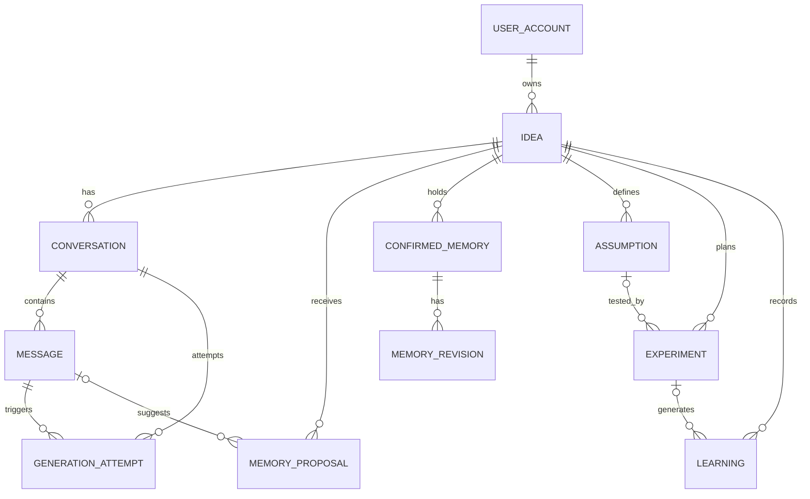
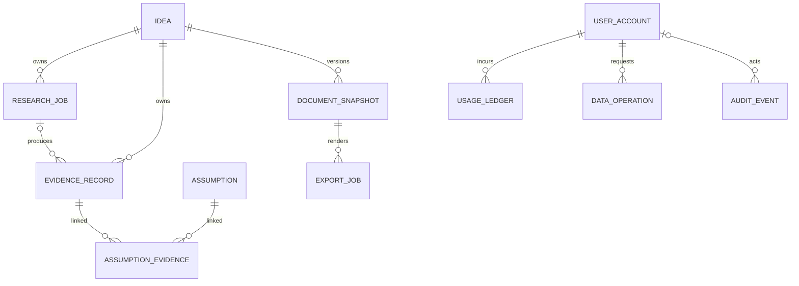

# Founder's Lens — LLD Phase 1A: Logical Database & Domain Design

**Document:** FL-LLD-DB-001 · **Version:** 0.2 · **Date:** 2026-11-15 · **Status:** Design proposal for review (not approved physical schema)

**Sources of authority:** `SRS.md` v1.0.0, particularly INV-001–014, DR-001–010 and §8; approved `HLD.md` §5–6, §8–9. The user approved the HLD and agreed to the recommended database modeling defaults. This document does **not** freeze Prisma models, PostgreSQL column types, or a deployed environment.

**Implementation alignment (v0.2):** The API is Node.js + Express 5 + strict TypeScript under [HLD](../../HLD.md) v1.1.0-rc1 and [ADR-013](../../ADR/013-express-typescript-api.md). Prisma repositories and domain transactions are shared with independent TypeScript workers and do not depend on Express request/response types. The HTTP framework change requires no logical entity, database migration, or transaction-boundary changes; all invariants below still apply.

## 1. Decisions established

- Each account owns multiple isolated ideas. An idea has a single owner (no collaboration in P0).
- A conversation belongs to one idea; messages are ordered server-side. One active assistant generation per conversation in v1.
- AI-proposed knowledge remains `MemoryProposal` until explicitly accepted. `ConfirmedMemory` is versioned; `Assumption` is a separate testable object.
- Evidence/observations are distinct from the founder's interpretation (`Learning`), and user reports must not be described as independent external evidence.
- AI regeneration is supported through distinct `GenerationAttempt` records without duplicating the submitted user message.
- Memory revision history persists while the parent idea exists, subject to retention/deletion policy.
- PDF exports reference an immutable approved snapshot and must never re-generate the approved business content.
- PostgreSQL is authoritative; Redis/BullMQ is execution infrastructure; Clerk owns login/session state.

## 2. Proposed aggregates and consistency boundaries

| Aggregate root | Owned logical entities | Critical invariants | Typical atomic write |
|---|---|---|---|
| `Idea` | Idea; coordination of idea lifecycle | Owner is fixed; inactive/deleting idea rejects new writes | Change idea state with version predicate |
| `Conversation` | Conversation, Message, GenerationAttempt | Server order, submission idempotency, one active generation | Save user message + generation request; finalize assistant turn |
| `ConfirmedMemory` | ConfirmedMemory, MemoryRevision | One current revision, no stale overwrite, provenance preserved | Accept proposal + write revision + audit |
| `MemoryProposal` | MemoryProposal | Exactly one terminal review outcome | Compare-and-set review state |
| `Assumption` | Assumption | Source of truth for testable statement; own version | Edit status/text with version check |
| `Experiment` | Experiment, related Learning references | Experiments never auto-accepted by AI | User-initiated lifecycle transition |
| `ResearchJob` | ResearchJob; linked evidence | Bounded retrieval, safe retries; source ≠ verified truth | Queue research + outbox event |
| `DocumentSnapshot` | Snapshot; ExportJob reference | Approval pins exact content/hash; approved cannot mutate | Approve version + enqueue export |

These are *business consistency boundaries*, not separate databases or a requirement that every transition fit inside exactly one repository class. Multi-root operations may use a short transaction when required.

## 3. Logical entity catalog (20 entities)

Legend: **required owner scope** means queries and writes must pass an authorized account/idea context; ID lookup alone is insufficient.

| Entity | Logical identity / fields | Owner scope | Lifecycle / uniqueness |
|---|---|---|---|
| UserAccount | ID, unique Clerk subject, preferences, account state, timestamps | Account | Unique Clerk subject; never store passwords |
| Idea | ID, owner, title/summary, status, version, timestamps | UserAccount | One owner; active/archived/deleting/deleted |
| Conversation | ID, idea, title, status, next sequence, active generation reference/state, timestamps | Idea | Never reparent; exactly one active generation |
| Message | ID, conversation, sequence, role, typed payload, persistence status, client submission key (user only), timestamps | Conversation | Unique (conversation, sequence); unique logical user submission |
| GenerationAttempt | ID, conversation, triggering user message, attempt number, state, strategy, timestamps, error/usage metadata, assistant message reference if final | Conversation | At most one active per conversation; attempts can fail/retry |
| MemoryProposal | ID, idea, proposed type/content, source message, review status, reviewer, reviewed at, target memory/version if edit | Idea | Only explicit owner approval changes confirmed state |
| ConfirmedMemory | ID, idea, canonical type, current content/version, status, provenance metadata | Idea | Current approved knowledge; optimistic version |
| MemoryRevision | ID, memory, version, content, provenance, actor/time | ConfirmedMemory | Unique (memory, version); append only |
| Assumption | ID, idea, canonical statement, status, version, optional related memory | Idea | Statement canonical here, not duplicate copy in memory |
| Experiment | ID, idea, optional primary assumption, hypothesis, plan, success criteria, status, timestamps | Idea | User accepted before active |
| Learning | ID, idea, optional experiment, user-confirmed observation/interpretation, origin, review state | Idea | Founder interpretation, not independent validation |
| ResearchJob | ID, idea, optional trigger message, query, budget, state, dedupe key, timestamps | Idea | At-least-once execution, state transitions conditional |
| EvidenceRecord | ID, idea, optional research job, type (external/user report), finding, source locator, retrieved/observed time, geo/period, trust status | Idea | Unknown provenance cannot be verified |
| AssumptionEvidence | Assumption ID, Evidence ID, idea scope, relationship and notes | Idea | Unique link per relationship; both endpoints same idea |
| DocumentSnapshot | ID, idea, version, draft/approved state, canonical content, approval hash, approved by/time | Idea | Approved version immutable, edits fork a new draft |
| ExportJob | ID, snapshot, status, output storage key/checksum, retry metadata | DocumentSnapshot | Requires approved snapshot; idempotent by export intent |
| OutboxEvent | ID, event type, aggregate ID/type, durable payload, dispatch state, next attempt, timestamps | Infrastructure | Committed with originating DB state; may be delivered repeatedly |
| AuditEvent | ID, actor (optional for system), idea/resource IDs, action, time, safe metadata | Account / infrastructure | No raw private content by default |
| UsageLedger | ID, account, operation class, usage count/units, provider, request key, time | Account | Append-only consumption ledger, unique reconciliation key where possible |
| DataOperation | ID, account, type (export/delete), status, requested/completed times, output reference if allowed | Account | Scoped to data subject; async purge/reconciliation |

### A note on model count

Exactly 20 entities appear above, including the `AssumptionEvidence` join. No table should be added simply to meet a target count. A separate request-idempotency or evidence-source-normalization table is conditional on observed requirements; the MVP can enforce idempotency using scoped unique keys on messages/jobs.

## 4. Core cardinality and scope

`OutboxEvent` is intentionally modeled as a typed infrastructure event referencing an originating aggregate; its polymorphic reference is a logical contract, not an unvalidated SQL foreign key. Its publisher maintains a bounded allowlist of event kinds and payload schemas.

## 5. Canonical truth, provenance, and duplication policy

- **Assumption text:** authoritative in `Assumption`. `ConfirmedMemory` may link to its ID, but should not store a second mutable canonical statement. If a historical memory revision quotes the original statement, it is an explicitly historical snapshot.
- **Approved founder knowledge:** authoritative in `ConfirmedMemory.current_version` plus its immutable `MemoryRevision`. Proposal text never becomes authoritative just because the LLM produced it.
- **Evidence:** `EvidenceRecord` owns source provenance, methodology, dates and trust classification. `AssumptionEvidence` describes whether a finding supports, challenges or is inconclusive for an assumption. A research result is not itself a certified market fact.
- **Learning:** a founder-approved interpretation; may point to evidence/experiment later if richer provenance is needed. Never silently promote user-reported learning to external fact.
- **Snapshot:** approved document content intentionally duplicates a curated view of idea knowledge. The content and checksum are frozen; current tables may continue to change.
- **Generation:** `GenerationAttempt` tracks execution; `Message` stores durable conversation content. Only valid finalized assistant content becomes a completed message; streaming drafts remain non-authoritative.

## 6. Required cross-record invariants (enforced at multiple layers)

1. Every `Conversation` points to an active/accessible `Idea` for writes and its owner is established through `Idea.owner_id`.
2. `Message.conversation_id` must match `GenerationAttempt.conversation_id` for the trigger and (where present) finalized assistant message.
3. Each client's user submission key is unique per conversation/operation. Replaying an existing key returns the existing logical message/result, not a duplicate.
4. Only one active generation may exist per conversation. Implement with atomic DB conditional state/lock plus a supporting uniqueness strategy where appropriate; never rely on in-memory locks across replicas.
5. A `MemoryProposal` can be accepted/rejected once. Acceptance and confirmed-memory revision/audit are transactional. For edits, the proposal's expected version must still match the target memory.
6. `AssumptionEvidence`, `Experiment.assumption_id`, and `Learning.experiment_id` must never cross idea boundaries; use application authorization plus composite FK/check constraints where feasible.
7. Research completion and evidence writes must recheck idea lifecycle and research-job state. Queued jobs cannot restore deleted data.
8. Approved snapshot content/version/hash never changes. An export must reference an approved snapshot and private storage metadata; storage upload happens **outside** DB transactions.
9. Deletion immediately blocks reads/writes; asynchronous cleanup must purge dependent content according to an approved retention and legal policy.
10. Use short DB transactions. No LLM, network research, queue publish, or PDF render inside the transaction.

## 7. Transaction design and failure outcomes

| Use case | Single-transaction writes | Asynchronous side effect | Failure/retry rule |
|---|---|---|---|
| Submit message | Reserve conversation generation state; allocate sequence; save message with scoped idempotency key; create generation attempt | LLM request/stream outside DB transaction | Replay key returns same state; simultaneous new request conflicts |
| Finalize assistant turn | Verify active attempt and version; insert final message with next sequence; mark attempt complete; release conversation active state | SSE completion only after durable commit | Failure leaves non-completed attempt; no fake `COMPLETED` |
| Approve memory | Conditional proposal acceptance; insert/update memory; append revision; audit | None | Stale version returns conflict; retry safe |
| Queue research | Insert research job + outbox event | Relay publishes BullMQ job | At least once; worker uses durable job ID for idempotency |
| Save research output | Conditional state transition; insert provenance-preserving evidence; update research job | None | Recheck same idea and deletion status; duplicate is no-op |
| Approve document | Persist immutable approved content+hash; optional export intent+outbox | PDF job in worker | Existing approved revision not mutable; idempotent exports |
| Finish PDF | Transition export job to completed with checksum/object key | Upload object before final commit; cleanup orphan on failures | Retry with stable artifact key; no wrong snapshot bytes |
| Delete idea | Mark deleting/inaccessible; record operation+outbox | Worker cleanup + storage purge | Reject late worker writes; no premature deletion success claims |

**Concurrency and PostgreSQL isolation:** `READ COMMITTED` plus atomic conditional updates/row locking is a proposed default; raise isolation for specific invariants only when proven necessary. Retry deadlocks and serialization failures with bounded backoff. An outbox relay can claim pending rows via `FOR UPDATE SKIP LOCKED`, with leases/reconciliation to recover abandoned claims.

## 8. Query paths and initial index hypotheses

| Access path | Index hypothesis | Notes |
|---|---|---|
| User idea dashboard | `idea(owner_id, updated_at DESC)` | Include lifecycle predicate in queries |
| Conversation listing | `conversation(idea_id, updated_at DESC)` | Idea ownership checked first |
| Read messages in stable order | `UNIQUE(message.conversation_id, sequence)` | Cursor pagination over sequence |
| Deduplicate user send | `UNIQUE(message.conversation_id, client_submission_key)` scoped to non-null user key | Define key length and operation semantics in physical design |
| Generation retries | `UNIQUE(generation_attempt.trigger_message_id, attempt_number)` | Ensure trigger role is user |
| Current approved memory | `confirmed_memory(idea_id, status)` | Select current version only |
| Review proposals | `memory_proposal(idea_id, review_status, created_at)` | Bound pagination |
| Active assumptions/experiments | `(idea_id, status)` by table | Avoid speculative over-indexing |
| Evidence for an assumption | `assumption_evidence(assumption_id, evidence_id)` PK / index reverse side | Same-idea validation |
| Approved document versions | `UNIQUE(document_snapshot.idea_id, version)` | Approval immutability additional rule |
| Retry dispatch | Partial `outbox_event(next_attempt_at)` WHERE state pending | Requires raw SQL migration if unsupported in ORM schema |

Index selection will be validated with realistic datasets and `EXPLAIN (ANALYZE, BUFFERS)`. PostgreSQL foreign keys are not automatically indexed; assess joins and deletion paths explicitly.

## 9. Deletion, retention, and privacy boundary

Clerk remains identity provider; locally `UserAccount.clerk_subject` is unique, not the primary identifier for every business row. Use internal opaque IDs, never user-supplied owner IDs for authorization. All private endpoints and downloads resolve their scope to an authenticated account. Workflows and logs use minimal data and redact founder text. Retention windows, backup purges, export format, vendor privacy policies, and deletion deadlines are **not finalized** by the HLD or this document; they are release-blocking policy decisions, not values to invent.

## 10. Design challenges still requiring physical-schema choices

1. **Message storage:** immutable append-only committed messages vs an explicit persisted partial-draft table. Proposed: committed `Message` + mutable attempt metadata; no persistent token-by-token drafts unless reconnect UX demands them.
2. **Memory provenance:** current v1 has one primary source message and structured provenance; add a link entity if multi-message provenance becomes necessary (do not store unbounded ID arrays with no validation).
3. **Generation output:** if regenerations can coexist as historical alternatives, choose how the UI selects the active assistant response. Proposed: one selected response per logical turn, immutable attempts/history.
4. **Evidence deduplication:** per-idea canonical evidence vs separate shared source registry. Proposed: per-idea storage to preserve privacy; dedupe within idea by normalized locator + claim identity, not URL alone.
5. **Learning evidence links:** add optional explicit link during physical schema design only if required to trace a specific learning to multiple sources.
6. **Deletion mechanisms:** soft-delete gate + asynchronous hard deletion; decide exactly what audit metadata, exports, and provider copies may persist under policy.
7. **Document structure:** typed reviewable sections vs one JSON document, with content hash over a deterministic canonical serialization; typed sections recommended.
8. **Operational tables:** choose which event states/audit fields require dedicated lookup indexes and partitioning only after measurements.

## 11. Acceptance checks before freezing Prisma

- Two different users cannot fetch or mutate another user's ideas even when guessing valid IDs.
- A repeated submission ID under concurrent requests produces one user message and one original generation intent.
- Two concurrent new submissions in a conversation have one winner; no duplicate sequence.
- Regeneration creates another attempt, not another user message.
- Proposal approval and version history either fully commit or fully roll back; stale approval cannot overwrite newer memory.
- An assumption cannot be linked to an evidence record or experiment belonging to another idea.
- Deleted ideas remain inaccessible and delayed workers cannot recreate their output.
- Evidence with absent original locator/time cannot be marked independently verified.
- Exported PDF matches exactly one immutable approved snapshot, despite later idea edits.
- Worker crashes/retries do not duplicate published business effects.

## 12. Next deliverable

**Phase 1B:** finalize detailed attribute-level schema, lifecycle enums/checks, SQL FK/unique/partial indexes, authoritative Prisma model mappings, transaction pseudocode, migration plan, and a database integration test matrix. Any discovered deviation from SRS invariants requires an explicit change request rather than silently changing product behavior.
