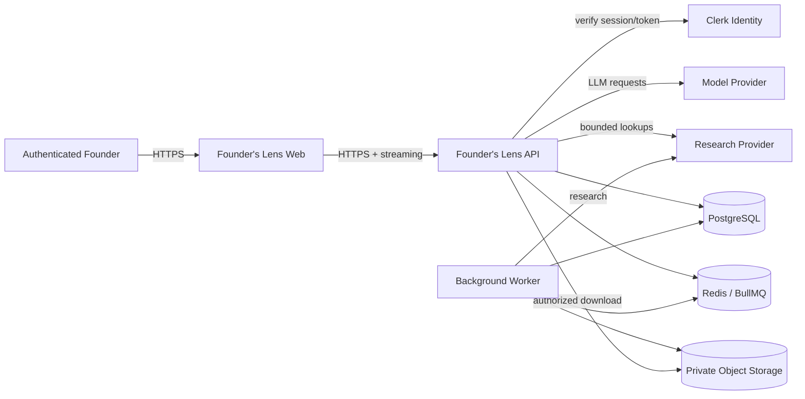
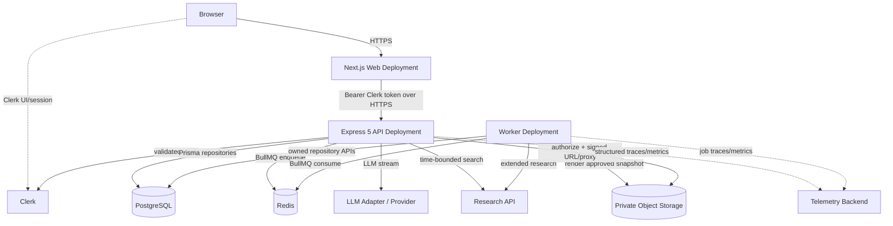
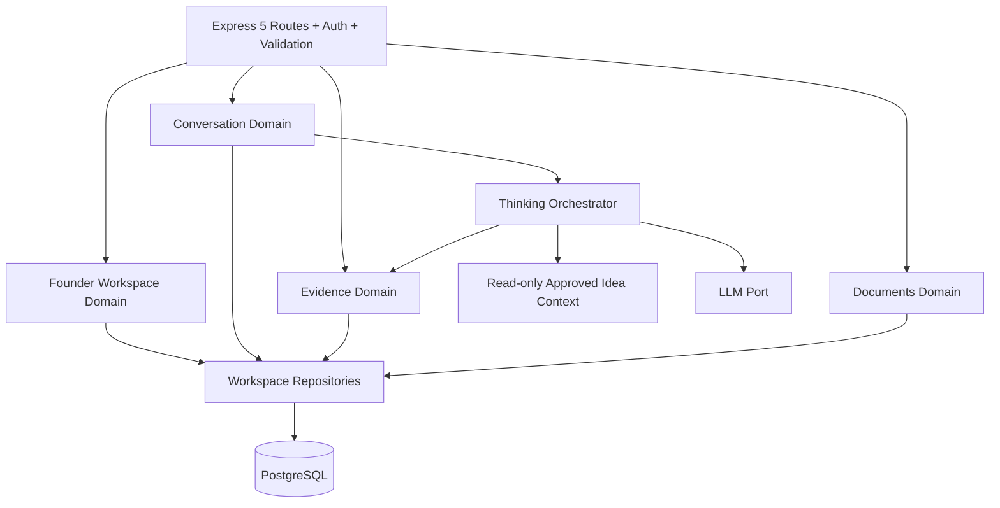
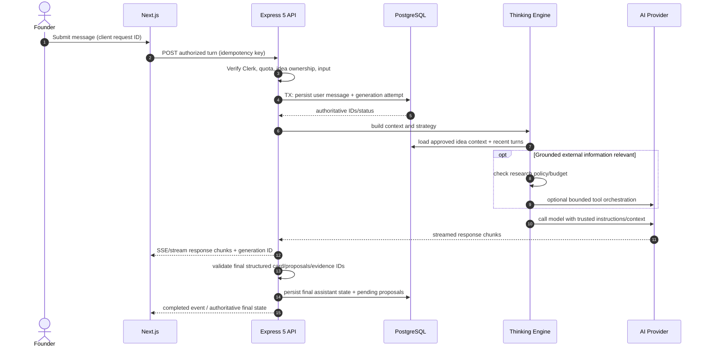
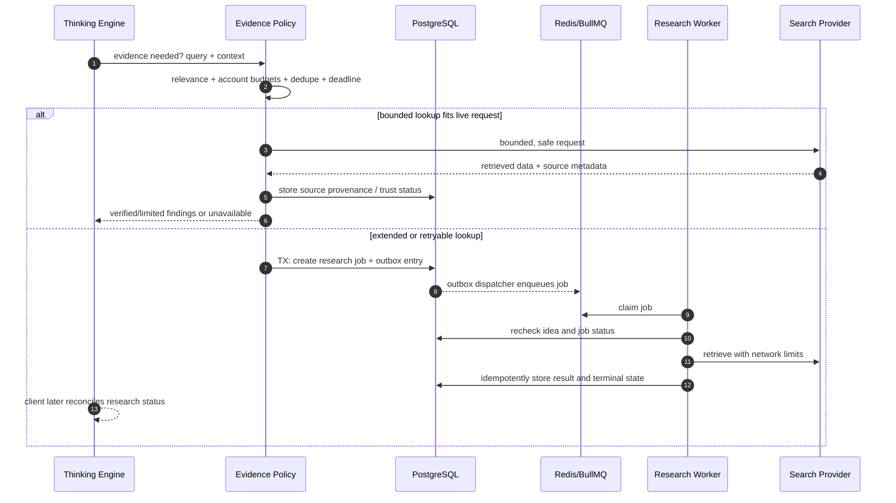
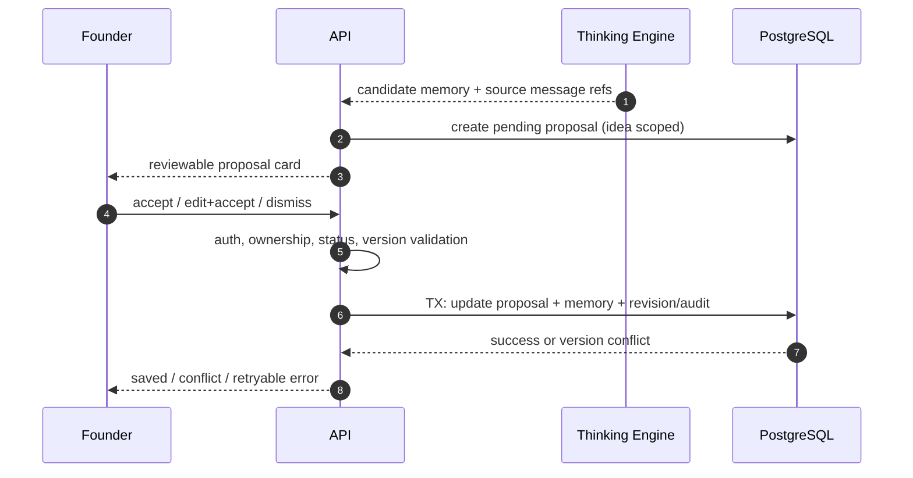

# Founder's Lens — High-Level Design (HLD)

**Document ID:** FL-HLD-001  
**Version:** 1.1.0-rc1  
**Status:** In Review — documentation only; approval and execution evidence tracked separately
**Date:** 2026-11-15  
**Owner:** Product Owner / Engineering Lead  
**Governing documents:** `PRD.md` (product baseline 2026-11-11; implementation clarification 2026-11-15), `SRS.md` v1.0.0 (2026-11-12)  
**Architecture style:** Separate Next.js web tier + independently deployable Express 5 API + BullMQ workers; modular domain boundaries; Docker-portable  
**Scope:** P0 MVP only; India-first, English + typed Hinglish  
**Implementation language:** TypeScript (strict mode)

> **Architecture authority.** The controlled SRS baseline, including `INV-*`, `FR-*`, `NFR-*` and its open-decision register, controls externally observable behavior. This HLD selects technical mechanisms to satisfy those requirements; it **must not silently alter them**. User choices after the SRS: Node.js + Express 5 + strict TypeScript backend, Prisma ORM, Clerk authentication, BullMQ + Redis background jobs, and separate backend/worker deployments. AWS is a **preferred future hosting target**, not a confirmed provisioned account or promise of free hosting. Conflicts require an ADR + SRS change request. This HLD is ready for LLD once review blockers are resolved; public beta has separate release gates.

**Backend decision update — 2026-11-15:** The owner selected Express with TypeScript. [ADR-013](adr/013-express-typescript-api.md) supersedes ADR-002 and the API framework choice in ADR-001. Express 5 is the documented major-version baseline; exact compatible package versions remain an implementation lockfile decision. This implementation change does not alter SRS behavior or acceptance criteria.

---

## 1. Executive architecture decision

### 1.1 Chosen baseline

1. **Web:** Next.js App Router application, TypeScript; the interactive chat and inline cards are client components; protected server-rendered pages may be used where appropriate.
2. **Backend:** Independently deployed Node.js + Express 5 + strict TypeScript HTTP API; thin routers/controllers, explicit validation/auth/error middleware, and modular domain/application layers; one API deployable with multiple stateless replicas where hosting allows.
3. **Workers:** One or more independently deployed TypeScript worker processes consuming **BullMQ on Redis**; separate job types/queues for targeted research and PDF rendering. The workers share a codebase/packages with the API, not its HTTP lifecycle.
4. **Database:** PostgreSQL, accessed through Prisma in domain-owned repositories; schema changes via migrations. One logical transactional database initially, not a database per module.
5. **Identity:** Clerk handles login and sessions; the API uses Clerk's Express middleware to verify requests and application policies to enforce **per-resource ownership** server-side.
6. **AI:** An abstract LLM adapter controlled by a single Thinking Orchestrator; provider selected through privacy/cost/quality evaluation. AI suggestions never directly update approved state.
7. **Research:** Automatically invoked **only when relevant and within quotas**; fast/bounded lookups may occur in a live turn; extended research runs as an authorized durable job. Retrieved content is untrusted.
8. **Documents:** Draft Idea Snapshot → user edits/reviews → immutable approved snapshot → background deterministic PDF render → private storage → authorized download.
9. **Deployment:** Cloud-portable Docker images, managed secrets, HTTPS, automated CI and separate runtime health checks. AWS deployment topology is a **reference mapping, not an approved zero-cost deployment**.

### 1.2 Why this, not microservices everywhere?

The architecture separates **workload deployments** (web, latency-sensitive API, retryable workers) while maintaining **cohesive transactional domains**. It minimizes distributed joins, duplicated auth logic, and cross-service sagas. Extract a business domain into an independent service only if measurements and ownership requirements justify its deployment and datastore separation. Independent workers are **not** proof that the business modules are microservices.

### 1.3 Quality attributes in priority order

1. **Privacy and isolation** (idea confidentiality, ownership, server-side policy enforcement).
2. **Evidence integrity / AI trust** (no invented verified source, honest uncertainty, reviewable memory).
3. **Durable correctness** (idempotency, transaction boundaries, exact snapshot export).
4. **Recoverability** (retry safe, observable failure states, reconnect reconciliation).
5. **Usability and responsiveness** (streaming, concise conversation, progressive depth).
6. **Cost predictability** (model and research quotas, bounded concurrency).
7. **Independent scaling** of API and worker runtime units where demand/budget support it.

---

## 2. Scope and explicit exclusions

**Included in P0:** mandatory login; private idea workspace; idea-scoped conversations and streaming; six response strategies; bounded automatic research with citations; pending/confirmed editable memory and provenance; assumption, evidence, comparison and experiment cards; experiments/reflection; reviewed Idea Snapshot PDF; privacy/export/delete controls; English + typed Hinglish; responsive interface; security, tests, tracing and limits.

**Not included in P0:** anonymous AI use, voice, uploaded-document understanding, user-to-user collaboration, autonomous external business actions, pitch decks, full financial forecasts, founder success scores, arbitrary model-generated UI, separate database per domain, generalized multi-agent platform, Kubernetes requirement, 24/7 free-hosting SLA, investor matching.

**Architectural non-goals:** AWS lock-in, exactly-once external execution claims, allowing model text to issue SQL/jobs/authorizations, streaming via WebSockets without a proven need, maintaining every chat turn in a vector index.

---

## 3. Assumptions, constraints and capacity planning

### 3.1 Confirmed versus provisional

| Kind | Item | Status |
|---|---|---|
| Product | Login required for all AI/private workspace actions | **Confirmed — DEC-002** |
| Product | User reviews memory before it becomes confirmed | **Confirmed — DEC-003** |
| Product | Auto-research when relevant, within limits | **Confirmed — DEC-004** |
| Product | Full MVP, progressive depth, adaptive cards, reviewed PDF, typed Hinglish | **Confirmed** |
| Stack | Next.js, Express 5, TypeScript, Prisma, PostgreSQL, Clerk, BullMQ + Redis | **Selected architecture** |
| Ops | Deploy API and worker independently | **Selected architecture** |
| Hosting | AWS as preferred future hosting target | **Preference; resource availability/card/cost NOT confirmed** |
| AI provider | Model, search providers and privacy contract | **OPEN / beta blocker** |
| Performance | Exact SLOs, peak load, RPO/RTO, quotas | **OPEN / benchmark and approval required** |
| Privacy | Data retention and deletion schedule/provider terms | **OPEN / beta blocker** |

### 3.2 Illustrative load model (not customer forecast)

For initial performance experiments assume **1,000 daily active users**, **15 messages per DAU per day** = **15,000 user-generated chat messages/day** (about **0.174 messages/s daily average**). Model traffic with *bursts* separately: example **50 or 100 simultaneous active streams**, 2–30 seconds provider latency per generation, and a configurable fraction of turns requiring retrieval. A single active stream often represents long-lived in-flight work; average RPS is misleading.

These numbers are **benchmark profiles only**. Derive resource needs from measurements of (a) concurrent HTTP streams and provider rate limits, (b) token usage, (c) Redis job depth, (d) DB pool size/query latency, (e) PDF CPU/memory, (f) external provider quotas, and (g) hosting bills. Never present the example load as an approved SLA.

### 3.3 Hosting and budget constraints

The owner prefers **₹0/month, no payment card, established infrastructure**, but also wants a professionally deployed, continuously functioning API and worker. These conditions may be mutually unsatisfiable on current established clouds. **No deployment cost guarantee is made.** AWS ECS itself does not charge an orchestration fee, but EC2/Fargate compute, database, Redis, storage, networking and logs can incur charges; see AWS pricing sources in §17. Before provisioning, confirm account eligibility, billing method, region, budget controls and a viable funding path. Professional **engineering practices** are not equivalent to an unpaid hosting SLA.

---

## 4. Architecture views (C4-inspired)

### 4.1 System context



Actors: visitor (public pages/sign-in), founder (private ideas, chat and learning), operator (metadata-only operational telemetry by default), external identity/model/research vendors, worker runtime. The browser never directly connects to the database, Redis, private storage administrative credentials, or raw model secret.

### 4.2 Container/deployment view



**Critical path:** Browser → API → authenticated/authorized conversation → context builder → model + optional bounded research → streaming output → durable final state. **Async path:** API commits job + outbox event → dispatcher → Redis queue → worker → authoritative result → UI polling/status refresh (optional notification optimization later).

### 4.3 Logical module map (within same backend codebase)



Arrows represent allowed logical API dependencies, not direct cross-module table access. The actual dependency graph is enforced in the LLD with application ports, dependency rules and tests.

---

## 5. Domain boundaries and data ownership

| Boundary / component | Owns | Public application capability | Must not do |
|---|---|---|---|
| Identity & Access | Local user mapping; access policies | Verify Clerk principal, enforce idea/record ownership | Store passwords or trust client-supplied user IDs |
| Founder Workspace | Ideas, accepted memory, assumptions, decisions, experiments, learnings and revisions | Create/edit/delete ideas; approve/correct memory; manage experiments | Let LLM directly change confirmed knowledge |
| Conversation | Conversations, messages, generation attempts, idempotency | Persist/retrieve chat; manage attempt states | Decide permanent memory or trust unsourced citations |
| Thinking Engine | Request-scoped intent/strategy, context selection, model output validation, pending proposals | Produce one of six strategies, zero/one card | Own canonical persisted business decisions |
| Evidence | Research requests/jobs, retrieved-source metadata, normalized evidence and trust status | Verify provenance, expose supported/limited/unavailable evidence | Treat user reports as independent market statistics |
| Documents | Snapshot drafts/approvals, export attempts, private object references | Review, approve, render and authorize downloads | Re-generate business claims during PDF rendering |
| Worker/Job infrastructure | Execution and delivery metadata, deadlines, retries | Reliable dispatch of research/PDF tasks | Treat queue payload as identity authorization or canonical state |

**Ownership invariant:** a table/aggregate has one logical domain owner. Shared database access is technical convenience, not permission for arbitrary imports/queries across modules. Prisma may use one generated client but repository/service rules enforce ownership; enforce layering with lint/module boundaries and tests. Workers call the same authorized domain use cases using trusted job context and re-check user/idea lifecycle before persistence or releasing output.

**Suggested monorepo (illustrative, not final LLD):**

```text
apps/
  web/                 # Next.js app
  api/                 # Express 5 HTTP and streaming entry point
  worker/              # BullMQ job processors, health/lifecycle
packages/
  contracts/           # Shared versioned Zod schemas and TypeScript types
  domain/              # Core business types/use cases/policies
  persistence/         # Prisma client, migrations, owned repositories
  integrations/        # Clerk, AI, search, storage, queue adapters
  telemetry/           # Cross-cutting logging/tracing conventions
infra/
  docker/              # Local Compose and image definitions
  deployment/          # Provider-specific configuration when chosen
Docs/
  PRD.md  SRS.md  HLD.md
  ADR/                 # Accepted/proposed architectural decisions
  LLD/                 # Detailed domain, data, and API design
```

Domain/application packages must not import Express request/response types or middleware. HTTP adapters translate validated requests and verified identity into framework-independent use-case inputs. Contracts package contains no secrets or server-only business logic.

---

## 6. Data architecture and persistence policies

### 6.1 Source of truth

PostgreSQL is authoritative for user-scoped business records and workflow statuses. Redis holds **dispatch/execution** state, not canonical user data. Object storage contains generated PDFs; metadata, version, ownership and authorization live in PostgreSQL. Clerk is source of truth for identity/session, while PostgreSQL stores stable `clerkSubject` mapping and app-owned data.

### 6.2 Logical data structures

| Entity | Owner | Critical fields / relations (conceptual) |
|---|---|---|
| UserProfile | Identity | app user ID, Clerk subject (unique), preferences |
| Idea | Workspace | owner ID, title, lifecycle state, timestamps |
| Conversation | Conversation | idea ID, title, created/updated |
| Message | Conversation | conversation ID, role, content, sequence, status, creation time |
| GenerationAttempt | Conversation | message/turn ID, idempotency key, strategy, status, provider metadata, timeouts |
| MemoryProposal | Workspace | idea ID, proposal type, source message IDs, status, candidate content |
| ConfirmedMemory | Workspace | idea ID, type, content, current revision/version, provenance |
| MemoryRevision | Workspace | memory ID, old/new version, actor, timestamp and reason |
| Assumption | Workspace | idea ID, text, evidence status, revision/version |
| Experiment | Workspace | assumption ID (optional), plan, state, constraints and results |
| Learning | Workspace | experiment ID, user-confirmed finding, source |
| ResearchJob | Evidence | idea ID, question, dedupe key, budget, status, deadline |
| EvidenceRecord | Evidence | source URL/id, retrieval time, jurisdiction/time scope, excerpt, trust status |
| Snapshot | Documents | idea ID, content version/hash, editable draft or immutable approved |
| ExportJob | Documents | approved snapshot ID, output object key, status, retry metadata |
| OutboxEvent | Infrastructure | event ID, type, aggregate reference, dispatch status/attempts |
| AuditEvent | Cross-cutting | actor, resource, operation, timestamp, minimal metadata |

**Relationships:** one user → many ideas → many conversations, assumptions, memory records, experiments, documents; one conversation → ordered messages and attempts; evidence can support multiple assumptions through a linking relation; one experiment may record multiple observations/learnings; snapshot approval pins its exact revision.

### 6.3 Data integrity and concurrency

- Unique `(owner, idempotency_key, operation_kind)` or equivalent bound to an authorized request context prevents duplicate logical submissions; a **regenerate** action uses a distinct explicit request intent.
- Message order uses an authoritative server sequence (not client timestamps); concurrent sends require an ordered/locked or explicitly rejected policy per conversation.
- Approved memory and assumption edits use `version` optimistic concurrency; stale writes receive conflict, not silent overwrite.
- Saving an accepted memory and its revision/audit event is one DB transaction. No provider call is made inside a long-held DB transaction.
- Status transitions are conditional updates; repeated workers cannot mark a completed/invalidated job as newly completed.
- Idea deletion immediately revokes API-level access and prevents newly produced async outputs from being attached; async cleanup follows an approved retention policy.
- Draft snapshots may be edited; **approved snapshots are immutable** and addressed by ID+version/hash; PDFs must be content-equivalent to the approved snapshot.
- Preserve evidence classification: user report ≠ independent sourced data; model inference ≠ verified fact; source metadata and limitations persist with evidence.
- Rejected/stale memory proposals remain excluded from confirmed-context retrieval. Relevant *recent chat* can still be shown with unconfirmed status, per `INV-005`.

### 6.4 Querying, indexes, pooling and migrations

Design LLD indexes around access patterns: `(owner_id, updated_at)` for ideas, `(conversation_id, sequence)` for messages, `(idea_id, status)` for memory/experiments, `(job_status, next_attempt_at)` for dispatch, uniqueness for idempotency. `EXPLAIN ANALYZE` and seeded test data decide final indexes.

Size PostgreSQL pools per API/worker replica and hosting limits. Where applicable use a pooler for application queries and appropriate **direct connections for migrations**; refer to the chosen provider's Prisma/Postgres configuration. Perform schema migrations as a **single controlled release step**, not simultaneously on every API replica. Backward-compatible expand/migrate/contract releases are preferred.

### 6.5 Retention, privacy and backup

Retention until deletion and the proposed maximum 30-day active-system purge target are now approved under P2D-P01. Other retention periods, raw provider content logging, backups and provider purge schedules **remain deployment/SRS beta gates** (`OD-003`, `OD-004`, `OD-007`). HLD sets technical hooks: private storage, lifecycle markers, cancellation-aware workers, bounded logs, export/delete endpoints, backup/restore playbooks, and controlled key access. Never claim a retention SLA until policy and provider contracts are approved.

---

## 7. Identity, authentication and authorization

### 7.1 Trust boundary

1. User authenticates in web via Clerk; there is **no guest AI path**.
2. Web obtains an appropriate Clerk session token for the separate API (exact token mode/issuer/audience/origin determined in auth integration spike).
3. API validates signature and trusted issuer/audience/expiry and maps verified subject to app user. Backend must not trust username or user ID sent by the browser.
4. Route validation checks ownership and permissions for the requested idea/conversation/memory/evidence/experiment/snapshot **in every request**, including streaming and signed-download issuance.
5. Jobs enqueue an internal immutable owner+idea+resource reference, not a browser token. Worker revalidates resource lifecycle and authorization eligibility before writing or releasing a result.

### 7.2 Security controls

- HTTPS/TLS end-to-end to external endpoints; no mixed-content authenticated requests.
- CORS allowlists for known web origins; do not treat CORS as authorization; CSRF protections if cookie-authenticated backend APIs are adopted; restrictive security headers.
- Provider secrets and DB/Redis credentials are stored in secret management, never bundled with the Next.js client or logged.
- All API inputs validated via versioned runtime schemas; output objects from models and research treated as untrusted.
- Per-account request/model/research quotas and IP-sensitive abuse controls; use server-side authoritative counters, not frontend checks.
- Domain authorization enforced inside use cases/data access where appropriate to prevent bypass through alternate routes or jobs.
- Private object download uses short-lived scoped signed URLs or API proxy after checking ownership; never a public storage bucket.
- Source URLs and model/research tool input sanitized; fetching arbitrary URLs may introduce SSRF; adopt allowlisted outbound providers, URL validation, timeout and content-size limits.
- Minimize sensitive data in logs, traces and job payloads; use IDs/hash/metadata rather than full private idea text by default.
- Account deletion requires coordination with Clerk identity lifecycle and application data; administrator access to private idea text is not assumed.

**Auth design spike (must pass before rollout):** token acquisition, Clerk token verification in the Express API, rotation/expiry, cross-origin requests, rejected-audience tokens, ownership denial, sign-out, webhook signature verification if sync webhooks are introduced. Clerk authentication alone never establishes object ownership.

---

## 8. Primary runtime flows

### 8.1 Chat send, generate, stream, persist



**Invariants:** authorization precedes any provider invocation; duplicate send does not create duplicate user message; streamed text is provisional until finalized; client receives authoritative completion state only after persistence. The model cannot choose trusted record IDs or mutate stored content. If final structured output validation fails, show safe failure/limited plain text as permitted by an explicit recovery policy, not an unsafe card.

**Generation lifecycle:** `PENDING → RUNNING → COMPLETED | FAILED`, with `PENDING/RUNNING → CANCEL_REQUESTED → CANCELLED`. Validate allowed transitions and expiration. Disconnect does **not** guarantee provider cancellation; v1 generation continues on browser disconnect, with no durable token replay; expose status and recover completed content from PostgreSQL. Persist user message before model invocation. Retrying an interrupted attempt is separate from replaying the idempotent submission.

**Backpressure & overlap:** define one in-flight generation per conversation for v1 (or reject/queue concurrent sends deterministically); never let concurrent answers silently reorder canonical messages. Server uses AbortSignal/timeouts; log provider request ID, attempt ID, stream duration and final outcome without logging private full text.

### 8.2 Automatic research



The **research policy**, not model instructions alone, decides whether and how many lookups are permitted. Use a per-turn time budget and per-user/idea limits; reuse equivalent recent queries when permissible. If research fails, assistant continues with explicit uncertainty, never fabricated citations. The evidence adapter returns a source URL, fetch time, region/time scope, excerpt or metadata and limitations. Evidence can be *insufficient*, *contradictory*, *pending* or *verified-as-sourced*; it is not proof of business viability.

**Consistency boundary:** if extended research completes after its originating chat turn, the earlier answer remains valid as an evidence-pending turn. Present findings in a separate status/card/next turn; do not silently rewrite a completed historical assistant message or inject unsupported sourced claims.

### 8.3 Memory proposal review and correction



A correction inside chat immediately affects that request's contextual understanding; persisted confirmed memory changes only after explicit approval and successful commit (`FR-023`, `FR-026`). Dismissal persists as a decision about the proposal, not an instruction to diagnose the user. No automatic memory approval due to inactivity.

### 8.4 Experiment and learning lifecycle

`proposed → accepted/active → completed | cancelled` (with edits/versioning and optional draft); reflections produce user-confirmed learning linked to observation and assumption. Rejected suggestions do not force a stage change. A user can return to brainstorming without a pending experiment. Service checks duplicate actions and version conflicts.

### 8.5 Reviewed PDF export

```mermaid
sequenceDiagram
  autonumber
  actor U as Founder
  participant A as Express 5 API
  participant DB as PostgreSQL
  participant Q as BullMQ
  participant W as PDF Worker
  participant O as Private Storage
  U->>A: Create snapshot draft
  A->>DB: read authorized canonical idea data; store draft
  A-->>U: editable draft
  U->>A: Approve specific draft revision
  A->>DB: TX: immutable approved snapshot + export job + outbox
  DB-->>Q: dispatcher enqueues export job
  W->>Q: claim export
  W->>DB: recheck approval hash + idea lifecycle
  W->>W: deterministic render from approved snapshot
  W->>O: put immutable output object
  W->>DB: commit result metadata/status idempotently
  U->>A: Download PDF
  A->>DB: verify owner, status and snapshot version
  A-->>U: authorized short-lived URL / stream
```

The same approved snapshot ID+version/content hash must be preserved across retries. Renderers must never call LLMs to re-create facts. Failed rendering does not invalidate the user's approved snapshot. If object upload succeeds but DB status update fails, recovery must safely reconcile/reuse or clean orphaned objects.

### 8.6 Delete idea / account

Authorization is revoked immediately at a defined logical deletion/tombstone transition. Cancel or invalidate pending research and export jobs, ensure workers check deletion status, and schedule cleanup of linked private data and objects. The user-facing confirmation must accurately reflect the approved retention/purge policy (still an open beta gate); never claim immediate total purge while provider backups remain.

---

## 9. Reliable jobs and outbox design

### 9.1 Job taxonomy

| Queue | Producer | Consumer | Idempotency basis | Typical outcome |
|---|---|---|---|---|
| `research` | Evidence application service | Research worker | idea ID + normalized query + policy window / job ID | evidence set + status |
| `export` | Document service after approval | PDF worker | approved snapshot ID + output format / job ID | immutable PDF object reference |
| `maintenance` (optional) | Operations scheduler | Maintenance worker | task type + period/resource ID | outbox redelivery, cleanup |

API and workers may use the same database and Prisma schema, but worker commands go through owned application use cases. A worker must not trust `userId`, `approved`, or `sourceVerified` values merely because they appear in a Redis payload; it re-reads authoritative records.

### 9.2 Reliability semantics

BullMQ provides **at-least-once** job processing; workers must be idempotent. Use deterministic job IDs where supported plus **database uniqueness/status guards**, because queue deduplication alone is insufficient for cross-system exactly-once effects. See BullMQ production guidance in §17. Set bounded attempts, exponential backoff with jitter where supported, provider timeouts, terminal failure states, and operations visibility for permanently failed jobs. Dead-letter handling may be implemented using a dedicated failure store/retry policy; do not assume an automatic DLQ exists without implementing it.

**Transactional outbox:** create domain job record and outbox row in the *same PostgreSQL transaction*. A dispatcher reads unsent rows with an appropriate claim/lock pattern, publishes idempotently to BullMQ, and marks dispatched. Duplicate publication is tolerated. A crash after queue publish but before marking outbox dispatched must not duplicate domain outcomes. Monitor oldest undelivered outbox age.

**Redis behavior:** choose a Redis plan/configuration appropriate for BullMQ persistence, memory eviction policy and availability. Do **not** deploy a job queue on an evicting cache instance without understanding job loss. Jobs/outputs remain recoverable from PostgreSQL when feasible. Redis outages should degrade research/PDF job scheduling without corrupting chat or approved memory.

**Worker availability:** independent deployments allow restarting/scaling worker processes, but do not by themselves guarantee uninterrupted service, multi-zone availability or no-cost operation.

---

## 10. External and internal interface contracts

### 10.1 Browser → Express 5

- HTTPS JSON API for CRUD/approval/status actions; authenticated progressive HTTP stream (SSE-framed or equivalent) for assistant generation.
- Structured errors: `code`, `message`, `requestId`, `retryable`; never include other users' resource details.
- Versioned contracts (`/v1` or headers) and server-owned IDs; authorization on all private operations.
- Token verification at API boundary; CORS allowlist; no direct DB or Redis access from Next.js browser bundle.
- Generated cards are **one of four discriminated unions**: `assumption`, `evidence`, `comparison`, `experiment`; max one primary card per assistant turn; client displays only server-validated variants.
- Long-running status endpoints permit reconnection without duplicating actions.

### 10.2 Logical API surface (illustrative, not LLD endpoint freeze)

| Capability | Possible resource grouping | Critical rule |
|---|---|---|
| Ideas | `/ideas` | auth + owner check |
| Conversations/messages | `/ideas/:ideaId/conversations`, `/messages`, `/generations` | idempotency + ordering + streaming recovery |
| Memory review | `/ideas/:ideaId/memory-proposals`, `/memories` | approval/version/provenance |
| Assumptions/experiments | `/ideas/:ideaId/assumptions`, `/experiments`, `/learnings` | owner and lifecycle validation |
| Evidence/research | `/ideas/:ideaId/evidence`, `/research-jobs` | verified source IDs + quotas |
| Documents | `/ideas/:ideaId/snapshots`, `/exports` | approved revision parity + authorized download |
| Privacy | `/account/export`, `/account/delete`, `/ideas/:ideaId` | truthful retention and cleanup state |
| Ops | `/health/live`, `/health/ready`, metrics (protected) | no sensitive data leakage |

Precise paths, HTTP methods, JSON schema, pagination, error codes and streaming event envelope are **LLD/OpenAPI deliverables**, but the constraints above are HLD obligations.

### 10.3 Internal ports / adapters

Core application code depends on interfaces, not on vendor SDKs: `IdentityVerifier`, `ConversationRepository`, `WorkspaceRepository`, `ResearchGateway`, `ModelGateway`, `JobPublisher`, `DocumentRenderer`, `PrivateObjectStore`, `Clock/IdGenerator`. Use dependency injection via explicit factories/composition root; Express routers and middleware adapt HTTP concerns and do not replace domain interfaces. Avoid enterprise DI framework overengineering.

### 10.4 LLM response and research trust

- The model proposes strategy, bounded chat text, optional card and pending memory proposals in a **versioned validated schema**.
- Six strategies: `EXPLORE`, `CHALLENGE`, `INFORM`, `COMPARE`, `ACT`, `REFLECT`.
- Model-selected `needsResearch` is **advisory**; backend policy decides execution.
- Evidence cards can reference **only server-issued verified evidence IDs**; generated URLs/IDs cannot become authoritative by assertion.
- External webpages/attachments are untrusted *data*, never system/developer instructions. Research result summaries must preserve source, retrieval date, jurisdiction/timeframe and uncertainty.
- Enforce meaningful cancellation, maximum provider calls, token budgets and per-account rate limits.

### 10.5 Express + TypeScript HTTP boundary

- **Composition:** separate application creation from the process entry point/listener. Compose domain routers, thin controllers, and middleware explicitly. Keep provider calls and business transactions in application services shared with workers.
- **Authentication:** use the compatible `@clerk/express` SDK; register `clerkMiddleware()` before protected routers and inspect verified auth with `getAuth()`. Authentication middleware alone does not protect routes: explicitly reject missing/invalid sessions with JSON `401`, then enforce resource ownership. Validate issuer, expiry, and configured audience/authorized origins as applicable to the selected token flow; prove the SDK configuration in the auth spike.
- **Middleware policy:** explicitly configure request correlation/redacted logging, allowed-origin CORS/preflight handling, security headers, bounded JSON parsing, and abuse limits. Private handlers require authentication, account quotas, parsed input, and ownership checks before side effects. Define and verify registration order in LLD; CORS must also cover error responses. If signed webhooks are added, preserve their raw body for signature verification before JSON parsing.
- **Runtime contracts:** parse body, params, and query with shared versioned Zod schemas; treat external values as untrusted until parsing succeeds. Infer TypeScript DTOs from schemas and validate structured responses/model output. Express does not supply schema validation or response serialization guarantees automatically. OpenAPI generation must use the same contract source; the generator remains HLD-OD-09.
- **Errors:** use a final four-argument Express error middleware plus an explicit not-found handler. Express 5 forwards rejected promises returned by async handlers; callback/event errors still require explicit handling. Map validation, auth, ownership, conflict, quota, and provider errors to the versioned error envelope without stack traces or secrets.
- **Streaming:** use the HTTP response stream with SSE framing, backpressure, timeouts, and disconnect cleanup. Validate/authenticate before sending headers. After headers are sent, do not attempt a JSON error or second response: emit a safe terminal event when writable, otherwise close and reconcile persisted attempt status. Completion remains conditional on durable commit. Verify proxy buffering, compression exclusions, and graceful shutdown with active streams.

TypeScript checks development-time types; runtime validation, ownership checks, and durable workflow guards remain mandatory. See [ADR-013](adr/013-express-typescript-api.md) for the decision and verification plan.

---

## 11. NFR realization and observable targets

The SRS's `NFR-001`–`NFR-020` remain normative; the HLD specifies implementation mechanisms, not replacement metrics.

| Attribute | Architectural measure | Evidence to collect |
|---|---|---|
| Security / authorization | Central Clerk verification; resource-scoped use cases; deny by default | cross-user/IDOR test matrix; audit traces |
| Isolation | Strict idea ID + user ID checks in queries/context, no cross-idea fallback | seeded multi-user/multi-idea tests |
| Trust | provenance and evidence status; source-ID validation | zero invented verified sources on release corpus |
| Correctness | DB transactions, version checks, idempotency keys | duplicate/concurrent request tests |
| Reliability | persisted attempts/jobs, outbox, replay-safe workers | crash/restart/Redis outage tests |
| Performance | streaming and bounded provider calls, optimized DB and pools | p50/p95 latency under defined workload |
| Scalability | stateless API replicas; worker concurrency/replicas; connection budgets | controlled concurrency and backlog tests |
| Accessibility | semantically accessible cards, keyboard navigation | WCAG 2.2 AA-oriented audit |
| Cost | provider routing abstraction, token/call quotas, job limiters | token budget and monthly spend dashboard |
| Observability | correlation IDs, W3C trace context, queue job IDs | distributed traces without private content |
| Backup / data export | managed backups + restore drill; user data export | restore test; export parity and deletion drills |

**No invented SLA.** The SRS has provisional latency targets and open availability/RPO/RTO/research-budget decisions. Record workload, region, warm/cold conditions, model type, measurement period and percentiles before sign-off. API and worker autoscaling cannot exceed underlying DB/Redis/provider limits.

---

## 12. Failure-mode matrix and recovery ownership

| Failure / trigger | Detection | User-visible outcome | Recovery and owner |
|---|---|---|---|
| Invalid/expired Clerk token | API auth validation | 401; sign-in / refresh flow | identity adapter; no AI invocation |
| Cross-idea resource ID | owner policy | 403 or non-enumerating 404 | API domain policy; security log |
| Double send/retry | idempotency collision | one persisted turn | Conversation; existing state returned |
| Two concurrent sends | active-attempt conflict | explicit busy/retry state | Conversation lock/unique constraint |
| LLM timeout or malformed response | timeout/schema validator | clear failed/partial state, not false completion | Thinking Engine; safe retry attempt |
| Browser drops stream | disconnect + attempt status | reconnect/refresh recovers authoritative state | Conversation lifecycle and status API |
| User changes idea mid-run | immutable request-bound idea ID | no output cross-leak | API and client correlation |
| Database unavailable | failed transaction | no 'saved' message | retry user action; no orphan canonical state |
| Stale memory edit | row-version mismatch | conflict and review | Workspace transaction |
| Bad source or prompt injection | evidence validation | unsupported/unavailable evidence label | Evidence; never execute content instructions |
| Research quota/provider outage | quota/provider errors | continue with uncertainty | Evidence policy; bounded retry |
| Redis unavailable | producer/dispatcher alerts | job pending; chat core may continue | Outbox retains dispatch state |
| Worker crashes mid-job | stalled/retry event | job pending/failed status | Worker replay + DB idempotency |
| PDF upload succeeded, DB update failed | object exists, job incomplete | pending/retry; no phantom download | Documents reconciliation/orphan cleanup |
| Idea deleted during job | lifecycle check / tombstone | no post-delete output | Workspace/worker cleanup |
| Provider data-policy mismatch | review gate | cannot launch public beta with real sensitive ideas | Owner / security policy |
| Hosting free allotment expired | account/billing monitor | degrade/stop according to controlled plan | Operator; **never imply free 24/7 SLA** |

**Recovery priority:** preserve data and confidentiality over continuously answering at any cost. Retry only operations known to be safe; user-visible state must be honest.

---

## 13. Deployment, environments and CI/CD

### 13.1 Environment topology

**Local:** Docker Compose (PostgreSQL, Redis, optionally object-storage emulator); Next.js, Express 5 and worker processes from the monorepo; model/research adapters mocked for automated tests; secrets in ignored local files.

**TypeScript build contract:** API, workers, and shared packages use `strict: true`. Typecheck in CI with `tsc --noEmit` (or the equivalent project-reference check), then build deployable JavaScript and run it with Node.js. A `tsc` emit build uses `noEmitOnError: true`; transpile-only development tooling never substitutes for typechecking. Pin compatible Express 5, `@types/express` 5, `@types/node`, TypeScript, and Clerk packages with a supported Node.js LTS release. Final module format, build/watch tool, and package manager belong to the implementation/tooling decision in HLD-OD-09.

**CI/test:** ephemeral/isolated database and Redis, seeded multi-user fixtures; unit/integration/E2E/AI evaluation suites; static analysis, audit/dependency checks, migration validation; safe network mocks for paid providers.

**Staging:** same API/worker container artifacts as production, isolated data/stores/secrets, Clerk test configuration, synthetic accounts and realistic load tests.

**Production:** independently deployable web, Express 5 API and workers; managed database/cache/storage when funded and available; TLS ingress, private service connectivity, observability and backups. Do not expose Redis, Postgres or worker admin ports publicly.

### 13.2 AWS reference mapping — **target, not a cost-free commitment**

| Logical unit | AWS-native candidate | Why / caveat |
|---|---|---|
| Web | AWS Amplify Hosting or external Next.js host | Choose based on SSR and operational needs; free eligibility differs |
| Container registry | ECR | Versioned API/worker images; storage/transfer costs apply |
| API container | ECS service on Fargate or EC2 | TLS ingress via ALB/other approved ingress; Fargate billed for vCPU/memory |
| BullMQ workers | Separate ECS service/task on Fargate or EC2 | Continuous workers consume resources; independent desired-count |
| Transactional DB | RDS PostgreSQL or managed Postgres provider | Managed backup and connection policy; costs can apply |
| Redis | ElastiCache Redis/Valkey or managed-compatible Redis | Persistence and maxmemory policy; costs can apply |
| PDF objects | S3 private bucket | IAM + short-lived signed URL; storage/request costs |
| Secrets | Secrets Manager / SSM | Cost, rotation and access policy evaluated |
| Logging/traces | CloudWatch + OTel collector/exporter | Guard against unbounded high-cardinality costs |
| CI/CD | GitHub Actions + image/release pipeline | GitHub/registry/host limits still apply |

**Architecture decision:** Containers, SQL and Redis protocols are portable. Provider-specific networking/IAM/observability belong in deployment ADR(s). Do not claim AWS can satisfy the owner's no-card, perpetual ₹0 constraint. **Provision only after a billing feasibility decision, with alarms and explicit owner consent.**

### 13.3 Deployment and rollback strategy

1. PR checks: typecheck, lint, unit, integration, schema validation, security tests, AI fixture regression.
2. Build immutable versioned web/API/worker artifacts; generate SBOM/dependency audit where practical.
3. Run a **single** migration step against staging then production; use expand/contract changes for rolling versions.
4. Deploy staging; smoke-test Clerk auth, live stream, worker enqueue/consume, research fallback, approved PDF parity, multi-tenant denial.
5. Deploy production with readiness/liveness probes and bounded concurrency; emit release version in telemetry.
6. On incident, roll back application version if backward compatible; **do not blindly reverse destructive DB migrations**. Preserve transactional data and follow restoration procedure.
7. Regularly verify backup restoration, not just backup existence.

### 13.4 Scaling principles

- **API:** scale by CPU, memory, active streams, response latency, and provider concurrency; stateless replica, no per-process canonical session/idea state.
- **Workers:** scale by queue wait time, depth, job age and resource utilization; research is I/O heavy, PDF generation may be CPU/memory heavy; tune independently.
- **PostgreSQL:** control connection limits across replicas; index real queries; use pooling and short transactions.
- **Redis:** capacity, persistence, maxmemory and queue metrics are bounded; queue throughput is not equivalent to model/search quota.
- **Providers:** admission controls per user/account/global, graceful throttling and circuit-breaker-like behavior where measured helpful.
- **Load test before autoscaling:** more API replicas can worsen DB connection exhaustion or provider 429 rates.

---

## 14. Observability, security operations and operational readiness

### 14.1 Logs, metrics, traces

**Correlation fields:** `requestId`, `traceId`, `userHash` (not raw founder content), `ideaId` where safe, `conversationId`, `generationId`, `researchJobId`, `exportJobId`, `releaseVersion`. Use W3C trace context across web/api and producer→worker job propagation. Do not attach bearer tokens, customer interviews, business descriptions, or raw source text to telemetry by default.

**Metrics:** requests by path/status, 401/403/429, active streams, first-token and total generation latency, provider errors, tokens/cost, research trigger rate/success/insufficient sources, queue depth and oldest age, worker retries/stalls, outbox age, DB pool utilization, PDF parity failures and object-storage errors. Alert thresholds require approved SLO and actual workload data.

**Operations runbooks:** LLM provider outage; Clerk outage; DB connection exhaustion; Redis queue unavailable; stalled/replayed jobs; research source poisoning; accidental cross-tenant exposure; failed snapshot export; account/idea deletion; unexpected spend. Every runbook identifies detection, mitigation, owner and post-incident review.

### 14.2 Threat model starter

| Threat | Boundary | Mitigation |
|---|---|---|
| IDOR / guessed idea ID | web → API | verified principal + owner predicate in every data access |
| Prompt injection from retrieved website | search → engine | untrusted data handling, no tool instruction promotion |
| Model hallucinated citation | engine → UI | server-issued evidence ID checks and verification policy |
| Unauthorized PDF URL | API → object storage | private bucket + expiring scoped URL after auth |
| Queue spoofing / stale job | queue → worker | server-only queue credentials + authoritative DB checks |
| Replay and double-submit | client → API/jobs | idempotency keys, versioned state, DB constraints |
| SSRF via research URL | engine → network | provider adapter, URL allowlists, hostname/IP safeguards |
| Secrets in client/logs | deployment → browser/observability | secret manager, server-only env, redaction, scanning |
| High model spend | user → provider | authentication, per-user quotas, bounded tools and alerts |
| Privacy leakage via model API | backend → provider | approved vendor terms, retention/training controls, disclosure |

---

## 15. Architecture Decision Records (ADR) register

Accepted means **an owner-selected architecture direction**, not proof that cloud hosting has been provisioned or that public beta gates have passed.

| ADR | Decision | Status | Alternatives considered | Key tradeoff / revisit trigger |
|---|---|---|---|---|
| ADR-001 | Next.js web, separate API, independent BullMQ worker deployments | **Accepted; API framework selection superseded by ADR-013** | Full-stack Next.js; full microservices | Deployment boundaries retained; current API uses Express 5 + TypeScript |
| ADR-002 | Original Node.js + strict TypeScript + **Fastify** selection | **Superseded by ADR-013 on 2026-11-15** | NestJS; Express | Historical decision only; not the implementation baseline |
| ADR-003 | **Prisma + PostgreSQL** transactional source of truth | **Accepted** | Drizzle; multiple DBs | ORM abstraction and pooling; use SQL when needed, benchmark queries |
| ADR-004 | **Clerk** identity; API validates token, owns resource permissions | **Accepted** | Self-hosted auth | Provider dependency, token/audience integration and data policy |
| ADR-005 | **BullMQ + Redis** for bounded async jobs | **Accepted** | Managed queue; DB-only jobs | Extra persistence/ops; requires replay-safe workers |
| ADR-006 | One DB initially; domain-owned tables, modular backend | **Proposed for approval** | DB per module | Easier transactions; potential later extraction requires refactor |
| ADR-007 | Historical request-scoped chat proposal | **Superseded proposal by Phase 2C durable generation design (In Review)** | Queued generations | API acceptance/outbox plus independent generation worker; no browser-disconnect cancellation |
| ADR-008 | Outbox for durable queue dispatch + idempotent workers | **Proposed for approval** | Best-effort enqueue | Extra dispatcher and monitoring complexity |
| ADR-009 | Single bounded Thinking Orchestrator + versioned schemas | **Proposed for approval** | Multi-agent coordinator | Model/provider flexibility; test trust/latency |
| ADR-010 | AWS preferred deployment target; Docker-portable | **Accepted as preference; hosting unresolved** | Other hosts; self-hosted | **₹0/no-card conflict requires separate approval** |
| ADR-011 | Managed private object store for approved PDF output | **Proposed for approval** | DB blobs; local FS | Storage vendor/access policies/cost |
| ADR-012 | Observability via structured logs + OpenTelemetry | **Proposed for approval** | Vendor SDK only | Added operational cost; essential for failure diagnosis |
| [ADR-013](adr/013-express-typescript-api.md) | Node.js + **Express 5 + strict TypeScript** API | **Accepted — owner direction 2026-11-15** | Earlier Fastify selection; Express with JavaScript; NestJS | Explicit middleware, validation, and error/stream handling; supersedes ADR-002 and framework choice in ADR-001 |

### ADR format for repository

Store architecture decision documents in `Docs/ADR/`. Each accepted ADR shall specify: **ID, status, date, context, constraints, decision, alternatives, consequences, security/data effects, observability effects, reversal/revisit trigger, related SRS requirements, reviewers**. Changing an accepted ADR requires a new superseding ADR; do not quietly edit rationale after implementation.

---

## 16. Traceability to SRS and architecture verification

| Architecture concern | SRS trace | Planned verification evidence |
|---|---|---|
| Mandatory auth / isolation | `INV-001`, `INV-002`, `INV-013`, `FR-001`–`FR-006` | Clerk token, cross-user, cross-idea and denial tests |
| Stream correctness / retries | `FR-007`–`FR-012`, `FR-019` | invalid input, duplicate, disconnect, malformed JSON and cancellation tests |
| Conversation policy | `FR-013`–`FR-021`, `INV-009`–`INV-010` | 12 conversation fixtures + card schema tests |
| Reviewed memory / revisions | `FR-022`–`FR-028`, `INV-004`–`INV-005` | approve/edit/dismiss/version conflict, context correction tests |
| Assumptions, experiments, reflection | `FR-029`–`FR-033`, `INV-011` | lifecycle + evidence classification tests |
| Auto-research / citations | `FR-034` onward in SRS §5.6; `INV-003`, `INV-006`–`INV-008` | provenance, quota, citation-hallucination, prompt-injection tests |
| Reviewed PDF | SRS §5.7, `INV-012`, `NFR-016` | exact snapshot/content hash parity, retries, denied downloads |
| Security / operations | `NFR-001`–`NFR-020` | load and threat tests, backups, cost, logs, access audit |
| Edge failures | SRS `EC-001`–`EC-025` | failure injection and recovery test matrix |
| Beta blockers | SRS `OD-003`–`OD-007`, `OD-014`–`OD-015` | explicit owner approval with evidence before public launch |

**Architecture test suite (planned):** component/unit tests for domain invariants; integration tests with disposable Postgres + Redis; contract tests for browser/API/model/research adapters; Playwright for user flows; automated + human-scored AI evaluation fixtures; security/authorization tests; performance tests for streaming and queue depth; chaos-lite tests (kill worker, drop Redis, restart API, expire token); deterministic PDF snapshot parity.

---

## 17. Technical references and verification notes

The following are supporting implementation/pricing references, **not** substitutes for the approved SRS or future provider contract/security review. Accessed 2026-11-13.

- AWS ECS pricing: https://aws.amazon.com/ecs/pricing/ — ECS orchestration itself has no separate management fee; underlying compute is chargeable.
- AWS Fargate pricing: https://aws.amazon.com/fargate/pricing/ — task vCPU/memory/storage are metered; do not assume perpetual free running workers.
- AWS App Runner pricing: https://aws.amazon.com/apprunner/pricing/ — provisioned/active container resources are billable.
- BullMQ overview: https://docs.bullmq.io/ — at-least-once work execution; idempotent consumers needed.
- BullMQ production: https://docs.bullmq.io/guide/going-to-production — Redis persistence and operations guidance.
- BullMQ concurrency: https://docs.bullmq.io/guide/workers/concurrency — process replicas and concurrency settings.
- Prisma PostgreSQL: https://www.prisma.io/docs/orm/v7/core-concepts/supported-databases/postgresql — database support and connection options.
- Prisma connection pooling: https://www.prisma.io/docs/postgres/database/connection-pooling — provider-specific pooling guidance; validate against **chosen Postgres host**.
- Express 5 migration guidance: https://expressjs.com/en/guide/migrating-5/ — major-version behavior and compatibility checks.
- Express error handling: https://expressjs.com/en/guide/error-handling/ — async handler errors and handling errors after headers are sent.
- Clerk Express middleware: https://clerk.com/docs/reference/express/clerk-middleware — verified authentication context and explicit route protection.
- TypeScript strict mode: https://www.typescriptlang.org/tsconfig/strict.html — compiler checking baseline.
- TypeScript emit policy: https://www.typescriptlang.org/tsconfig/noEmitOnError.html — prevent emitting on type errors for compiler-based builds.
- Clerk backend API: https://clerk.com/docs — token validation details must be checked for chosen deployment origins and SDK version.
- OpenTelemetry: https://opentelemetry.io/docs/ — distributed tracing and semantic instrumentation.
- OWASP cheat sheets: https://cheatsheetseries.owasp.org/ — authentication, authorization, SSRF, API and secrets controls.

**Version verification rule:** pin compatible Node.js LTS, Express 5, `@types/express` 5, `@types/node`, TypeScript, Zod, Prisma, BullMQ, Clerk and Next.js versions in the implementation ADR/package lockfile; verify current migration/auth/streaming APIs in a proof of concept. Do not rely on outdated examples.

---

## 18. Open architectural questions and decision gates

| ID | Gate | Open question | Required decision/evidence |
|---|---|---|---|
| HLD-OD-01 | **Before provisioning** | How can professional always-on hosting be paid for under current no-card/₹0 constraints? | Explicit feasibility proof or revised funding/hosting constraint; no fictional free SLA |
| HLD-OD-02 | **Before auth integration** | Exact Clerk token flow for browser → separate Express 5 API? | Working proof of concept with expiry, audience/origin, authorization, sign-out |
| HLD-OD-03 | **Before AI integration** | Which model/search vendors meet privacy, cost, rate and quality requirements? | Terms and data-processing review; test fixtures and quotas |
| HLD-OD-04 | **Before async implementation** | Should research short lookups be inline, or always queued above a threshold? | Benchmark deadline, fallback policy and UI reconciliation |
| HLD-OD-05 | **Before production rollout** | Desired concurrency, model/research quotas, SLOs, alert thresholds? | Load results and owner-approved numerical targets |
| HLD-OD-06 | **Before public beta** | Retention/deletion, backups, RPO/RTO, provider data use, minors, regulated topics? | Close SRS `OD-003`/`004`/`007`/`014`/`015` with policy/tests |
| HLD-OD-07 | **Before implementation of hosting** | Exact database, Redis, storage and container hosting providers/regions? | Cost estimate, compatibility (BullMQ Redis semantics), restore plan |
| HLD-OD-08 | **Before LLD freeze** | Which concurrent-turn and cancellation semantics? | Implementable state machine & reconnect contract |
| HLD-OD-09 | **Before LLD freeze** | Which Zod/OpenAPI approach, test libraries and monorepo tooling? | Small spike and team/repository conventions |
| HLD-OD-10 | **Before production** | Secrets, backups, monitoring and deletion across all external providers? | Operational controls and end-to-end failure drill |

**No architecture redesign is needed just because a hosting provider changes.** Keep deployment configuration outside domain logic, use provider adapters, containers, and migration-safe storage contracts.

---

## 19. Critical consistency audit

| Audit | Finding | Disposition |
|---|---|---|
| SRS product identity | HLD consistently uses **Founder's Lens**; "Thinking Partner" describes positioning | **Pass** |
| Guest access | No AI or private workspaces without Clerk-authenticated session | **Pass** |
| Memory | Proposals cannot become confirmed without user review and successful write | **Pass** |
| Research | Automatic but bounded; supports no-evidence and async completion states | **Pass; quotas still open** |
| Chat UX | Six strategies; concise English/Hinglish; max one primary card; flexible journey | **Pass** |
| MVP scope | Chat, memory, research/evidence, experiments/reflection, reviewed PDF all included | **Pass** |
| Technology | Next.js, Express 5/TS, Prisma/Postgres, Clerk, BullMQ/Redis aligned with user decisions | **Pass** |
| Separate backend/worker | Independently deployed processes, not prematurely split business microservices | **Pass** |
| Source of truth | PostgreSQL canonical; Redis execution; immutable snapshot for PDF | **Pass** |
| Privacy/deletion | Technical hooks defined; exact provider policy and retention dates unresolved | **Open beta blocker** |
| Performance | Measurable profiles defined; SLO/quotas not invented | **Open calibration** |
| Hosting | AWS target identified, but ₹0/no-card/continuous worker feasibility unresolved | **Open provisioning blocker** |
| Production readiness | Recovery/runbooks/testing specified; no unearned SLA claim | **Conditional** |
| LLD handoff | Domain, data, flows, interfaces, state and failure obligations specified | **Ready after architecture review** |

**Final disposition:** This is a **review-ready HLD baseline**, not a completed deployment design or evidence of production reliability. Approve ADR-006–ADR-009 and ADR-011–ADR-012, validate auth/provider and hosting spikes, then draft LLD/OpenAPI/ERD. Close privacy, operational targets and hosting affordability before a real-user public beta.

---

## 20. Sign-off, change control and next artifacts

**Reviewers:** Product Owner, Engineering Lead (same person may hold both roles), security/privacy reviewer if handling external founders' ideas, and operations owner. Record review date, decisions, risk acceptance and change-request IDs.

**Change precedence:** confirmed product decision → updated SRS requirement → HLD/ADR → LLD/API/schema → tests and release. A new architectural choice may be proposed in an ADR, but must not override a binding SRS invariant. Use semantic HLD versioning: editorial patch, compatible refinement minor, boundary/security/deployment change major.

### Change log

| Version | Date | Change |
|---|---|---|
| 1.0.0-rc1 | 2026-11-13 | Original architecture baseline with Fastify API |
| 1.1.0-rc1 | 2026-11-15 | ADR-013 selects Express 5 + strict TypeScript; updates diagrams, auth, validation, error/stream handling, build guidance, and references. SRS behavior and deployment/domain boundaries retained. |

**Next deliverables (do not start all simultaneously):**

1. Approve/refine the six proposed ADRs and resolve the hosting-cost constraint; perform an Express 5–Clerk–Prisma–streaming PoC with one worker.
2. Create **LLD: conversation lifecycle** (API state machine, idempotency, cancellation, streaming event schema).
3. Create **LLD: PostgreSQL logical-to-physical ERD** (relations, indexes, migration policy, per-record owner authorization).
4. Create **LLD: outbox + BullMQ jobs** (payloads, retries, replay, worker lease behavior, job status reconciliation).
5. Create **LLD: evidence and memory approval contracts**, then **document snapshot parity and private download**.
6. Define CI test matrix, failure injection and staging gate from SRS acceptance tests.

**Definition of HLD acceptance:** all major responsibilities have one owner; every external trust boundary is explicit; every synchronous/asynchronous flow has an observable failure outcome; state-of-truth and replay behavior are defined; accepted ADRs and unresolved risks are traceable; costs and production guarantees are not misrepresented.


## Phase 2D closure detail references (In Review amendments)

Architecture is unchanged. Retention periods remain policy proposals; concrete deletion lifecycle, scoped immutability DELETE exception, durable Clerk inbox/tombstone and memory context fencing are now specified in [state machines](../lld/04-integration-review/state-machines.md), [security §16](../lld/02-api-security/architecture-and-security.md#16-durable-clerk-webhook-and-identity-tombstone-design) and [physical §12–13](../lld/01-database/physical-design.md#12-final-privacy-and-identity-persistence-contract). These are shared PostgreSQL domain/operational models, not new services. Generic DataOperation progress is distinct from account/idea deletion state. The [approval register](../lld/04-integration-review/decision-log.md) governs pending user-facing decisions and unchanged deployment/provider gates.
