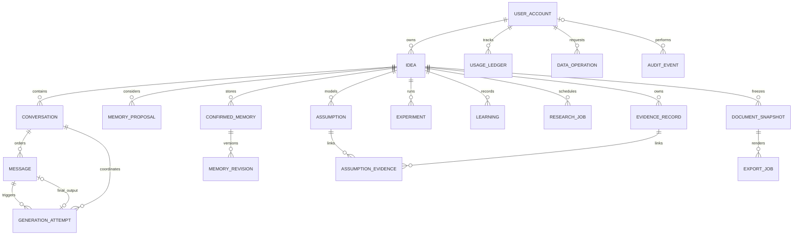

# Founder's Lens — LLD Phase 1B: Physical Database Design

**ID** FL-LLD-DB-002 · **Version** 0.1 · **Date** 2026-11-13 · **Status** Approved — Documentation Only (historical A07; declared Phase 3 amendments under P3D-A09, FL-P3-0.3-approved); not validated against a running database.

**Current controlled design:** approved P4-B01/B02 in§18 supersede earlier pending mapping proposals. The current Prisma artifact has24 models;no migration/runtime correctness is asserted. Historical dates/statuses above identify earlier revisions,not a new approval timestamp.

**Authority**: See approval provenance in [documentation index](../../README.md); `HLD.md` §5–9; `SRS.md` §4, §5, §7–8, §11–12; `logical-design.md` (Phase 1A). **Implementation assumption**: PostgreSQL 15+, pinned Prisma ORM **6.x**, Node.js 22, TypeScript. Exact supported patch versions must be selected and locked at repository bootstrap. Prisma 7 and later may differ: re-evaluate generator/config and migration integration if upgrading.

## Executive summary and decision gates

Phase 1A contained **20** logical entities. The reviewed proposal retains those 20 and adds IdempotencyRecord plus WebhookInbox and IdentityTombstone (23 physical models). This is a proposed v1 schema, not a verified production migration.

**Proposed engineering defaults for this design iteration**:
1. **Regeneration**: a single original user message may trigger multiple `GenerationAttempt` rows. Each completed attempt may own a distinct immutable final assistant `Message`. `GenerationAttempt.selectedAt` elects at most one completed response per trigger user message, enforced by a partial unique index. Selection is an application transaction on successful latest-turn completion; arbitrary user selection of historical alternatives is not exposed in v1. Historical alternatives remain for audit/history but are excluded from normal AI context assembly. This does **not** re-order prior conversation turns or duplicate the original submission.
2. **Evidence**: `EvidenceRecord` is private, idea-scoped, and represents **one finding**, not a global web page registry. It preserves origin, trust classification, source locator/publisher, observed/retrieved time, geography and limitations. Optional `(ideaId, dedupeFingerprint)` deduplicates **claim-level** findings. `AssumptionEvidence` is a many-to-many linkage with qualitative support/challenge relation. A URL is not a proof and a user report is not independent market evidence. No separate evidence-source registry in v1.
3. **Versioning**: `ConfirmedMemory.currentVersion` is a current-read projection backed by append-only `MemoryRevision`. `Assumption`, `Experiment` and `Idea` use optimistic `version` integers. `DocumentSnapshot` uses per-idea unique immutable version numbers, `draftRevision` CAS on editable previews, canonical content JSON, schema version and SHA-256 at approval; new edits create a new version instead of modifying an approved row. `ExportJob` points to one approved snapshot.

**Not finalized**: retention/deletion deadlines, storage provider/S3 lifecycle, vendor privacy terms, precise quota thresholds, and AWS deployment price. Those are product/release gates, not database values to fabricate. AWS is a deployment target, not a guaranteed $0 hosting solution.

## 1. Relational design and aggregate boundaries



`OutboxEvent` is the twentieth entity, omitted from the diagram because it has a polymorphic aggregate reference (`aggregateType`, `aggregateId`) rather than a physical FK to a single domain. The application validates its `kind` and `payload` schemas; no untrusted freeform dispatch.

### 1.1 Ownership

The root chain is Clerk verified subject → local `UserAccount.id` → `Idea.ownerId` → idea-scoped resources. API and worker repositories require authorized scope; `WHERE id = :id` on a private resource **alone is forbidden**. Child tables often carry `ideaId` redundantly so a composite FK can mechanically reject cross-idea links. This is purposeful denormalization for safety and faster scoped retrieval; it must be populated only from an authorized parent query, not a client-supplied body.

### 1.2 Canonical data rules

| Canonical concept | Authoritative record | Other representation |
|---|---|---|
| User identity | Clerk session/subject | `UserAccount` is local app ID and account state |
| Testable assertion | `Assumption.statement` | `ConfirmedMemory.assumptionId` may link without duplicating live statement |
| Confirmed knowledge | `ConfirmedMemory` + append-only `MemoryRevision` | `MemoryProposal` remains untrusted until accepted |
| Sourced finding | `EvidenceRecord` | `Learning` is founder interpretation, not an independent citation |
| Conversation transcript | User `Message` + *selected* final assistant message by attempt | Unselected generations kept for history, excluded from standard context |
| Reviewed PDF content | `DocumentSnapshot.content` where APPROVED | `ExportJob` only renders frozen content; cannot call AI after approval |
| Job lifecycle | PostgreSQL job/outbox rows | BullMQ/Redis tracks execution, not canonical business state |

## 2. Table-level specification

Read the full implementation columns and relation mappings in [`schema/schema.prisma`](schema/schema.prisma). Names are PascalCase SQL identifiers because there are no `@@map` mappings; quoted identifiers in [`constraints/guards.sql`](constraints/guards.sql) match this design. A later naming migration may switch to snake_case but **must** update the guards atomically.

| Table | Primary key | Important unique/index keys | Owner and lifecycle |
|---|---|---|---|
| UserAccount | id UUID | clerkSubject UNIQUE | Clerk mapping; ACTIVE/DISABLED/DELETION_REQUESTED |
| Idea | id UUID | ownerId + updatedAt index | Fixed owner; ACTIVE/ARCHIVED/DELETION_REQUESTED; version |
| Conversation | id UUID | (id, ideaId) UNIQUE; ideaId + updatedAt | Per-idea, server nextSequence |
| Message | id UUID | (conversationId, sequence) UNIQUE; submission key scoped | Per conversation; user/assistant final output JSON |
| GenerationAttempt | id UUID | triggerMessageId + attemptNumber UNIQUE; partial active/selected unique | State machine; one active per conversation |
| MemoryProposal | id UUID | ideaId + review status + createdAt | User review state and expected target version |
| ConfirmedMemory | id UUID | (id, ideaId) UNIQUE; ideaId + status | Current content + currentVersion |
| MemoryRevision | id UUID | (memoryId, version) UNIQUE | Append-only immutable history |
| Assumption | id UUID | (id, ideaId) UNIQUE; ideaId + status | Canonical statement, optimistic version |
| Experiment | id UUID | (id, ideaId) UNIQUE; ideaId + status | User-accepted status, optimistic version |
| Learning | id UUID | ideaId + createdAt | Approved founder interpretation |
| ResearchJob | id UUID | (ideaId, dedupeKey) UNIQUE | Durable budget/state |
| EvidenceRecord | id UUID | (ideaId, dedupeFingerprint) UNIQUE | One private finding with provenance |
| AssumptionEvidence | (assumptionId, evidenceId) | evidenceId index | Composite idea-scoped FKs |
| DocumentSnapshot | id UUID | (ideaId, version) UNIQUE | DRAFT/REVIEWING/APPROVED |
| ExportJob | id UUID | (snapshotId, idempotencyKey) UNIQUE | Stable output storage metadata |
| OutboxEvent | id UUID | status + nextAttemptAt; lease fields | Event relay/reconciliation |
| AuditEvent | id UUID | actorId/time; ideaId/time | Sanitized metadata; retention policy needed |
| UsageLedger | id UUID | accountId + reconciliationKey UNIQUE | Append-only usage reconciliation |
| DataOperation | id UUID | accountId + requestedAt | Portable export / deletion intent |

## 3. Regeneration and ordering: exact rule

**Source of truth**: user messages have their own monotonically increasing `Message.sequence`; assistant responses are also appended with server-generated sequences, but **display order is based on the logical user-turn grouping**, not blindly sorted message sequence when an older turn is regenerated.

A normal transcript query takes user messages in ascending sequence; for each eligible user turn, it obtains the selected completed `GenerationAttempt` and the final `Message` where `generationAttemptId = attempt.id`. System context excludes nonselected assistant outputs and any interrupted token stream. Regenerating a turn with later user messages present changes a historical turn; the API must warn that downstream already-generated answers are not automatically recomputed. For v1, **restrict regeneration to the latest user turn** unless a deliberate future product decision enables historical branches. This avoids misleading downstream state.

**Attempt state / selection rules**:
- Exactly one active generation per conversation (`PENDING`, `RUNNING` or `CANCEL_REQUESTED`) via partial unique index.
- An attempt may be selected only when status `COMPLETED` (SQL CHECK).
- At most one attempt per trigger user message may have `selectedAt` not null (partial unique index).
- Completion means committed final `Message`, valid structured payload, and terminal attempt state in one transaction. An AI partial stream is not a completed message.
- In a single transaction, clear old selected attempt then select newly completed alternative. Race-safe when locking the triggering `Message` row, not by relying on last-write-wins; completion must also match the current worker epoch.
- A regeneration request has its **own idempotency contract**. `GenerationAttempt.regenerationKey` is nullable for the initial attempt and unique per conversation for explicit regeneration requests; replayed regeneration keys must return the existing attempt.
- A selected attempt should not later transition away from `COMPLETED`.

**Design consideration**: With assistant response messages appended separately, a simple `ORDER BY sequence` alone is insufficient to rebuild the selected transcript. API LLD must formalize a transcript projection query.

## 4. Evidence and provenance

`EvidenceRecord` combines the observation/finding and original locator. In P0, this is a deliberately compact model: the same URL can produce different evidence claims, and the same claim may be linked to multiple assumptions. `dedupeFingerprint` must be generated from a stable canonical form including idea scope, normalized source locator, normalized claim and context scope. A bare URL is insufficient. Missing source fields means `UNASSESSED`/`UNVERIFIABLE`, never source checked. `SOURCE_CHECKED` means the cited source metadata was checked; **it does not prove the business claim**.

A user interview is `EvidenceRecord.origin = USER_REPORT` with optional observation date and limitations; the founder's conclusion is `Learning`. Automatic promotion of user report to independent external evidence is disallowed. `AssumptionEvidence.relationship` says SUPPORTS, CHALLENGES or INCONCLUSIVE; it does not assign fake numeric business-success scores.

## 5. Versioned writes and transactions

### 5.1 User message submission

Transaction (ideally PostgreSQL `READ COMMITTED`):
1. Verify authorized owner, ACTIVE idea, ACTIVE conversation.
2. If `(conversationId, clientSubmissionKey)` exists, return the existing operation after validating its original payload hash. Compare immutable `Message.submissionSha256` to the incoming canonical payload hash and reject a same-key/different-body replay.
3. Acquire `FOR UPDATE` lock on `Conversation` row; confirm no active generation.
4. Insert USER `Message` with current `nextSequence`, advance counter, insert `GenerationAttempt(1, PENDING)`.
5. In that same transaction claim the generic ledger, reserve usage, insert OutboxEvent and store original 202 references. Commit; dispatcher queues the generation, then an independent worker invokes the model outside the transaction. API never directly starts generation. Return conflict for a different new request during an active generation.

### 5.2 Finalize assistant response

Transaction: lock `Conversation` and attempt; validate attempt RUNNING, matching leaseEpoch, live lease/deadline, account ACTIVE and idea ACTIVE in the same lifecycle-locked transaction; insert ASSISTANT `Message` linked to this attempt at next sequence; increment sequence; set attempt COMPLETED + `completedAt` + selectedAt if first/explicit selection; append any **pending** `MemoryProposal` rows and audit metadata; commit. Only then emit final stream completion. Failed persistence implies failed/uncertain generation, never a confirmed completion.

### 5.3 Memory approval

Transaction: lock `MemoryProposal`, check PROPOSED and proposal.version against If-Match, confirm identity, idea ACTIVE, if targeting existing `ConfirmedMemory` compare `expectedMemoryVersion`; update current content and version using CAS, insert `MemoryRevision(memoryId,version)`, then finalize proposal status with reviewer/time, create audit event; all-or-nothing. The proposal source message and target memory must be from the same idea. No AI-generated proposal may write memory directly.

### 5.4 Assumptions and experiments

Update where `(id, ideaId, version)` and increment version. A stale If-Match returns `412 PRECONDITION_FAILED`; missing If-Match returns 428. Composite FK prohibits linking another idea's assumption/experiment/evidence. User approval is required to transition suggested experiment to planned or in-progress; state transitions validated by application and tested.

### 5.5 Research and document jobs

Create job + `OutboxEvent` in the same PostgreSQL transaction. Outbox dispatcher claims rows by `FOR UPDATE SKIP LOCKED`, publishes BullMQ with a stable `jobId`, records publish status and reclaims stale lease. Each worker rechecks idea ACTIVE and job state before committing output; both queue and business writes must be idempotent. Never hold an open DB transaction during web fetch, model call, Redis network call, PDF render or object upload.

Snapshot approval computes SHA-256 from a deterministic **canonical JSON serialization** of `schemaVersion` + typed content. Store hash and approving user; guard prevents mutation afterward. Rendering downloads this frozen JSON, not live idea state. Upload to private storage before committing COMPLETED with stable object key/checksum. Repeated export must return/reconcile the same intent; orphaned uploads are cleaned by a janitor.

## 6. SQL-only invariants

Prisma schema covers tables, types, foreign keys, ordinary unique constraints and indexes. [`constraints/guards.sql`](constraints/guards.sql) adds PostgreSQL features missing from our pinned Prisma 6 schema:

- One active generation per conversation (`WHERE status IN (PENDING, RUNNING, CANCEL_REQUESTED)`).
- One selected attempt per user turn (`WHERE selectedAt IS NOT NULL`).
- Append-only `MemoryRevision` trigger.
- Approved snapshot immutability trigger.
- Evidence source-check provenance requirements and common value checks.
- Completed export artifact metadata requirement.

**Review caveat**: The snapshot trigger blocks ordinary deletion of an approved snapshot. The **privileged, audited deletion pathway** is specified in §13; scoped guard and role behavior must be proved against PostgreSQL, together with storage cleanup. Do not grant general API/worker accounts ability to disable triggers.

**Not yet enforced in SQL**: role of generation trigger user message, selected assistant response completeness, snapshot APPROVED requirement at `ExportJob` insertion, matching current memory revision, all state transitions, deletion-time access policy, or independently enforced row-level security. API service and transactions enforce them; add DB triggers/constraints for residual high-risk cases after prototyping and testing.

**Important**: PostgreSQL FKs and partial indexes enforce structural relationships, **not** Clerk-based authorization. API and workers always resolve owner-scoped idea first. PostgreSQL RLS may be considered later with verified pooled-connection session context; don't incorrectly assume Prisma alone supplies RLS.

## 7. Index policy

Initial indexes exist for the most common owner/idea/recentness and status access patterns. The partial active-generation and selection indexes protect correctness, not only performance. Composite unique constraints on `(id, ideaId)` exist to support cross-idea FK integrity. Additional indexes are permitted only after query plans and representative data justify them.

Benchmark with ~100k messages, 5k ideas and 20k evidence records in synthetic data; run `EXPLAIN (ANALYZE, BUFFERS)` with owner-scoped conditions and keyset pagination. These are performance test sizes, **not forecasts**. Avoid pagination by OFFSET over unbounded history.

## 8. Migration and deployment plan

1. Pin Prisma 6.x and compatible Node/TypeScript versions; check `npx prisma validate` in CI. Set `DATABASE_URL` and a direct migration DSN where provider pooling requires it.
2. Initialize package and copy [`schema/schema.prisma`](schema/schema.prisma). Generate the baseline with `npx prisma migrate dev --name initial_schema --create-only` against a disposable **development** PostgreSQL 15+.
3. Append [`constraints/guards.sql`](constraints/guards.sql) into the generated migration SQL **after** the generated CREATE TYPE/TABLE/FK statements. Review generated SQL and enforce migration ownership in code review. The guard script is a source fragment, **not a standalone initial migration**.
4. Apply migrations to fresh test DBs. Run `npx prisma validate`, `npx prisma generate`, and the integration suite. Confirm the guards exist by querying `pg_indexes`, `pg_constraint`, and `pg_trigger`. `prisma db push` is prohibited in deployed environments.
5. Promote with `prisma migrate deploy` as a **single release job**, never every API instance. For future changes use additive expand → migrate/backfill → contract, with rollback/fix-forward and backup restore drills.
6. Size database connections for API + workers; avoid exhausting low-tier managed PostgreSQL connection caps. Secrets are held in environment/secret manager, not repository.

### 8.1 Example SQL for outbox dispatch

```sql
BEGIN;
SELECT id FROM "OutboxEvent"
WHERE "status" = 'PENDING' AND "nextAttemptAt" <= now()
ORDER BY "nextAttemptAt", "createdAt"
FOR UPDATE SKIP LOCKED LIMIT 25;
-- Mark selected rows CLAIMED and leaseUntil in the SAME transaction.
COMMIT;
-- Publish to BullMQ outside transaction; mark PUBLISHED in separate guarded write.
```

`CLAIMED` rows require a lease-expiry reconciler; merely querying PENDING forever would strand claims.

## 9. Testing and acceptance

See [`validation/integration-test-plan.md`](validation/integration-test-plan.md) for 30 tests covering tenant isolation, composite FKs, idempotency, concurrent generation, version CAS, append-only history, snapshot immutability, provenance checks, Redis/DB crash windows, purge behavior, migration drift and query performance. Run on actual PostgreSQL—not SQLite/in-memory mocks—because partial indexes, triggers, SQL enum types and transaction semantics matter.

### 9.1 Traceability

| SRS | Physical mechanism | Tests |
|---|---|---|
| FR-003/004, DR-001 | UserAccount → Idea owner chain + scoped repository + composite FKs | DB-01, DB-06–10, DB-29 |
| FR-009–012, DR-004/009 | Message submission key, attempt states, partial uniqueness | DB-02–06, DB-22 |
| FR-022–028, DR-002 | Proposal state, memory CAS, append-only revision | DB-11–13, DB-23 |
| FR-029–033, DR-005 | Assumption/Experiment/Learning scope and versions | DB-07–09 |
| FR-034–039, DR-003 | Evidence provenance, bounded research job, idea scope | DB-10, DB-14–15, DB-19–21 |
| FR-041–044, DR-006 | Versioned approved snapshot, guarded export | DB-16–18 |
| FR-005, DR-007 | Idea DELETION_REQUESTED gate, data operation | DB-20, DB-24 |
| FR-045 and ops | Usage ledger idempotency, outbox retries | DB-19–21, DB-30 |

## 10. Remaining blocking issues before implementation approval

| ID | Issue | Proposed closure |
|---|---|---|
| DB-B03 | Role check for trigger user message and terminal assistant response cross-row | Implement guarded transaction and integration test; consider DB triggers if defense-in-depth requirement escalates |
| DB-B04 | New-account / idea purge flow for approved snapshots and historical revisions | Design privileged purge SQL and vendor/object-storage cleanup after retention policy is approved |
| DB-B05 | Need database-level status-transition enforcement scope | Review whether dedicated immutable triggers warranted on high-risk tables |
| DB-B06 | PostgreSQL + Prisma generated schema/migrations **not executed or validated** in this environment | Run `prisma validate`, Migrate, integration tests against target pinned Prisma 6 and PostgreSQL 15+ |
| DB-B08 | Explicit snapshot approval must confirm viewer is the sole account owner | Enforce in scoped service and audit; optionally store approval user FK |

**Approval recommendation**: Request-key hashing, regeneration idempotency, and draft CAS fields are now modeled; do not label Phase 1B implementation-ready until DB-B06 is closed and a real PostgreSQL integration suite passes. Remaining retention/privacy issues must be resolved before any public beta.


## 11. Reconciliation mappings and unresolved safeguards

The [integration matrix](../04-integration-review/consistency-matrix.md) owns cross-layer mapping; [state machines](../04-integration-review/state-machines.md) own allowed lifecycle transitions. Schema fields are now proposed for generic replay, epochs/deadlines, proposal/preferences/conversation versions and usage reservations. These fields do not enforce transactional compare-and-swap by themselves. Ledger responseRef contains only enough safe IDs/scalars to reconstruct the original accepted DTO, never a signed URL; original HTTP status is responseStatus. Immutable content may be read only after current authorization.

Mapping: public clientSubmissionId -> Message.clientSubmissionKey, semantic content hash -> submissionSha256; selected -> selectedAt != null; finishedAt -> completedAt; memory.version -> currentVersion; snapshot.version -> immutable document version, snapshot.draftRevision -> draft CAS/ETag, contentHash -> contentSha256; evidence.sourceUrl -> sourceLocator. AssumptionEvidence identity is the pair (assumptionId,evidenceId), not a triple; changed relationship requires explicit delete/recreate (no silent overwrite).

UsageLedger is a reservation/current settlement projection, not wholly append-only: RESERVED -> SETTLED or RELEASED once under guarded write; finalized accounting is immutable. Crash reconciliation uses reservationId; provider billing uncertainty remains visible. Bounded checkpoint/export-manifest contracts are now specified in §12 and state-machines. Privacy bypass, tombstone and inbox design are specified in §12–13; no general trigger-disabling privilege is authorized. Generation terminal transition enforcement remains a service/transaction obligation until PostgreSQL race tests prove it. Existing selectedAt may change only to replace selection atomically on eligible successful regeneration; terminal execution result remains immutable.


Outbox poison handling: exhausted dispatch transitions to FAILED with lastErrorCode and dispatchAttempts; alerts are mandatory. Re-drive is a reviewed operational action with fresh claimEpoch, lifecycle check and audit, never an infinite automatic reset. DataOperation also has leaseEpoch/lease/deadline fields; its bounded checkpoint/export-manifest schemas are specified in state-machines and §12. Usage reservation measuredUnits starts at zero on admission, then one guarded settlement supplies actual usage or marks uncertainty for reconciliation.


## 12. Final privacy and identity persistence contract

Historical design status at introduction: In Review. Current documentation approval: A07; subsequent declared Phase 3 amendments: P3D-A09. No migration executed. Existing models cannot retain a unique webhook receipt and deleted identity after account removal without conflating user idempotency or retaining private accounts. Therefore exactly two operational models are added to the existing PostgreSQL database: WebhookInbox and IdentityTombstone; no additional service/database. Count is 23 (original 20 + request ledger + 2 operational identity models). Their field definitions are in schema/schema.prisma; no duplicate provider-event ledger elsewhere.

WebhookInbox unique(provider,clerkInstanceId,eventId) serializes deliveries; bodySha256 detects ID/payload mismatch. subjectKey is a HMAC, not a client identity input; row stores normalized verified metadata, never full event JSON. Status/epoch/lease/deadline/attempt/nextAttemptAt support durable retry and poison alerts. IdentityTombstone unique(instance,subjectKey) and subject-lock protocol survive UserAccount hard deletion. Neither has an account FK. Raw Clerk subject exists only on the live account mapping; suppression uses keyed hashes. Retention/rotation and deliberate new-subject signup are canonical in security §16 and state-machines; those documents govern transaction predicates, not enum defaults alone.

AccountStatus/IdeaStatus use DELETION_REQUESTED/PURGING/DELETED instead of the retired ambiguous deletion marker. ACTIVE-only admission remains unchanged; existing DISABLED and ARCHIVED states do not grant write access. DataOperation.deletionState is authoritative after parent deletion, with status expressing progress/retry separately. deletionScopeKey=account:<configured instance>:<subjectKey> or idea:<UUID> (server-derived); nullable for EXPORT, unique for retained deletions. Account deletion reuses/subsumes child operations under account-first locking. DataOperation.accountId becomes nullable with SET NULL so receipt survives account purge; ownerSubjectKey/instance/subjectKeyVersion protects narrow status access without preserving content. ideaId remains non-FK restore/purge scope metadata. On completion erase checkpoint/details/artifact references after acknowledged cleanup, retain only receipt policy/time/scope, then expire under approved policy.

DataOperation checkpoint has DELETE or EXPORT variant, schemaVersion=1, max 32 KiB. DELETE fields/allowlisted phases are in state-machines. EXPORT variant: type=EXPORT, cutoffAt, manifestObjectKey/hash, rowCounts (known domain keys only), schemaVersions, archivePhase (PIN,PACKAGE,UPLOAD,VERIFY), lastBatchCursor and expiresAt; no private rows in checkpoint itself. Export manifest contains authorized content under encrypted private storage and is erased with the archive/parent. Export cutoff materialization must be bounded (proposed maximum 20 MiB content per request, explicitly refuse oversized requests with recoverable guidance instead of holding an unbounded transaction). Same snapshot/manifest metadata is checksummed before worker use; limits and ZIP format remain Pending Product Approval. No new public upload feature is introduced.

Idea.contextEpoch increments on memory accept/edit/remove and lifecycle gate. GenerationAttempt.contextEpoch/dispatchAuthorizedAt captures provider-dispatch authorization boundary; final commit verifies the current idea epoch. This prevents a context assembled before removal from becoming newly authorized or committed after removal without revalidation, while acknowledging previously in-flight external requests. It does not duplicate generation leaseEpoch (execution ownership). ExportJob and EXPORT DataOperation use artifactState AVAILABLE/EXPIRED/PURGED and artifactExpiresAt separate from terminal execution status; retain opaque key/checksum only until policy expiry/purge. No signed URL is persisted.

## 13. Privileged purge migration and transaction contract

Define the following reviewed DB entry point at implementation: privacy_purge_batch(operationId UUID, expectedEpoch integer, phase allowlisted text, batchLimit integer 1..500) -> deletedCount,nextCursor. It is SECURITY DEFINER owned by NOLOGIN fl_purge_owner, fixed qualified search_path, not executable by PUBLIC/API/general workers. Dedicated privacy login has EXECUTE only, not ownership, direct private-content SELECT, role membership or arbitrary DELETE. Migration owner is separate. Procedure rejects any nondeletion operation, state other than PURGING, expired lease, mismatched epoch, disallowed phase or target outside its operation. It locks operation, account/idea gates and bounded child batch; transaction-local operation and epoch settings are used only inside that validated invocation. Operator re-drive cannot change target or regain ACTIVE.

The invoker-mode guard helper in constraints/guards.sql checks both current_user and the locked operation's scope/epoch/lease before allowing DELETE of normally immutable rows. It never authorizes UPDATE of revisions or approved snapshots. SECURITY DEFINER procedure owner cannot be reached by SET ROLE from app logins. API-set custom configuration cannot bypass the role check. Migrations must revoke PUBLIC EXECUTE on the purge entry point, assign exact grants, schema-qualify identifiers, and prove SQL-injection/search_path and ordinary-role rejection tests. No trigger is disabled globally, and deleting one idea cannot authorize another idea's rows. The helper and grants require real PostgreSQL role tests; naming a role does not prove privilege safety.

Purge order for FK cycles: delete response Message (FK to attempt), then GenerationAttempt (FK to trigger Message), then triggering Message; delete revisions before memory and exports before snapshot. Cross-domain proposals/research/source links are removed first in scoped batches as required. Procedure locks lifecycle while deleting and writes checkpoint/counts transactionally. External objects/providers are handled outside transactions with durable manifests and acknowledgments; a DB DELETE is not proof of object deletion. The final account transaction detaches receipts and deletes local mapping; root DELETED is mirrored to retained operation even after root row is absent. state-machines is the authority for backup/restore residuals and failure recovery.


DataOperation.reverificationKey is an optional unique keyed digest of the verified signed reverification ID, bound to its deletion scope/policy. It is required for owner-originated fresh deletions after policy approval, absent for provider-originated deletion. Same-scope deletion replay resolves existing operation without consuming another token. Expiry removes only completed eligible operation receipts; no general authentication token or claim set is persisted.


Account-export DataOperation persists capturedAt and fileSha256 on successful manifest pin/archive completion; checkpoint retains manifest hash, schemaVersions and archive progress until artifact expiry/purge. Public capturedAt is the pinned consistent data cutoff, not the initial request time. Capture/upload/final pin and privacy lifecycle are synchronized as specified in state-machines.


## 14. Explicit owner approval reconciliation

P2D-P01–P05 are recorded in decision-log from the latest owner instruction; no approval date is supplied. DataOperation.policyVersion=p2d-privacy-v2 binds active retention until deletion and the approved proposed 30-day maximum active-system purge target. Derive activePurgeTargetAt=requestedAt+30 days on deletion DTOs/monitoring; do not add a competing database deadline or reset requestedAt on retry. leaseUntil/deadlineAt remain execution/recovery controls. BackupResidualUntil and provider obligations are tracked separately; no seven-day backup recommendation becomes an approved or validated capability. Existing receipts preserve their own policy version.

Memory currentVersion/contextEpoch, lifecycle/tombstone, and approved snapshot hash/version/draftRevision mechanics implement the approved product behavior without schema/SQL changes in this approval-only revision. PDF admission reserves at most two active jobs per account under the account lock, validates canonical content <=1 MiB, and workers enforce 60-second/10 MiB output limits (API §17). These are engineering defaults under delegated bounded-export approval; prove concurrent admission/worker enforcement in PostgreSQL/integration tests. Retained historical text, snapshots and already authorized external requests follow the documented P2D-P04 boundary and full privacy purge. No application implementation or runtime validation is asserted.


## 15. Phase 3 approved-principle design amendments

The owner explicitly approved P3-P01–P05 and subsequently the complete Phase 3 package under P3D-A09, FL-P3-0.3-approved (recorded in Phase 3D §11/17). No date/signature/commit is inferred. This revision intentionally amends current API/DB specifications; historical A07 FL-P2D-1.0-approved manifest is preserved unchanged. Changed paths and baseline hashes are recorded in Phase 3D §16. These are design specifications only; no migration or application code executed.

### Versioned assistant message persistence and compatibility

New validated assistant results use Message.contentSchemaVersion=2 with JSON {text,assistantContent}. text is the canonical assistant messageText; assistantContent.schemaVersion=1 contains primaryStrategy, optional singleton card, citationRefs,proposalIds,actions and optional nextQuestion. These three version axes are distinct: contentSchemaVersion2 is persisted JSON format; assistantContent.schemaVersion1 is AI response shape; assistantResponseVersion2 is opt-in HTTP representation. User messages and existing assistant version1 {text} rows remain unchanged. No automatic backfill/invented historical strategy/card/citations. Reader supports1/2; unknown format fails closed, not guessed. All final fields are validated before short guarded response/selection/proposal/usage transaction; primaryStrategy must equal GenerationAttempt.strategy.

Public default Message.content remains string. Existing GET transcript default/exact version1 excludes assistantContent even for new stored format2 rows. Explicit assistantResponseVersion=2 returns StructuredMessageList and assistantContent only for eligible ASSISTANT rows. Actual Message schema stays unchanged. An unnegotiated extra response property is not assumed compatible with strict legacy validators. See API §18/OpenAPI0.3.0. Same logical selected-turn projection, ownership, pagination and no-store rules; cursor binds representation version. No new endpoint or change to accepted submission/status/cancel/SSE contracts.

### Minimal durable orchestration metadata

GenerationAttempt.orchestrationMetadata Json? is the sole added column; no new entity or private-context store. Object metadataSchemaVersion=1, mandatory for newly dispatched Phase3 attempts: promptPolicyVersion,strategyPolicyVersion,contextSchemaVersion,outputSchemaVersion,retrievalPolicyVersion,providerAdapterVersion,contextBuilderVersion,modelConfigurationVersion (opaque immutable registry/artifact IDs, each <=64 characters). Optional evaluationDatasetVersion/evaluationRunId and requestCorrelationId identify relevant evaluation/debug runs; <=64 characters each, never an auth/session token. Optional selectedItemCounts uses allowlisted domain/count keys and nonnegative bounded integers. At most4KiB of PostgreSQL jsonb textual bytes (provisional engineering bound). Additional keys rejected; no free-form debugging blob, raw prompt, hidden reasoning, private snippets, removed content, raw provider response or duplicated context. Existing provider/model/strategy/contextEpoch columns remain authoritative and are not duplicated inside the JSON. Registry references must resolve to immutable release/config artifacts; do not silently change a referenced configuration in place.

Set metadata under current lease before provider-dispatch authorization; subsequent safe pre-dispatch rebuild may update selection counts under epoch guard. Freeze explanatory version/config references when dispatchAuthorizedAt commits; never mutate terminal historical attempts. Unstarted/legacy rows may be null with honest unknown provenance, no invented backfill. The same finalization/context/lifecycle guards still apply. Cleanup purges the attempt+metadata with parent data; allowed metadata is sensitive operational provenance, not automatically anonymous. No public DTO includes orchestrationMetadata. Guards.sql adds object/byte-size and basic format2 shape CHECKs; full strict versioned schema/ownership/claim validity are service gates. Real role/migration/JSON-null/missing-key/race tests remain unexecuted.

### Migration and compatibility acceptance (planned)

Add nullable JSON column and reviewed guards through a generated migration; baseline A07 remains historical, never rewrite its manifest. Expand readers for both stored formats before writing2; opt-in API representation can be disabled while text-only reader continues to project text from both formats. Do not roll back to a reader unable to parse2 after2 data exists; retain compatible text projection, stop new structured writes and fix forward. SQL constraints do not prove application correctness. Test legacy rows/old clients, USER payload rejection, malformed/missing/null fields, mismatched strategy/evidence, unknown versions, metadata size/forbidden keys, privacy purge, stale epochs and failed transaction rollback. No implementation bootstrap is authorized by this amendment.


## 16. Phase 4 controlled projection mappings and explicit blockers

P4-AM01–04 are owner-approved design amendments, not migrations/runtime proof. Existing23 Prisma models and guards.sql stay byte-identical in this revision. No new entity,column,datastore or service. [API§19](../02-api-security/api-contracts.md#19-phase-4-controlled-api-amendments--approved-design-not-package-sign-off) owns negotiated HTTP contracts; [change register](../06-frontend/controlled-amendments-0.3.json) records raw old/new content hashes without changing A07/P3 manifests.

| Projection / read | Existing physical source | Invariant / unknown handling |
|---|---|---|
| SubmissionCorrelation | Message.clientSubmissionKey unique per conversation + triggeringAttempt.attemptNumber1 | USER/same idea/conversation/current owner; initial attempt, not latest selected regeneration;no match404 inconclusive,corrupt linkage503,no write |
| MemoryProposalV2.version/proposedText | MemoryProposal.version/candidate.text | Required actual values; malformed candidate fails503,never invented; accept target expectedMemoryVersion still server-side |
| ProposalSource | MemoryProposal.sourceMessageId→Message(conversationId,role,ideaId)→Conversation | Current scope authorization before disclosing IDs;raw provenance JSON never serialized;unknown/unavailable source fields null,no private excerpt |
| LearningV2.observation/interpretation | Learning.observation nullable / Learning.interpretation | observation omitted/null stays null;v1 reflection is interpretation alias, v2 explicit names;origin USER_REPORT/approvedById principal, no silent parsing |
| ExperimentV2.method/successCriteria | Experiment.plan.method / Experiment.successCriteria JSON string scalar | Supported bounded strings only,unmapped legacy JSON→null,never stringify/truncate or alter history |
| EvidenceLinkList | AssumptionEvidence(assumptionId,evidenceId,relationship,createdAt) | Existing composite PK/same-idea FKs;cursor(createdAt,evidenceId),owner/idea/assumption-bound;do not expose internal note |
| Learning replay projection | IdempotencyRecord.algorithmVersion/requestFingerprint/responseRef | Keep v1 algorithm;include normalized projection2 in new fingerprint;original row+representation reconstructs immutable Learning after current auth, not a mutable current record disguised as original |

P4-B01: title/hypothesis write/read mapping is absent from preceding specs despite required Experiment.hypothesis and API.title; no new automatic derivation chosen. P4-B02: LearningCreate.evidenceIds has no physical learning-evidence relationship; AssumptionEvidence is not a silent substitute. Both require explicit technical/mapping review before complete experiment/learning acceptance; no entity is added merely to hide these gaps. New nullable observations/unsupported JSON unknowns do not solve missing business mappings. Existing JSON-shape/role/FK/index/query concurrency behavior remains unexecuted; see DB-P4 tests.

## 17. Final mapping investigation and precise proposals — Pending Owner Approval

Historical v0.4 investigation. The owner has now explicitly approved P4-B01/B02. **Current accepted design is§18 andAPI§21**,not the pending statuses/alternatives below. In particular,current create3 returns a minimal operational receipt,not the earlier proposed private full-body response. Preserve source evidence andMAP IDs as history;no historical paragraph overrides the current schema/contract.

**Status: proposal only, not an active schema/contract amendment.** The owner authorized investigation and preparation, not approval of a new entity or incompatible contract. Active Prisma/SQL/OpenAPI/inventory remain unchanged, with23 models and53 operations. Both P4-B01/B02 remain open pending the decisions below. Historical A07/P3 manifests and the Phase4 controlled-amendments0.3 register are preserved verbatim. This section owns the proposed physical design; [API§20](../02-api-security/api-contracts.md#20-mapping-resolution-proposals--pending-owner-approval) owns proposed external changes. All SQL/Prisma fragments are design examples, not migrations or validated executable artifacts.

### 17.1 Source-exact evidence and rejected shortcuts

| Source | Actual declaration / absence | Consequence |
|---|---|---|
| [OpenAPI ExperimentCreate/ExperimentPatch/Experiment/ExperimentV2](../02-api-security/openapi.yaml) | Create requires title/method;title<=200. PATCH permits title/method/status. Both response views require title. No request/response carries hypothesis | A title cannot be traced to a declared column/JSON key;legacy create also cannot supply required stored hypothesis |
| [Prisma Experiment](schema/schema.prisma#L360) | hypothesis:String required;plan:Json;successCriteria:Json;no title column;optional assumptionId | plan can hold a distinct title key without changing hypothesis;it does not establish a pre-existing mapping or supply a missing hypothesis |
| API§12/19.5 andphysical§16 | Only method→plan.method andJSON-string criteria mapping are specified | Neither title=hypothesis nor plan.title already being populated is established |
| [Prisma Assumption](schema/schema.prisma#L343),SRS FR-031/032 and§7.1 | Assumption.statement is a separate claim;Experiment has a separate hypothesis;Learning interpretation/observation remain separate | Do not rename a hypothesis,derive one from a title,or silently use the current linked assumption as the experiment's historic hypothesis |
| OpenAPI LearningCreate/LearningCreateV2 | Both accept optional evidenceIds UUID array,max20;current response views do not return evidenceIds | Durable capture/read-back cannot be demonstrated from the wire contract alone |
| [Prisma Learning](schema/schema.prisma#L380) | ideaId,optional experimentId,observation?,interpretation,origin,approvedById,createdAt;no evidence FK,array,JSON metadata orlink relation | No suitable existing learning-specific association exists |
| [EvidenceRecord/AssumptionEvidence](schema/schema.prisma#L419) | Evidence has(id,ideaId) unique;AssumptionEvidence PK(assumptionId,evidenceId),same-idea FKs andrelationship | This table records an assumption↔evidence proposition,not learning↔evidence membership;reusing it would change meaning andcannot distinguish two learnings for the same experiment |
| [HLD§6.2](../../architecture/HLD.md),[logical model§4–7](logical-design.md),[SQL guards](constraints/guards.sql) | No LearningEvidence table/array orother learning-specific evidence persistence;Learning lacks unique(id,ideaId) needed by a composite FK | A durable association andits same-idea constraint must be explicitly proposed;no existing migration/guard can be claimed to implement it |

### 17.2 P4-B01 recommendation: distinct plan title plus explicit hypothesis input

**Recommend a JSON contract mapping, not a redundant title column:** ExperimentCreate.title→Experiment.plan.title;GET response.title←that same stored string. plan remains an object containing independent title/method fields andother supported keys. Title is a display label;hypothesis is a testable claim. Rename updates only plan.title under existing version/If-Match CAS;never hypothesis. PATCH method updates only plan.method;preserve all other JSON keys. A new explicit hypothesis input writes Experiment.hypothesis independently. No new title field,entity orDDL is needed for this mapping. Its JSON validation andAPI compatibility changes still need explicit approval;the absence of DDL does not make this an already accepted mapping.

Keep existing hypothesis NOT NULL: SRS§7.1 lists hypothesis as a mandatory logical attribute. Require an explicit nonempty hypothesis in proposed version3 create input (API§20),rather than weakening that invariant. Existing title/method-only create cannot honestly retain an unconditional201 promise while satisfying a required hypothesis. **This is an unresolved legacy-create compatibility decision, not a documentation typo.** Recommended owner choice: introduce explicit version3 creation,document the legacy create limitation andrequire old create clients to upgrade;do not claim backwards-compatible availability. Alternative nullable/unknown hypothesis would require an explicit SRS/logical/Prisma policy amendment andis not recommended or applied here. Copying title orAssumption.statement is rejected unless a separately approved,explicit user action actually supplies that hypothesis.

Legacy preservation: leave all stored hypothesis values andJSON bytes unchanged. Read a title only from a validated plan.title string;never infer it from hypothesis. Version3 allows title:null for unrecorded legacy labels;version1/2 schemas still require strings andmust fail safely with503 PROJECTION_UNAVAILABLE if a row has no supported title,not invent a placeholder fact orreturn a breaking null. Only a normal explicit owner title edit may populate a missing key;unsupported/nonobject legacy plan requires409 LEGACY_PLAN_REQUIRES_REVIEW andreviewed conversion preserving its data. No bulk JSON rewrite,backfill orautomatic title generation. If a real dataset exists later,inventory JSON shapes,round-trip samples andprove preservation before any approved conversion. In this documentation-only repository,no deployed-data inventory is asserted.

### 17.3 P4-B02 recommendation: one explicit learning-evidence join andcapture marker

**Recommend one new domain association,LearningEvidence,not a new service/database.** A learning may cite multiple records andan evidence record may support multiple learnings. One Boolean marker on Learning distinguishes old unknown linkage from a newly recorded,explicit empty set. Without that marker,no join rows cannot distinguish lost legacy intent from a correctly saved empty array. Neither observation norinterpretation should be overloaded with source IDs oropaque serialized metadata.

Proposed Prisma deltas only (do not copy into the active schema before approval):

```prisma
// additions inside Learning
evidenceLinksRecorded Boolean @default(false)
evidenceLinks LearningEvidence[]
@@unique([id, ideaId])

// addition inside EvidenceRecord
learningLinks LearningEvidence[]

model LearningEvidence {
  ideaId     String @db.Uuid
  learningId String @db.Uuid
  evidenceId String @db.Uuid
  learning Learning @relation(fields: [learningId, ideaId], references: [id, ideaId], onDelete: Restrict)
  evidence EvidenceRecord @relation(fields: [evidenceId, ideaId], references: [id, ideaId], onDelete: Restrict)
  @@id([learningId, evidenceId])
  @@index([ideaId, learningId])
  @@index([evidenceId, ideaId])
}
```

The proposed model count becomes24 only after explicit approval;active count stays23. Shared ideaId in both composite FKs enforces that Learning andEvidence belong to the same idea. Parent ownership/lifecycle remains an application authorization check,not something a foreign key can prove. Composite primary key prevents duplicate membership;no relationship/trust field,extra row UUID orduplicated source text is needed. The idea-leading index supports bounded scoped purge;the evidence-leading index supports FK/reverse dependency checks. Existing EvidenceRecord already has unique(id,ideaId);Learning needs the proposed matching unique key.

Corresponding proposed DDL (design only,not generated/applied/parsed by PostgreSQL):

```sql
ALTER TABLE "Learning" ADD COLUMN "evidenceLinksRecorded" boolean NOT NULL DEFAULT false;
ALTER TABLE "Learning" ADD CONSTRAINT "learning_id_idea_unique" UNIQUE ("id", "ideaId");
CREATE TABLE "LearningEvidence" (
  "ideaId" uuid NOT NULL,
  "learningId" uuid NOT NULL,
  "evidenceId" uuid NOT NULL,
  PRIMARY KEY ("learningId", "evidenceId"),
  FOREIGN KEY ("learningId", "ideaId") REFERENCES "Learning" ("id", "ideaId") ON DELETE RESTRICT,
  FOREIGN KEY ("evidenceId", "ideaId") REFERENCES "EvidenceRecord" ("id", "ideaId") ON DELETE RESTRICT
);
CREATE INDEX "learning_evidence_idea_learning" ON "LearningEvidence" ("ideaId", "learningId");
CREATE INDEX "learning_evidence_evidence_idea" ON "LearningEvidence" ("evidenceId", "ideaId");
```

Prisma migration index/constraint names must be reconciled with final generatedDDL,not executed twice from this example. No hypothesis nullability change is part of the recommendation. SQL guard proposal: prohibit ordinary UPDATE/DELETE of captured associations;authorize DELETE only through the existing scope/role/lease-checked privacy mechanism public.fl_privacy_delete_authorized(OLD.ideaId),with a new table-specific trigger/grants reviewed against guards.sql. Do not reuse the memory-revision trigger blindly. Application service permits INSERT only while creating that Learning in its original transaction;no new standalone association edit/delete endpoint. FK/PK prove structural scope/uniqueness,not founder intent,20-item bound orinitial-capture completeness;those require validated service rules andtests. Direct SQL/service bypass scenarios remain release gates.

### 17.4 Atomic capture,scope,replay,read-back anddeletion

For either existing Learning input representation,validate at most20 raw UUID entries;retain existing duplicate acceptance by storing the distinct set. Do not change the legacy idempotency fingerprint algorithm: different request arrays/order may still conflict under the same key;deduplicating membership is not permission to change request identity. Authenticate current local owner;lock lifecycle in established account→idea→experiment order;validate every referenced evidence record in the same active idea. Missing/foreign IDs return the same neutral404 without exposing which record exists;invalid types/bounds400. No evidence is automatically attached through Experiment.assumptionId.

In one short PostgreSQL transaction:claim/replay existing IdempotencyRecord,insert Learning with server-owned origin/approvedById,insert distinct LearningEvidence memberships,write evidenceLinksRecorded=true even for an empty/omitted set,andpersist original response reference. Any scope/insert/DB failure rolls back all rows andreceipt;no partial learning,no partial set,no provider/outbox/new job. Same-key replay reauthorizes andreturns the original Learning/representation,never creates more memberships. New distinct keys intentionally create distinct learnings. Membership andLearning are immutable through ordinary application actions;only scoped privacy purge erases them. Concurrent deletion uses the same lifecycle lock order andFK protection,not a browser lock.

Proposed projection3 returns evidenceIds sorted by canonical UUID andevidenceLinkage=RECORDED when the marker is true (empty array means an explicitly recorded empty set). Marker false returns evidenceIds:null,evidenceLinkage=LEGACY_UNKNOWN;never invent old source selections from current assumption links,model output,logs ormatching text. Old rows defaultfalse andreceive no associations/backfill. Existing default1/projection2 response properties stay byte-shape compatible;after approval they may accept anddurably store evidenceIds without returning new fields. The existing409 EVIDENCE_MAPPING_UNRESOLVED guard remains active until the design/migration/writer rollout is approved andvalidated;removing it is an explicit later controlled change,not this investigation.

Deletion: no ordinary standalone evidence erase is added. Parent idea/account deletion first blocks access andthen the privileged purge removes LearningEvidence before Learning orEvidenceRecord,including batches,storage/audit inventories andretry checkpoints. ON DELETE RESTRICT prevents accidental orphaning orsilent normal-history unlinking;it does not prevent authorized privacy erasure through explicit order. Removing AssumptionEvidence changes only that separate relationship. Source verification metadata may change without reassigning saved Learning memberships;these are references,not approved snapshot-style immutable source copies. Read-back always rechecks parent/evidence authorization;unexpected broken source scope fails closed,not a partial foreign-ID list. No private text/source copies in the join,logs orreplay ledger. Backups/restore deletion watermarks andretention remain the existing approved policy;old restored rows are not evidence of legitimate renewed access.

### 17.5 Migration/rollback andplanned acceptance

Only after approval:pin actual Prisma/PostgreSQL versions,generate reviewed migration,add Learning unique key/Boolean/join andindexes with an explicit lock/concurrency plan,then deploy readers/purge support before enabling the new writer/projection. No actual DB ordata deployment is assumed. Existing Learning rows remain markerfalse;new writes explicitly true. Never infer a legacy evidence set from another association. A backfill requires separate proof of the original owner-approved set andreview,otherwise leave unknown. B01 requires noDDL;JSON reader/writer expansion must precede use of plan.title/new explicit hypothesis input. Old processes must not silently overwrite new plan keys orcreate uncaptured learning associations during mixed rollout;gate writers until every deployment honors the negotiated contract andcapture semantics.

Rollback is disable-new-feature/fix-forward:retain populated join/marker andcompatible reads/purge,do not drop the table/column orrestore title=hypothesis behavior. A destructive schema rollback would erase founder provenance andrequires a separately approved/exported recovery plan. No routine immutable-history rule can disable authorized parent privacy purge. No migration,Prisma validation,SQL execution,concurrency/provider/security/browser test has run for this proposal.

| Planned ID | Scenario / invariant | Responsible component / verification | Status |
|---|---|---|---|
| MAP-01 | Rename title without changing hypothesis/method/other JSON | Experiment use case +versioned DB round-trip fixture | Not executed |
| MAP-02 | Explicit hypothesis create;legacy title-only create cannot invent one | API version/schema/use-case fixtures incl400/409 paths | Not executed |
| MAP-03 | Legacy missing/nonobject plan andhypothesis preservation | Data-shape inventory,reader compatibility andguarded update tests | Not executed |
| MAP-04 | Two learnings for one experiment cite different evidence sets | DB round-trip/ownership tests;no AssumptionEvidence changes | Not executed |
| MAP-05 | Foreign evidence/mismatched idea cannot link | Two-owner API fixtures +real composite-FK rejection | Not executed |
| MAP-06 | Duplicate IDs/same-key replay/concurrent delivery | PK uniqueness,ledger barriers,one Learning/set;unchanged fingerprint | Not executed |
| MAP-07 | DB failure between parent/link/receipt insertion | Fault-injected atomic rollback andno partial marker/set | Not executed |
| MAP-08 | Recorded empty set vs old unknown;strict projections1/2/3 | DTO fixtures andold/new writer rollout;no invented backfill | Not executed |
| MAP-09 | Ordinary unlink forbidden;privacy delete/retry/restore succeeds safely | SQL roles/trigger/purge-order/failure checkpoints +watermark tests | Not executed |
| MAP-10 | Owner/evidence deletion races create/read | Lifecycle locks,FK andscope checks;no partial/foreign-ID response | Not executed |

MAP-01–03 supplement FR-031/033→AT-030/032;MAP-04–10 supplement FR-004/005/028/032/033→AT-003/004/027/031/032 andF4D-18/29/36/38. Tests specify future verification,not evidence of a working schema. **P4-B01/P4-B02 are not fully closed in documentation until the owner accepts the proposed contract/legacy policy andnew association design.**

## 18. Approved final mapping design — P4-B01 and P4-B02

The owner explicitly approved both mapping decisions for controlled design/documentation and now grants **FE4D-A08: Approved — Documentation Only**, FL-P4-0.5-approved; see the [approved manifest](../06-frontend/approved-revision-0.5.json). This closes design-approval blockers;implementation/migration/security/provider/browser/accessibility/AI proof remains unexecuted. No date/timestamp/signature/commit inferred. [API§21](../02-api-security/api-contracts.md#21-approved-final-mapping-contracts--p4-b01-and-p4-b02) andOpenAPI0.5.0 define exact DTOs. [Prisma](schema/schema.prisma)/[guards](constraints/guards.sql) reflect **24 design models**,one new association only. Prior manifests andall three amendment/proposal registers are unchanged;the [mapping register](../06-frontend/controlled-mapping-amendments-0.5.json) fingerprints its previous stage. The final manifest separately accounts for administrative sign-off edits.

### 18.1 Experiment fields andcompatibility

Experiment.hypothesis remains required nonnullable String;plan remains Json andsuccessCriteria required Json. No new title column orpartial-draft state. Create3 maps title→plan.title,method→plan.method,hypothesis→hypothesis andoptional successCriteria→JSON string (absent→JSON null,not SQL null). Title is only a label;hypothesis is independently supplied owner-reviewed testable text. Current initial SUGGESTED/default andexisting accepted transitions remain. An unrelated assumption is not silently copied tofill missing input. Rename/CAS merges only title;method update merges only method;explicit hypothesis update changes only hypothesis;preserve other JSON keys underversion increment.

Fresh legacy body1 has no hypothesis input,so409 EXPERIMENT_HYPOTHESIS_REQUIRED withno row/provider work is the safe compatibility path. Resolve an already accepted legacy same-key receipt before that guard;do not fabricate a new hypothesis to preserve a fresh201 promise. Existing1/2 request/read definitions remain;creation clients must explicitly upgrade to3. This disclosed creation-availability risk is an accepted limitation under the owner's conditional rejection instruction,not a residual unspecified mapping. Read3 returns nullable title only for missing/unsupported legacy data,always the actual stored hypothesis;read1/2 safely503 rather than return a breaking null/invented title. Unsupported old nonobject plan edits409 LEGACY_PLAN_REQUIRES_REVIEW. No automatic backfill,lossy truncation orhypothesis-nullability migration. The new title-shape CHECK is NOT VALID:existing unreviewed rows are preserved,new writes checked,validation deferred untildata review. There is no executedDDL orassumed deployed dataset.

Create3 records only {id,ideaId,status,version} inexisting responseRef asits original201 receipt;the UI fetches full private content throughlist3. This avoids a new private response-history entity orundocumented copies ofmutable fields. PATCH3 isunkeyed/If-Match protected andreturns a currentfull view,not an original-replay promise. Old fingerprint meanings andrepresentation-specific receipts remain;new3 binds its selector/body;different key payload/selector409. SeeAPI§21 forbounds/schemas.

### 18.2 LearningEvidence exact schema andcapture states

The sole new model is LearningEvidence withideaId,learningId,evidenceId UUIDs,PK(learningId,evidenceId),compositeFK(learningId,ideaId)→Learning(id,ideaId) and(evidenceId,ideaId)→EvidenceRecord(id,ideaId),bothON DELETE RESTRICT. Learning gains unique(id,ideaId),evidenceLinksRecorded Boolean defaultfalse andevidenceLinks reverse relation;EvidenceRecord gainslearningLinks. Index(ideaId,learningId) supports scopedpurge;index(evidenceId,ideaId) supports reverse/FK checks. No membership/trust enum,private source text,extra rowUUID ornew service/database. Existing AssumptionEvidence remains a different relationship withits own semantics.

| Persisted state / transition | Meaning andpermission |
|---|---|
| Historical markerfalse withnojoin rows | LEGACY_UNKNOWN;read3 evidenceIds:null,not a proven empty selection |
| New accepted Learning INSERT markertrue | RECORDED;complete distinct set iscaptured inits original transaction,including an explicit empty/omitted selection |
| Recordedtrue withzerojoin rows | Authoritatively empty capturedset;read3 evidenceIds:[] |
| Persistedfalse→true | Not offered;no automatic backfill orordinary update. A future independent migration would require new proof/approval;not silently enabled here |
| Persistedtrue→false orotherordinaryLearning UPDATE | Forbidden byimmutable-history guard;cannot erase orrelabel captured intent |
| Ordinarymembership UPDATE/DELETE orlateINSERT port | No business endpoint/usecase;UPDATE/DELETE guarded;service allows INSERT only whilecreating thatnew Learning |
| Eitherstate→physicaldeletion | Only scoped role/operation/lease-authorized privacy purge,links beforeparents |

Markerfalse plusunexpectedjoins is an invariant503,not a guessed partially knownset. New accepted creates inallinput versions explicitly inserttrue;defaultfalse isfor preserving oldrows/unknownness,not permission for an older writer todrop captures. Gate/drain old writers before enabling newcapture success. The marker isnot source verification,user approval ora generation state. Duplicate inputIDs remain accepted underoldschemas/rawmax20;membership isdistinct andsorted atreadback. Preserve existingrequest fingerprint semantics (arrays/order maystill differ undera reusedkey),not a new hidden deduplication mechanism.

### 18.3 Transactions,SQL responsibility andprivacy

After session/localowner/activeidea/experiment checks,resolve allsubmittedIDs withinthatidea;missing/foreign neutral404,shape/limit400. In one short PostgreSQL transaction,lock existing lifecycleorder,claim/replay ledger,insert Learning(markertrue,serverorigin/approvedById),insert distinct associationrows,capture originalresponse reference andcommit. Parent/links/receipt failtogether. A repeatedkey returnsitsoriginal immutableLearning/representation aftercurrentauth,not newlinks. Different explicitkeys are distinctlearnings. No paidjob,outbox ornewLearning edit action. These rules areindependent ofRedis availability.

PK/compositeFKs enforce duplicate/same-idea structure. The SQL insertguard locks the parent,requires markertrue andchecks capturedcount<=20;SQL ordinaryUPDATE/DELETE guards preserve history andpermitonlypublic.fl_privacy_delete_authorized scopedDELETE. Existing malformed dollar-quote delimiters inprivacy/revision helper design text are corrected as a separate recorded syntax repair. SQL isnot claimed toprove founderidentity orfresh-parent-onlyINSERT;those remaintrusted creation-service/DB-role contracts tested withMAP scenarios. ClientIDs never authorize edits. No API port can add membership toan existing Learning. DirectSQL/role/transaction race behavior remains unexecuted.

Idea/account deletion blocksaccess beforecleanup. The privileged worker deletesLearningEvidence inboundedidea-scoped batches beforeLearning orEvidenceRecord;allparentIdea/DataOperation purge state/lease remainuntilguardeddeletes finish. RestrictFKs preventaccidental normalunlinking butdo notblock authorizedorderedpurge. Retrycheckpoints,privacyreceipts,storage/backup residuals andrestorewatermarks followexistingpolicy. DeletingAssumptionEvidence changesneitherLearningEvidence norapprovedsnapshots. No private content isduplicated inthejoin orlogs;Learning remains aninterpretation andevidence anattributedsource,notautomatically confirmedtruth.

### 18.4 Migration androllback boundaries

Prisma is the canonical table/constraint/index design;generate/review itsDDL beforeappending guards.sql. Do notexecute the older§17 illustrativeDDL aswell:it wouldduplicateobjects. Expand withLearning unique/marker/join/reverseindexes,defaultfalse foroldrows,no inferredsource/backfill,thenenable compatible readers,purgeworker andallwriters. Allsuccess paths settrue;learners seeingoldunknown/null mustnotpretend itis a recordedemptyset. Review legacyplanJSON andNOT VALID checks beforevalidation,not via hidden contentrewrite. Pin actual versions,planlocks/indexbuilds,grants andrestore behavior during implementation. No Prisma validation,SQL parsing againstPostgreSQL ormigrationexecution isclaimed now.

Disable newfeature admission/fixforward onrollback;retain populated associations/marker andcompatibleprivacycleanup/readers. A destructive table/column rollback wouldlose founderprovenance andneeds explicit export/recoveryapproval. No routine triggerdisabling todelete history. ExistingAPI/workers/frontend remain independently deployable;gatedrollout isrequired,not an unapproved newservice.

MAP-01–10 remainplanned withtheiroriginalIDs andcurrentapproved semantics. Additional planned cases:MAP-11 freshlegacycreate409 vsaccepted oldreplay/receipt3;MAP-12 falselegacy/null vsnewtrue/[] andallforbiddenmarker updates;MAP-13 ordinaryroleupdate/delete denial vsauthorized scopedpurge;MAP-14 mixedwriter/migration/rollback/data-preservation;MAP-15 originalreceipt/private-field separation,source authorization andinitial-only servicecapture. Allare **Not executed**. Approveddesign consistency isnotruntimevalidation.

## P5-AM01 controlled deletion amendment - approved design

The current [independent deletion protocol](../04-integration-review/state-machines.md#p5-am01-approved-independent-deletion-admission-protocol) is normative for this later owner-approved amendment. Independent durable intent precedes primary deletion commit;202 still requires the committed DataOperation/lifecycle/idempotency/outbox transaction and immediate access blocking. Intent is not proof of primary commit. Scope/incarnation-bound conditional intent writes and existing Idempotency-Key converge on one operation; changed fingerprint409. Proven unavailable-before-intent and uncertain outcomes use sanitized existing503, never a false202 or automatic new-key resend. Existing primary status GET/404 cannot prove absent independent intent. No new endpoint/status DTO is promised.

Unresolved intents block private access and sensitive worker reads/finalization until safe reconciliation; unavailable/stale independent authority fails closed. Existing fresh-auth, ownership, contextEpoch, leaseEpoch, purge ordering and account-incarnation rules remain. The frontend retains only approved opaque recovery identifiers and shows uncertainty, not automatic resend. No private text in the independent record. Physical design reuses existing operation UUID/scope/receipt/checkpoint metadata: generated migration review must prove operation-ID reservation and bounded reference encoding; no new entity/column or executed SQL is asserted. No remote call belongs inside a primary transaction. Old accepted responses remain replayable only through current narrow authorization and suppression checks. Export-only operations are unaffected. The independent-store dependency changes availability and admission semantics; earlier Phase4/A07 member hashes remain historical, not current. Schema/role/provider/security/browser/restore tests remain unexecuted.
