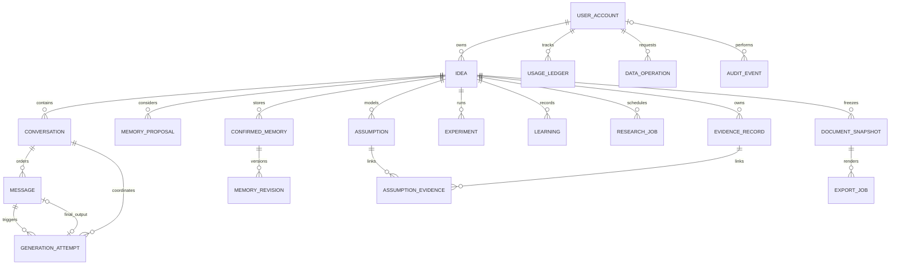

# Founder's Lens — LLD Phase 1B: Physical Database Design

**ID** FL-LLD-DB-002 · **Version** 0.1 · **Date** 2026-11-13 · **Status** In Review; not validated against a running database.

**Authority**: See approval provenance in [documentation index](../../README.md); `HLD.md` §5–9; `SRS.md` §4, §5, §7–8, §11–12; `logical-design.md` (Phase 1A). **Implementation assumption**: PostgreSQL 15+, pinned Prisma ORM **6.x**, Node.js 22, TypeScript. Exact supported patch versions must be selected and locked at repository bootstrap. Prisma 7 and later may differ: re-evaluate generator/config and migration integration if upgrading.

## Executive summary and decision gates

Phase 1A contained **20** logical entities. The reviewed proposal retains those 20 and adds IdempotencyRecord plus WebhookInbox and IdentityTombstone (23 physical models). This is a proposed v1 schema, not a verified production migration.

**Proposed engineering defaults for this design iteration**:
1. **Regeneration**: a single original user message may trigger multiple `GenerationAttempt` rows. Each completed attempt may own a distinct immutable final assistant `Message`. `GenerationAttempt.selectedAt` elects at most one completed response per trigger user message, enforced by a partial unique index. Selection is an application transaction on successful latest-turn completion; arbitrary user selection of historical alternatives is not exposed in v1. Historical alternatives remain for audit/history but are excluded from normal AI context assembly. This does **not** re-order prior conversation turns or duplicate the original submission.
2. **Evidence**: `EvidenceRecord` is private, idea-scoped, and represents **one finding**, not a global web page registry. It preserves origin, trust classification, source locator/publisher, observed/retrieved time, geography and limitations. Optional `(ideaId, dedupeFingerprint)` deduplicates **claim-level** findings. `AssumptionEvidence` is a many-to-many linkage with qualitative support/challenge relation. A URL is not a proof and a user report is not independent market evidence. No separate evidence-source registry in v1.
3. **Versioning**: `ConfirmedMemory.currentVersion` is a current-read projection backed by append-only `MemoryRevision`. `Assumption`, `Experiment` and `Idea` use optimistic `version` integers. `DocumentSnapshot` uses per-idea unique immutable version numbers, `draftRevision` CAS on editable previews, canonical content JSON, schema version and SHA-256 at approval; new edits create a new version instead of modifying an approved row. `ExportJob` points to one approved snapshot.

**Not finalized**: retention/deletion deadlines, storage provider/S3 lifecycle, vendor privacy terms, precise quota thresholds, and AWS deployment price. Those are product/release gates, not database values to fabricate. AWS is a deployment target, not a guaranteed $0 hosting solution.

## 1. Relational design and aggregate boundaries



`OutboxEvent` is the twentieth entity, omitted from the diagram because it has a polymorphic aggregate reference (`aggregateType`, `aggregateId`) rather than a physical FK to a single domain. The application validates its `kind` and `payload` schemas; no untrusted freeform dispatch.

### 1.1 Ownership

The root chain is Clerk verified subject → local `UserAccount.id` → `Idea.ownerId` → idea-scoped resources. API and worker repositories require authorized scope; `WHERE id = :id` on a private resource **alone is forbidden**. Child tables often carry `ideaId` redundantly so a composite FK can mechanically reject cross-idea links. This is purposeful denormalization for safety and faster scoped retrieval; it must be populated only from an authorized parent query, not a client-supplied body.

### 1.2 Canonical data rules

| Canonical concept | Authoritative record | Other representation |
|---|---|---|
| User identity | Clerk session/subject | `UserAccount` is local app ID and account state |
| Testable assertion | `Assumption.statement` | `ConfirmedMemory.assumptionId` may link without duplicating live statement |
| Confirmed knowledge | `ConfirmedMemory` + append-only `MemoryRevision` | `MemoryProposal` remains untrusted until accepted |
| Sourced finding | `EvidenceRecord` | `Learning` is founder interpretation, not an independent citation |
| Conversation transcript | User `Message` + *selected* final assistant message by attempt | Unselected generations kept for history, excluded from standard context |
| Reviewed PDF content | `DocumentSnapshot.content` where APPROVED | `ExportJob` only renders frozen content; cannot call AI after approval |
| Job lifecycle | PostgreSQL job/outbox rows | BullMQ/Redis tracks execution, not canonical business state |

## 2. Table-level specification

Read the full implementation columns and relation mappings in [`schema/schema.prisma`](schema/schema.prisma). Names are PascalCase SQL identifiers because there are no `@@map` mappings; quoted identifiers in [`constraints/guards.sql`](constraints/guards.sql) match this design. A later naming migration may switch to snake_case but **must** update the guards atomically.

| Table | Primary key | Important unique/index keys | Owner and lifecycle |
|---|---|---|---|
| UserAccount | id UUID | clerkSubject UNIQUE | Clerk mapping; ACTIVE/DISABLED/DELETION_REQUESTED |
| Idea | id UUID | ownerId + updatedAt index | Fixed owner; ACTIVE/ARCHIVED/DELETION_REQUESTED; version |
| Conversation | id UUID | (id, ideaId) UNIQUE; ideaId + updatedAt | Per-idea, server nextSequence |
| Message | id UUID | (conversationId, sequence) UNIQUE; submission key scoped | Per conversation; user/assistant final output JSON |
| GenerationAttempt | id UUID | triggerMessageId + attemptNumber UNIQUE; partial active/selected unique | State machine; one active per conversation |
| MemoryProposal | id UUID | ideaId + review status + createdAt | User review state and expected target version |
| ConfirmedMemory | id UUID | (id, ideaId) UNIQUE; ideaId + status | Current content + currentVersion |
| MemoryRevision | id UUID | (memoryId, version) UNIQUE | Append-only immutable history |
| Assumption | id UUID | (id, ideaId) UNIQUE; ideaId + status | Canonical statement, optimistic version |
| Experiment | id UUID | (id, ideaId) UNIQUE; ideaId + status | User-accepted status, optimistic version |
| Learning | id UUID | ideaId + createdAt | Approved founder interpretation |
| ResearchJob | id UUID | (ideaId, dedupeKey) UNIQUE | Durable budget/state |
| EvidenceRecord | id UUID | (ideaId, dedupeFingerprint) UNIQUE | One private finding with provenance |
| AssumptionEvidence | (assumptionId, evidenceId) | evidenceId index | Composite idea-scoped FKs |
| DocumentSnapshot | id UUID | (ideaId, version) UNIQUE | DRAFT/REVIEWING/APPROVED |
| ExportJob | id UUID | (snapshotId, idempotencyKey) UNIQUE | Stable output storage metadata |
| OutboxEvent | id UUID | status + nextAttemptAt; lease fields | Event relay/reconciliation |
| AuditEvent | id UUID | actorId/time; ideaId/time | Sanitized metadata; retention policy needed |
| UsageLedger | id UUID | accountId + reconciliationKey UNIQUE | Append-only usage reconciliation |
| DataOperation | id UUID | accountId + requestedAt | Portable export / deletion intent |

## 3. Regeneration and ordering: exact rule

**Source of truth**: user messages have their own monotonically increasing `Message.sequence`; assistant responses are also appended with server-generated sequences, but **display order is based on the logical user-turn grouping**, not blindly sorted message sequence when an older turn is regenerated.

A normal transcript query takes user messages in ascending sequence; for each eligible user turn, it obtains the selected completed `GenerationAttempt` and the final `Message` where `generationAttemptId = attempt.id`. System context excludes nonselected assistant outputs and any interrupted token stream. Regenerating a turn with later user messages present changes a historical turn; the API must warn that downstream already-generated answers are not automatically recomputed. For v1, **restrict regeneration to the latest user turn** unless a deliberate future product decision enables historical branches. This avoids misleading downstream state.

**Attempt state / selection rules**:
- Exactly one active generation per conversation (`PENDING`, `RUNNING` or `CANCEL_REQUESTED`) via partial unique index.
- An attempt may be selected only when status `COMPLETED` (SQL CHECK).
- At most one attempt per trigger user message may have `selectedAt` not null (partial unique index).
- Completion means committed final `Message`, valid structured payload, and terminal attempt state in one transaction. An AI partial stream is not a completed message.
- In a single transaction, clear old selected attempt then select newly completed alternative. Race-safe when locking the triggering `Message` row, not by relying on last-write-wins; completion must also match the current worker epoch.
- A regeneration request has its **own idempotency contract**. `GenerationAttempt.regenerationKey` is nullable for the initial attempt and unique per conversation for explicit regeneration requests; replayed regeneration keys must return the existing attempt.
- A selected attempt should not later transition away from `COMPLETED`.

**Design consideration**: With assistant response messages appended separately, a simple `ORDER BY sequence` alone is insufficient to rebuild the selected transcript. API LLD must formalize a transcript projection query.

## 4. Evidence and provenance

`EvidenceRecord` combines the observation/finding and original locator. In P0, this is a deliberately compact model: the same URL can produce different evidence claims, and the same claim may be linked to multiple assumptions. `dedupeFingerprint` must be generated from a stable canonical form including idea scope, normalized source locator, normalized claim and context scope. A bare URL is insufficient. Missing source fields means `UNASSESSED`/`UNVERIFIABLE`, never source checked. `SOURCE_CHECKED` means the cited source metadata was checked; **it does not prove the business claim**.

A user interview is `EvidenceRecord.origin = USER_REPORT` with optional observation date and limitations; the founder's conclusion is `Learning`. Automatic promotion of user report to independent external evidence is disallowed. `AssumptionEvidence.relationship` says SUPPORTS, CHALLENGES or INCONCLUSIVE; it does not assign fake numeric business-success scores.

## 5. Versioned writes and transactions

### 5.1 User message submission

Transaction (ideally PostgreSQL `READ COMMITTED`):
1. Verify authorized owner, ACTIVE idea, ACTIVE conversation.
2. If `(conversationId, clientSubmissionKey)` exists, return the existing operation after validating its original payload hash. Compare immutable `Message.submissionSha256` to the incoming canonical payload hash and reject a same-key/different-body replay.
3. Acquire `FOR UPDATE` lock on `Conversation` row; confirm no active generation.
4. Insert USER `Message` with current `nextSequence`, advance counter, insert `GenerationAttempt(1, PENDING)`.
5. In that same transaction claim the generic ledger, reserve usage, insert OutboxEvent and store original 202 references. Commit; dispatcher queues the generation, then an independent worker invokes the model outside the transaction. API never directly starts generation. Return conflict for a different new request during an active generation.

### 5.2 Finalize assistant response

Transaction: lock `Conversation` and attempt; validate attempt RUNNING, matching leaseEpoch, live lease/deadline, account ACTIVE and idea ACTIVE in the same lifecycle-locked transaction; insert ASSISTANT `Message` linked to this attempt at next sequence; increment sequence; set attempt COMPLETED + `completedAt` + selectedAt if first/explicit selection; append any **pending** `MemoryProposal` rows and audit metadata; commit. Only then emit final stream completion. Failed persistence implies failed/uncertain generation, never a confirmed completion.

### 5.3 Memory approval

Transaction: lock `MemoryProposal`, check PROPOSED and proposal.version against If-Match, confirm identity, idea ACTIVE, if targeting existing `ConfirmedMemory` compare `expectedMemoryVersion`; update current content and version using CAS, insert `MemoryRevision(memoryId,version)`, then finalize proposal status with reviewer/time, create audit event; all-or-nothing. The proposal source message and target memory must be from the same idea. No AI-generated proposal may write memory directly.

### 5.4 Assumptions and experiments

Update where `(id, ideaId, version)` and increment version. A stale If-Match returns `412 PRECONDITION_FAILED`; missing If-Match returns 428. Composite FK prohibits linking another idea's assumption/experiment/evidence. User approval is required to transition suggested experiment to planned or in-progress; state transitions validated by application and tested.

### 5.5 Research and document jobs

Create job + `OutboxEvent` in the same PostgreSQL transaction. Outbox dispatcher claims rows by `FOR UPDATE SKIP LOCKED`, publishes BullMQ with a stable `jobId`, records publish status and reclaims stale lease. Each worker rechecks idea ACTIVE and job state before committing output; both queue and business writes must be idempotent. Never hold an open DB transaction during web fetch, model call, Redis network call, PDF render or object upload.

Snapshot approval computes SHA-256 from a deterministic **canonical JSON serialization** of `schemaVersion` + typed content. Store hash and approving user; guard prevents mutation afterward. Rendering downloads this frozen JSON, not live idea state. Upload to private storage before committing COMPLETED with stable object key/checksum. Repeated export must return/reconcile the same intent; orphaned uploads are cleaned by a janitor.

## 6. SQL-only invariants

Prisma schema covers tables, types, foreign keys, ordinary unique constraints and indexes. [`constraints/guards.sql`](constraints/guards.sql) adds PostgreSQL features missing from our pinned Prisma 6 schema:

- One active generation per conversation (`WHERE status IN (PENDING, RUNNING, CANCEL_REQUESTED)`).
- One selected attempt per user turn (`WHERE selectedAt IS NOT NULL`).
- Append-only `MemoryRevision` trigger.
- Approved snapshot immutability trigger.
- Evidence source-check provenance requirements and common value checks.
- Completed export artifact metadata requirement.

**Review caveat**: The snapshot trigger blocks ordinary deletion of an approved snapshot. The **privileged, audited deletion pathway** is specified in §13; scoped guard and role behavior must be proved against PostgreSQL, together with storage cleanup. Do not grant general API/worker accounts ability to disable triggers.

**Not yet enforced in SQL**: role of generation trigger user message, selected assistant response completeness, snapshot APPROVED requirement at `ExportJob` insertion, matching current memory revision, all state transitions, deletion-time access policy, or independently enforced row-level security. API service and transactions enforce them; add DB triggers/constraints for residual high-risk cases after prototyping and testing.

**Important**: PostgreSQL FKs and partial indexes enforce structural relationships, **not** Clerk-based authorization. API and workers always resolve owner-scoped idea first. PostgreSQL RLS may be considered later with verified pooled-connection session context; don't incorrectly assume Prisma alone supplies RLS.

## 7. Index policy

Initial indexes exist for the most common owner/idea/recentness and status access patterns. The partial active-generation and selection indexes protect correctness, not only performance. Composite unique constraints on `(id, ideaId)` exist to support cross-idea FK integrity. Additional indexes are permitted only after query plans and representative data justify them.

Benchmark with ~100k messages, 5k ideas and 20k evidence records in synthetic data; run `EXPLAIN (ANALYZE, BUFFERS)` with owner-scoped conditions and keyset pagination. These are performance test sizes, **not forecasts**. Avoid pagination by OFFSET over unbounded history.

## 8. Migration and deployment plan

1. Pin Prisma 6.x and compatible Node/TypeScript versions; check `npx prisma validate` in CI. Set `DATABASE_URL` and a direct migration DSN where provider pooling requires it.
2. Initialize package and copy [`schema/schema.prisma`](schema/schema.prisma). Generate the baseline with `npx prisma migrate dev --name initial_schema --create-only` against a disposable **development** PostgreSQL 15+.
3. Append [`constraints/guards.sql`](constraints/guards.sql) into the generated migration SQL **after** the generated CREATE TYPE/TABLE/FK statements. Review generated SQL and enforce migration ownership in code review. The guard script is a source fragment, **not a standalone initial migration**.
4. Apply migrations to fresh test DBs. Run `npx prisma validate`, `npx prisma generate`, and the integration suite. Confirm the guards exist by querying `pg_indexes`, `pg_constraint`, and `pg_trigger`. `prisma db push` is prohibited in deployed environments.
5. Promote with `prisma migrate deploy` as a **single release job**, never every API instance. For future changes use additive expand → migrate/backfill → contract, with rollback/fix-forward and backup restore drills.
6. Size database connections for API + workers; avoid exhausting low-tier managed PostgreSQL connection caps. Secrets are held in environment/secret manager, not repository.

### 8.1 Example SQL for outbox dispatch

```sql
BEGIN;
SELECT id FROM "OutboxEvent"
WHERE "status" = 'PENDING' AND "nextAttemptAt" <= now()
ORDER BY "nextAttemptAt", "createdAt"
FOR UPDATE SKIP LOCKED LIMIT 25;
-- Mark selected rows CLAIMED and leaseUntil in the SAME transaction.
COMMIT;
-- Publish to BullMQ outside transaction; mark PUBLISHED in separate guarded write.
```

`CLAIMED` rows require a lease-expiry reconciler; merely querying PENDING forever would strand claims.

## 9. Testing and acceptance

See [`validation/integration-test-plan.md`](validation/integration-test-plan.md) for 30 tests covering tenant isolation, composite FKs, idempotency, concurrent generation, version CAS, append-only history, snapshot immutability, provenance checks, Redis/DB crash windows, purge behavior, migration drift and query performance. Run on actual PostgreSQL—not SQLite/in-memory mocks—because partial indexes, triggers, SQL enum types and transaction semantics matter.

### 9.1 Traceability

| SRS | Physical mechanism | Tests |
|---|---|---|
| FR-003/004, DR-001 | UserAccount → Idea owner chain + scoped repository + composite FKs | DB-01, DB-06–10, DB-29 |
| FR-009–012, DR-004/009 | Message submission key, attempt states, partial uniqueness | DB-02–06, DB-22 |
| FR-022–028, DR-002 | Proposal state, memory CAS, append-only revision | DB-11–13, DB-23 |
| FR-029–033, DR-005 | Assumption/Experiment/Learning scope and versions | DB-07–09 |
| FR-034–039, DR-003 | Evidence provenance, bounded research job, idea scope | DB-10, DB-14–15, DB-19–21 |
| FR-041–044, DR-006 | Versioned approved snapshot, guarded export | DB-16–18 |
| FR-005, DR-007 | Idea DELETION_REQUESTED gate, data operation | DB-20, DB-24 |
| FR-045 and ops | Usage ledger idempotency, outbox retries | DB-19–21, DB-30 |

## 10. Remaining blocking issues before implementation approval

| ID | Issue | Proposed closure |
|---|---|---|
| DB-B03 | Role check for trigger user message and terminal assistant response cross-row | Implement guarded transaction and integration test; consider DB triggers if defense-in-depth requirement escalates |
| DB-B04 | New-account / idea purge flow for approved snapshots and historical revisions | Design privileged purge SQL and vendor/object-storage cleanup after retention policy is approved |
| DB-B05 | Need database-level status-transition enforcement scope | Review whether dedicated immutable triggers warranted on high-risk tables |
| DB-B06 | PostgreSQL + Prisma generated schema/migrations **not executed or validated** in this environment | Run `prisma validate`, Migrate, integration tests against target pinned Prisma 6 and PostgreSQL 15+ |
| DB-B08 | Explicit snapshot approval must confirm viewer is the sole account owner | Enforce in scoped service and audit; optionally store approval user FK |

**Approval recommendation**: Request-key hashing, regeneration idempotency, and draft CAS fields are now modeled; do not label Phase 1B implementation-ready until DB-B06 is closed and a real PostgreSQL integration suite passes. Remaining retention/privacy issues must be resolved before any public beta.


## 11. Reconciliation mappings and unresolved safeguards

The [integration matrix](../04-integration-review/consistency-matrix.md) owns cross-layer mapping; [state machines](../04-integration-review/state-machines.md) own allowed lifecycle transitions. Schema fields are now proposed for generic replay, epochs/deadlines, proposal/preferences/conversation versions and usage reservations. These fields do not enforce transactional compare-and-swap by themselves. Ledger responseRef contains only enough safe IDs/scalars to reconstruct the original accepted DTO, never a signed URL; original HTTP status is responseStatus. Immutable content may be read only after current authorization.

Mapping: public clientSubmissionId -> Message.clientSubmissionKey, semantic content hash -> submissionSha256; selected -> selectedAt != null; finishedAt -> completedAt; memory.version -> currentVersion; snapshot.version -> immutable document version, snapshot.draftRevision -> draft CAS/ETag, contentHash -> contentSha256; evidence.sourceUrl -> sourceLocator. AssumptionEvidence identity is the pair (assumptionId,evidenceId), not a triple; changed relationship requires explicit delete/recreate (no silent overwrite).

UsageLedger is a reservation/current settlement projection, not wholly append-only: RESERVED -> SETTLED or RELEASED once under guarded write; finalized accounting is immutable. Crash reconciliation uses reservationId; provider billing uncertainty remains visible. Bounded checkpoint/export-manifest contracts are now specified in §12 and state-machines. Privacy bypass, tombstone and inbox design are specified in §12–13; no general trigger-disabling privilege is authorized. Generation terminal transition enforcement remains a service/transaction obligation until PostgreSQL race tests prove it. Existing selectedAt may change only to replace selection atomically on eligible successful regeneration; terminal execution result remains immutable.


Outbox poison handling: exhausted dispatch transitions to FAILED with lastErrorCode and dispatchAttempts; alerts are mandatory. Re-drive is a reviewed operational action with fresh claimEpoch, lifecycle check and audit, never an infinite automatic reset. DataOperation also has leaseEpoch/lease/deadline fields; its bounded checkpoint/export-manifest schemas are specified in state-machines and §12. Usage reservation measuredUnits starts at zero on admission, then one guarded settlement supplies actual usage or marks uncertainty for reconciliation.


## 12. Final privacy and identity persistence contract

Status: In Review, proposed schema amendment only; no migration executed. Existing models cannot retain a unique webhook receipt and deleted identity after account removal without conflating user idempotency or retaining private accounts. Therefore exactly two operational models are added to the existing PostgreSQL database: WebhookInbox and IdentityTombstone; no additional service/database. Count is 23 (original 20 + request ledger + 2 operational identity models). Their field definitions are in schema/schema.prisma; no duplicate provider-event ledger elsewhere.

WebhookInbox unique(provider,clerkInstanceId,eventId) serializes deliveries; bodySha256 detects ID/payload mismatch. subjectKey is a HMAC, not a client identity input; row stores normalized verified metadata, never full event JSON. Status/epoch/lease/deadline/attempt/nextAttemptAt support durable retry and poison alerts. IdentityTombstone unique(instance,subjectKey) and subject-lock protocol survive UserAccount hard deletion. Neither has an account FK. Raw Clerk subject exists only on the live account mapping; suppression uses keyed hashes. Retention/rotation and deliberate new-subject signup are canonical in security §16 and state-machines; those documents govern transaction predicates, not enum defaults alone.

AccountStatus/IdeaStatus use DELETION_REQUESTED/PURGING/DELETED instead of the retired ambiguous deletion marker. ACTIVE-only admission remains unchanged; existing DISABLED and ARCHIVED states do not grant write access. DataOperation.deletionState is authoritative after parent deletion, with status expressing progress/retry separately. deletionScopeKey=account:<configured instance>:<subjectKey> or idea:<UUID> (server-derived); nullable for EXPORT, unique for retained deletions. Account deletion reuses/subsumes child operations under account-first locking. DataOperation.accountId becomes nullable with SET NULL so receipt survives account purge; ownerSubjectKey/instance/subjectKeyVersion protects narrow status access without preserving content. ideaId remains non-FK restore/purge scope metadata. On completion erase checkpoint/details/artifact references after acknowledged cleanup, retain only receipt policy/time/scope, then expire under approved policy.

DataOperation checkpoint has DELETE or EXPORT variant, schemaVersion=1, max 32 KiB. DELETE fields/allowlisted phases are in state-machines. EXPORT variant: type=EXPORT, cutoffAt, manifestObjectKey/hash, rowCounts (known domain keys only), schemaVersions, archivePhase (PIN,PACKAGE,UPLOAD,VERIFY), lastBatchCursor and expiresAt; no private rows in checkpoint itself. Export manifest contains authorized content under encrypted private storage and is erased with the archive/parent. Export cutoff materialization must be bounded (proposed maximum 20 MiB content per request, explicitly refuse oversized requests with recoverable guidance instead of holding an unbounded transaction). Same snapshot/manifest metadata is checksummed before worker use; limits and ZIP format remain Pending Product Approval. No new public upload feature is introduced.

Idea.contextEpoch increments on memory accept/edit/remove and lifecycle gate. GenerationAttempt.contextEpoch/dispatchAuthorizedAt captures provider-dispatch authorization boundary; final commit verifies the current idea epoch. This prevents a context assembled before removal from becoming newly authorized or committed after removal without revalidation, while acknowledging previously in-flight external requests. It does not duplicate generation leaseEpoch (execution ownership). ExportJob and EXPORT DataOperation use artifactState AVAILABLE/EXPIRED/PURGED and artifactExpiresAt separate from terminal execution status; retain opaque key/checksum only until policy expiry/purge. No signed URL is persisted.

## 13. Privileged purge migration and transaction contract

Define the following reviewed DB entry point at implementation: privacy_purge_batch(operationId UUID, expectedEpoch integer, phase allowlisted text, batchLimit integer 1..500) -> deletedCount,nextCursor. It is SECURITY DEFINER owned by NOLOGIN fl_purge_owner, fixed qualified search_path, not executable by PUBLIC/API/general workers. Dedicated privacy login has EXECUTE only, not ownership, direct private-content SELECT, role membership or arbitrary DELETE. Migration owner is separate. Procedure rejects any nondeletion operation, state other than PURGING, expired lease, mismatched epoch, disallowed phase or target outside its operation. It locks operation, account/idea gates and bounded child batch; transaction-local operation and epoch settings are used only inside that validated invocation. Operator re-drive cannot change target or regain ACTIVE.

The invoker-mode guard helper in constraints/guards.sql checks both current_user and the locked operation's scope/epoch/lease before allowing DELETE of normally immutable rows. It never authorizes UPDATE of revisions or approved snapshots. SECURITY DEFINER procedure owner cannot be reached by SET ROLE from app logins. API-set custom configuration cannot bypass the role check. Migrations must revoke PUBLIC EXECUTE on the purge entry point, assign exact grants, schema-qualify identifiers, and prove SQL-injection/search_path and ordinary-role rejection tests. No trigger is disabled globally, and deleting one idea cannot authorize another idea's rows. The helper and grants require real PostgreSQL role tests; naming a role does not prove privilege safety.

Purge order for FK cycles: delete response Message (FK to attempt), then GenerationAttempt (FK to trigger Message), then triggering Message; delete revisions before memory and exports before snapshot. Cross-domain proposals/research/source links are removed first in scoped batches as required. Procedure locks lifecycle while deleting and writes checkpoint/counts transactionally. External objects/providers are handled outside transactions with durable manifests and acknowledgments; a DB DELETE is not proof of object deletion. The final account transaction detaches receipts and deletes local mapping; root DELETED is mirrored to retained operation even after root row is absent. state-machines is the authority for backup/restore residuals and failure recovery.


DataOperation.reverificationKey is an optional unique keyed digest of the verified signed reverification ID, bound to its deletion scope/policy. It is required for owner-originated fresh deletions after policy approval, absent for provider-originated deletion. Same-scope deletion replay resolves existing operation without consuming another token. Expiry removes only completed eligible operation receipts; no general authentication token or claim set is persisted.


Account-export DataOperation persists capturedAt and fileSha256 on successful manifest pin/archive completion; checkpoint retains manifest hash, schemaVersions and archive progress until artifact expiry/purge. Public capturedAt is the pinned consistent data cutoff, not the initial request time. Capture/upload/final pin and privacy lifecycle are synchronized as specified in state-machines.


## 14. Explicit owner approval reconciliation

P2D-P01–P05 are recorded in decision-log from the latest owner instruction; no approval date is supplied. DataOperation.policyVersion=p2d-privacy-v2 binds active retention until deletion and the approved proposed 30-day maximum active-system purge target. Derive activePurgeTargetAt=requestedAt+30 days on deletion DTOs/monitoring; do not add a competing database deadline or reset requestedAt on retry. leaseUntil/deadlineAt remain execution/recovery controls. BackupResidualUntil and provider obligations are tracked separately; no seven-day backup recommendation becomes an approved or validated capability. Existing receipts preserve their own policy version.

Memory currentVersion/contextEpoch, lifecycle/tombstone, and approved snapshot hash/version/draftRevision mechanics implement the approved product behavior without schema/SQL changes in this approval-only revision. PDF admission reserves at most two active jobs per account under the account lock, validates canonical content <=1 MiB, and workers enforce 60-second/10 MiB output limits (API §17). These are engineering defaults under delegated bounded-export approval; prove concurrent admission/worker enforcement in PostgreSQL/integration tests. Retained historical text, snapshots and already authorized external requests follow the documented P2D-P04 boundary and full privacy purge. No application implementation or runtime validation is asserted.
