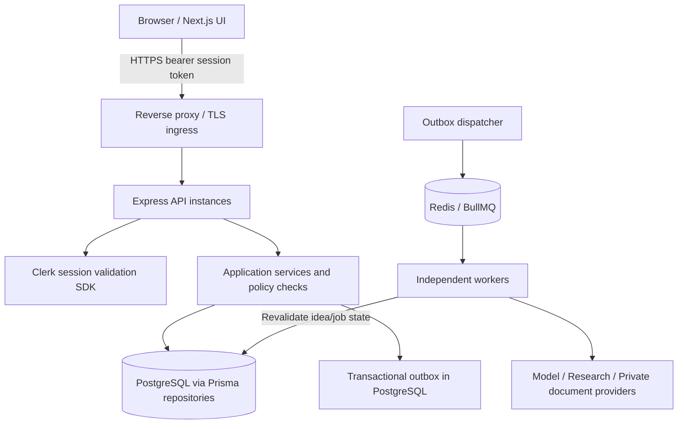
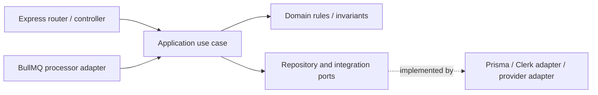

# Founder's Lens — LLD Phase 2A: Express API Architecture & Security

**Version:** 1.0 (review draft)  
**Status:** In Review — documentation only; approval and execution evidence tracked separately
**Baseline:** PRD/SRS/HLD approval evidence is tracked as D01; accepted ADR-013; Phase 1A and proposed Phase 1B.  
**Supersedes:** HLD ADR-002 framework choice *Fastify* → **Express 5 + strict TypeScript**. Other HLD decisions unchanged. HLD text/diagrams referencing Fastify must be amended through an ADR, not silently reinterpreted.  
**Audience:** Product owner, software engineer, security reviewer, Codex implementation agent.

## 1. Scope, goals and non-goals

**Goals:** Define Express request pipeline, authenticated principal creation, Clerk trust boundary, object- and action-level authorization, module layers, route policy inventory, common cross-cutting middleware, HTTP and streaming security, worker authorization boundary, failure handling, telemetry and review gates. An independent engineer should be able to implement the security architecture without inventing permission rules.

**Non-goals:** Complete OpenAPI field definitions (Phase 2B), streaming event grammar and resumability (Phase 2C), full state machine details (Phase 3–6), infrastructure provisioning (delivery plan), and working code. Phase 1B database constraints remain **unvalidated** by real Prisma/PostgreSQL execution; Phase 2A does not imply schema approval.

**Trust model:** Browser requests, request IDs, JSON, URLs, file metadata, research results, model outputs and queue messages are untrusted until checked at the appropriate boundary. Clerk authenticates the user session; *our API* authorizes private resources. PostgreSQL is authoritative for account eligibility and resource ownership. Business content is private by default.

## 2. Decisions and tradeoffs

| ID | Decision | Rationale / caveat |
|---|---|---|
| 2A-01 | Express 5 and strict TypeScript; modular monolith | Familiar ecosystem, explicit module boundaries. Framework alone does not enforce architecture. |
| 2A-02 | Stateless HTTP API; no session stored in API process | Supports multiple API instances. Clerk session tokens still require proper validation, expiry and revocation handling. |
| 2A-03 | Bearer Clerk session token for cross-origin web→API calls | Simple HTTP/SSE authentication; verify token from SDK and pin accepted token type to session. Do not accept arbitrary machine/api-key tokens on user routes. |
| 2A-04 | `@clerk/express` `clerkMiddleware()` then `getAuth()` | Current SDK guidance. Use explicit JSON 401 guards for API routes rather than browser sign-in redirects; pin and verify SDK behavior. |
| 2A-05 | Single local `UserAccount` mapped by unique `clerk_subject` | Stable internal UUID for data ownership; never use user ID supplied by client for scoping. |
| 2A-06 | Owner-scoped repository queries + use-case authorization | Prevents IDOR even if controller route is reused. Protect nested cross-idea references and avoid leaking existence. |
| 2A-07 | Strict allowlisted input schemas; explicit DTO projection | Avoids mass assignment, unexpected enum variants and privacy leaks; never return ORM records wholesale. |
| 2A-08 | Fail closed on auth, authorization, quota and state-change uncertainty | Reliability must not weaken security. Public status endpoints are explicitly exempt and data-free. |
| 2A-09 | Redis/distributed throttle for horizontally deployed APIs; DB-enforced usage ledger for paid AI quota | In-memory throttle works only per instance; distributed quotas must be atomic. Redis failure handling depends on operation risk. |
| 2A-10 | Separate worker identity and DB-scoped job revalidation | No end-user bearer token inside queue; delay/retry cannot resurrect deleted resources. |
| 2A-11 | JSON operations + dedicated authenticated SSE response for streaming | Enables backpressure-aware response; v1 reconnect reads durable generation state, not guaranteed delta replay. |
| 2A-12 | Structured error envelope and trace propagation | Reliable client recovery and incident debugging without exposing secrets. |

### Architectural constraints

- No collaboration or organization-based cross-owner access in v1. Clerk organization membership does **not** grant idea access.
- Every idea-bound resource has one authoritative `idea_id` and is accessible only if `idea.owner_id = principal.localUserId` and neither user nor idea is blocked/deleting.
- Business-logic authorization must be checked at use-case and scoped query boundaries; authentication middleware alone is not sufficient.
- Allowed user claims are scoped to identity/session, never permission to read a specific idea.
- All AI-triggering operations require authentication, account eligibility, per-account quotas and resource authorization.

## 3. Trust boundaries and runtime topology

**Boundary-specific controls:**

1. **Web → ingress:** HTTPS, controlled origins, request/body-size limits, rate-limit and denial-of-service protections. Only trusted ingress can set effective proxy IP/forwarded protocol headers.
2. **Ingress → Express:** Centralized request context and logger; Clerk attaches validated auth state; reject malformed/expired/wrong-token-type credentials.
3. **Express → use cases:** Parsed/whitelisted data, internal authenticated principal, scoped operations and transactional business rules.
4. **Use cases → repositories:** Owner/idea predicates + same-idea relationship integrity; optimistic versions/idempotency; never trust raw IDs for private lookup.
5. **API → background workers:** Durable job IDs and references only; workers read authoritative state, check lifecycle/eligibility, execute idempotently. Redis is not the security authority.
6. **Backend → external model/research:** Server-only secrets, bounded timeouts, egress/URL validation, model output considered untrusted. Private content policy and provider terms are release gates.
7. **Backend → object storage:** Private objects; authorized API gates download or issues short-lived scoped signed URL; never expose permanent public links.

## 4. Express composition root and dependency direction

**Composition root:** Constructs configuration, database pool, Logger, Clerk adapter, Zod schemas, repositories, policy helpers, quota service, orchestrators, queues, controllers, routers and worker consumers. Use explicit factories/constructor injection rather than a mandatory DI framework. Avoid circular dependencies and framework objects in domain packages.

**Folder-oriented module boundaries** (logical only; not a code mandate): `identity-access`, `workspace`, `conversation`, `memory`, `experiments`, `research-evidence`, `documents`, `operations`. Each has controllers/routes, application use cases, domain policies, ports and adapters. Cross-module calls go through published service interfaces; Prisma client should not be imported into controllers.

**Controller duties:** Parse validated inputs/context; call one use case; map expected outcome to HTTP; set location/ETag if appropriate; never manage multi-record transactions, external provider SDK operations or raw authorization SQL.

**Use-case duties:** Enforce state/ownership/idempotency invariants; coordinate repositories, quota and outbox; create atomic transactions around short durable changes; return domain-level outcome.

**Repository duties:** Perform scoped data access; return non-sensitive, deliberate projections; enforce same-idea references and concurrency conditions; never accept arbitrary `ownerId` from HTTP body.

## 5. Middleware pipeline and execution ordering

**Global/request setup:**

1. TLS termination and ingress-level rate/size protection (outside Express).
2. Initialize request correlation ID (generate server ID; accept only bounded/sanitized upstream ID from a trusted proxy), trace context, request start timestamp and structured request logger. Do not log body or Authorization header.
3. Minimal hardening: disable identifying headers, Helmet/security response headers, explicit `trust proxy` for *known* proxy hops, tight CORS allowlist and method/header policy; handle OPTIONS preflight before protected routes. CORS is browser isolation, **not** authorization.
4. Install Clerk `clerkMiddleware()` **before other application middleware that relies on authentication**. Its exact ordering relative to harmless request-ID/security-header processing is an integration detail; Clerk's current reference says it must be set before other middleware. Validate with integration tests.
5. Route-group-level authentication guard: `getAuth(req)` accepts a valid **session token** and non-pending authenticated session; otherwise `401` JSON, not redirect. Reject mixed-token fallback and ambiguous cookie/bearer precedence. Configure Clerk authorized parties/issuer/audience/origin settings according to chosen token mode; prove integration with real dev/staging tokens.
6. Resolve local principal via `clerk_subject` mapping. Idempotent provisioning may create account on first authenticated request. Reject `DISABLED`, `DELETION_REQUESTED`, `DELETED` account states. No role escalation from optional Clerk metadata or request body.
7. Apply endpoint-class distributed rate limits and user-specific AI/research/PDF quotas *before* costly work; for sensitive writes quota reservation and durable job creation must be consistent.
8. Apply route-specific Zod `params`, `query`, `headers` and `body` parsing. Enforce JSON content type when required, bounded field lengths, allowlisted keys, normalized UTF-8 and configured depth limits.
9. Resource lookup/authorization + precondition checks (version headers, ownership, lifecycle). Authorization must be performed again in use cases/repositories rather than solely relying on route middleware.
10. Controller → use case → repository/outbox; validate outgoing DTO/card shape, omit internal fields; stable HTTP status and headers.
11. Error boundary: central error mapper, safe structured logging, metric increment, telemetry; no stack trace or raw SQL/provider response to client. For an SSE stream with headers already sent, emit sanitized stream.error if possible and close; transport failure does not mutate generation state. Only the fenced worker/reconciler may persist a generation terminal outcome. Do not write JSON or reset HTTP status.

**Public endpoints:** `GET /health/live` (no private information), `GET /health/ready` (minimal status, preferably restricted to ingress/orchestrator), webhook endpoint (only after raw-body signature verification), and optionally a published API schema/docs depending on threat review. All other founder data routes require user authentication.

**Limit:** An Express middleware pipeline does not by itself enforce database ownership, transactional consistency, or worker authorization. Those are separate layers.

## 6. AuthN detailed contract

1. Next.js uses Clerk login; browser obtains session token using documented Clerk acquisition flow. For cross-origin API calls, explicitly send `Authorization: Bearer <token>`. Never put tokens in URLs, logs or analytics events.
2. Express Clerk SDK validates the token/session. Accept only `session_token` for user routes. Verify expected environment/issuer/authorized party and audience if using a specific JWT template. SDK configuration requires an integration spike; don't invent audience settings.
3. Only after successful verification derive `principal = { localUserId, clerkSubject, sessionId, requestId, accountStatus }`. `localUserId` is server-resolved; email is *not* a stable ownership key. Account creation must be idempotent on unique Clerk subject.
4. For invalid/missing/expired session return `401` with safe error; for disabled/deleting account use a stable blocked-account error without revealing data. Token expiry while long SSE active does not automatically revoke a connection: bound stream max lifetime, check state on continuation, close private streams on explicit account disable/delete; lifecycle cleanup cancels durable work separately, and document revocation lag.
5. Clerk webhook events, if used for sync/account deletion, have a separate signed-webhook trust boundary and replay/idempotency protection. They do not use normal browser session auth.
6. API never asks Clerk on each repository read to determine item ownership. Identity from authenticated principal; access control from local authoritative database.
7. Tokens and passwords are never stored in PostgreSQL, queue payloads, log events or application exceptions.

**Decision on browser credential mechanism:** Bearer token only for API calls (not API authentication by ambient cookies). Thus CSRF exposure is reduced, but XSS/token theft and origin/CORS remain concerns. If later changing to cookies, re-open CSRF and SameSite/anti-CSRF controls as an ADR.

## 7. Authorization model and route policy matrix

**Authorization rule:** For user principal `p` and target `r`, permit ordinary founder `action` only when `p` is active, route/action policy permits it, resolved `r.idea_id` points to active idea `i`, and `i.owner_id == p.localUserId` (plus resource state and version predicates). Never infer permission from opaque UUID unpredictability.

| Resource/action | Scope check | Extra condition | Error on unseen/foreign ID |
|---|---|---|---|
| List/create ideas | Authenticated active local account | Creation/plan limits | N/A |
| Read/update/archive/delete idea | `Idea.ownerId=principal.localUserId` | version + lifecycle | `404` |
| List/create conversations | Parent idea ownership | idea active | `404` |
| Read/post message | Conversation → idea ownership | chat turn state, limits, idempotency | `404` |
| Stream/read/cancel generation | Attempt → conversation → idea ownership | generation lifecycle | `404` |
| Read/review memory proposal | Proposal → idea ownership | pending state, expected version | `404` |
| Read/edit confirmed memory | Memory → idea ownership | revisions, non-deleting account | `404` |
| Read/edit assumption | Assumption → idea ownership | concurrency version | `404` |
| Create/update experiment/learning | idea ownership; all supplied linked IDs same idea | lifecycle and no unauthorized confirmation | `404` |
| Read/research evidence | ResearchJob/Evidence → idea ownership | quotas; source trust status not synonymous with truth | `404` |
| Request snapshot/approve/export/download | Snapshot/export → idea ownership | approved snapshot for export; private object | `404` |
| Read account / request account data operation | `principal.localUserId` only | re-auth/sensitivity gate where needed | `401`/`403` |
| Ops liveness | No user auth | no private data | N/A |
| Clerk webhook | Signed webhook identity | signature timestamp, replay guard | `401`/`400` |

**Cross-idea reference validation:** When a request supplies both an `ideaId` and `assumptionId` or `evidenceId`, require all records to belong to exactly the same authorized idea. Prefer database constraints and repository predicates in addition to service checks. Don't rely on separate unconstrained `findUnique` calls.

**Privacy-preserving not-found:** For resource IDs whose existence is not public, return identical `404 RESOURCE_NOT_FOUND` whether absent or owned by someone else; never disclose ownership or counts. Use `403` for a known action denial within the caller's legitimately visible resource. Sensitive admin endpoints do not exist in v1. The only blocked-local-account projection exception is minimal deletion status/replay in §16, with verified subject ownership; no business data access.

**Query pattern:** Read by `(id, owner scope)` through join/where conditions; for nested resources, query through a path with `idea.owner_id`. For writes, use short transactions or conditional updates and verify affected-row count; repeat critical guard within transaction to avoid time-of-check/time-of-use races. DB same-idea FKs and unique indexes are second-line defense, not substitutes for authorization.

## 8. Request consistency, quotas and error taxonomy

**Idempotency:** For selected state-changing API operations (chat send, approval, research job creation, export request) require the inventory-specified `Idempotency-Key`; chat also requires clientSubmissionId; store `(userId, operationType, scope, key, canonicalRequestHash, status, resultRef)` with appropriate unique constraint/retention. Same key+same body returns original accepted/result status; same key+different body → `409 IDEMPOTENCY_KEY_REUSED`. Writes must be atomic with outcome or outbox. Do not claim guaranteed exactly-once external side effects.

**Concurrency:** Expected version/ETag or version request field for mutable memory/assumption/snapshot draft updates; stale If-Match → `412 PRECONDITION_FAILED`; missing required If-Match → 428. One active generation per conversation is DB-enforced where possible. Regenerate only latest eligible turn in v1; persist distinct generation attempts and clearly selected answer.

**Rate-limiting tiers:** Network/IP safeguard, per authenticated account general read/write, heavyweight chat generation, research quota, PDF export, and webhook ingress. Use distributed atomic Redis token buckets for burst control and authoritative DB ledger for purchased/allocated resource quotas; reserve budget before calling providers, settle actual after completion, reconcile stale reservations. No numeric limits fabricated; configurable via environment/plan profile and tested against realistic usage. On Redis unavailable: fail closed for costly or security-sensitive operations; allow designated lightweight authenticated reads if safe and observable.

**Representative error contract:** `{"error":{"code":"RESOURCE_NOT_FOUND","message":"The requested resource was not found.","requestId":"...","retryable":false}}`. No internal stack, SQL, tokens or cross-tenant identifying metadata. Machine codes: `UNAUTHENTICATED`, `ACCOUNT_UNAVAILABLE`, `RESOURCE_NOT_FOUND`, `VALIDATION_ERROR`, `CONFLICT`, `PRECONDITION_FAILED`, `IDEMPOTENCY_KEY_REUSED`, `RATE_LIMITED`, `QUOTA_EXCEEDED`, `PROVIDER_UNAVAILABLE`, `DEPENDENCY_UNAVAILABLE`, `INTERNAL_ERROR`. Version and finalize in Phase 2B.

**Status mapping:** 400 for schema validation (not 422), 401, 403 (known permission), 404, 409, 412, 413, 415, 429, 503, 500. Return `Retry-After` when meaningful for 429/503. Respect idempotency on retries; client should not retry all unsafe actions blindly.

## 9. Streaming and long-running requests — API security contract

- Use a separate authenticated SSE endpoint or streaming response with bearer header, not URL query credentials. Native browser `EventSource` cannot set custom Authorization headers; use an authenticated `fetch` streaming client or another secure design explicitly reviewed in Phase 2C.
- Authenticate and authorize at stream start, including generation ownership, session token validity and account/idea state. Limit simultaneous streams per user and bounded stream duration.
- Persist the generation lifecycle and final/failed state in PostgreSQL. A lost network connection **does not mean** generation or job is undone; on reconnect fetch durable status/transcript and avoid duplicated submissions.
- No guaranteed replay of historical token deltas in v1. Partial tokens are not automatically authoritative transcript; distinguish `running`, `completed`, `failed`, `interrupted`, `cancelled`.
- Implement heartbeat intervals, backpressure handling, disconnect policy, server/resource timeouts; ensure process termination/drain stops new streams and allows in-flight state reconciliation.
- Recheck authorization before exposing final artifacts and before any post-disconnect durable state mutation. Never send full private prompts in error events or observability.

## 10. Background worker authorization

1. API validates user and writes authorized `ResearchJob` / `ExportJob` + outbox record in one DB transaction.
2. Outbox dispatcher publishes only IDs/event metadata and bounded trace context, **not** user JWT or raw private business ideas.
3. Worker consumes with server-only Redis credentials, obtains job row from DB and verifies account/idea active state and job/target relationship.
4. Worker obtains necessary private content from DB through service-controlled access; limits provider calls/URL fetches/timeout budgets; logs metadata only.
5. Before committing research evidence, snapshot export or long-running result, recheck current account/idea/job state and version. Superseded/cancelled/deleting jobs must not publish stale artifacts.
6. Retry is idempotent with DB uniqueness/version predicates; dead-letter/failed queue state is visible and recoverable. Deletion cleanup requires special authorized workflow, not bypassing all policies silently.

## 11. Operational hardening, privacy and deployment portability

| Control | Minimum documented behavior |
|---|---|
| HTTPS / proxy | Strict TLS externally; trusted proxy hops only; don't trust arbitrary X-Forwarded-For/Proto. |
| CORS | Exact approved web origins, methods and headers; no wildcard with credentials; CORS does not authorize. |
| Headers | Helmet baseline; tune CSP for API vs frontend; avoid blindly breaking documented streaming/content types. |
| Request limits | Bounded JSON body size, URL/query length, concurrency, SSE duration, DB pool and provider timeouts. |
| Errors | Central mapper with safe public codes and server-side details protected/redacted. |
| Logging | Structured request/trace/job IDs, status/duration; no raw session token, prompts, messages or download URLs. |
| Trace | W3C trace context through API → outbox → jobs with safe propagation, not arbitrary inbound baggage. |
| Secrets | Environment/secret manager, rotation procedure; no frontend model/DB/Redis keys. |
| Readiness | `/health/live` process-only; `/health/ready` reports dependency readiness without detailed internals. Keep metrics private. |
| Shutdown | Stop accepting new HTTP, drain bounded streams, close database/Redis gracefully, reconcile active generation attempts. |
| Scale | API instances stateless; shared PostgreSQL/Redis; pool limits, queue backpressure, distributed throttle. |
| Availability | No production SLO, backup RPO/RTO or zero-cost uptime promise until hosting and NFR-020 are approved. |
| Privacy | Account/idea deletion and audit retention policy unresolved; must be resolved before public beta. |

**Threat focus:** OWASP API1 broken object-level authorization, API2 broken authentication, API3 unsafe field/property authorization, API4 unrestricted resource consumption, API7 SSRF, API10 unsafe external APIs. Avoid logging private founder ideas or forwarding unvalidated LLM/research output as trusted data.

## 12. Required tests and architecture proof points

| Test ID | Scenario | Expected result |
|---|---|---|
| AUTH-001 | Missing/invalid/expired/wrong-type Clerk credential | 401; no private query or AI spend |
| AUTH-002 | Authenticated Clerk subject without local account | Idempotent safe provisioning or explicit failure; no duplicate account |
| AUTH-003 | Account disabled or deleting | No new mutation, research, export or stream |
| AUTH-004 | Signed webhook invalid/replayed | Rejected; no identity mutation |
| AUTHZ-001 | Guess another user's idea ID on GET/PATCH/DELETE | Consistent 404 and no side effects |
| AUTHZ-002 | Guess another user's conversation/message/memory/export IDs | 404; no content or metadata leak |
| AUTHZ-003 | Cross-idea assumption/evidence/experiment combination | Rejected before and inside write transaction |
| AUTHZ-004 | Long research/export job after idea deletion | Worker stops safely; no new public artifact |
| AUTHZ-005 | Authorized PDF owner creates short-lived download access | Scoped; expired/foreign cannot fetch |
| API-001 | Unknown JSON properties, invalid UUIDs/enums, overlarge body | Stable error; no unexpected field mutation |
| API-002 | Same idempotency key same body concurrently | One logical operation and stable replay |
| API-003 | Same idempotency key different body | 409; no duplicate work |
| API-004 | Concurrent message sends on same conversation | Only one active generation; deterministic conflict |
| API-005 | Stale memory/assumption version | No lost update; conflict/precondition error |
| RATE-001 | Limits hit on each costly endpoint | 429/appropriate quota error before provider spend |
| RATE-002 | Two API replicas with Redis | Global limit consistent; no per-pod bypass |
| RATE-003 | Redis unavailable for costly operation | Fail closed with safe error, not unlimited provider spend |
| SSE-001 | Token expires/connection drops during generation | Durable truthful state; no duplicate submission |
| SSE-002 | Browser cannot attach bearer via EventSource | Fetch-stream client or documented alternative succeeds |
| SEC-001 | CORS header sent by attacker | No authorization bypass |
| SEC-002 | Forged forwarded IP headers | Real proxy policy controls rate-limit identity |
| SEC-003 | Logs/traces on validation/provider failures | No tokens, raw prompt or private content |
| OPS-001 | Graceful shutdown with active streams/jobs | Bounded drain and reconciled lifecycle |
| OPS-002 | DB/Clerk/provider outage | Safe 503/5xx, no partially accepted business side effects |

**Acceptance:** 100% of priority access-control/identity tests pass; every externally accessible protected route has positive and negative authorization tests; no cross-idea linkage; no leaked secrets in logs; production diagnostics can correlate request→outbox→worker; no undocumented bypass. Performance NFR targets remain provisional until realistic workload/profile approved.

## 13. SRS/HLD traceability

- **SRS INV-001/INV-002/INV-013, NFR-001:** No guest AI; founder and idea scoped data; cross-user and cross-idea protection → §5–7 and AUTHZ suite.
- **SRS NFR-003:** No private founder content or secrets in telemetry → §11 and SEC-003.
- **SRS NFR-004/NFR-005:** Idempotency, state/retry handling → §8–10 and API/SSE suite.
- **SRS NFR-012/NFR-013:** Quota/rate-limit counters and observability → §8, §11 and RATE/OPS suite.
- **SRS NFR-017/NFR-018:** Runtime validation and CI release gate → §5, §12.
- **HLD §7, §8, §10, §14:** Auth trust boundary, streaming, reliable jobs, operational visibility.

## 14. Open decisions and approval gates

1. **Clerk integration spike:** Confirm cross-origin acquisition of the correct token, accepted issuer/authorized parties/audience, sign-out, expiry, CSRF mode and error responses. Must pass before public access.
2. **Phase 1B:** Validate actual Prisma schema and SQL guards, especially same-idea composite FKs, active-generation uniqueness and privacy deletion semantics.
3. **Phase 2B:** Review complete API routes/fields/status codes/OpenAPI; use 400 validation and If-Match with 428/412 consistently.
4. **Phase 2C:** Freeze SSE event grammar, reconnect status, cancellation semantics, stream timeouts and partial-generation cleanup.
5. **Operational policy:** Confirm account deletion and retention, model provider privacy terms, quota values, hosting availability and backup targets before public beta.
6. **HLD revision:** Record Express replacement as explicit ADR revision and update diagrams, module descriptions, worker/API docs and code-generation constraints.

**Sign-off recommendation:** Accept Phase 2A as the **documentation architecture baseline**, contingent on closing the above implementation/security proof gates. It is not a claim that a working service has been tested or deployed.

## 15. References (checked 2026-11-15)

- Clerk Express SDK: https://clerk.com/docs/reference/express/overview
- Clerk Express getAuth: https://clerk.com/docs/reference/express/get-auth
- Clerk Express middleware: https://clerk.com/docs/reference/express/clerk-middleware
- Express security: https://expressjs.com/en/advanced/best-practice-security/
- OWASP API Top 10: https://owasp.github.io/www-project-api-security/
- OWASP BOLA: https://api-security.owasp.org/editions/2023/en/0xa1-broken-object-level-authorization/

## 16. Durable Clerk webhook and identity tombstone design

Status: In Review technical contract; implementation acceptance pending. Sources checked 2026-11-15: [Clerk synchronization guide](https://clerk.com/docs/guides/development/webhooks/syncing), [delivery/order guidance](https://clerk.com/docs/guides/development/webhooks/overview), [verification reference](https://clerk.com/docs/reference/backend/verify-webhook). The Express guide documents verifyWebhook from @clerk/express/webhooks on express.raw(application/json) before JSON parsing, with CLERK_WEBHOOK_SIGNING_SECRET. The generic backend helper takes a different request adapter; do not interchange examples. No payload logging from tutorial examples is permitted here.

Official delivery guidance confirms duplicate/out-of-order delivery, stable svix-id on retries, event timestamp and instance_id, and user.created/user.updated/user.deleted. Delete payloads lack updated_at; use event timestamp for recording. These are verified provider facts, not a promise of instantaneous delivery. Timestamp units, delete-data subset and exact pinned SDK freshness defaults must be asserted with recorded fixtures before implementation acceptance. No hand-written signature algorithm or guessed SDK method for account deletion/reauthentication is specified.

### Admission and durable inbox

1. Public POST /webhooks/clerk is outside founder bearer guards, behind body-size/rate limits; cap proposed raw body 256 KiB. Require bounded svix-id, svix-timestamp, svix-signature. Verify raw bytes/signature with the configured endpoint secret and freshness check. Reject invalid signature/expired delivery timestamp with safe 400 (no PII); do not log headers/body. Proposed acceptance window is +/-5 minutes only if supported by the pinned verifier; otherwise prove the provider-supported bound and update configuration. Event occurrence timestamp may be old during a legitimate signed retry; it is not the signed delivery freshness timestamp. Replays that pass signature verification still face durable dedupe.
2. Verify configured instance_id; normalize supported type and subject data.id, never owner IDs/email/metadata as authorization. Support only user.created, user.updated, user.deleted. Unknown valid types record IGNORED metadata and return 204; user.merged is not supported and must not merge private workspaces. Provider event-subscription changes require review. Malformed supported events return 400, not successful silent loss.
3. PostgreSQL short transaction inserts WebhookInbox unique(provider,clerkInstanceId,eventId=svix-id), SHA-256 of exact verified raw body, subjectKey (keyed HMAC), normalized type, occurredAt, optional objectUpdatedAt, state RECEIVED and outbox. Never persist the raw body, email, profile image, metadata or token. Same ID/same body is replay; return 204 only if previous durable acceptance exists. Same ID/different body returns 409 WEBHOOK_EVENT_ID_REUSED with security alert and no mutation. Concurrent inserts serialize by unique index; bounded wait failure returns 503, never speculative success.
4. For user.deleted, in that SAME acceptance transaction take the subject coordination lock, upsert IdentityTombstone, gate any local account DELETION_REQUESTED, create/find scoped DataOperation and outbox. This prevents a queue/Redis delay from leaving an already-received deletion usable. A nonexistent local subject still receives a tombstone and minimal deletion DataOperation with nullable accountId; do not create a UserAccount. Mirror its suppression receipt too. Commit before 204. DB failure rolls everything back and returns 503 (optional Retry-After), relying on provider retry. A 204 means durably accepted, not physical purge complete.
5. Worker consumes only inbox ID, claims epoch/lease and rereads DB; at-least-once BullMQ delivery is expected. RECEIVED -> PROCESSING -> APPLIED or IGNORED. Expired PROCESSING is reclaimed with higher epoch; bounded 5 attempts/jitter 5s–5min, then FAILED with lastErrorCode and alert. Failed row re-drive uses same event ID and fresh epoch; deletion gate remains intact. Outbox publish/recovery follows the shared dispatcher; DB scanner can resume inbox/deletion work without Redis. Final inbox state and any local sync/outbox changes commit atomically.

### Ordering and local synchronization

Local app identity and eligibility are authoritative; webhooks never create an account, grant access, clear DISABLED/deletion states or change ownership. user.created/user.updated are synchronization hints: for an existing ACTIVE mapping record the greatest pair (objectUpdatedAt when available, occurredAt) under subject lock; older/equal hints are IGNORED. This repository does not cache Clerk profile PII, so no email/name overwrite is necessary. A missing local mapping is IGNORED, not provisioned. If future profile sync is needed, fetch current provider state via a verified adapter outside a transaction and recheck version/lifecycle before persisting; do not assume event order. user.deleted dominates all hint timestamps, regardless of delivery order. An existing deletion operation/tombstone cannot be reversed by a newer-looking create/update. Handling receipts and deletion is idempotent even after inbox TTL expires.

### Tombstones, provisioning and deliberate recreation

IdentityTombstone is independent of UserAccount FK/cascade: configured Clerk instance, subjectKey=HMAC-SHA-256(instance + subject), subjectKeyVersion, deletion operation UUID (optional for unknown local subjects), requestedAt, livePurgedAt, retainUntil, lastProviderEventAt. No email or original profile. It is sensitive pseudonymous metadata, not anonymous data. Same subject lock coordinates webhook receipt, initial provisioning and deletion. PostgreSQL advisory transaction locks on a stable derived subject-lock key plus unique constraints arbitrate absent-row races; use pg_advisory_xact_lock(hashtextextended(configured instance + separator + verified raw subject, fixed seed 0)); the raw subject is not persisted in lock metadata/logs. All cooperating paths use the same derivation, independent of HMAC rotation; hash collisions only serialize unrelated subjects and never confer permission. Reverify this function on pinned PostgreSQL.

Only a valid authenticated founder request can provision a missing local account. It must verify the current provider user/session is live through a server-side adapter (not JWT signature alone), lock subject, recheck tombstone/all local states, then insert one UserAccount with a fresh local UUID and subject mapping. Provider outage fails closed with 503. Provider operations were verified in official references: [getUser](https://clerk.com/docs/reference/backend/user/get-user), [deleteUser](https://clerk.com/docs/reference/backend/user/delete-user) and [revokeSession](https://clerk.com/docs/reference/backend/sessions/revoke-session). The documented Backend API also provides GET /sessions/{session_id}; verify session status/subject match plus live user before provisioning. Wrap these in pinned SDK adapters; missing user/session fails closed, transient provider failure 503. Do not presume error-code details or revocation latency from method existence; integration fixtures must prove them.

Deliberate new signup means a fresh live Clerk subject in the configured instance, explicitly authenticated, with no tombstone for that new subject: create an empty local account; never relink by email, old local ID or payment/profile metadata. Old subject remains blocked while its tombstone exists. A same-subject “recreation” is rejected with 403 ACCOUNT_UNAVAILABLE; any future subject-reuse exception requires explicit reviewed migration/identity proof and is outside v1. New empty-account recreation without restored data is explicitly approved under P2D-P03; new-subject authentication and anti-resurrection safeguards remain the technical contract. After retention expiry, delayed webhooks still cannot provision; an old session must also fail current-provider liveness. Do not expire a tombstone until required Clerk deletion is acknowledged and backup/suppression horizons are satisfied. Verify the provider does not reuse a deleted subject for a new identity; if that assumption cannot be established, require owner-approved longer suppression before expiring markers, rather than risk linking an old subject.

Keys: keep HMAC key/version in managed secrets, not database/backups. During rotation check all retained key versions for tombstones/mappings, atomically migrate active mapping hashes under the stable subject lock, and retain old keys until associated receipts expire. Suppression manifests carry subjectKeyVersion; restore cannot open if required keys are missing. Do not use unhashed email as fallback. Tombstone/inbox/receipt retention and data-subject disclosure are defined only in [privacy policy](../04-integration-review/state-machines.md#privacy-and-retention-policy).

### Revocation, observability and proof gates

Local deletion gates work while Clerk/Redis is unavailable. Account privacy worker attempts provider session revocation/account deletion using idempotent adapter semantics, treats confirmed already-absent identity as success, persists retry state and never declares those obligations complete merely because a request timed out. Signed user.deleted confirms provider deletion; provider status checks handle missed events. No event-based automatic reactivation or merge. Remote sign-out/revocation lag on otherwise ACTIVE sessions must be measured; no instantaneous guarantee.

Metrics: accepted/deduped/conflicting events, oldest inbox age, retries/failed rows, deletion age, orphan objects and restore watermark. Logs contain event/operation ID and code only; subject hash is omitted from default logs. Tests FSEC-01–04/07/08/15 and DB-38–42 are implementation gates. SDK behavior, clock skew, provider retries and event fixtures remain unexecuted.

### Verified fresh-action adapter

[Clerk reverification](https://clerk.com/docs/guides/secure/reverification) documents signed fva factor ages and an optional configured session.reverification_id custom claim. Proposed deletion assurance: first-factor verification <=5 minutes, plus the required second factor when MFA policy applies. The API verifies signature/session and factors server-side, requires the configured signed reverification identifier and records a keyed hash in DataOperation.reverificationKey, unique and bound to deletionScopeKey/policyVersion. Never accept an unsigned ID or a browser “recently authenticated” boolean. Existing same-operation replay returns the minimal receipt after current subject authorization before requiring a new fresh-action token; using a consumed reverification for a different target fails 403. Provider-signed claims/configuration and Next.js prompt behavior must be proved on the pinned Express/Clerk integration, not copied from a different framework adapter. Fresh account-deletion authentication is approved under P2D-P02; five-minute/factor handling is an engineering default requiring pinned-SDK validation.

Pipeline exceptions are deliberately narrow: an otherwise blocked local subject may retrieve its own minimal deletion status or replay its existing deletion intent with verified credentials; no new operation, founder read, provisioning, grant or content projection follows. Root idea DELETE retries resolve by receipt scope/owner before the normal inactive-resource 404 rule; foreign scopes remain 404. Once provider session deletion makes authentication impossible, no receipt-based unauthenticated API fallback is provided.
