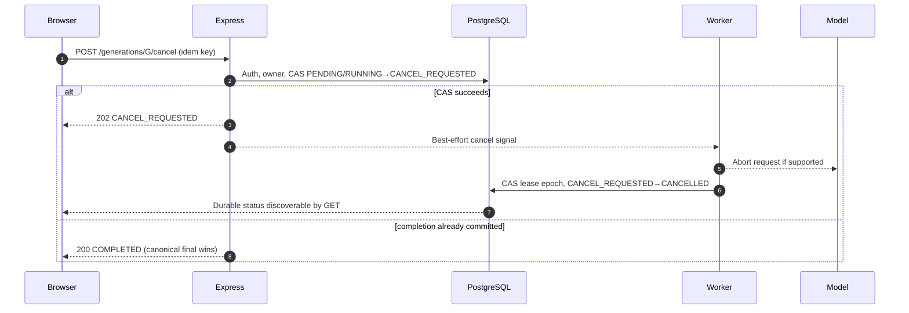

# 3. Idempotency, concurrency, retries, cancellation and worker reliability

**Status:** In Review — documentation/specification, not executed acceptance.

## 3.1 Idempotency keys: two layers, not one

1. **Durable request ledger** (`IdempotencyRecord`, added to Phase 1B): unique `(localUserId, operationType, targetScope, key)`; `requestFingerprint` SHA-256 of canonical semantic JSON + operation/versioned headers; `responseRef`, `status` (`IN_PROGRESS`, `SUCCEEDED`, `FAILED_REPLAYABLE`), original HTTP status/body or safe resource reference, expiry and timestamps. A ledger insert/claim and the business operation commit in the **same PostgreSQL transaction**; never return successful replay when operation did not commit. A winner losing its HTTP 202 response may be retried safely.
2. **Long-lived chat dedupe**: `Message` unique `(conversationId, clientSubmissionId)` (Phase 1B calls it `clientSubmissionKey`); this protects against duplicate submissions after ledger expiry. The submission-content hash must match on duplicate IDs. If same ID/different content → 409; same content/new key maps to existing message/generation. `Idempotency-Key` and `clientSubmissionId` are both required for chat; ledger governs request replays and stable response envelope.

**Same key and same fingerprint** → return existing operation with same durable IDs and originally accepted HTTP status (202 for chat), optionally current status via GET. **Same key and different fingerprint** → 409 `IDEMPOTENCY_KEY_REUSED`. **Concurrent same-key** → DB uniqueness serializes claim; winner performs write, loser reads persisted outcome or gets bounded 409 `REQUEST_IN_PROGRESS` with `Retry-After` if outcome cannot yet be read. **Same content and different key** is a new action except chat duplicate `clientSubmissionId` maps to same logical message. Do not canonicalize semantically different texts as equal.

**Retention:** propose 14-day request-ledger retention (adjust after privacy/resource review), but never imply indefinitely safe key reuse; preserve chat submission uniqueness as long as message exists. No private full bodies stored in ledger; store fingerprints and safe response refs. Scope includes authenticated actor and target object; never trust route-supplied user ID. Cross-account duplicate key is independent.

**Payload canonicalization:** RFC 8785-style canonical JSON rules or explicit stable field ordering; include normalized content and precondition `If-Match` when it changes command meaning; do not hash raw bearer credential, volatile request timestamp or diagnostic headers. Store `algorithmVersion` so changes do not break replay assumptions. Refuse reused key with different semantic content.

## 3.2 Persistence and concurrency boundaries

### Send-message transaction
1. Authenticate local user, verify idea/conversation is ACTIVE and owned, check request schema, quota **without trusting pre-transaction read**.
2. In one short DB transaction lock conversation/conditional active generation, claim idempotency scope; check unique `clientSubmissionId`; verify content hash; atomically reserve budget and commit usage ledger entry; increment `nextSequence`; insert USER message; insert `GenerationAttempt(PENDING)`; insert outbox event with stable generation ID; commit.
3. After commit, return 202. The outbox dispatcher handles Redis outage asynchronously. If commit uncertain due to network, retry same key and resolve by unique DB records before invoking model.
4. If a competing new message with a **different** submission ID arrives while generation active, 409 `GENERATION_IN_PROGRESS`. Replayed identical submission may return existing ID even while active.

**Important:** Do not hold PostgreSQL transactions around Redis, LLM, web requests, SSE or PDF. Chat uniqueness and active-generation constraints require actual PostgreSQL isolation/concurrency tests.

### Generation worker claim and finalization
- BullMQ queue `generation`; use `jobId = generationId` (where safe after considering BullMQ job removal/retention). Duplicate BullMQ delivery is expected.
- Worker claim uses conditional status check, idea lifecycle recheck and monotonic lease epoch increment. Provider API call outside DB transaction; heartbeat/lease renewal with epoch. Worker emits provisional deltas only if claim remains valid (periodic epoch/cancellation checks).
- Completion transaction checks `(attemptId, leaseEpoch, status=RUNNING, deadline, idea ACTIVE)`; stores validated assistant message and pending memory proposals, advances authoritative message ordering, finalizes usage reservation, transitions to COMPLETED and updates `selectedAt` atomically. Only then publish completed notice. If CAS fails, discard late provider result and do not select it.
- Worker cancellation or failure transaction similarly verifies epoch and terminal status. Retry of final transaction cannot insert a duplicate assistant message due to unique `generationAttemptId`. No AI text from failed/uncommitted attempts is included in canonical transcript.
- A publish failure **after DB completion** is only a notification failure; polling still returns completed result. A broker publish failure **before** queueing is retried by outbox. Redis loss while provider runs means provisional events may be lost, but DB completion remains valid.

## 3.3 Retry taxonomy

| Failure | Owner | Allowed retry | Safeguard |
|---|---|---|---|
| Client HTTP timeout after submit | Client | Same `Idempotency-Key` + `clientSubmissionId` | Never append duplicate user message |
| SSE disconnect | Client | GET status, reconnect fresh stream | No token replay promise; AI continues |
| 401 on stream | Client | Refresh Clerk session then reauthenticate | No automatic unauthenticated fallback |
| 429 on submit | Client | Respect `Retry-After` | No new key while same operation outcome uncertain |
| 503 before durable commit | Client | Backoff with same key | Distinguish not accepted from unknown commit; retriable only under idempotency |
| Redis outage after DB commit | Outbox relay | Retry publish with same jobId | DB remains source of truth |
| Worker crash before model invocation | Dispatcher/worker | Safe reassignment after lease expiry | Re-check status and epoch |
| Worker crash during model invocation | Reconciler | Do not blindly re-invoke provider; mark FAILED or retry under explicit bounded cost policy | Provider may already have billed; lack of exactly-once guarantee |
| Provider transient error | Worker | Bounded attempts with jitter if request not known to have side effect | Budget caps/deadlines, retain error code only |
| Output schema invalid | Worker | Explicit single repair budget or fail | Do not commit unvalidated final cards |
| Terminal notification lost | Client | Poll GET generation | Terminal DB state is authoritative |
| DB unavailable at final commit | Worker | Retry bounded DB commit with epoch | No terminal SSE before commit; if epoch lost, fail safe |

**Backoff:** bounded exponential with jitter, max attempts, max elapsed time, dead-letter/failed status and alert. No retry storms. Distinguish transport retries from provider regeneration (different operation). Avoid retrying user cancellation as a new generation.

## 3.4 Cancellation and regeneration

If cancel is acknowledged, worker cannot subsequently commit COMPLETED. If model/provider cannot abort, late output is discarded; external provider may still charge. User cannot cancel another founder's attempt. Cancellation cannot undo approved memory or published final responses. Retried cancel with same key returns its original accepted status/body; GET returns current terminal status.

**Regeneration:** Allowed only on latest eligible USER turn, no later user turn, no active attempt, account/idea authorized and quota reserved. Creates a new `GenerationAttempt` linked to same trigger message, distinct `attemptNumber`, same outbox workflow. Existing selected completed answer remains selected until successful new answer commits and selection switches atomically. Failed/cancelled regeneration leaves previously selected answer. No new USER message on regeneration. UI must show a regenerating draft without replacing canonical selected response until commit.

## 3.5 Distributed safety & operations

- **Lease fencing:** a worker with expired lease cannot finalize after another epoch claims; heartbeat has lease epoch predicate. DB uniqueness on active generations per conversation; careful definition includes CANCEL_REQUESTED, not only PENDING/RUNNING.
- **Outbox:** claim rows in PostgreSQL using bounded batches with `FOR UPDATE SKIP LOCKED`; publish at least once; track dispatch lease, attempts, nextAttemptAt, sanitized failure code. Worker dedupe closes dispatcher crash gap. Outbox event must remain until safely observed/retained, not auto-deleted on first publish.
- **Rate limits:** Redis shared counters are best-effort abuse controls; durable quota/usage reservation in PostgreSQL is financial correctness boundary. Redis down → fail closed for expensive AI/research admission or use DB-backed stricter fallback, never silently unlimited.
- **Shutdown:** stop new admissions and worker claims, drain active SSE connections within grace period; mark heartbeat leases and let reconciler resolve, do not signal COMPLETED without DB commit. Health/readiness expose no sensitive state.
- **Observability:** log requestId, user pseudonymous ID, idea ID hash, generationId, event class, status, latency, provider error category, token usage aggregates; no raw prompts or bearer. Measure queue wait, worker leases, duplicate suppression, reconnects, stream drop rate, cancellation latency, time-to-first-delta, completed-with-no-final-notification, cost reservations and orphaned attempts.
- **Capacity:** cap token fanout memory per API node, active SSE sockets by tenant, worker concurrency and API DB pool. Redis Pub/Sub is ephemeral: it is NOT BullMQ queue storage or evidence memory.
- **Privacy:** disable founder access on account/idea deletion immediately; revoke/deny new status/stream routes; workers inspect lifecycle before writes; retained history/export has approved erasure/retention policy. Reconciler and data purge tests required.

## Phase 2D reconciliation

[Integration mapping](../04-integration-review/consistency-matrix.md) defines proposed bounded retry/lease recovery, replay-before-version-check ordering, transcript projection and lifecycle locking. Physical Phase 1B exists as a reconciled draft, not an implemented or runtime-validated ledger/fencing model. Read the discrepancy register before implementation.

## Final Phase 2D privacy/context integration

Account/idea write admission is ACTIVE-only; DELETION_REQUESTED/PURGING gates and purges immediately revoke new authorization without relying on Redis cancellation delivery. Check account and idea lifecycle in each sensitive final transaction. Generation finalization additionally matches Idea.contextEpoch to the saved dispatch epoch (API §13); changed memory yields FAILED CONTEXT_CHANGED only under current lease and status RUNNING, never a late completed message. Cancellation-first still wins; a cancelled/requested attempt must follow its canonical cancellation path. No change to browser-disconnect continuation or no-token-replay decision. Privacy coordinator fences leases; stream close/stream.error never itself authorizes terminal state. [Deletion/restore policy](../04-integration-review/state-machines.md#account-and-idea-deletion-lifecycle) and FSEC tests govern cleanup and residual disclosure.

## Phase 4 projection and recovery integration (approved design only)

API§19 adds read-only submission correlation and relationship-list reads; neither uses a replay ledger, outbox, quota reservation or provider call. Lookup always maps persisted USER submission identity to original attempt1;404 does not prove noncommit. After reloading with the approved minimal session record, use correlation/status GET, never POST a reconstructed private body. Record expiration30minutes is provisional engineering configuration under FE4D-A03, not a new data-retention approval. Clear records on resolution,sign-out/account switch/deletion and expire on every read; bind to local UUID, not email. Browser storage may be unavailable, tampered or copied; all server auth remains mandatory.

Only negotiated Learning POST changes a keyed body/result: projection1 retains existing algorithmVersion/fingerprint/body schema;2 includes normalized projectionVersion and exact interpretation/observation input. Same key selecting a different projection409, not an implicit new intent or replay under a changed response schema. Learning has no ordinary edit endpoint, so original row+representation can reconstruct its accepted result while authorized; erasure disables replay rather than reconstructing private data. Return original full Generation acceptance snapshots on cancel/regeneration replay, current status only via GET. No raw prompts/private request bodies are added to ledger. Memory/experiment writes keep their prior schemas and guards; UI refetches their versioned read projection. Tests CT-P4/stream-P4 are planned, no exactly-once provider or runtime claim.

## Approved final mapping transaction and replay rules

API section21 controls the new representation3 fields. Experiment create3 returns an operational201 receipt {id,ideaId,status,version}; the original small snapshot can be retained in existing responseRef without copying private mutable fields. Current full content comes from authorized list3. Accepted legacy receipts resolve before new-admission rejection; a fresh default1 create lacking a hypothesis is409, never an invented draft. Same key with a changed body/selector is409. PATCH3 remains unkeyed, version/CAS protected and not automatically replayable.

Learning creates in all admitted input versions atomically write Learning(markertrue), distinct LearningEvidence memberships and the original representation receipt. Lifecycle locks and all evidence ownership checks precede commit. PK/FKs prevent duplicate/cross-idea structure, while the create use case must enforce initial-capture-only INSERT and SQL roles prevent ordinary rewrites. Legacy false rows remain unknown; immutable membership makes original Learning3 read-back stable while authorized. Deletion or loss of authorization denies replay instead of reconstructing erased content.

New fingerprint bindings include representation3 without recomputing prior1/2 algorithms. Array-order differences retain their established request identity even though stored membership is a set. No second ledger, Redis authority, outbox job or paid call is added. Existing generation six-state, cancellation, fencing, disconnect continuation and ephemeral SSE rules are unchanged. All concurrency, recovery and privacy tests remain planned, not executed.

## P5-AM01 controlled deletion amendment - approved design

The current [independent deletion protocol](../04-integration-review/state-machines.md#p5-am01-approved-independent-deletion-admission-protocol) is normative for this later owner-approved amendment. Independent durable intent precedes primary deletion commit;202 still requires the committed DataOperation/lifecycle/idempotency/outbox transaction and immediate access blocking. Intent is not proof of primary commit. Scope/incarnation-bound conditional intent writes and existing Idempotency-Key converge on one operation; changed fingerprint409. Proven unavailable-before-intent and uncertain outcomes use sanitized existing503, never a false202 or automatic new-key resend. Existing primary status GET/404 cannot prove absent independent intent. No new endpoint/status DTO is promised.

Unresolved intents block private access and sensitive worker reads/finalization until safe reconciliation; unavailable/stale independent authority fails closed. Existing fresh-auth, ownership, contextEpoch, leaseEpoch, purge ordering and account-incarnation rules remain. The frontend retains only approved opaque recovery identifiers and shows uncertainty, not automatic resend. No private text in the independent record. Physical design reuses existing operation UUID/scope/receipt/checkpoint metadata: generated migration review must prove operation-ID reservation and bounded reference encoding; no new entity/column or executed SQL is asserted. No remote call belongs inside a primary transaction. Old accepted responses remain replayable only through current narrow authorization and suppression checks. Export-only operations are unaffected. The independent-store dependency changes availability and admission semantics; earlier Phase4/A07 member hashes remain historical, not current. Schema/role/provider/security/browser/restore tests remain unexecuted.
