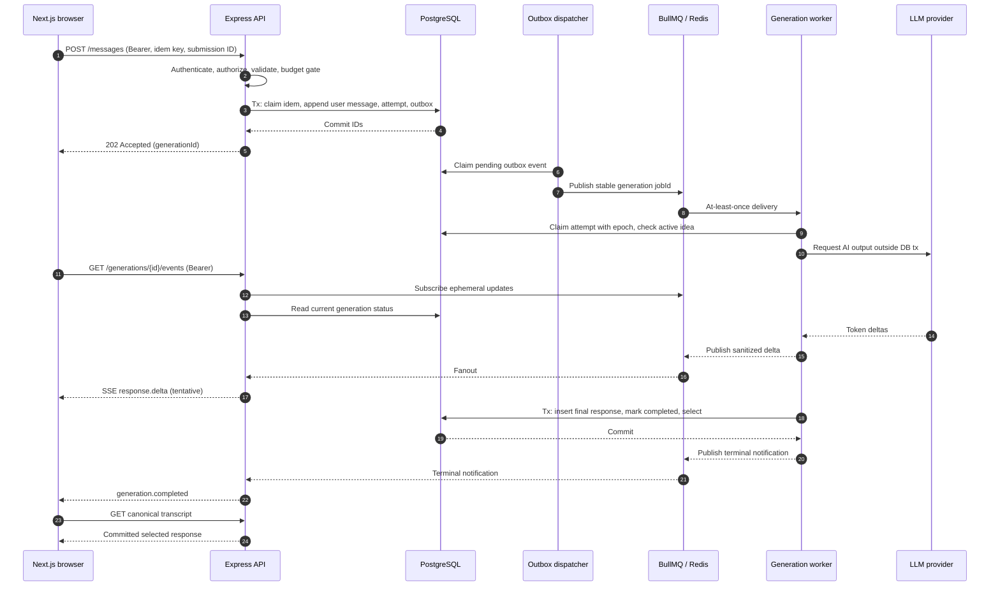
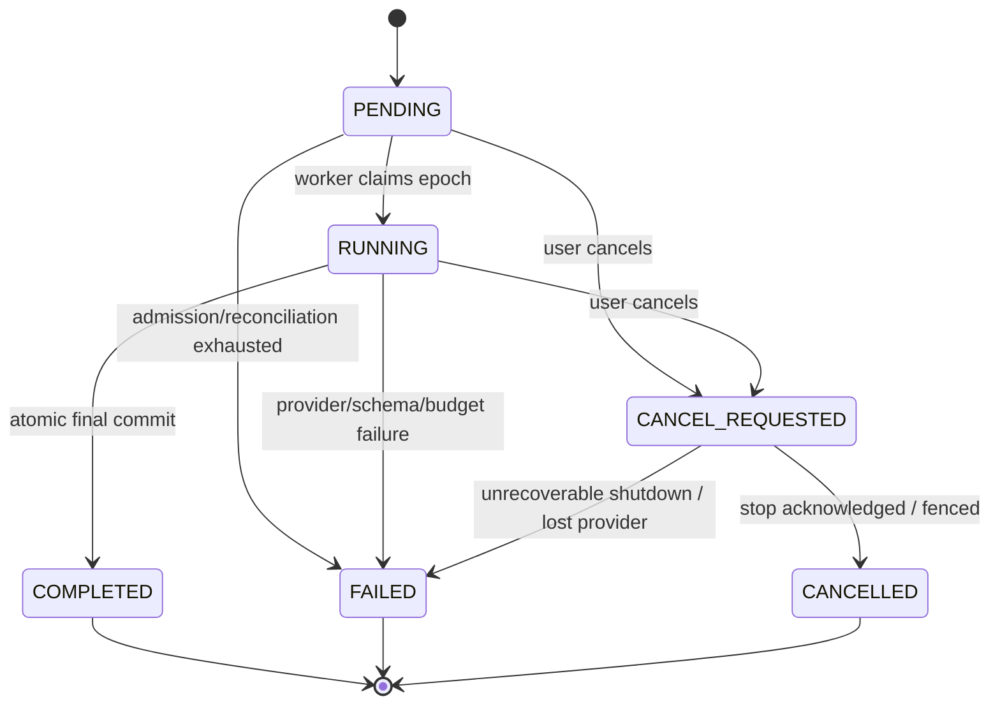

# 2. Streaming & generation HTTP contracts

**Status:** Approved — Documentation Only (historical A07; declared Phase 3 final-fetch amendment P3D-A09, FL-P3-0.3-approved); not executed acceptance.

## 2.1 Resources and route semantics

All paths below are prefixed `/api/v1`. All founder paths require valid Clerk **session** Bearer authentication and resource ownership checks; foreign/private resource IDs produce 404. Every status/stream request also checks that user and idea are still active. `Cache-Control: no-store` on private responses; disable reverse-proxy buffering/compression for SSE; enforce authenticated browser CORS allowlist. No bearer in URL, query string or event data.

| Operation | Request / conditions | Success | Conflicts / failure |
|---|---|---|---|
| `POST /conversations/{id}/messages` | `Idempotency-Key`, `clientSubmissionId`, validated user content; account/idea active, quota allowed, no active generation | 202 `{messageId, generationId, status:"PENDING", statusUrl, eventsUrl}`; `Location` points to generation | 401/404/409/413/415/429/503; same request replay returns same logical IDs |
| `GET /generations/{id}` | Read auth + owner check each time | 200 `{id, conversationId, triggerMessageId, status, selected, outputMessageId?, error?:{code,retryable}, createdAt, startedAt?, finishedAt?}` | 401/404/503 |
| `GET /generations/{id}/events` | `Accept: text/event-stream`; no `Last-Event-ID`; Bearer token | 200 `text/event-stream` only after auth; at most one attached subscriber per client tab recommended | 400 unsupported cursor; 401/404/406/429/503 before headers; after headers emit sanitized `stream.error` and close when possible |
| `POST /generations/{id}/cancel` | `Idempotency-Key`, authenticated current owner; no body | 202 full `Generation` with status CANCEL_REQUESTED when in-flight; terminal generation returns200 full `Generation` | 401/404/409 for invalid transition; 503 if state cannot be safely persisted |
| `POST /conversations/{id}/regenerations` | `Idempotency-Key`; latest eligible user turn, no active generation, quota | 202 full `Generation` status PENDING; request RegenerationCreate requires triggerMessageId | 401/404/409/429/503 |
| `GET /conversations/{id}/messages` | authenticated, cursor stable | 200 canonical messages and selected completed responses only | 401/404/400 |

**Phase 2D draft OpenAPI corrections applied; approval and validation gates remain:** add concrete 202 body, SSE event frame doc, cancellation responses, `Last-Event-ID` 400, 406, 428 when applicable, 503/429 + `Retry-After` where appropriate; see `contract-delta.md`. Do not claim draft OpenAPI already includes these.

## 2.2 SSE event grammar

SSE is UTF-8; event frame consists of `event: <name>`, one `data: <single-line compact JSON>` and blank-line separator. The transport may split bytes at any point; parser handles fragmented frames, Unicode and multiple frames per read. Server sends `: heartbeat` comment every ~15 seconds while open (tunable; proxy idle timeout must exceed heartbeat). Every JSON payload includes `schemaVersion:1`, `generationId`, `emittedAt`; all events are server-authored, JSON escaped, bounded (suggest 16 KiB maximum event frame). **No `id:` or `retry:` fields**; `Last-Event-ID` is rejected to avoid misleading replay semantics. Heartbeat is NOT an application event.

| Event | Extra data | Semantics |
|---|---|---|
| `generation.status` | `{status:"PENDING"|"RUNNING"|"CANCEL_REQUESTED"}` | Informational; not proof final commit |
| `response.delta` | `{text:string, chunkIndex:integer}` | Tentative append-only display bytes; **chunkIndex identifies this ephemeral feed, not canonical transcript** |
| `generation.completed` | `{status:"COMPLETED", outputMessageId:string, selected:boolean}` | Emitted only after committed final message/state; client MUST fetch canonical transcript/message |
| `generation.failed` | `{status:"FAILED", error:{code:string,retryable:boolean}}` | Terminal; no raw provider errors or prompts |
| `generation.cancelled` | `{status:"CANCELLED"}` | Terminal after durable state transition |
| `stream.error` | `{code:string, retryable:boolean}` | Transport/subscription problem, **not** generation terminal state; client reads status route |

**Terminal handling:** Exactly one terminal **database state** per attempt. Terminal SSE events are best-effort, may be missed or duplicated across reconnection/races. Clients should not assert completion from stream close or from having received tokens. If client subscribed after final state, return one terminal event (after owner check) then close. Streaming can terminate without any event if network fails.

**Redaction:** Never include Clerk token, raw prompts, other ideas, internal reasoning, provider access keys, research raw HTML, audit fields, and private URLs in SSE. Stream only user-appropriate assistant text, not structured cards until validated; final cards read from canonical message.

## 2.3 Handshake & fanout race discipline

For multiple Express instances, generation workers publish ephemeral updates on a scoped broker topic keyed by generation UUID and guarded by server-only access; **topic name itself is not authorization**. SSE handler must authenticate, establish broker subscription, **then read current DB state**, so an already committed terminal response is not silently missed. A terminal notification can arrive during DB read; deduplicate terminal rendering by `(generationId, terminalStatus)` in the client, but DB remains authoritative. Provisional deltas can be dropped during subscription/reconnect. Server caps subscribers and outbound buffered bytes; slow clients are disconnected, not allowed to exhaust process memory. Losing Redis Pub/Sub must not lose the authoritative generation result.

### Submission and live flow



### Disconnect and reconnect

```mermaid
sequenceDiagram
  participant B as Browser
  participant A as Express API
  participant P as PostgreSQL
  participant W as Worker
  B--xA: SSE network disconnect
  Note over W: Generation continues until terminal/cancelled
  B->>A: GET /generations/{id} (new valid Bearer)
  A->>P: Verify ownership + read status
  P-->>A: RUNNING or terminal
  alt Terminal
    A-->>B: 200 canonical terminal state
    B->>A: GET /messages (render final)
  else Still RUNNING
    B->>A: GET /events (new stream, no Last-Event-ID)
    A->>P: Subscribe broker then recheck DB
    A-->>B: Live updates from new attachment point
    Note over B: Prior token deltas may be missing; replace provisional text with final transcript
  end
```

## 2.4 Generation lifecycle

**Canonical states:** `PENDING → RUNNING → COMPLETED | FAILED`; and `PENDING/RUNNING → CANCEL_REQUESTED → CANCELLED` ; completion that committed first is already terminal before cancellation. A pending job may be cancelled before starting. `FAILED`, `CANCELLED` and `COMPLETED` are terminal and immutable; regeneration is a **new** `GenerationAttempt`, not a transition out of terminal.



**Race clarification:** Cancellation versus completion is decided by a database compare-and-swap. If completion commits **first**, cancellation observes the already-terminal COMPLETED state; there is no actual `CANCEL_REQUESTED → COMPLETED` transition. If cancellation commits first, a completion transaction must fail its `status=RUNNING` predicate, discard its output, and eventually settle CANCELLED (or FAILED for a documented terminal recovery failure).

**Expiry:** Every in-flight attempt has `deadlineAt`, `leaseUntil`, monotonically increasing `leaseEpoch`, `lastHeartbeatAt` (database design delta). Reconciler moves stranded attempts to FAILED or requeues only where safe; never leaves PENDING/RUNNING forever. Failure is safe even if expensive provider invocation already happened. Client may explicitly regenerate later.

**Selected result rule:** Store every attempt; at most one selected COMPLETED attempt for the trigger message. Auto-select first successful completion. Regeneration latest turn only; on regeneration completion, replace selection atomically; if retry fails/cancels, previous selected success remains. Transcript and context builder include only selected completed outputs. Unselected responses accessible only via explicitly authorized history (future endpoint; not in v1 UI).

## 2.5 Stream limits and lifecycle controls (initial design targets)

- 1 active attempt per conversation; 1 user stream connection per generation per tab (soft client rule) and configured max per account/IP (server enforced).
- Heartbeat target 15s; ingress idle timeout > 30s; stream hard timeout target 5 minutes with reconnection/status fallback; bounded queues per connection, for example 64 KiB or 128 events. Benchmark and tune before shipping.
- Max generation execution time initial target 120s, configurable by provider/model; deadline/reconciler must not assume provider timeout always cancels remote usage.
- `X-Accel-Buffering: no` where applicable; `Cache-Control: no-store, no-transform`; disable compression/transformation on SSE. Do not set `Connection: keep-alive` if HTTP/2 ingress disallows it.
- Per-tenant stream caps and rate limits must work across API instances. Respond with 429 before stream begins if over quota.
- If backend cannot establish broker subscription, do not return a fake successful live stream; return 503 or a `stream.error` if headers already sent, and direct client to status polling.


## Phase 2D response-shape clarification

Cancel returns the full Generation projection (required id, conversationId, triggerMessageId, status, selected, createdAt); table bodies illustrate the status decision only. Regeneration requires triggerMessageId and returns the full Generation projection in PENDING; Location points to its status route. New chat submission alone uses the flat MessageSubmission envelope. Same-key replay returns the original status/body; GET returns latest state. Snapshot and privacy amendments remain subject to the Phase 2D register.


## Final Phase 2D privacy/context integration

Account/idea write admission is ACTIVE-only; DELETION_REQUESTED/PURGING gates and purges immediately revoke new authorization without relying on Redis cancellation delivery. Check account and idea lifecycle in each sensitive final transaction. Generation finalization additionally matches Idea.contextEpoch to the saved dispatch epoch (API §13); changed memory yields FAILED CONTEXT_CHANGED only under current lease and status RUNNING, never a late completed message. Cancellation-first still wins; a cancelled/requested attempt must follow its canonical cancellation path. No change to browser-disconnect continuation or no-token-replay decision. Privacy coordinator fences leases; stream close/stream.error never itself authorizes terminal state. [Deletion/restore policy](../04-integration-review/state-machines.md#account-and-idea-deletion-lifecycle) and FSEC tests govern cleanup and residual disclosure.


## Phase 3 structured final-fetch amendment (approved principle, unimplemented)

P3-P01 explicitly adds opt-in assistantResponseVersion=2 to the existing authenticated GET transcript route; default1 keeps legacy string-content JSON. Only a committed ASSISTANT format2 row can include versioned assistantContent/optional single card/citation refs; no structured enrichment on USER or invented history. See API §18 and OpenAPI0.3.0. This is a declared post-A07 amendment; original A07 manifest remains historical and unchanged. No new SSE event, replay storage, id/retry field or generation state is introduced. response.delta remains assistant-safe text only, metadata/tool plans/hidden reasoning never stream. generation.completed follows guarded commit; reconnect fetches selected canonical result with opt-in representation if supported. Existing cancellation/context/lease/privacy/finalization and no-store rules unchanged.


## Phase 4 controlled contract closure (P4-AM01/02)

P4-AM02 explicitly adopts the unchanged full OpenAPI Generation on cancel200/202 and regenerate202: required id,conversationId,triggerMessageId,status,selected,createdAt; optional outputMessageId,startedAt,finishedAt,error. Earlier compact examples are historical only; no generationId alias replaces Generation.id. Cancel202=CANCEL_REQUESTED, regenerate202=PENDING; same-key replay returns original accepted full snapshot even after terminal, GET returns current. No status, event, terminal guard, logical ordering or browser-disconnect behavior changes. P4-AM01 lookup GET /api/v1/conversations/{conversationId}/submissions/{clientSubmissionId} returns only original-attempt correlation after fresh authorization;404 is inconclusive. It never starts work or resumes/replays missed tokens. New read uses existing session Bearer/no-store/owner/lifecycle limits. [API§19](../02-api-security/api-contracts.md#19-phase-4-controlled-api-amendments--approved-design-not-package-sign-off) owns exact DTOs. Approved principles/amendments do not sign off Phase4 or execute tests; [change register](../06-frontend/controlled-amendments-0.3.json) preserves old/new fingerprints.
