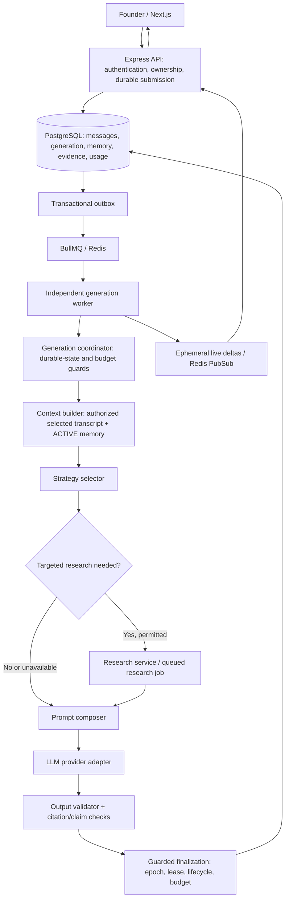

# Founder's Lens — LLD Phase 3A: AI Orchestration Fundamentals & Architecture

**Document ID:** FL-LLD-AI-3A  
**Status:** Approved — Documentation Only; P3D-A09, FL-P3-0.3-approved. Numerical settings remain provisional; implementation/provider/security/model validation remains pending.
**Version:** 0.3 — formal documentation sign-off recorded
**Baseline:** Canonical repository Phase 2D `decision-log.md`, `phase-3-handoff.md`, `state-machines.md`, `consistency-matrix.md`, `integration-review.md`, `traceability.md`, `test-acceptance-matrix.md`.  
**Implementation status:** No application code, model evaluation, or runtime validation is asserted.

## 1. Purpose, scope and authority

Design the *thinking engine* responsible for converting a founder's message into a useful, respectful, grounded next step. This document defines conceptual responsibilities, information flows, decisions, failure behavior, interfaces, and evaluation criteria, **not** database migrations, executable prompts, provider-specific SDKs, or implementation code.

**Existing Phase 2D authority, not changed here:** Express + TypeScript API; Clerk authentication; PostgreSQL authoritative; selected logical transcript and ACTIVE approved memory scoped to an authorized idea; `Idea.contextEpoch` checked at context build, dispatch and finalization; six generation lifecycle states; lease/fencing and bounded budgets; one active generation per conversation; transactional outbox/BullMQ; ephemeral Pub/Sub/SSE with durable final-result recovery; no automatic memory approval; approved snapshot immutability; privacy/deletion blocking; `Conversation.proactiveResearch` guards new automatic research admission. Phase 2D A07 is Approved as FL-P2D-1.0-approved, with byte-hash evidence in its approved revision manifest; Phase 3 has separate explicit P3D-A09 documentation approval.

**This phase proposes** how to select conversational strategies, build the AI's context, decide on research, produce safe structured responses and assess conversational quality. No new public API operation or physical database table is approved by this document.

## 2. Fundamentals, in human terms

| Term | Short definition | Founder's Lens example |
|---|---|---|
| **Orchestration** (workflow coordination) | Deciding which component acts, and in what order | Select strategy, get approved knowledge, optionally research, generate reply |
| **Context engineering** (choosing information supplied to the model) | Picking accurate, relevant inputs within a size budget | Latest conversation, approved memory, user correction and citations |
| **Prompt architecture** (organized model instructions) | Separating stable rules from dynamic, untrusted context | Product principles are instructions; a web page is only evidence |
| **Strategy** (response approach) | The main job of this turn | Challenge an assumption instead of drafting a report |
| **Grounding** (connecting claims to sources) | Making factual statements traceable and appropriately cautious | Cite retrieved customer research with date and geography |
| **Structured output** (validated fields rather than arbitrary text) | A defined response envelope rendered by known components | A brief answer with one approved assumption card |
| **Guardrail** (enforced safety or correctness rule) | A rule that blocks unsafe behavior, not just a prompt | Worker cannot persist memory approval |
| **Evaluation** (systematic quality measurement) | Testing how often outputs meet requirements | Does the AI avoid fabricated citations and repetitive questioning? |
| **Provider adapter** (interchangeable integration boundary) | A stable interface around model services | Change model vendor without rewriting domain decisions |

The important distinction is that an LLM *proposes* language and classifications; **application code and database constraints enforce** identity, authorization, versioning, job lifecycle, budgets and lasting memory.

## 3. User-facing behavioral contract

Founder's Lens is a curious, supportive, respectfully challenging companion for pre-revenue founders, initially India-aware and supportive of English and typed Hinglish. A turn should generally be brief, acknowledge the founder's actual question, provide useful thinking, and ask **at most one** meaningful next question unless the founder explicitly requests a list, report or detailed analysis. The journey labels **Explore → Question → Discover → Experiment → Reflect** are guidance, not mandatory wizard gates.

Never output a fabricated success probability, certainty score or authoritative 'validated idea' verdict. Distinguish founder statement, hypothesis, reported observation, retrieved source, inference and confirmed approved memory. Do not infer demographics, finances or intentions from incidental wording. If the user corrects something, prioritize the correction and do not continue asserting the old statement. Offer concrete, small affordable experiments rather than ungrounded business plans. Support autonomy: don't insist on interviewing people when the founder wants a comparison or actionable first step.

## 4. Component boundaries



This diagram is conceptual: research admission may be deferred and a queued research job can finish *after* the current reply. A successful model completion is **not** a successful database generation until guarded finalization commits.

| Component | Owns | Must never do |
|---|---|---|
| Express admission | Clerk identity/ownership, Zod input, idempotent message acceptance, response IDs | Invent model results or trust client user ID |
| Generation coordinator | State transitions, quotas, deadlines, job orchestration, checkpoint/reconciliation decisions | Hold transactions open across network/model calls |
| Context builder | Authorized and bounded context snapshot with provenance, epoch, ordering | Include removed memory, private other-idea content, raw secrets or unselected attempts |
| Strategy selector | Choose one primary conversational intent and optional secondary action | Treat probabilistic classification as permission or user approval |
| Research policy engine | Decide whether external evidence is useful and allowed | Automatically research when conversation disables proactive research |
| Prompt composer | Combine stable rules, specific task, scoped evidence, user text | Promote retrieved text into system instructions |
| Provider adapter | Model invocation, bounded streaming, timeout, usage/cost telemetry | Decide database authority or hide provider spend |
| Response validator | Validate text/card envelope, source references, quality constraints | Accept arbitrary model-authored HTML or fabricated verified statuses |
| Memory-proposal generator | Suggest small reviewable changes with provenance | Write `ConfirmedMemory` or accept proposals |
| Finalization service | Conditional commit under lease/context/lifecycle checks | Commit stale, cancelled, deleted, unauthorized or invalid responses |
| Quality evaluation | Deterministic assertions and scenario-based scoring | Claim objective business success prediction |

**Logical architecture:** The coordinator, selector, context builder, prompt composer, response validator and memory proposer are modules inside the existing API/worker codebase—not six new independently deployed microservices.

## 5. Canonical orchestration workflow

```mermaid
sequenceDiagram
    participant F as Founder
    participant A as Express API
    participant D as PostgreSQL
    participant Q as BullMQ
    participant W as Generation worker
    participant R as Research service
    participant L as LLM adapter
    F->>A: Submit message + Idempotency-Key
    A->>D: Clerk/ownership checks; commit user message, PENDING attempt, outbox, replay record
    A-->>F: 202 + stable IDs + status/events URLs
    D-->>Q: Outbox relay dispatches stable job
    Q->>W: At-least-once delivery
    W->>D: Claim lease + verify ACTIVE, epoch, budget; RUNNING
    W->>D: Load authorized selected transcript, ACTIVE memory, evidence
    W->>W: Select strategy and bounded context
    opt Research is useful AND proactiveResearch allows automatic admission
      W->>R: Create durable research intent / use bounded available findings
      R-->>W: Verified retrieval metadata or unavailable/insufficient result
    end
    W->>L: Versioned prompt + untrusted user/evidence data
    L-->>W: Candidate deltas / candidate final response
    W-->>A: Best-effort temporary live deltas
    A-->>F: SSE partial text; not authoritative final
    W->>W: Validate structure, claim provenance, card schema
    W->>D: Guarded commit: lifecycle + contextEpoch + leaseEpoch + current state
    D-->>A: Durable final answer and generation status
    A-->>F: Terminal event after commit OR GET final response on reconnect
```

### Detailed decision checkpoints

1. **Admission:** API verifies current owner and active idea; reserves budget and commits submission exactly once. Existing Phase 2B/2C contract controls 202 acceptance and original-response replay.
2. **Claim:** Worker validates its job lease and the generation state `PENDING`; transitions to `RUNNING` only using the existing guard. One active generation per conversation; a second conflicting turn gets the existing conflict behavior.
3. **Snapshot:** Load authorized selected transcript, ACTIVE memory, relevant assumptions/experiments and sourced evidence. Read `Idea.contextEpoch` and preserve it with the generation context. Do not use unselected regenerated responses.
4. **Plan:** Select one primary strategy; consider whether research is worth doing. Strategy and research are engineering decisions, not arbitrary permission to change memory.
5. **Research admission:** If `proactiveResearch=false`, don't create *new automatic* research. Existing explicitly user-requested/accepted jobs are governed by Phase 2D. If research is too slow or unavailable, either answer with labeled uncertainty or defer evidence and tell the user.
6. **Generation:** Assemble versioned prompt and call model through adapter; enforce remaining deadline and budget. SSE deltas are best effort, not permanently replayed.
7. **Validation:** Ensure output fits allowed text/typed cards, citations match stored source references, claims are appropriately qualified, and proposals remain pending.
8. **Finalization:** Check active account/idea, generation `RUNNING`, matching `leaseEpoch`, valid deadline, and **unchanged `contextEpoch`** in a short transaction. Commit selected final assistant answer/usage/proposals atomically according to Phase 2D constraints. Terminal state is committed before terminal SSE event.
9. **Recovery:** On browser reconnect, authenticate again and GET durable generation status/final selected message. Do not promise replay of lost fragments.

**Explicit privacy race:** If approved memory is removed or the idea is deleted between context capture and dispatch, dispatch must not proceed using old context. If an authorized provider request was already sent, late output cannot finalize if the context epoch has changed; Phase 2D defines the terminal reason `CONTEXT_CHANGED` under FAILED. Do not replace it with a silent new provider call.

## 6. Six response strategies and deterministic precedence

| Primary strategy | Use when founder is trying to… | Ideal output | Avoid |
|---|---|---|---|
| **EXPLORE** | Clarify an early idea or user goals | Reflect understanding + one useful question | Overly long onboarding quiz |
| **CHALLENGE** | Test confidence or expose a risky belief | Respectful counterpoint + testable assumption | Insulting, unsupported contradiction |
| **INFORM** | Obtain facts/context | Short answer with scoped evidence or uncertainty | Invented market statistics |
| **COMPARE** | Choose between options | Criteria, tradeoffs, explicit unknowns | Fake winner score |
| **ACT** | Decide next practical action | Small bounded experiment and success signals | Huge generic business plan |
| **REFLECT** | Interpret results or corrections | What changed, what remains unknown, next step | Treating 4 interviews as proof of market demand |

**Priority order (proposed):** (1) mandatory security/ownership gates, then permitted current-user corrections/instructions, (2) direct question or user requested output, (3) recent context and active experiment stage, (4) evidence sufficiency, (5) journey stage fallback. The LLM can propose a classification, but the coordinator checks policy constraints. Classifier uncertainty must not cause a second expensive model call by default. In ambiguous cases select a low-risk answer and one clarifying question.

**Multi-intent example:** “Compare SaaS and automation services for gyms and tell me what to do this weekend.” Primary `COMPARE` with a short `ACT` recommendation; not multiple independent monologues. **Correction example:** “No, Bengaluru working women, not Delhi students.” Correction wins: acknowledge/update pending proposal if justified, exclude stale *confirmed* memory only via approved edit/removal mechanism; don't silently overwrite approved data.

## 7. Context builder: source selection and precedence

**Trust tiers:**
1. Server-side system/developer policies and approved user product settings (instructions; never supplied by web tools).
2. Current verified user message and selected idea/conversation facts (the user's statement is authoritative *about what they said*, not proof of market facts).
3. `ACTIVE` approved memory and current canonical assumptions/experiments/learning, versioned and idea-scoped.
4. Selected logical conversation history, ordered by turn; current correction has priority over historical discussion.
5. Evidence records with source ID, locator, retrieved/observed dates, geography, verification state and caveats.
6. Unreviewed proposals, raw research snippets and model outputs are lower-trust *data*, not confirmed facts or executable instructions; include only for the explicit purpose.

**Hard exclusions:** Removed memory and its revisions; unselected generated answers; private data from other founders/ideas; deleted or inaccessible ideas; secrets; unapproved memory as confirmed truth; source text instructing the model to ignore safety; unnecessary personally identifying data. Searching old transcript must not re-introduce removed memory as authoritative context. Review the specific historical-text handling against approved P2D-P04 before retrieval.

**Bounded retrieval (proposed, to benchmark):** First select current user turn + a short contiguous recent window, then a limited number of the most relevant active memory/assumption/experiment items, then the minimum evidence needed for factual claims. Prioritize correctness and recency over filling a token limit. Keep input/output budgets configurable per model and account. If context cannot fit, trim less-relevant evidence/historical turns before current corrections or safety instructions; when essential facts conflict, ask rather than guess. Do not write AI-produced summaries into confirmed memory without approval.

**Context assembly (transient private data; only minimized durable versions/counts under approved P3-P02, physical §15):** idea/conversation/account IDs (internal only), selected logical-turn boundary, current memory versions, idea context epoch, evidence record IDs/retrieval timestamps, policy/prompt version, model adapter ID, budget reservation ID, and minimal safe hash/correlation. Do not persist full assembled prompts by default because of confidential founder data; logs must not include secrets/raw prompt.

## 8. Research decisions and evidence integrity

New externally retrieved evidence always has a durable ResearchJob, usage reservation and outbox before provider work. The existing public POST /api/v1/ideas/{ideaId}/research-jobs is the manual adapter; the generation coordinator invokes the same internal admission use case with a server-derived automatic origin and triggerMessageId, never a stored bearer or a new public endpoint. FR-034 already permits automatic research. Admission locks/checks ACTIVE owner/idea and conversation.proactiveResearch; disabling affects newly admitted automatic jobs, not accepted/manual work.

NO_RESEARCH and USE_EXISTING_EVIDENCE create no job. INLINE_BOUNDED_RESEARCH is a bounded wait for the same durable job/worker, not a direct in-process search bypass; QUEUE_RESEARCH stops waiting and answers honestly with pending research. Research results arriving later are read through existing evidence/job GET routes or the next authorized turn; no autonomous assistant message is appended. RESEARCH_UNAVAILABLE records no false accepted job/evidence. Full dedupe, deadline, retry and budget mapping is in Phase 3D §6.

Persisted ResearchStatus values are QUEUED, RUNNING, SUCCEEDED, INSUFFICIENT_EVIDENCE, FAILED, LIMIT_REACHED, CANCELLED. Source ID, locator/retrieval time, known geography/period and caveats are retained; SOURCE_CHECKED verifies source attribution, not business truth. User reports remain USER_REPORT. No evidence is promoted to confirmed memory.

## 9. Prompt architecture and structured response contract

**Prompt layers (separate responsibilities):** stable product identity and behavioral boundaries; application policy and tool permission rules; per-turn strategy/task; structured idea-specific approved memory/selected transcript; evidence packets clearly labeled untrusted; output-shape contract. Attach stable `promptPolicyVersion` and strategy label to internal evaluation metadata; provider-specific syntax stays behind adapter. No disclosure or storage of private model chain-of-thought. User-visible concise rationale is fine.

**Conceptual response envelope (not a public OpenAPI amendment yet):**

| Field | Description | Enforcement |
|---|---|---|
| `messageText` | Clear, brief main answer | Validate type/length; screen misleading certainty |
| `primaryStrategy` | Primary strategy name | One of six internal types |
| `card` | Optional single safe visual element | Zero or one discriminated assumption/evidence/comparison/experiment; no card array |
| `citationRefs[]` | Evidence IDs referenced | Verify each ID is allowed for this idea, source exists, provenance valid; unsupported material claim rejected or safely omitted with independent text validation; no cosmetic citation removal or hidden paid repair |
| `memoryProposals[]` | Suggested user-reviewable changes | Always pending; source and target/version specified; never auto-write confirmed memory |
| `nextQuestion?` | Optional single useful question | Avoid repetitive interrogation; no forced question if user seeks direct answer |
| `qualityFlags[]` | Internal validation warnings | Never expose raw model debugging/private prompts |

**Progressive rendering:** User sees a concise answer; cards are optional and appear only when helpful. The server renders **known UI components from validated data**, never arbitrary AI-generated HTML. If typed enrichment fails validation, prefer a safe text-only reply *only if text is itself valid, grounded and consistent*; otherwise fail the generation safely. No 'repair' call that silently incurs provider costs outside budget.

## 10. Failure-mode and recovery table

| Failure / race | Expected behavior | Test oracle |
|---|---|---|
| Browser disconnects midstream | Generation may continue; final stored result recoverable via GET; live chunks not guaranteed replay | No duplicated submission or invented completed message |
| Same message submitted twice | Existing Phase 2C idempotency key returns original acceptance; only one logical user message | Stable IDs, identical recorded accepted response |
| Two active attempts in conversation | Database/claim guards prevent simultaneous active generations | One accepted, one defined conflict |
| Model timeout before reliable completion | Bounded retry only if provider invocation safety known; otherwise FAILED, no fake success | No extra unapproved provider spending |
| Redis lost after outbox commit | Durable intent remains; relay recovers; temporary live deltas may be lost | One durable business effect after reconciliation |
| Worker lease expires and stale worker returns | `leaseEpoch` guard rejects stale output | No stale assistant selection/proposals |
| Founder removes memory during context build | Old `contextEpoch` cannot authorize dispatch or commit | No obsolete-context provider dispatch/final result |
| Founder deletes idea midresearch | Lifecycle gate prevents new evidence/selected output, purge handles prior artifacts | No data reappears after deletion |
| Proactive research disabled | No new automatic research admitted; accepted/manual jobs follow existing rules | No automatic queue admission |
| Search unavailable/contradictory | Answer with uncertainty, defer or ask; no invented sources | Every citation maps to an evidence ID |
| Output schema invalid | Text-only fallback if safe or controlled failure | No arbitrary HTML/unsupported cards committed |
| Provider gives unsafe/tool-injection text | Treat tool output as untrusted source data | No execution of web instructions or exfiltration |
| User corrects target market | Acknowledge correction; don't silently edit approved memory | Correctness measured in ensuing response and proposals |
| Quota reached | No paid provider call; controlled limits response | Usage reservation and actual provider calls reconcile |
| SSE says completed before DB commit | Forbidden | Final event follows durable successful commit |

**Existing state machine authority:** Do not add an `INTERRUPTED` persisted generation state. Canonical generation states are `PENDING`, `RUNNING`, `CANCEL_REQUESTED`, `COMPLETED`, `FAILED`, `CANCELLED`; terminal states immutable, and no `CANCEL_REQUESTED → COMPLETED` transition. Regeneration only the latest eligible user turn and does not reopen a terminal attempt.

## 11. Evaluation program (offline design before implementation)

**Two independent gates:** (a) deterministic correctness/security assertions for permissions, transitions, citations, idempotency and budgets; (b) scored conversational quality for usefulness, respect, calibration and founder progress. A high average conversational score cannot excuse a privacy/citation violation.

**Historical diagnostic rubric** (0–4 only for optional analysis; not the canonical SRS 0–2/12 release rubric):
- **Intent fit:** answers the actual question rather than a generic startup script.
- **Appropriate challenge:** identifies shaky assumptions without being condescending.
- **Grounding and calibration:** facts supported by scoped sources, uncertainty explicit.
- **Memory discipline:** respects confirmed/assumed/pending/removed distinctions.
- **Actionability:** small realistic next step where relevant.
- **Conversation quality:** concise, progressive, English/Hinglish coherent and non-repetitive.

**Hard failures (always fail fixture):** cross-owner leakage, unauthorized/automatic memory approval, fabricated citation, stale-context commit, unbounded hidden provider calls, removed memory reintroduced as approved truth or known-linked stale context, model-generated executable HTML, invented success score, completed signal without committed response.

**Fixture categories:** vague Hinglish founder; overly confident student-app founder; ₹20k bakery startup; local tiffin competitor claim; SaaS-vs-service comparison; “no competitors”; price-sensitive market stereotype; research loop; 4/5 interview nonpurchase; founder frustrated by too many questions; correction from Delhi students to Bengaluru working women; deleted memory during active generation; research disabled; conflicting sources; document-related request; explicit direct factual question. Evaluate both human-readable answers and state/DB side effects using a deterministic fake adapter for flows and pinned model responses for quality review.

**Historical release-target proposal, superseded by SRS §10/§12.3:** the original >=80% / 0–4 thresholds are retained as rationale only, not the release baseline. Use Phase 3D §9: 0–2 per six SRS dimensions, provisional >=90% at >=10/12, >=95% correction fidelity, >=90% correct memory type/provenance; hard safety gates remain uncompensated. Collect regression snapshots when prompt or provider versions change. Do not use these as production evidence until measured.

**Traceability:** Existing `FR-013–021`, `FR-034–040`, `NFR-008–011`, `AT-012–020`, `AT-033–039` and relevant `AI-001–004` are the Phase 3 input set indicated in Phase 2D handoff/traceability. Actual SRS wording/targets are checked in Phase 3D §2/9/14; the earlier uploaded-index limitation is superseded.

## 12. Nonfunctional design and observability

**Scalability:** Stateless Express API instances and independently scalable worker processes; bounded concurrency per user and per model adapter; no locks held across model/search network calls; per-provider quotas and deadlines; feature flags for research and cards. Redis supports queue/ephemeral updates, not authoritative chat content. Parallelize only genuinely independent, bounded retrieval tasks; do not create expensive unbounded tool loops.

**Reliability:** Every accepted operation has a durable ID; relay and worker are idempotent under Phase 2C contracts; a generated answer is committed only after validation and guarded finalization. Backpressure disconnects slow stream consumers without silently canceling durable generation. Faults are classified as validation, authorization, provider/research, budget, cancellation, lifecycle/context change, and infrastructure.

**Security/privacy:** Minimize sensitive data sent to external model/research providers. Record provider data retention limitations and hosting restrictions before deployment. Never log prompts, full founder ideas, tokens, signed URLs or raw search results by default. Never let external text override policy. All cited evidence is scoped and authorized before exposure. Context deletion guarantees follow approved P2D-P04; provider in-flight calls cannot be retroactively undone.

**Telemetry (metadata only):** correlation/generation ID, strategy, prompt version, adapter, approximate token count, quota reservation/settlement, elapsed times per stage, research decision, validation failure code, cancellation/deadline/lease outcome and opaque evidence IDs. Export metrics like generation error rate, time to first delta, finalization success, stale epoch rejections, no-source fallback rate, cost per operation. Set objective SLOs only after baselines; do not promise uptime on unverified free hosting.

## 13. Decision and change-control register

| Decision | Status | Rationale / next proof |
|---|---|---|
| Reuse approved Phase 2D generation states, outbox, SSE and privacy guards | **Existing approved/design baseline** | Do not modify in Phase 3A |
| Six strategies EXPLORE/CHALLENGE/INFORM/COMPARE/ACT/REFLECT | **Inherited SRS FR-016 requirement** | Selector heuristics reviewed against fixtures |
| Context trust tiers and minimum-necessary retrieval | **Phase 3A proposal** | Security/provenance review, benchmark relevance |
| One primary strategy; secondary action only when useful | **Inherited one-primary requirement; heuristic proposal** | Human conversational evaluation |
| Automatic targeted research only when needed/permitted/budgeted | **Phase 3A proposal** | Validate policy, tool admission and latency |
| Optional allowlisted cards; no arbitrary HTML | **Approved principle P3-P01** | Schema tests and opt-in UI contract alignment |
| Internal response envelope fields | **Approved principle P3-P01** | Explicit API §18 opt-in amendment; legacy default retained |
| Prompt/model adapter, token/cost budget defaults | **Open technical choices** | Select available model/provider and measure |
| Thresholds in evaluation rubric | **Proposed, not measured** | Approve quality target then run fixture suite |
| Phase 2D formal sign-off A07, exact revision evidence | **Resolved: A07 approved, exact manifest verified** | Record separately; don't infer from product policy approvals |
| External provider privacy/backup retention, hosting | **Deployment gate** | Verify before public beta |

## 14. Phase 3A acceptance checklist

- [ ] Behavior and strategy table accepted without changing approved product scope.
- [ ] Every module has a clear owner and no new independently deployed service is introduced.
- [ ] Context rules respect `contextEpoch`, approved memory, selected transcript and same-idea scope.
- [ ] Research decision rules respect `proactiveResearch` and source provenance.
- [ ] AI cannot approve memory, forge citations or render arbitrary HTML.
- [ ] Every model call is admitted under lease/deadline/usage controls.
- [ ] Cancellation and deletion races align with canonical Phase 2D states.
- [ ] Error/fallback paths and evaluation hard failures are documented.
- [ ] Approved response principle distinguished from provisional quality targets and recorded complete-package P3D-A09 sign-off.
- [ ] Phase 2D A07 revision sign-off is recorded separately or tracked.
- [ ] No code or runtime performance/testing claims made.

## 15. Next design packages (documentation only)

Historical planning record: Phase 3A–3D are now approved documentation under P3D-A09. The sequencing below describes their original preparation; it does not reopen sign-off or authorize another phase.

**3B — Context & Prompt Contracts:** exact field precedence; history/memory/evidence selection and token budgeting; corrections; prompt templates/versions; redaction and adversarial tool-text handling.

**3C — Strategy, Research & Response Schemas:** scoring/classification decision tables; inline-vs-queued research policy; typed allowed-card DTOs; citation grounding; pending memory proposal structure; full failure responses; reconcile any public API changes.

**3D — AI Quality Evaluation & Integration Review:** golden scenarios, explicit rubrics, deterministic security tests, regression gates, prompt/provider version management, cross-document reconciliation and sign-off.

**Do not advance to implementation or claim Phase 3 accepted until its proposed contracts are reviewed and reconciled with the canonical SRS/API/DB documents.**


## Repository reconciliation boundaries (Phase 3D v0.3)

Current status: P3-P01–P3-P05 are explicitly owner-approved principles in [3D §11](ai-integration-evaluation-review.md#11-decision-and-approval-register). Complete-package sign-off P3D-A09 is Approved — Documentation Only; exact finalized file bytes are in [FL-P3-0.3-approved](approved-revision-0.3.json). All numerical bounds, allocations and quality targets remain provisional engineering settings; no runtime/model evaluation is asserted.

Structured replies retain the legacy default Message.content:string. Explicit assistantResponseVersion=2 on the existing transcript GET selects assistantContent with one primary strategy and at most one card; [API §18](../02-api-security/api-contracts.md#18-phase-3-owner-approved-assistant-response-amendment) and OpenAPI own the wire contract. Stored content format2 is distinct from assistantContent.schemaVersion1. No new submit route, generation state, SSE event or token replay is introduced. Buffer structured enrichment until validation; stream only safe text, never proposals, private context or hidden reasoning.

[Physical §15](../01-database/physical-design.md#15-phase-3-approved-principle-design-amendments) declares nullable GenerationAttempt.orchestrationMetadata for minimal version references/counts. It is a design amendment, not an executed migration. Existing provider/model/strategy/contextEpoch fields are reused. Raw prompts, hidden reasoning and duplicated private context are prohibited. P3-P03 stronger linked-history filtering follows 3B §5; semantic removal is imperfect. P3-P04 approves bounded spending and honest failure, while exact one-call/no-repair/research caps remain provisional. P3-P05 approves repeatable datasets/review, while calibrated thresholds and measured results remain pending validation. Phase 2D authority, ownership, cancellation, epochs, fencing, privacy and user-only memory approval remain in force.
