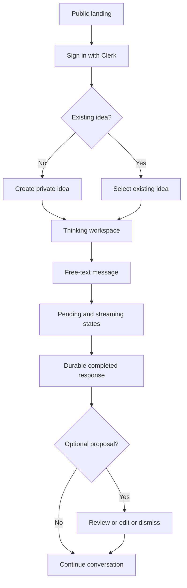
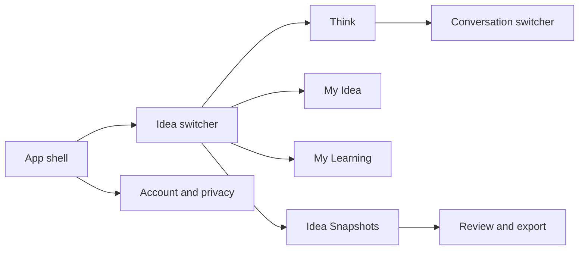
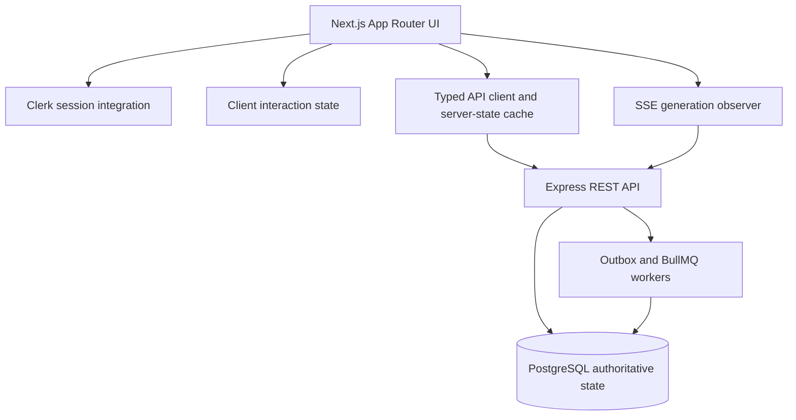
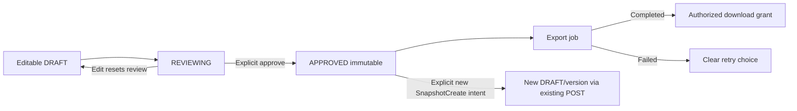

# Founder's Lens — LLD Phase 4A: Frontend Fundamentals, User Journeys & Architecture

**Document ID:** FL-LLD-FE-4A  
**Version:** 0.5 — approved final mapping design
**Status:** Approved — Documentation Only under FE4D-A08, revision `FL-P4-0.5-approved`. Navigation, visual/recovery principles, P4-AM01–04 and P4-B01/B02 are included. Runtime/migration/provider tests remain pending. The exact approved baseline is [approval manifest](approved-revision-0.5.json); [4D §19](frontend-integration-review.md#19-formal-phase-4-documentation-sign-off) records evidence and deferred gates.
**Scope:** Next.js/TypeScript frontend architecture, navigation, user journeys, state ownership, API boundaries, accessibility and test specification. **Documentation only; no code or UI implementation.**

## 1. Purpose and source authority

Phase 4A translates the existing product and backend contracts into an implementable frontend architecture. It must preserve the conversation-first experience and the approved privacy, AI and reliability decisions without pretending a frontend choice can override server authority.

**Current source evidence:** canonical PRD/SRS/HLD, ADR-013, Phase 2 API/OpenAPI/inventory/security/database/reliability, Phase 2D approval/product policies and all Phase 3 documents/FL-P3-0.3-approved manifest were inspected. [4D §1](frontend-integration-review.md#1-executive-assessment) records inventory/approval evidence and [4C §8](frontend-state-api-integration.md#8-endpoint--ui-operation-matrix-design-mapping) maps all 48 founder operations. Earlier unavailable-source caveats are superseded; navigation and visual choices remain proposals, not owner approvals.

**Non-negotiable inherited requirements:** authentication before AI; one primary thinking strategy per AI turn; at most one assistant card and two prominent contextual actions; typed English/Hinglish; no compulsory stage gates; reviewed memory; idea-scoped authorization; approved immutable snapshots; existing six-state generation lifecycle; SSE (server-sent events) provides live fragments without durable fragment replay; browser disconnect does not cancel generation; legacy message projection remains default with explicit `assistantResponseVersion=2` for compatible structured transcript; no new server endpoints assumed.

### 1.1 Out of scope

No production UI, Next.js project scaffolding, page code, design tokens in CSS, Figma artifacts, app routes deployed, analytics SDK installation, database migration, new REST endpoint, background job, full visual design or provider selection. The four Phase 4 documents provide design only; later separately authorized frontend acceptance must validate implementation.

## 2. Fundamentals explained plainly

| Term | Meaning | Founder's Lens example |
|---|---|---|
| **Route** | A URL representing a navigable view | Opening a particular idea's workspace |
| **Server Component** | A Next.js rendering unit executed on the server | Rendering a noninteractive workspace shell |
| **Client Component** | An interactive browser component | Chat composer, editable memory proposal |
| **Hydration** | Connecting browser interactivity to server-rendered markup | Making a rendered chat button interactive |
| **Application state** | Information the UI currently tracks | Draft message, selected tab, stream status |
| **Server state** | Data owned by the backend and fetched by the UI | Saved idea, confirmed memory, completed generation |
| **Optimistic UI** | Showing a tentative update before server confirmation | Labeling a message *sending*, not *saved* |
| **SSE** | A one-way live server-to-browser event connection | Displaying assistant text while generation runs |
| **Accessibility** | Making interfaces usable through keyboard and assistive technology | Visible focus and announced response status |
| **Design system** | Reusable rules for typography, spacing and components | Consistent action, error and card patterns |
| **ETag / If-Match** | A version check preventing accidental overwrite | Two tabs editing the same saved memory |
| **Idempotency key** | A request identifier preventing repeated actions from being duplicated | Safe retry after uncertain chat submission |
| **Progressive disclosure** | Showing essential information first and details on request | One evidence finding, expandable sources |

**Core principle:** The browser renders and initiates actions; Express/PostgreSQL decides what is authorized and saved. UI labels are never proof that a database write succeeded.

## 3. Product experience principles

1. **Conversation first:** The founder can explain an idea immediately after authentication, without answering a long business-plan form.
2. **Founder controls the direction:** Journey stages are suggestions, not locks or mandatory checklist steps.
3. **Truthful provenance:** Distinguish founder belief, untested hypothesis, user observation, external evidence and AI suggestion.
4. **Review before durable promotion:** AI proposals are never pre-accepted; save confirmations occur after successful authorized response.
5. **Quiet intelligence:** Default text is concise, at most one card and two prominent actions per turn, one meaningful question if useful—not mandatory.
6. **Recoverable work:** Disconnect, refresh, timeout and duplicate submission do not imply failure or success without checking durable status.
7. **Private by default:** No sensitive idea data in public pages, cross-account caches, analytics payloads or URL query strings.
8. **Mobile is a first-class workspace:** Think, My Idea and My Learning remain reachable without losing the idea/conversation.
9. **Typed Hinglish supported:** Interface text may start in English; assistant accepts mixed-language input. No voice/full Hindi localization promise in MVP.
10. **No fabricated data:** Missing sources, status and evidence remain visibly unknown rather than inferred by the frontend.

## 4. User journeys and acceptance outcomes

| Journey | Founder steps | Essential UI outcome | Primary SRS references |
|---|---|---|---|
| **FJ-01 First idea** | Land → sign in → select/create idea → type free-text idea → chat → review proposed assumption → optionally save test | No compulsory questionnaire; no unconfirmed promotion | J-01; FR-013–020, 022–023, 029–030 |
| **FJ-02 Returning founder** | Sign in → choose existing idea → return to conversation → record observation → inspect linked learning | Selected transcript and prior hypothesis remain coherent | J-02; FR-031–033 |
| **FJ-03 Targeted research** | Ask factual question/AI initiates relevant permitted research → status notice → inspect one finding → expand sources | Proactive-research toggle visible; no fake source or certainty | J-03; FR-034–040 |
| **FJ-04 Correction and memory** | Correct target market in chat → immediate response adapts → inspect proposal → edit/accept or dismiss | Conflicting saved memory not silently changed; confirm only after commit | J-04; FR-022–028 |
| **FJ-05 Snapshot export** | Create draft → edit → review → approve → request PDF → wait/status → download | PDF corresponds to exact approved version; no hidden auto-export | J-05; FR-041–044 |
| **FJ-06 Network interruption** | Submit → network drops/refresh → return → fetch generation status and selected transcript | Same-intent replay only with exact retained command; reload ambiguity disclosed, no automatic paid resend | J-06; FR-007–012, 045–047 |
| **FJ-07 Authorization denial** | Attempt foreign/deleted idea link | Neutral access-denied/not-found state with no content or signed URL exposure | J-07; FR-001–006 |
| **FJ-08 Privacy deletion** | Reauthenticate → confirm deletion → see accepted status → lose normal workspace access | No false immediate hard-purge claim; only permitted minimal status surfaces | P2D-P01–03, FSEC-05–08 |

### 4.1 First-founder happy path

**Authentication clarification:** PRD sketches an open landing/start prompt; SRS explicitly requires authenticated identity before AI. A public page may show non-AI example copy and a tentative unsent draft, but it cannot submit it to the model before authentication or promise durable persistence. This is a proposed UX reconciliation, not a change to the SRS.

## 5. Information architecture and route proposals

The SRS describes **logical surfaces**, not mandatory URL count. Prefer stable idea-scoped routes for deep links, and mobile tab/drawer navigation with the same accessible destinations. Proposed routes below must be checked against chosen Next.js app-router structure; names are not backend API paths.

| Proposed route | View | Access rule / empty state |
|---|---|---|
| `/` | Public introduction | No private content/AI call |
| `/sign-in`, `/sign-up` | Clerk-hosted/embedded auth flow | Product-specific flow follows verified Clerk integration |
| `/app` | Idea selection and new idea entry | Authenticated; first-use empty state |
| `/app/ideas/[ideaId]/think` | Chat/workspace; conversation chooser; selected chat has the explicit conversation route below | Verified active idea; no foreign content |
| `/app/ideas/[ideaId]/conversations/[conversationId]` | Specific conversation | Idea and conversation ownership verified server-side |
| `/app/ideas/[ideaId]/overview` | My Idea | Claim types, assumptions, memory proposals, evidence |
| `/app/ideas/[ideaId]/learning` | My Learning | Experiments, observations, linked learnings |
| `/app/ideas/[ideaId]/snapshots` | Snapshots list | Approved/draft states |
| `/app/ideas/[ideaId]/snapshots/[snapshotId]` | Preview/review/export | Only owned snapshots, stale version handling |
| `/app/settings` | Preferences/privacy/data operations | Reauth for destructive account deletion |

**Approved route direction (FE4D-A01):** retain the idea-scoped table above. Think is primary; /think is the conversation chooser and /app/ideas/[ideaId]/conversations/[conversationId] the selected chat. My Idea/My Learning/Snapshots support it without stage gates. No alternate query-selected route is introduced; browser implementation/usability remains untested. HTTP operations are in4C§8.

### 5.1 Navigation hierarchy

**Mobile navigation:** persistent, keyboard/screen-reader-operable way to reach Think/My Idea/My Learning; Snapshots and privacy accessible through a menu. Leaving Think never cancels generation. Retain unsent drafts in current principal/idea-scoped memory where possible; warn before destructive navigation. Refresh loses an unsaved draft under the no-persistence default.

## 6. Frontend architecture — responsibilities

**Diagram semantics:** Next.js does not access PostgreSQL directly or run the generation orchestration. Express accepts and authorizes; independent workers execute accepted work. This is consistent with Phase 2D/3 even if an older HLD conceptual diagram has a pending AI-D14 caption correction.

| Module | Frontend responsibility | Not its responsibility |
|---|---|---|
| App shell/layout | Navigation, focus, error/loading boundaries, responsive structure | Resource authorization |
| Auth boundary | Obtain/refresh Clerk session using supported integration, redirect unauthenticated users | Trust client-supplied user IDs |
| Typed API adapter | Parse responses, attach permitted headers, normalize errors, surface status | Override server contract or invent resources |
| Query/cache layer | Scope server state by account/idea/conversation and response version | Durable source of truth |
| Chat composer | Local draft, prevent accidental duplicate sends, show accepted IDs | Generate permanent message IDs/AI replies |
| Generation observer | SSE lifecycle display, reconnect/status reconciliation, cleanup on view exit | Cancel server generation merely because view closes |
| Structured response renderer | Render allowlisted text and optional card, source and action links | Render arbitrary HTML/tool directives from model output |
| Review editor | Manage proposals, If-Match versions, confirmation dialogs and conflicts | Silent server-side approval |
| Snapshot workspace | Draft edits, reviewed approval, export status and authorized download grant | Rewrite approved content |
| Privacy settings | Explicit confirmations and status messaging | Claim deletion complete before acknowledged |

### 6.1 Next.js rendering decisions (proposed)

- Use App Router layouts for authenticated app shell and idea navigation; isolate responsive interactive chat/editor elements as Client Components.
- Use Server Components for static/shell content and safe, authorized initial view data only after session validation. For private or time-sensitive data, avoid accidental cross-user caching or public static generation.
- All mutation and canonical fetch paths should conform to existing Express APIs; do not create a second, competing business backend inside Next.js Server Actions.
- Direct browser→Express session Bearer is inherited from API/security, not an open BFF choice.4C §20 defines no ambient-cookie API auth, CORS/CSRF and SSR gates; changing transport requires a new ADR.
- Do not expose model/provider keys or raw authorization details to browser bundles.

## 7. State ownership and persistence

| State category | Example | Owner | Persistence / recovery |
|---|---|---|---|
| Durable business | Ideas, messages, saved memory, experiments, snapshots | PostgreSQL behind Express | Authorized GET, versioned writes |
| Durable generation | PENDING/RUNNING/CANCEL_REQUESTED/COMPLETED/FAILED/CANCELLED | Backend generation state machine | GET generation status; terminal transcript GET |
| Ephemeral transport | SSE connection and token fragments | Browser observer | Fragments may be lost; not replayed |
| Local UI | Composer text, active tab, modal, validation hints | Client UI | Private text stays in memory;only bounded opaque recovery IDs use approved sessionStorage (4C§19) |
| Query cache | Fetched lists/details keyed by principal, idea, route, representation | Frontend cache | Invalidated after server commit/identity change |
| Draft edit | Unsaved snapshot or proposal changes | Review component | Explicit unsaved indicator; server version before approval |

**Cache key requirement:** Include principal/session boundary, idea ID, resource ID and structured-response selector where relevant. On logout, account change or deletion, clear all private cached data and abort subscriptions. No local-storage cache of full private transcripts by default; evaluate offline drafts separately with explicit privacy trade-offs.

## 8. Chat interaction and generation recovery

### 8.1 Submission lifecycle

1. Validate local nonempty text and any configured display limit; don't claim backend acceptance yet.
2. Generate a fresh client submission identifier and idempotency key for the **new user intent**; keep both stable for retries of that intent.
3. Call the existing message-submission endpoint; only after the server returns its accepted `messageId`, `generationId` and URLs display **Saved / accepted for generation**. Before that use **Sending…** and **Uncertain—checking…**, not *saved*.
4. Observe the server generation by its status GET and SSE endpoint. A live delta is temporary text, **not** durable persisted output.
5. On terminal completion, fetch the authoritative transcript; request `assistantResponseVersion=2` to render structured output, with a legacy-compatible fallback only when the documented contract permits it.
6. On network loss within a tab, replay only the exact retained command with the same identifiers/key. After full reload, use 4C §19: default no private persistence, no automatic resend, authorized transcript inspection and explicit uncertainty. Opaque IDs alone cannot reconstruct the command or locate an unknown generation.
7. Browser close, tab switch, stream error or slow client must **not** silently cancel the job. Explicit Stop calls cancellation endpoint with its own idempotency key and shows `CANCEL_REQUESTED` until terminal status.

### 8.2 UI states

| Server/transport state | Visible behavior | Prohibited claim |
|---|---|---|
| Local pending (not accepted) | Sending indicator, disable duplicate action | “Saved” before 202/commit |
| PENDING | Message accepted; assistant queued | Fake generated text |
| RUNNING | AI thinking; safe ephemeral text delta; accessible status | Promise that stream is stored/replayable |
| CANCEL_REQUESTED | Stopping…; disable repeated stop UI | “Cancelled” before terminal |
| COMPLETED | Fetch and show persisted assistant response and card | Render unvalidated provider JSON |
| FAILED | Show recoverable explanation; new action must respect latest-turn regeneration rules | Auto-create hidden paid retries |
| CANCELLED | Show cancellation; no selected new response | Convert cancelled to completed |
| SSE disconnect | Reconnecting/status polling; preserve composer & current view | Implicit cancellation |
| Context changed after dispatch | Explain response could not be finalized; refreshed memory used next turn | Surface obsolete reply as saved |
| Research queued/unavailable | Status, uncertainty and optional manual controls | Claim fresh result exists |

Never infer final status from a missing SSE event; the DB-backed GET is authoritative. No `Last-Event-ID` replay claim or fabricated replay timeline.

## 9. Structured responses and grounded research

- **Text-first default:** Readable assistant answer with optional singleton card (assumption, evidence, comparison, experiment).
- **Representation contract:** Existing default `content:string` stays unchanged. Explicit GET messages `assistantResponseVersion=2` returns structured `assistantContent` for eligible assistant rows; user/legacy rows have no invented metadata. Representation-specific cursor remains scoped to the chosen selector. Check the current OpenAPI before implementation.
- **Actions:** At most two prominent actions, bound to already-authorized user commands. A card suggesting an experiment **does not save the experiment**. Clicking Save requests an explicit user-initiated API mutation.
- **Citations:** Render source name/locator, retrieval time and relevant geography/time caveats when available. IDs alone are not proof of factual support. Never render model-provided raw HTML or unsafe links.
- **Research indicator:** Show when automatic external research is in progress; place the conversation-specific `proactiveResearch` preference control near relevant status. Turning it off prevents **new automatic** research, not necessarily a previously admitted job. Never invent a job-status value or second API.
- **Unknown/conflicting evidence:** Prefer a clear uncertainty notice, not an attractive but unsupported evidence card.
- **Language:** Preserve Unicode, code-switching and plain-language prompts. Do not use language heuristics as an authorization or factual-evidence signal.

## 10. Review workflows

### 10.1 Memory proposals and confirmed memory

- Show each proposal as **Pending review**;request projectionVersion2 for actual version/text/minimal source. Unknown/unavailable source has null IDs,never invented text. Target checks remain server-owned;API§19.4 defines the approved projection.
- Provide explicit **Accept**, **Edit and accept** and **Dismiss** choices. The UI cannot mark a proposal approved just because a button was clicked; wait for successful transaction response.
- For confirmed memory, provide inspect, correct, remove and revision history using available projections. Missing proposal source/version fields are an explicit 4D §13 gap; never fabricate them. `REMOVED` is not an invitation to restore it via the model.
- Use `If-Match` against the proposal's own version; backend additionally checks targeted memory version. Show 412 conflict with Refresh and Compare, not silent retry/overwrite.
- If a recent founder correction conflicts with confirmed memory, treat it immediately in chat while the durable memory update remains pending; show that distinction.
- Do not reuse removed-memory text in cached AI summaries, suggested chips or analytics.

### 10.2 Assumptions, experiments, learning

Present claim class, validation status, evidence links, review/edit/dismiss options and realistic experiment constraints. Avoid binary “proven” badges when evidence is partial. User observations remain distinct from interpretations. Experiment progress is optional; founder can freely return to Think.

### 10.3 Reviewed Idea Snapshots

Proposed UI state machine:

Existing API §14 expressly supports new versions: POST /api/v1/ideas/{ideaId}/snapshots with SnapshotCreate.content and a new Idempotency-Key returns 201; the server allocates the next idea version under lock. No fork endpoint, parentSnapshotId, clone operation or automatic AI drafting is implied. REVIEWING can be local review mode; approval permits DRAFT directly.

Make unknown facts prominent; provide revision-aware unsaved-change warnings and preview parity checks. After approval, disable content edits on that version. Export is an **explicit separate action**; show job status then obtain an owner-checked fresh download grant. Grant expiry and object availability are not the same as job completion. Do not persist signed URLs in analytics, logs or query-cache storage.

### 10.4 Account and idea deletion

Explain scope and active-system 30-day purge target separately from actual backup/provider retention. Account deletion requires verified fresh authentication; on accepted deletion, immediately replace the workspace with a limited privacy status view and clear private caches. Never imply a completed purge while DataOperation remains pending. After Clerk account deletion, status may be inaccessible without a valid session; the UI must not imply guaranteed later status retrieval. New signup is a new empty account, never a restore by email.

## 11. Accessible interaction requirements

Target WCAG 2.2 AA-oriented audit per SRS NFR-014, with documented manual and automated checks; success is **not** established by library choice alone.

- Full keyboard use for navigation, composer, cards, memory review, modal confirmations, snapshot editor, source expansion and research toggle.
- Strong visible focus, logical tab order, labeled inputs/buttons and skip-to-main link.
- Chat status announcements via non-disruptive live regions; announce lifecycle milestones without speaking every streaming token. Avoid auto-scrolling when users scroll back/read older content.
- Error summaries and field-specific errors; never rely on color alone to convey pending, approved, uncertain or deletion states.
- Text contrast and touch targets verified against the chosen design tokens; responsive layouts prevent horizontal overflow at common mobile widths.
- Reduced-motion support; no spinner as sole status indicator. Long-running operations include explicit status text.
- Screen-reader-friendly card labels, source links and document preview fallback (including text review), with explicit return to prior focus after dialogs.
- Keyboard shortcuts for message submission must not trap users; multiline compose supports Enter/Shift+Enter policy, configurable or clearly documented, including IME composition behavior for Hinglish.

## 12. Security and privacy boundaries

1. Server controls resource scope and authorization; route hiding is not access control.
2. No user-entered `userId` treated as identity. Session claims must be verified using the supported Clerk boundary.
3. Browser never holds model provider secrets, database credentials, or privileged worker tokens.
4. Use safe text rendering; sanitize any required rich text through an allowlisted policy; no arbitrary HTML from model/cards/evidence.
5. Do not use untrusted research URLs for implicit fetch, preconnect or preview without an approved SSRF/URL scheme policy.
6. Clear cache on sign-out, account switch/deletion; never share cached server state between principals.
7. Avoid sending prompts, idea text, citations or signed URLs to generic analytics/error trackers. Request correlation is opaque and minimal.
8. Handle token expiry and SSE reauthentication as explicit UI status; never promise instantaneous revocation of a previously authorized provider call.
9. Respect backend rate limits, expiration, `Retry-After` and quota errors; no client-side retry loop that creates new paid intents.
10. Accessibility and error copy must avoid revealing whether another founder's resource exists (privacy-preserving 404).

## 13. Performance, resilience and operational UI

- Load only the current selected conversation page and requested idea summaries first; paginate older transcript and experiments.
- Use virtualized/segmented transcript rendering only if it preserves screen-reader order, focus and selected logical-turn cursor after regeneration.
- No automatic background polling across every dormant idea. Poll active generation/status only with bounded, visibility-aware behavior and explicit server guidance.
- Expensive client formatting, long lists and charts must not block the composer. Avoid animating every delta excessively.
- Treat offline status as an inability to confirm server state, not proof that a POST failed. Preserve stable retry identifiers while resolution is pending.
- No speculative metric targets without measuring device/browser/model behavior; performance budgets to be set in later testing phase.

## 14. Frontend acceptance catalog (planned, not executed)

| ID | Scenario | Expected oracle / proof |
|---|---|---|
| FE4A-01 | Public user tries AI | Authentication before provider invocation; public marketing sample only |
| FE4A-02 | First-time founder | Free-text start without mandatory questionnaire |
| FE4A-03 | Desktop/mobile navigation | Think/My Idea/My Learning accessible; conversation persists |
| FE4A-04 | Journey stage change | No forced checklist completion |
| FE4A-05 | Long Hinglish input | Text preserved, IME/multiline composer usable |
| FE4A-06 | Default assistant render | Concise text, <=1 card, <=2 prominent actions |
| FE4A-07 | Legacy vs opt-in messages | Strict default shape unchanged; eligible format 2 only with explicit selector |
| FE4A-08 | Duplicate send / lost 202 | Same intent IDs/key recover one message/attempt |
| FE4A-09 | SSE disconnect | Generation continues; status/transcript GET recovers durable outcome |
| FE4A-10 | Explicit stop | CANCEL_REQUESTED then terminal; no false immediate cancellation |
| FE4A-11 | Stream contains invalid JSON | Never rendered as card/tool/raw HTML delta |
| FE4A-12 | Two prompt cards | Schema rejection, no second card displayed |
| FE4A-13 | Toggle proactive research off | No new automatic job after setting commit; admitted work not misreported |
| FE4A-14 | Source missing/stale/wrong geography | Clearly unknown or qualified; no fake verified evidence |
| FE4A-15 | Memory proposal approve/edit/dismiss | Server-confirmed durable state; no silent AI approval |
| FE4A-16 | Concurrent memory edits | 412/version conflict with refresh/compare, no overwrite |
| FE4A-17 | Correct customer segment midchat | Current correction honored; saved memory still pending approval |
| FE4A-18 | Removed memory | Old value absent from active UI summaries/context projections under agreed filters |
| FE4A-19 | Experiment from assistant card | Not automatically persisted; founder must explicitly save |
| FE4A-20 | Approve snapshot then edit | Old approved content/hash unchanged; create new draft |
| FE4A-21 | PDF retry/expired link | Same approved content, new owner-authorized download grant |
| FE4A-22 | Account deletion | Fresh auth, immediate UI denial/cache purge, truthful 30-day/backup text |
| FE4A-23 | Foreign/deleted resource URL | No private data leak; privacy-preserving not-found state |
| FE4A-24 | Keyboard/screen reader | End-to-end composable interactions, status announcements and focus restoration |
| FE4A-25 | Mobile viewport + zoom | Core controls usable without essential content loss |
| FE4A-26 | Browser tab change during RUNNING | No implicit cancel or lost generation reference |
| FE4A-27 | Quota/provider errors | Honest error and safe retry; no hidden paid loop |
| FE4A-28 | Logout/account switch | Previous account cache, streams and drafts not exposed |
| FE4A-29 | Regenerated latest turn | Logical transcript cursor/order remains stable; no duplicate authoritative assistant reply |
| FE4A-30 | Save acceptance | No success toast before authorized backend commit; conflict/rejection visible |

**Validation plan:** static contract/link review; component accessibility tests; Playwright browser tests with multiple viewports and keyboard; fault-injected E2E against API/worker/DB; old-client response fixtures; manual screen-reader review; usability observation with representative founders. All planned; **no runtime/browser tests executed; static results recorded in 4D§14**.

## 15. Traceability and ownership

| Requirement family | Frontend ownership | Existing test authority |
|---|---|---|
| SRS UI-001–008 | Shell, chat, review, research status, preview | SRS §9.1; UX-001/002 |
| FR-007–012 | Composer/generation observer/recovery | AT-006–011; Phase 2C C/I/R suites |
| FR-013–021 | Text, strategy and card projection | AT-012–020; Phase 3 P3D/C3 fixtures |
| FR-022–028 | Memory review/correction/version handling | AT-021–027; FSEC-09/10 |
| FR-029–033 | Assumptions/experiments/learning | AT-028–032 |
| FR-034–040 | Research, provenance and disablement | AT-033–039; P3D-11–15 |
| FR-041–044 | Snapshot review/export | AT-040–043; FSEC-11/12 |
| FR-045–047 | Limits/errors/confirmed saves | AT-044–046 |
| NFR-014/019 | Keyboard/mobile/browser | UX-001/002; FE4A-24/25 |
| P2D-P01–05 / P3-P01–05 | Security, privacy, compatibility, metadata and fallback | Existing approved contracts; runtime suites deferred |

## 16. Decision log — Phase 4A proposals requiring confirmation

| ID | Decision | Recommendation | Status |
|---|---|---|---|
| FE4A-D01 | Primary route hierarchy and deep-link granularity | Approved Think-first tree in§5;explicit conversation route | Approved design FE4D-A01;runtime/usability pending |
| FE4A-D02 | Client→Express transport | Inherited session Bearer; no BFF/cookie API auth;4C §20 | Pending Implementation/Provider Validation |
| FE4A-D03 | Client/server rendering split | App Router server shell + minimal interactive client islands; private data never public-cache | Pending technical review |
| FE4A-D04 | Chat draft persistence | Private text memory-only;bounded session recovery IDs per4C§19.2 | Approved principle FE4D-A03;TTL/browser validation provisional |
| FE4A-D05 | Navigation on narrow screens | Reachable Think/My Idea/My Learning; tabs vs drawer to settle with wireframes/usability | Pending UX review |
| FE4A-D06 | Structured transcript rendering | Request version 2 where UI needs cards; preserve version 1 support and cursor scope | Inherited P3 contract; frontend adaptation proposed |
| FE4A-D07 | Research and generation status affordances | Distinct visual and accessible statuses, no fake replay/saved state | Inherited contract; presentation proposed |
| FE4A-D08 | Frontend caching and privacy | Principal/idea/version scoped cache, clear on logout/delete, no raw prompts in analytics | Pending technical review |

No new owner policy approval is inferred. All Phase 2D/3 approved principles remain binding regardless of local UI preferences.

## 17. Review gaps and handoff

Current disposition: [4D](frontend-integration-review.md) owns decisions, discrepancies and validation. The original preparation sequence below is historical; it does not authorize coding or another phase. See 4C §19 for conservative refresh recovery, §20 for auth/state handling and 4D §13 for unmodified-baseline amendment proposals.

**Known dependencies:** exact current OpenAPI response/parameter names; selected browser auth transport and Clerk SDK behavior; Next.js version/build mode; Figma/design tokens; precise empty/error copy; whether route hierarchy or persistent panes best preserves history; reduced-motion and screen-reader browser matrix; pricing/quotas; optional consent for client-side persistence. None should be silently filled with invented source facts.

**Phase 4A exit criteria:** owner accepts journeys and navigation principles; engineering confirms client/API compatibility; security confirms auth/cache/URL boundaries; UX reviews mobile/keyboard flows; all FE4A findings explicitly approved/deferred; documentation hash/revision recorded. Phase 4B can then design wireframes, components and visual system; Phase 4C can detail API interaction/state charts. Implement only after separate implementation authorization.

**Canonical location:** Docs/lld/06-frontend/frontend-fundamentals-journeys-architecture.md; no relocation needed.

---

**Review status:** v0.5, `FL-P4-0.5-approved` — Approved, Documentation Only under FE4D-A08. API§21/physical§18 and current4D close the approved mapping design. An experiment name never becomes its hypothesis: create3 requires that separate reviewed claim; fresh legacy create receives explicit rejection/upgrade guidance. Learning evidence is captured atomically, with historical unknown distinct from explicit empty. Earlier preparation/handoff recommendations are historical or deferred implementation checks; no code, runtime proof or next-phase authorization is implied.
