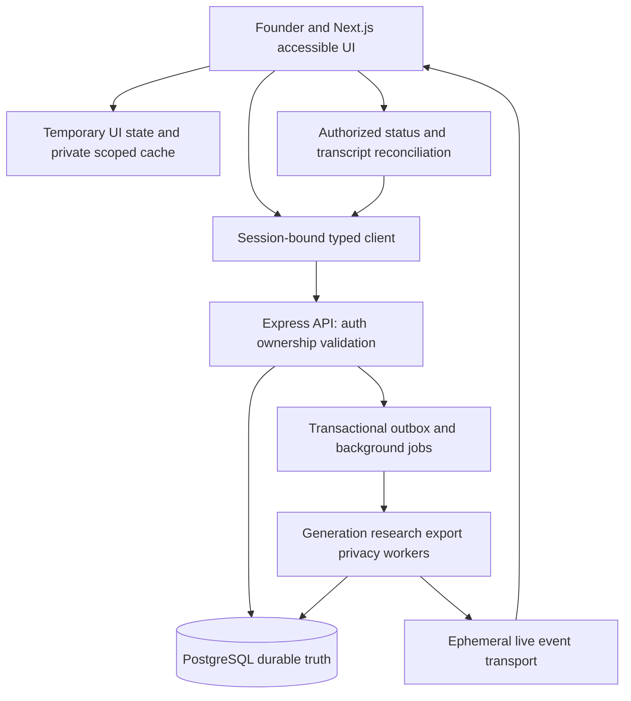

# Founder's Lens — LLD Phase 4D: Frontend Integration, Accessibility & Sign-off Review

**Document ID:** FL-LLD-FE-4D  
**Version:** 0.5 — approved final mapping reconciliation
**Status:** FE4D-A08: Approved — Documentation Only. **Revision:** `FL-P4-0.5-approved`. Both mapping blockers are closed in approved design. Runtime/migration/provider/security/browser/accessibility/model validation remains unexecuted. The [exact approved manifest](approved-revision-0.5.json) and [§19 sign-off evidence](#19-formal-phase-4-documentation-sign-off) govern current package status; earlier review-stage wording is historical.
**Scope:** Phases 4A–4C, their inherited Phase 2D/3 contracts, verification plan, decisions, traceability and phased readiness. **Documentation only; no application implementation or runtime tests.**

## 1. Executive assessment

**FL-P4-0.5-approved — Approved, Documentation Only.** The owner explicitly grants FE4D-A08 in the current conversation, including FE4D-A01/A02/A03, P4-AM01–04 and P4-B01/B02. The four Phase4 documents retain their paths and historical evidence. No approval date, timestamp, signature or commit is inferred. No application, dependency, migration execution, deployment or Phase5 work is authorized.

Unambiguous resolutions: direct session Bearer browser→Express (already accepted, no BFF), strict default vs opt-in structured transcript, all 48 founder route/header/DTO mappings, six generation states/separate connection state, snapshot new-version creation through existing POST, explicit export retry and privacy/cache guards. The19 original finding IDs remain; FE4D-20–23 capture additional actual contract gaps. A design resolution is not a runtime pass.

Current v0.5 includes the explicit approvals P4-B01/P4-B02 and final package sign-off FE4D-A08. Title→plan.title and the required independent hypothesis have exact version3 creation/read contracts and a disclosed legacy rejection path. LearningEvidence plus its capture marker define atomic, same-idea, durable source sets and privacy-safe deletion. OpenAPI0.5.0 still has53 operations; Prisma has24 design models. Approved package revision **FL-P4-0.5-approved** supersedes the earlier unapproved review label. Numerical tuning, runtime/provider/migration/security/accessibility gates and accepted AI-D14 editorial exception remain explicit.

### Source inventory, approval evidence and overlaps

The table preserves the original reconciliation intake (v0.2 and earlier API/model counts), not the current frozen counts or statuses. Current specifications are OpenAPI0.5.0,53 total/50 founder operations,24 design models and Phase4A–4D v0.5 Approved — Documentation Only; see §19 and the manifest. Earlier source-hash verification describes its original review stage; approved amendments account for subsequent changes.

| Actual canonical path(s) | Purpose / status | Review result and suspected/confirmed conflict |
|---|---|---|
| [PRD](../../requirements/PRD.md), [SRS](../../requirements/SRS.md) | Product goals;47 expanded FRs,UI-001–008,AT-001–046,NFRs; historical approval evidence under A07, old In Review headings retained | Source hierarchy unchanged; exact FR/AT mappings in§10. PRD and SRS IDs are not interchangeable |
| [HLD](../../architecture/HLD.md), [ADR-013](../../architecture/adr/013-express-typescript-api.md), [historical ADR-002](../../architecture/adr/002-express-revision.md) | Approved modular monolith/Express; preserved historical framework decision | AI-D14 accepted editorial clarification still awaits controlled HLD edit; no new frontend service |
| [Logical](../01-database/logical-design.md), [physical](../01-database/physical-design.md), [Prisma](../01-database/schema/schema.prisma), [guards](../01-database/constraints/guards.sql), [DB acceptance](../01-database/validation/integration-test-plan.md) | Approved design history;23 models and durable versions/epochs/purge rules; execution unproven | Learning.observation and Experiment plan exist in DB but are not fully projected by API; do not expose raw Prisma records |
| [Security](../02-api-security/architecture-and-security.md), [API](../02-api-security/api-contracts.md), [OpenAPI](../02-api-security/openapi.yaml), [inventory](../02-api-security/route-inventory.json), [API tests](../02-api-security/testing.md) | Active approved bearer/private contracts, OpenAPI 0.3.0 with51 operations/48 founder rows | Actual method/headers/card/DTOs mapped in 4C§8/21; missing projection requirements and success-shape mismatch tracked, not silently fixed |
| [Streaming](../03-streaming-reliability/streaming-contract.md), [reliability](../03-streaming-reliability/idempotency-and-concurrency.md), [stream tests](../03-streaming-reliability/testing.md) | Six generation states, accepted-response replay, ephemeral SSE, outbox/fencing | No token replay; old cancel/regeneration DTO examples conflict with full OpenAPI Generation, P4-AM02 |
| [Phase2D decisions](../04-integration-review/decision-log.md), [privacy/states](../04-integration-review/state-machines.md), [A07 manifest](../04-integration-review/approved-revision-1.0.json), [P2D review](../04-integration-review/integration-review.md) | A07 FL-P2D-1.0-approved and P2D-P01–05; ancillary/deployment/runtime gates retained | Historical raw originals verified; current approved seven Phase 3 amendments and navigation-only index drift are declared, not A07 hash failures to hide |
| [3A](../05-ai-orchestration/ai-orchestration-architecture.md), [3B](../05-ai-orchestration/context-and-prompt-architecture.md), [3C](../05-ai-orchestration/strategy-research-structured-response.md), [3D](../05-ai-orchestration/ai-integration-evaluation-review.md), [P3 manifest](../05-ai-orchestration/approved-revision-0.3.json) | P3D-A09 Approved — Documentation Only, FL-P3-0.3-approved,11 files | Actual11 raw hashes/aggregate verify; numerical/provider/runtime gates retained; frontend cannot reopen or silently amend this baseline |
| [4A](frontend-fundamentals-journeys-architecture.md), [4B](wireframes-and-design-system.md), [4C](frontend-state-api-integration.md), this4D | Current v0.2 In Review; source inputs were v0.1 untracked drafts | Four responsibilities retained. Overlapping recovery/auth statements now point to4C§19–21; token values owned solely by4B§4.2/15; findings/matrices/approvals owned here |

Authority: explicit owner decisions/active ADR > PRD goals > SRS requirements > approved HLD > approved detailed DB/API/runtime/AI contracts > OpenAPI representation > test specifications. Phase 4/wireframes cannot create permissions or endpoints. No redundant file was identified or removed. Original pre-edit fingerprints are in§15; current uncommitted changes were inspected, including unrelated .gitattributes deletion, which is left untouched.

## 2. Fundamentals (human terms)

| Term | What it means | Why it matters |
|---|---|---|
| Integration review | Checking that independently written designs agree | A beautiful Save button is unusable if no matching API command exists |
| Contract | An exact interface or behavior agreement | `202` means accepted, not finished |
| Source of truth | The system whose answer is authoritative | PostgreSQL confirms saved work; the browser does not |
| Optimistic UI | Showing a pending result before confirmation | “Sending…” must not become “Saved” too early |
| Recovery | Finding what really happened after a failure | Losing the HTTP reply must not create a duplicate paid generation |
| Cache invalidation | Removing or refreshing an outdated local copy | Deleted memory must not remain presented as active memory |
| Sign-off | Approving an exact version of the design | Future changes can be reviewed rather than silently introduced |
| Accessibility | Making controls usable with keyboard, screen readers and other needs | Founders must be able to send, stop, review and recover without a mouse |

## 3. Integrated architecture and authority

- **Only Express and the database** can accept durable commands and enforce ownership. Browser guards are presentation controls, not authorization.
- UI may distinguish local `SENDING`/`ACCEPTANCE_UNKNOWN` from backend `PENDING/RUNNING/CANCEL_REQUESTED/COMPLETED/FAILED/CANCELLED` but must never invent backend state.
- A successful SSE event is a notification, not the final durable card, citation, approval or message selection. On terminal signal or disconnection, use authorized GET and selected transcript recovery.
- Session changes and deletion gate private reads, pending commands, observers, caches and delayed asynchronous responses by principal/idea scope.

## 4. Contract consistency matrix

Current v0.5 authority is§18/API§21:both mapping decisions are approved andclosed;24 design models,53 operations,six negotiated operations. The following v0.3 notes/table preserve the earlier source review;their old blocker labels do not reopen these decisions.

Current v0.3 bindings: API§19 closes the formerly proposed lookup,full Generation,proposal andlearning/experiment/link DTO gaps in the historical matrix below.50 founder/53 total operations now exist in the design. P4-B01/B02 physical mappings remain open;all runtime verification remains pending. This note supersedes old “P4-AM proposed/gap” wording,not the unchanged ownership,worker orprivacy rules.

Exact per-operation mapping belongs to [4C §8](frontend-state-api-integration.md#8-endpoint--ui-operation-matrix-design-mapping); this table maps responsibilities rather than redefining DTOs.

| UI responsibility | Approved API/database/runtime authority | Presentation / state rule | Verification / exception |
|---|---|---|---|
| Authentication/routes | API§2/security§6; UserAccount/Idea ownership | Explicit session Bearer, no client userId, request-scoped private SSR/client cache, neutral404 |4C §20; FE4D-02/14, F4D-02/03/25 |
| Idea/conversation creation | Keyed IdeaCreate201, unkeyed ConversationCreate201 | Chain existing calls; no atomic create-and-chat endpoint or hidden retry of uncertain conversation creation |F4D-22/40 |
| Message accept/replay | MessageCreate→MessageSubmission202; ledger/clientSubmissionKey/outbox | Freeze exact intent; local SUBMITTING/ACCEPTANCE_UNKNOWN distinct from backendPENDING |4C §19; FE4D-03/17; P4-AM01 optional improvement |
| Generation/observer | Six-state Generation, selected assistant, lease/contextEpoch; six SSE events | Deltas tentative, GET final; fresh streams reset fragments; terminal/cancel winner from DB |F4D-09/10/27/28; P4-AM02 DTO exception |
| Structured response | GET transcript opt-in2, AssistantResponse.schemaVersion 1; stored format 2 | One primary strategy,0..1 singleton card,<=2 prominent actions; no private metadata |F4D-06/07/18 |
| Memory | Proposal accept/dismiss If-Match plus idempotency; memory currentVersion/epoch | Explicit atomic approvedText; REMOVED active-context exclusion; history caveat |F4D-16/30/39; P4-AM03 version/provenance projection gap |
| Research/evidence | proactiveResearch metadataVersion; durable job/outbox/quota; seven ResearchJob states | Off only on saved setting; no new automatic jobs after commit; admitted/manual work remains |F4D-21/31/32; account researchEnabled semantics not invented |
| Assumptions/learning | Existing create/PATCH and linked Learning; DB observation/interpretation | User-confirmed actions; no virtual source count/observation restore from missing DTO fields |F4D-18/38; P4-AM04 blocks complete intended read/write UI |
| Snapshots | API§14 SnapshotCreate201 allocates new idea version; content/hash/immutable approved rows | Local review, explicit approve201 with draftRevision; new POST for changes, no fork route |FE4D-05 resolved; F4D-08 |
| Export/download | Keyed ExportCreate202, ExportJob/artifact state, non-keyed fresh grant | Failed job→explicit new key; expired link≠expired object; grant transient, no token forwarded |F4D-17/33;4C §20.3; deployment storage CORS pending |
| Deletion | P2D-P01–05/DataOperation/lifecycle/tombstones | Gate at commit, clear private state/epochs, narrow status only with auth, no backup erasure overclaim |F4D-11/12/36 |
| Mobile/accessibility | SRS NFR-014/019/UI-001–008;4B token owner | Keyboard/focus, safe status announcements, IME,reflow,reduced motion; visuals illustrative |F4D-13–15; all browser/accessibility execution deferred |

## 5. Discrepancy and decision register

**Current v0.3 disposition is in the table at the end of this section.** The detailed v0.2 rows below retain original conflicts/IDs as historical evidence; their former Pending Owner Approval/proposed statuses are superseded by the seven explicit approvals and current API§19 contracts. Runtime gates are not superseded.

All original FE4D-01–19 IDs, original concerns and associated acceptance IDs are preserved; source-exact evidence/current disposition replace the former unavailable-repository status. New FE4D-20–23 were discovered in the actual contracts. **Resolved in design** means a documented canonical resolution, not executed acceptance. **Pending Owner Approval** is a product/privacy/explicit baseline decision. **Pending Implementation/Provider Validation** means unexecuted engineering proof. An edited file alone never closes a behavioral gap.

| ID | Severity | Conflicting sources / exact sections | Conflict and impact | Canonical resolution / recommendation | Documentation changes | Acceptance | Current status |
|---|---|---|---|---|---|---|---|
| FE4D-01 | high | 4A §5/16,4C §4/17 vs SRS§3.1/9.1 | Two candidate conversation route schemes; history ambiguous | Recommend one tree: /think chooser, explicit /conversations/[conversationId] for selected chat, sibling overview/learning/snapshots; URL opaque | 4A §5,4C §4,4D §6 | F4D-01/37 | Pending Owner Approval FE4D-A01 |
| FE4D-02 | high | 4A §6.1/16,4C §4 vs API§2/API-02/security§6 | Draft reopened Bearer vs BFF though API already chooses Bearer | Direct explicit session Bearer even same origin; no BFF/cookie API auth. CORS/Clerk adapter remains untested | 4A,4C §20 | F4D-02/03 | Resolved in design; Pending Implementation/Provider Validation |
| FE4D-03 | high (original blocker for unconditional reload promises) | 4A §7/8,4B FE4B-D10,4C §5/9 vs Message/Conversation DTOs and clientSubmissionKey | Refresh loses exact command; IDs alone cannot replay or locate unknown acceptance | No persisted private data by default, no auto-resend, truthful paginated history inspection. Optional scoped opaque record needs owner decision; exact lookup P4-AM01 | 4A §8,4C §19,4D §13 | F4D-04/05/26/34 | Conservative design defined; Pending Owner Approval A03 and optional P4-AM01; stronger recovery not claimed |
| FE4D-04 | high | 4A §9,4B §5.1,4C §8/12 vs API§18/OpenAPI Message/StructuredMessage/AssistantResponse | Current schema had not been compared; cards[]/version axes risk | Default legacy strict, explicit query2, eligible ASSISTANT only, schemaVersion 1/single card; cursor representation bound | 4A/4B,4C §8/12/21 | F4D-06/07 | Resolved in design; custom static schema/mapping checks, runtime pending |
| FE4D-05 | high | 4A §10.3,4B §3.6,4C §11/17 vs API§14/SnapshotCreate/physical§5.6 | Desired new draft was mistaken for missing fork capability | Existing POST idea snapshots with content allocates DRAFT next version under idea lock; no parent/fork field. Review local, approved unchanged | 4A/4B,4C §11/21 | F4D-08 | Resolved in design with explicit API§14 evidence; no API amendment needed |
| FE4D-06 | high | 4A §8,4B §5.2,4C §9/10 vs streaming§2.2–2.5 | Live fragments/EOF mistaken for persisted final or backend failure | Six states authoritative; parse six events; reset new feed; GET status/transcript; disconnect never cancel | 4C §19.3,4A/4B | F4D-09/10/27/28 | Resolved in design; Pending Implementation/Provider Validation |
| FE4D-07 | high | 4C §6/11/13 vs P2D privacy/state gates | Late reads, BFCache and identity changes could restore old data | Blank view, increment principal/scope epochs, abort and discard late results, clear caches, gate restored pages before reads | 4C §20.2 | F4D-11/12/35/36 | Resolved in design; browser/security race tests pending |
| FE4D-08 | medium | 4A §16,4B §2/4.2/13 vs SRS NFR-014/019 | Visual/dark-theme decisions unapproved and unmeasured | 4B owns one provisional scale; light-neutral recommendation, dark not required; no contrast certification | 4B §15,4D §6 | F4D-13 | Pending Owner Approval FE4D-A02; numerical calibration pending |
| FE4D-09 | high | 4B §7/11,4C §13 vs SRS NFR-014/019 | Accessibility specification is not tested conformance | Keyboard/focus/IME/reflow/reduced-motion criteria and browser/AT matrix with explicit untested combinations | 4B §15,4D §9 | F4D-14/15 | Design specified; Pending Implementation/Provider Validation |
| FE4D-10 | high | 4A §10.1,4B UI-12/13,4C §11 vs API§6/11/13,MemoryProposal schema | Conflict UX must use proposal version plus target check; version optional in current schema | Atomic accept approvedText; missing version disables mutation. Canonical version→quoted vN, no guessed target/version; P4-AM03 required guarantee | 4C §11/21,4D §13 | F4D-16/29/39 | Version UX resolved; projection gap open P4-AM03 |
| FE4D-11 | high | 4A §10.3/10.4,4C §11 vs API§14/17 | Approved snapshot, export job and download expiry could be conflated | Separate immutable version/draftRevision, execution status/artifact state/grant; no guarantee zero browser traces | 4A/4B,4C §20.3 | F4D-17/33 | Resolved in design; storage/browser/runtime pending |
| FE4D-12 | medium | 4B §3.4/UI-09,4C §12 vs API AssumptionCreate/ExperimentCreate and P3 action enum | Suggestion could silently Save or trigger arbitrary URL | Allowlisted action opens explicit user workflow; existing authorized command only; no auto business approval | 4C §8/21 | F4D-18 | Resolved in design; runtime acceptance pending |
| FE4D-13 | medium | 4A §16,4C §6/17 vs modular-monolith simplicity | Query manager phrasing could imply unneeded dependency | Typed fetch/read-controller in-memory cache, local React UI/forms; no third-party state library selected; tune TTL later | 4C §17/20.2 | F4D-11/35 | Resolved engineering recommendation; Pending Implementation/Provider Validation |
| FE4D-14 | medium | 4C §4/7/17 vs security§6/7 and official Clerk request/verification guidance | SDK freshness/SSR/authenticated SSE mechanisms unverified | Explicit Bearer fetch; verify current SDK, token type/claims/party/origin, refresh and fresh-delete proof; no guessed methods | 4C §20.1 | F4D-02/19/25 | Provider documentation inspected; Pending Implementation/Provider Validation |
| FE4D-15 | medium | 4B §6.2,4C §7 vs API Error/status taxonomy | Quota message falsely claimed nothing started; unknown responses unsafe | Typed Error; no guarantee rejected request from network503/quota alone; distinguish400/401/403/404/409/412/428 and failures | 4B §6.2,4C §7/21 | F4D-20/34 | Resolved in design; localized/browser errors untested |
| FE4D-16 | medium | 4B UI-10,4C §12 vs Evidence/SourceReference/API§15 | Citation source checked might imply proven business truth | Render nullable provenance/time/geography/trust and caveats, no privileged arbitrary URL previews or fabricated source counts | 4A/4B,4C §12/21 | F4D-21/30 | Resolved in design; actual grounding/URL/browser tests pending |
| FE4D-17 | medium | 4C §7/8 vs inventory flags/API§12 | Unkeyed creates may duplicate on generic retry | Classify all 48 operations, keyed original outcome vs unkeyed GET/explicit uncertainty; idea DELETE domain-idempotent, grants no replay ledger | 4C §8/19 | F4D-05/22/40 | Resolved retry classification; P4-AM04 evidence-link read gap remains |
| FE4D-18 | medium | 4A–4D headers vs A07/P3D-A09 manifests | Draft docs have no Phase 4 owner sign-off | Current v0.2 In Review; preserved source hashes; verify approved baselines, future exact manifest only after explicit approval | Four Phase 4 docs,index,4D §14/15 | F4D-23 | Pending Owner Approval FE4D-A08; no Phase 4 approval generated |
| FE4D-19 | low | 4A §6 vs approved3D AI-D14/HLD§8.1 | Old HLD direct-model arrow already accepted as editorial exception | Carry accepted editorial clarification pending controlled HLD edit; independent worker contract governs; do not edit frozen HLD | 4A §6,4D §11 | F4D-24 | Accepted inherited exception; controlled HLD amendment pending |
| FE4D-20 | high | 4B §3.3/3.4,4C §8/11 vs SRS FR-031/032,Learning/Experiment/Assumption/EvidenceLink DTOs,Prisma Learning/Experiment | Observation missing from write/read; experiment plan/success criteria and assumption evidence links unavailable on re-entry | P4-AM04 explicit scoped projection/read amendments. Do not merge structured observation into reflection or fabricate missing values | 4A/4B caveats,4C §21,4D §13; approved API/Prisma unchanged | F4D-38 | Open implementation-design blocker for complete MVP; proposed amendment Pending Owner Approval |
| FE4D-21 | high | 4B §3.3/UI-12,4C §11 vs SRS FR-022/023/028,MemoryProposal required list | Proposal provenance absent and required version/text missing; no detail GET exists | P4-AM03 strengthen required version/text and expose minimal authorized source projection with explicit compatibility review; missing fields fail closed | 4B/4C,4D §13 | F4D-39 | Open projection blocker; proposed amendment Pending Owner Approval |
| FE4D-22 | high | streaming§2.1 vs OpenAPI cancel200/202 and regeneration202 Generation schema; API§2 generic success taxonomy vs snapshot approve201 | Different purported canonical async DTO shapes can make client parse valid replies incorrectly | P4-AM02 reconcile human/API/OpenAPI/inventory together; target full Generation and existing201 approval (no lifecycle change). Until amendment schema disagreement explicit; never parse partial as full | 4C §9/21,4D §13; approved sources unchanged | F4D-20/27/28 | Open technical baseline amendment; Pending Implementation/Provider Validation before freeze |
| FE4D-23 | medium | 4B §3.2/3.5,4C §7/12 vs PreferencesPatch.researchEnabled,Conversation.proactiveResearch and available GETs | Account research flag precedence undefined; mocked search/last-message/linked-source counts could imply unsupported API | Use conversation toggle only; loaded-list filters not global search, nullable metadata not fake0. Defer global research setting until precedence specified | 4A/4B,4C §21,4D §13 | F4D-21/31/38 | Current UI bounded to supported reads; broader controls/projections pending technical specification |

**Disposition summary:** 11 findings are resolved in design (FE4D-02/04/05/06/07/11/12/13/15/16/17), with runtime verification still pending. The other 12 are owner choices, partial contract gaps, engineering proof or the accepted editorial exception; none is silently closed.

No approved API/database/AI/HLD file is edited. Required changes remain explicit proposals in§13, not instructions to implement them or silently regenerate approved manifests.

### Current v0.3 resolutions (authoritative over historical statuses above)

| Finding reference | Current decision / supporting contract | Documentation closure vs remaining verification |
|---|---|---|
| `FE4D-01` | FE4D-A01 approves Think-first idea-scoped route tree;4A§5 | Resolved design;navigation/browser usability untested |
| `FE4D-02`, `FE4D-14` | Existing Bearer-only Express transport;security§6/17,4C§20 | Architecture resolved;Clerk/freshness/CORS/SSR Pending Implementation/Provider Validation |
| `FE4D-03` | FE4D-A03 and P4-AM01: bounded opaque session record plus original-attempt read lookup;API§19.1/4C§19 | Former recovery decision gap closed;404 inconclusive,no text storage/no automatic resend;race/browser tests pending |
| `FE4D-04`, `FE4D-06` | Unchanged assistantResponseVersion2/single card/six generation states/SSE recovery;API§18/19.2 | Resolved design;full DTO/parser/terminal/worker runtime tests pending |
| `FE4D-05`, `FE4D-11` | Existing snapshot POST/version/hash/export/grant rules unchanged;API§14/17 | Resolved design;PDF/storage/browser/privacy validation pending |
| `FE4D-07`, `FE4D-09` | Identity/scope epochs andcache cleanup;SRS NFR-014/019,4B§15,4C§20 | Design specified;browser accessibility/security races not executed |
| `FE4D-08` | FE4D-A02 approves light-neutral professional direction | Direction closed;exact tokens/contrast remain provisional/unmeasured |
| `FE4D-10`, `FE4D-21` | P4-AM03 API§19.3/19.4: opt-in MemoryProposalV2 actual version/text/redacted source;legacy unchanged | Projection discrepancy resolved;no automatic founder approval;source/If-Match races pending |
| `FE4D-12`, `FE4D-13`, `FE4D-15`, `FE4D-16` | Existing explicit user action,scoped in-memory state,error/provenance semantics | Resolved design;implementation/accessibility/security tests pending |
| `FE4D-17` | All50 founder routes classified;P4-AM04 link read now exists;unkeyed create retries remain constrained | Former read gap closed;idempotency andscope tests pending |
| `FE4D-18` | FE4D-A08 explicitly approves FL-P4-0.5-approved;§19 and approved-revision-0.5.json freeze the exact baseline | Governance discrepancy closed — documentation only; runtime gates remain pending |
| `FE4D-19` | AI-D14 remains accepted editorial HLD clarification,pending controlled edit | Accepted inherited exception;HLD unchanged |
| `FE4D-20` | API§21/physical§18: approved title/hypothesis contract, LearningEvidence/capture marker and strict version3 read-back | Mapping discrepancies resolved in approved design P4-B01/B02; migration, client upgrade and runtime tests remain pending |
| `FE4D-22` | P4-AM02 adopts unchanged full Generation oncancel200/202/regenerate202;API§19.2/streaming amendment | Cross-document shape discrepancy closed;replay/status/concurrency tests unexecuted |
| `FE4D-23` | Conversation-only proactiveResearch remains UI control;unsupported global precedence/search actions not invented | Current UI bounded;global researchEnabled semantics remain unverified andout of scope |

## 6. Product and engineering decisions and approval register

**Evidence:** the owner explicitly approved FE4D-A01/A02/A03,P4-AM01–04 and P4-B01/B02, and now grants **FE4D-A08: Approved — Documentation Only**, target **FL-P4-0.5-approved**, in the instruction titled “Founder's Lens — FE4D-A08 Formal Phase 4 Documentation Sign-off”. Approval date/timestamp,signature andcommit are unspecified; none is inferred. Earlier pending statuses and unchanged amendment/proposal records describe their historical stages, not current package approval.

| ID | Recommended disposition / scope | Authority / current status |
|---|---|---|
| FE4D-A01 | Think-first idea-scoped routes with My Idea,My Learning,Snapshots supporting;explicit conversation URL | Approved design only;explicit owner instruction,usability untested |
| FE4D-A02 | Calm professional light-neutral direction;4B sole provisional token catalog | Approved direction only;exact values/measured accessibility remain provisional |
| FE4D-A03 | Minimal session-scoped opaque recovery IDs,bounded expiry,account isolation/cleanup;no private text or automatic resend | Approved principle only;30-minute TTL provisional,storage/browser tests pending |
| FE4D-A04 | Never claim saved/complete before commit; distinguish sending/unknown/accepted/generating/final | Inherited SRS/Phase2D invariant, no new product approval required; presentation tests pending |
| FE4D-A05 | Preserve local drafts on 412, compare current canonical record, explicit renewed action | Inherited version guarantee, frontend design specified; no silent merge/auto approval |
| FE4D-A06 | Direct session Bearer browser→Express, authenticated fetch SSE; no BFF | Inherited approved API/security choice. Exact SDK/CORS/SSR/freshness proof Pending Implementation/Provider Validation |
| FE4D-A07 | Plain typed fetch/read controller + scoped in-memory cache/local UI state; no new state library selected. Pin framework/Clerk versions later | Engineering recommendation; Pending Implementation/Provider Validation. No dependencies installed |
| FE4D-A08 | Complete Phase4A–4D v0.5 documentation and associated controlled API/database amendments; exact baseline in approved-revision-0.5.json | **Approved — Documentation Only**, FL-P4-0.5-approved; explicit owner instruction in this conversation; no date/timestamp/signature/commit inferred |
| P4-AM01 | Pure authorized original-submission correlation GET;404 inconclusive | Approved controlled design/documentation amendment;API§19.1 |
| P4-AM02 | Full existing Generation on cancel200/202 andregenerate202;no lifecycle/replay change | Approved controlled design/documentation amendment;API§19.2 |
| P4-AM03 | Actual proposal version/text,minimal redacted source;explicit list projection2 | Approved controlled design/documentation amendment;API§19.3/19.4 |
| P4-AM04 | Observation/interpretation/experiment reads and paginated evidence-link GET | Approved earlier amendment; current API§21 now also resolves its explicitly approved P4-B01/B02 persistence mappings |
| P4-B01 / P4-B01-D01 | plan.title display label, required separate hypothesis, explicit creation3 input; safe legacy rejection/upgrade with accepted replay preserved | Approved by the owner's latest explicit instruction. Design closed; creation availability risk disclosed, no invented data or incomplete drafts |
| P4-B02 / P4-B02-D01 | One LearningEvidence association, same-idea constraints, capture marker, atomic capture and version3 read-back | Approved by the owner's latest explicit instruction. Design closed;24-model artifact and SQL guards are not executed migrations |

Exact polling/backoff/cache/token/layout sizes,performance/cost targets andrecord expiry remain provisional. FE4D-A08 grants package documentation approval; it does not validate runtime tests,contrast,providers,deployment or migrations. P4-B01/B02 are approved mapping decisions, with the documented legacy-create limitation retained.

## 7. Frontend recovery contract (integrated reference)

Current amendment: FE4D-A03 selects bounded session-only opaque IDs andP4-AM01 provides read-only lookup. Old no-record/no-lookup wording below is v0.2 rationale. Current4C§19/API§19 govern: no text,original correlation,404 inconclusive,no automatic resend,expiry/account cleanup andstorage-failure fallback.

[4C §19](frontend-state-api-integration.md#19-canonical-refresh-retry-and-live-recovery-policy) is authoritative for frontend refresh/retry/SSE; [§20](frontend-state-api-integration.md#20-canonical-authentication-state-and-private-data-boundary) owns authentication/cache/privacy. This section intentionally does not duplicate those state rules.

Safe default: exact same-tab command/ID/key permits original accepted-response replay; reload with no original command never automatically resends. Current Message/Conversation DTOs have no submission lookup or active-generation reference, so history inspection cannot prove exact acceptance. No fragment replay and no paid mutation on reconnect, online, focus, back/forward or auth refresh. Cancellation/regeneration are distinct explicit intents; durable DB state/selected transcript wins races. P4-AM01 is an optional proposed convenience, not an existing safety guarantee.

Every request/stream callback is epoch-scoped; sign-out/deletion/account swap clears private state and rejects late results. Non-keyed create ambiguity is surfaced, not retried. Error envelopes and available DTOs are in 4C§8/21; unresolved fields cannot be fabricated from wireframes. Research-off applies at saved conversation-setting commit to new automatic admission only. Historical removed-memory text is labeled history; it is not current confirmed context, and perfect paraphrase removal is not promised.

## 8. Wireframe/design-system sign-off criteria

- Each route/view has states for loading, empty, success, offline, forbidden, not found, stale version and deletion-lifecycle gate.
- All four product areas (Think, My Idea, My Learning, Snapshots) are discoverable on desktop and phone; confirmation actions remain reachable without horizontal scrolling or hidden sticky overlays.
- Default chat is text-led, optional one card, at most two prominent actions; no automatic durable mutation from a UI suggestion.
- Typography and color can be tuned but status meaning is never color-only. Source age/geography/unknowns visible where material.
- Keyboard sends, multiline composition and Hinglish IME (input method editor, supports composed characters) work without accidental submissions.
- Dialog focus is trapped appropriately, restores on close, and announces destructive scope; motion respects reduced-motion preferences. Screen reader announces major generation milestones rather than each streamed token.
- Run zoom and narrow-width checks from 4B §2/§7, plus realistic long Hinglish input and text reflow. No accessibility conformance claim until testing.

## 9. Acceptance matrix — planned, not executed

Original F4D-01–24 IDs are retained. F4D-25–40 explicitly cover remaining required security, concurrency, memory/research, retry/privacy and DTO-gap scenarios. They supplement all 30 FE4A,36 FE4B,36 FE4C and inherited SRS/DB/Phase 2/Phase 3 scenarios. **Every scenario is unexecuted**; static documentation checks are recorded separately in§14.

| ID | Scenario | Expected invariant / behavior | Frontend / backend responsibility | Verification method | Execution |
|---|---|---|---|---|---|
| F4D-01 | Deep links,idea switch,Back/Forward | Validate parent idea/conversation match, discard stale scopes, restore route not old private cache | Router/cache + Express scoped reads | Two ideas/principals; E2E navigation/history/cache race | Not executed |
| F4D-02 | Session expiry during chat/fetch/SSE | Private transport closes, epochs advance, fresh supported auth before reconnect; no paid resend | Clerk adapter/observer + Express auth | Expired/rotated dev-token fixtures; delayed delta/fetch barriers | Not executed |
| F4D-03 | Cross-origin or proposed BFF | Bearer-only direct API, exact CORS preflight/exposed headers; no cookie fallback or duplicate authorization layer | API adapter + Express security/ingress | Allowed/denied origins,OPTIONS,redirect and token-scope integration fixtures | Not executed |
| F4D-04 | Lost202 then refresh | No new request/paid attempt automatically; disclose unknown, inspect durable transcript, never infer failure | Command controller + submission transaction/ledger | Drop response after DB commit; full reload with no original command | Not executed |
| F4D-05 | Opaque record without payload | No replay from key alone; current known IDs may GET status, unknown IDs require proposed lookup | Recovery UI + current/proposed read adapter | Storage absent/expired/partial/wrong principal; verify zero auto mutation | Not executed |
| F4D-06 | Legacy transcript default | Strict Message.content:string with no enrichment; USER/legacy metadata not invented | Message mapper + API projection | Contract fixtures default/selector 1/empty list/legacy strict validator | Not executed |
| F4D-07 | Opt-in structured transcript | Only explicit 2 enriches eligible ASSISTANT; singleton card,one strategy,<=2 prominent actions; bound cursor | Renderer + API/schema/finalizer | Four card variants,foreign citation,unknown schema/cards[],selector switch400 | Not executed |
| F4D-08 | Edit approved snapshot/new version | No PATCH of APPROVED;409 on server attempt; existing POST full SnapshotCreate allocates new DRAFT, oldhash unchanged | Snapshot editor + documents service/DB | Approval/edit race; same-key create replay; new-key createversion; provenance409 | Not executed |
| F4D-09 | SSE disconnect mid-generation | Backend continues; reset provisional fragments/new feed; GET truth, no false terminal/no replay | Observer + SSE/status/worker | Fragment UTF-8/comments,network cut,late status,loss of Redis PubSub | Not executed |
| F4D-10 | Missed terminal SSE | Finite polling/explicit Check status finds canonical terminal and selected transcript | Observer + generation/status repository | Drop terminal/close; already-terminal subscribe; duplicate events | Not executed |
| F4D-11 | Sign-out/account switch with late response | Synchronously blank/clear state; old epoch callbacks cannot paint new account, even same email | Privacy boundary/cache + auth/local identity | Two principals,two tabs,paused requests,session re-creation | Not executed |
| F4D-12 | Idea/account deletion during generation | Gate after known commit/denial; discard late output; only authenticated narrow deletion-status read | Lifecycle UI + deletion/generation workers | Deletion vs dispatch/finalization barriers; purge independent from Redis | Not executed |
| F4D-13 | Palette/semantic tokens/accessibility | No color-only truth/status; chosen rendered colors meet intended contrast/reflow, exact tokens provisional | Design maintainer + accessibility reviewer | Rendered contrast and forced-color inspection after implementation | Not executed |
| F4D-14 | Keyboard-only critical journey | All essential controls/focus reachable,dialogs restore focus,explicit Send/Stop,review/export/delete operable | Accessible shell/components + API actions | Manual keyboard and automated focus assertions; complete founder journey | Not executed |
| F4D-15 | Mobile keyboard/screen reader/IME,zoom,reduced motion | No obscured composer,logical announcement order,320 px reflow/400%zoom,no token spam or compulsory animation | Responsive UI/live regions + observer | Real mobile/VoiceOver/TalkBack/Windows screen-reader matrix,zoom,motion preference | Not executed |
| F4D-16 | Concurrent memory approval/edit | One canonical revision; same-key replay original outcome or412/409; preserve user draft,never auto merge | Proposal editor + memory transaction/version guards | Two tabs same/different intent,target version changed,missing version fail-closed | Not executed |
| F4D-17 | Expired download grant/artifact | AVAILABLE artifact permits fresh grant;expired/purged object409;COMPLETED not download availability | Export/grant UI + documents/storage service | Clock advance,grant expiry,artifact cleanup delay,cross-owner denial | Not executed |
| F4D-18 | Assistant assumption/experiment action | Presentation opens explicit founder workflow, never auto save/approve or privileged URL fetch | Card/action dispatcher + existing authorized use case | Malicious resourceId/action/URL fixtures; assert no mutation before confirmation | Not executed |
| F4D-19 | Bearer SSE expiry/CORS | No native EventSource auth hack,no URL token; fresh verified connection before private deltas | Fetch observer/auth adapter + SSE auth | Real Clerk dev integration,expiry/allowed parties,preflight,connection reset | Not executed |
| F4D-20 | Typed errors/status-shape disagreement | Safe400/401/403/404/406/409/412/413/415/428/429/500/503; unknown acceptance retained; P4-AM02 remains explicit | Error/DTO adapter + API responses | Error fixtures + sparse/full cancel/regenerate responses; reject schema mismatch safely | Not executed |
| F4D-21 | Evidence scope/provenance/unknown fields | SOURCE_CHECKED is attribution not proof,nullable unknown stays unknown; no arbitrary preview or invented source count | Citation disclosure + evidence/context service | Wrong geography/time,foreign IDs,stale sources,malicious URI | Not executed |
| F4D-22 | Unkeyed create response lost | No generic POST replay; inspect actual supported reads,explicit uncertainty instead of duplicate create | Command controller + conversation/assumption/link service | Drop response for each non-keyed route; no auto POST on GET failure | Not executed |
| F4D-23 | Package approval governance | Only owner can approve an exact Phase4 revision; no fabricated time/signature or runtime pass | Documentation owner/reviewer | Explicit FE4D-A08 evidence and manifest/reference checks recorded in§19 | Static governance checks executed; runtime acceptance Not executed |
| F4D-24 | Inherited HLD diagram exception | AI-D14 accepted editorial clarification stays pending controlled edit; worker authority retained | Architecture reviewer + durable-worker contract | Static request→outbox→independent worker→commit trace; verify HLD hash unchanged | Not executed |
| F4D-25 | Unauthenticated protected-page request | No private SSR/client-cache content or provider invocation; sign-in navigation safe | App Router auth/data boundary + Express401 | Direct private URL,expired SSR auth,network request inspection | Not executed |
| F4D-26 | Duplicate tabs submit same/different intent | Exact shared ID/key/body produces original one logical message; independently created IDs are not semantically deduped | Tab command controls + DB ledger/uniqueness | Two-tab simultaneous clicks,shared-key replay,distinct-key active409; DB effect checks | Not executed |
| F4D-27 | Cancellation races completion/failure | Only server CAS winner shown;202 cancellation not terminal;same-key replay may stale202 so GET | Stop UI + generation worker/fencing | Commit-order barriers for completion-first/cancel-first/failure-first | Not executed |
| F4D-28 | Regeneration ordering/races | Latest eligible USER only;old selected response retained until new completed selection,failed/cancelled keeps it | Transcript/observer + selection transaction | Historical-turn409,two attempts,stable logical cursor;assert no extra USER row | Not executed |
| F4D-29 | Stale If-Match/missing guard | Missing428/malformed400/stale412 differ;local draft preserved,renewed intent explicit | Form controller + atomic version checks | All versioned route families,two tabs,changed payload must use new keyed intent | Not executed |
| F4D-30 | Removed memory in history/context | Exclude known-linked stale summaries/chips/current context;history/snapshots not rewritten;imperfect semantic removal disclosed | UI cache + context builder/epoch finalizer | Remove during build/dispatch/finish,stale summary cache,old paraphrase caveat | Not executed |
| F4D-31 | Automatic research disabled | Off only after setting commit;no new auto jobs,prior admitted/manual continue,no fake research-cancel | Research control + conversation version/admission transaction | Toggle412,admit-before/afterfalse,manual job,replay accepted request | Not executed |
| F4D-32 | Research job failure/limit/cancel | Seven ResearchJob states handled independently of Generation;uncertainty,no fabricated finding or automatic paid retry | Research UI + research worker/status | QUEUED/RUNNING/SUCCEEDED/INSUFFICIENT_EVIDENCE/FAILED/LIMIT_REACHED/CANCELLED fixtures | Not executed |
| F4D-33 | Failed PDF export/retry | Same key returns original accepted job even failed;new explicit export key creates new job,same approved hash;size/deadline failures honest | Export command/UI + renderer/DB/storage | Failed upload/render,duplicate replay,expiry,partial cleanup,snapshot unchanged | Not executed |
| F4D-34 | Offline/unreliable connectivity | Offline is transport fact not rejection;no auto paid sends on online/foreground,unsaved edits local and labeled | Connectivity/command state + idempotency/status reads | Network throttling,POST then cut,reload,poll budget exhausted,manual recovery | Not executed |
| F4D-35 | Back/forward/BFCache stale content | Restore gates private view before fresh auth/lifecycle read;epoch prevents old data after sign-out/deletion | Router/privacy/cache + Express lifecycle | pageshow restore,auth swap,deleted idea,history and prefetch inspection | Not executed |
| F4D-36 | Account deletion/browser cleanup | Fresh provider-accepted auth;clear all scoped private state at acceptance;no guarantee later auth status or device-file erasure | Privacy UI + deletion/auth/storage workers | Accept/lost202,session deletion,other tabs,backup residual disclosures | Not executed |
| F4D-37 | Foreign/missing/mismatched deep link | Neutral404 with no cached title/content;an owned conversation from another idea is not silently mixed | Route loader/cache + owner/same-idea repositories | Two principals,two ideas,deleted resource,malformed params and back navigation | Not executed |
| F4D-38 | Observation/experiment/evidence-link re-entry gaps | Current DTO omission visibly blocks complete intended UI; after approved P4-AM04 roundtrip distinct observation/interpretation/plan/links | Learning forms + proposed projection/link use cases | Strict request/response and reload fixture,foreign-link403/404;design gate until amendment | Not executed |
| F4D-39 | Memory proposal missing source/version | No fake provenance/guessed ETag;missing version disables review command;after P4-AM03 typed minimal source maps owner-safe | Proposal renderer/editor + proposed source projection | Optional-field absence fixture,source-deleted/foreign cases,legacy compatibility | Not executed |
| F4D-40 | First idea→conversation→message partial failure | Use three existing operations;IdeaCreate keyed,ConversationCreate unkeyed,MessageCreate keyed;no fictional atomic endpoint | Onboarding controller + three existing application services | Fail after each commit/reply;inspect owned list;no duplicate auto conversation/message | Not executed |

A fake SSE/browser fixture cannot prove database deduplication, provider invocation count, revocation or privacy erasure. Use real PostgreSQL/BullMQ integration barriers and pinned Clerk/dev/staging tests separately.4B §15 owns the manual browser/assistive-technology plan. Security/privacy/keyboard hard failures block release independently of average quality.

## 10. Requirements traceability

Current closure: API§21/physical§18 now satisfy the mapping-design bindings forFR-031–033 with distinct title/hypothesis anddurable learning evidence. The old pending-mapping annotations below are historical;47 exact requirement/acceptance pairs remain. MAP/CT-MAP/DB-MAP/STR-MAP cases verify them later;no execution orfull-package approval inferred.

The47 FR/AT pairs remain exact SRS references. Their v0.2 P4-AM gap labels are historical:current API§19.1/19.2 binds FR-007/010/011,§19.4 binds FR-022–028 and§19.5 binds FR-031–033. Approved DTO gaps are closed;full experiment/learning roundtrip retains **P4-B01/B02** physical mapping blockers. CT-P4-01–08,DB-P4-01–05,STR-P4-01–04 andF4D-01–40 remain unexecuted.

Exact FR and AT pairs below are extracted from canonical SRS§5, not inferred from matching suffixes. Proposed amendments do not remove unmet requirements. Every acceptance remains Not executed.

| SRS requirement | Frontend design / actual gap | SRS acceptance | Supporting frontend scenarios | Execution |
|---|---|---|---|---|
| FR-001 | 4A §4/5,4C §20; auth/owner/privacy | AT-001 | F4D-01/11/12/25/36/37 | Not executed |
| FR-002 | 4A §4/5,4C §20; auth/owner/privacy | AT-001 | F4D-01/11/12/25/36/37 | Not executed |
| FR-003 | 4A §4/5,4C §20; auth/owner/privacy | AT-002 | F4D-01/11/12/25/36/37 | Not executed |
| FR-004 | 4A §4/5,4C §20; auth/owner/privacy | AT-003 | F4D-01/11/12/25/36/37 | Not executed |
| FR-005 | 4A §4/5,4C §20; auth/owner/privacy | AT-004 | F4D-01/11/12/25/36/37 | Not executed |
| FR-006 | 4A §4/5,4C §20; auth/owner/privacy | AT-005 | F4D-01/11/12/25/36/37 | Not executed |
| FR-007 | 4A §8,4C §8/9/19; P4-AM01 optional recovery/P4-AM02 DTO gap | AT-006 | F4D-04–10/26–28/34 | Not executed |
| FR-008 | 4A §8,4C §8/9/19; P4-AM01 optional recovery/P4-AM02 DTO gap | AT-007 | F4D-04–10/26–28/34 | Not executed |
| FR-009 | 4A §8,4C §8/9/19; P4-AM01 optional recovery/P4-AM02 DTO gap | AT-008 | F4D-04–10/26–28/34 | Not executed |
| FR-010 | 4A §8,4C §8/9/19; P4-AM01 optional recovery/P4-AM02 DTO gap | AT-009 | F4D-04–10/26–28/34 | Not executed |
| FR-011 | 4A §8,4C §8/9/19; P4-AM01 optional recovery/P4-AM02 DTO gap | AT-010 | F4D-04–10/26–28/34 | Not executed |
| FR-012 | 4A §8,4C §8/9/19; P4-AM01 optional recovery/P4-AM02 DTO gap | AT-011 | F4D-04–10/26–28/34 | Not executed |
| FR-013 | 4B §5/15,4C §12/21; one strategy/card,explicit actions | AT-012 | F4D-06/07/14/15/18 | Not executed |
| FR-014 | 4B §5/15,4C §12/21; one strategy/card,explicit actions | AT-013 | F4D-06/07/14/15/18 | Not executed |
| FR-015 | 4B §5/15,4C §12/21; one strategy/card,explicit actions | AT-014 | F4D-06/07/14/15/18 | Not executed |
| FR-016 | 4B §5/15,4C §12/21; one strategy/card,explicit actions | AT-015 | F4D-06/07/14/15/18 | Not executed |
| FR-017 | 4B §5/15,4C §12/21; one strategy/card,explicit actions | AT-016 | F4D-06/07/14/15/18 | Not executed |
| FR-018 | 4B §5/15,4C §12/21; one strategy/card,explicit actions | AT-017 | F4D-06/07/14/15/18 | Not executed |
| FR-019 | 4B §5/15,4C §12/21; one strategy/card,explicit actions | AT-018 | F4D-06/07/14/15/18 | Not executed |
| FR-020 | 4B §5/15,4C §12/21; one strategy/card,explicit actions | AT-019 | F4D-06/07/14/15/18 | Not executed |
| FR-021 | 4B §5/15,4C §12/21; one strategy/card,explicit actions | AT-020 | F4D-06/07/14/15/18 | Not executed |
| FR-022 | 4A §10.1,4C §11/20/21; P4-AM03 provenance/version gap | AT-021 | F4D-16/29/30/39 | Not executed |
| FR-023 | 4A §10.1,4C §11/20/21; P4-AM03 provenance/version gap | AT-022 | F4D-16/29/30/39 | Not executed |
| FR-024 | 4A §10.1,4C §11/20/21; P4-AM03 provenance/version gap | AT-023 | F4D-16/29/30/39 | Not executed |
| FR-025 | 4A §10.1,4C §11/20/21; P4-AM03 provenance/version gap | AT-024 | F4D-16/29/30/39 | Not executed |
| FR-026 | 4A §10.1,4C §11/20/21; P4-AM03 provenance/version gap | AT-025 | F4D-16/29/30/39 | Not executed |
| FR-027 | 4A §10.1,4C §11/20/21; P4-AM03 provenance/version gap | AT-026 | F4D-16/29/30/39 | Not executed |
| FR-028 | 4A §10.1,4C §11/20/21; P4-AM03 provenance/version gap | AT-027 | F4D-16/29/30/39 | Not executed |
| FR-029 | 4B §3.4,4C §8/21; P4-AM04 observation/plan/link read gap | AT-028 | F4D-18/38 | Not executed |
| FR-030 | 4B §3.4,4C §8/21; P4-AM04 observation/plan/link read gap | AT-029 | F4D-18/38 | Not executed |
| FR-031 | 4B §3.4,4C §8/21; P4-AM04 observation/plan/link read gap | AT-030 | F4D-18/38 | Not executed |
| FR-032 | 4B §3.4,4C §8/21; P4-AM04 observation/plan/link read gap | AT-031 | F4D-18/38 | Not executed |
| FR-033 | 4B §3.4,4C §8/21; P4-AM04 observation/plan/link read gap | AT-032 | F4D-18/38 | Not executed |
| FR-034 | 4A §9,4C §11/12/21; existing conversation toggle/admission | AT-033 | F4D-21/31/32 | Not executed |
| FR-035 | 4A §9,4C §11/12/21; existing conversation toggle/admission | AT-034 | F4D-21/31/32 | Not executed |
| FR-036 | 4A §9,4C §11/12/21; existing conversation toggle/admission | AT-035 | F4D-21/31/32 | Not executed |
| FR-037 | 4A §9,4C §11/12/21; existing conversation toggle/admission | AT-036 | F4D-21/31/32 | Not executed |
| FR-038 | 4A §9,4C §11/12/21; existing conversation toggle/admission | AT-037 | F4D-21/31/32 | Not executed |
| FR-039 | 4A §9,4C §11/12/21; existing conversation toggle/admission | AT-038 | F4D-21/31/32 | Not executed |
| FR-040 | 4A §9,4C §11/12/21; existing conversation toggle/admission | AT-039 | F4D-21/31/32 | Not executed |
| FR-041 | 4A §10.3,4B §3.6,4C §11/20.3/21; existing new snapshot POST | AT-040 | F4D-08/17/33 | Not executed |
| FR-042 | 4A §10.3,4B §3.6,4C §11/20.3/21; existing new snapshot POST | AT-041 | F4D-08/17/33 | Not executed |
| FR-043 | 4A §10.3,4B §3.6,4C §11/20.3/21; existing new snapshot POST | AT-042 | F4D-08/17/33 | Not executed |
| FR-044 | 4A §10.3,4B §3.6,4C §11/20.3/21; existing new snapshot POST | AT-043 | F4D-08/17/33 | Not executed |
| FR-045 | 4C §7/19/21; quota/errors/commit-confirmed success | AT-044 | F4D-20/22/26/34/40 | Not executed |
| FR-046 | 4C §7/19/21; quota/errors/commit-confirmed success | AT-045 | F4D-20/22/26/34/40 | Not executed |
| FR-047 | 4C §7/19/21; quota/errors/commit-confirmed success | AT-046 | F4D-20/22/26/34/40 | Not executed |

UI-001–008 map to4A routes/journeys,4B UI-01–20 and4C control/state boundaries. SRS NFR-014→UX-001 keyboard/focus/contrast; NFR-019→UX-002 responsive/browser/Hinglish (F4D-13–15). NFR-001–003/015/017/020 and DR-001–010 map to owner/lifecycle/privacy/schema/backup gates (F4D-11/12/25/30/36/37). NFR-004/005/012/013 map to replay/recovery/cost-observability (F4D-04/05/20/26–28/33/34); numeric latency/quality/cost/TTL and NFR-006–011 remain provisional or model-evaluation gates, never browser proof. NFR-016 snapshot parity maps F4D-08/17/33. P2D-P01–05 and P3-P01–05 are inherited without reapproval. FR-022/023/028 and FR-031/032/033 cannot be claimed fully covered until P4-AM03/04 read/write omissions are resolved and tested.

## 11. Review gates and readiness

Current v0.5: **FL-P4-0.5-approved — Approved, Documentation Only** under FE4D-A08. Both P4-B01/B02 are resolved by explicit owner-approved design. Legacy-create upgrade risk remains documented. The v0.3 recommendation/table below is historical and superseded by§19; runtime and accepted AI-D14 gates remain pending.

**Current v0.3 recommendation:** ready for owner final review **with two disclosed mapping blockers**, not unconditional documentation sign-off. FE4D-A01/A02/A03 andP4-AM01–04 are approved/applied to the design. P4-B01 (Experiment title/hypothesis mapping) andP4-B02 (Learning.evidenceIds storage) are genuinely unspecified;API§19.6/physical§16 record them rather than introduce an unapproved schema. Runtime/provider/accessibility gates andAI-D14 controlled editorial exception remain. Proposed package identifier **FL-P4-0.3-review — NOT APPROVED**. The following v0.2 gate table is historical preparation evidence; its pending owner/amendment statements are superseded by this paragraph and§6,not by invented test passes.

| Gate | Current disposition |
|---|---|
| Repository inventory, actual approval hierarchy and operation mapping | Completed static design review; original 19 findings retained plus 4 actual findings |
| Direct Bearer/auth/SSE/state/version/snapshot mapping | Reconciled design; current cancel/regeneration success DTO disagreement explicitly pending P4-AM02 |
| P0 memory/learning/provenance/read completeness | P4-AM03/04 unresolved explicit contract blockers; no fake UI field or silent backend edit |
| Route/navigation and visual direction | Pending Owner Approval FE4D-A01/A02 |
| Optional opaque browser recovery persistence/lookup | Pending Owner Approval FE4D-A03/P4-AM01; conservative no-persistence/no-auto-resend default specified |
| Clerk/Next.js private rendering/CORS/download storage profile | Pending Implementation/Provider Validation; official guidance consulted, no SDK/runtime claim |
| Accessibility, concurrency/privacy/browser/provider/model tests | Not executed; release gates preserved |
| Baseline integrity | Approved11-file P3 technical scope,aggregate,manifests,HLD and historical decisions preserved. Index navigation intentionally updated outside approved technical scope |
| AI-D14 | Accepted inherited editorial HLD clarification, pending controlled amendment; not reopened or silently applied |
| Phase 4 whole-package sign-off | Not granted, FE4D-A08 |

**Ready for owner review with explicit decisions and blockers; not ready for unconditional documentation sign-off or complete-MVP implementation claims.** Review A01/A02/A03 and the declared amendments first. A02 exact token choices and all numeric/runtime calibrations remain separate. If approved later, identify an exact versioned Phase 4 content manifest then; this task does not freeze or approve one. No Phase 5, feature implementation or dependency/deployment work starts.

## 12. Review handoff boundaries

Repository reconciliation requested by the original v0.1 checklist is now performed. Remaining work is explicit owner disposition of§6/13 proposals and later controlled amendment review; implementation-stage tests remain plans. No need to reorganize files or re-open approved architecture. Full Phase 4 approval is a separate future instruction; no manifest or approval evidence is fabricated here.

---

**Final disposition:** Phase 4 v0.2 design reconciliation is ready for owner review, with documented owner choices, technical/provider gates and explicit baseline contract blockers. No Phase 4 sign-off or runtime/accessibility/model validation is granted or claimed.

## 13. Controlled amendments — current authority and historical rationale

**Current authority:** the owner approved P4-AM01–04; exact current definitions are in [API§19](../02-api-security/api-contracts.md#19-phase-4-controlled-api-amendments--approved-design-not-package-sign-off),OpenAPI0.4.0,route inventory,security§17,physical§16 andreliability/acceptance amendments. They add two GETs andfour negotiated existing operations;no new entity,Prisma field orSQL change. [Controlled change register](controlled-amendments-0.3.json) records every changed file's pre/post SHA-256 fingerprints while preserving A07/P3 manifest bytes. This is **not** an approved Phase4 package manifest.

The remaining text in this section is the **historical v0.2 proposal/rationale**, retained for audit. All Pending Owner Approval/no-approved-files-changed statements inside that historical text describe v0.2 only;§6/API§19 supersede them. Its former claim that core models covered every mapping is narrowed by newly discovered blockers P4-B01/B02. No historical paragraph grants a deployed capability or changes the current no-auto-resend/legacy-compatibility rules.

**No approved Phase 2/3/HLD/ADR/Prisma/SQL/OpenAPI/inventory file is changed by this reconciliation.** The proposals below are engineering review artifacts, not existing capabilities. Each accepted amendment would require controlled human API, OpenAPI, inventory, database mapping, security/reliability and test updates, plus a new approved baseline; never regenerate A07/P3 manifests in place. No microservice, datastore or additional entity is proposed.

### P4-AM01 — optional exact submission lookup (Pending Owner Approval)

Current state: Message DTO has id/conversationId/sequence/role/content/createdAt, no clientSubmissionId; Conversation has no activeGenerationId. Neither transcript matching nor a generation GET without its ID can prove an uncertain submission outcome. The server does persist Message.clientSubmissionKey and generation link. Recommendation if stronger reload convenience is desired: propose authenticated owner-scoped GET /api/v1/conversations/{conversationId}/submissions/{clientSubmissionId}, returning200 a minimized committed correlation {clientSubmissionId,messageId,generationId,statusUrl,eventsUrl}; current status still comes from Generation GET. Require current auth, active lifecycle and same-idea scope; no request body/text/prompts/keys in response.404 is neutral and **does not prove nonacceptance** while a concurrent commit is still possible, so it never authorizes automatic paid resubmission. This read neither starts work nor changes idempotency/quotas. No new DB column/table is needed for the lookup; indexes/access and safe schema compatibility need review. It is useful only if the correct clientSubmissionId survived under separately approved FE4D-A03 policy. Files requiring controlled change if accepted: API/OpenAPI/inventory/security/streaming recovery documentation and tests; physical mapping/query plan review, not assumed DDL. F4D-04/05/26/34 verify it later. Current default remains4C§19.1 without this endpoint.

### P4-AM02 — generation/cancellation success-shape reconciliation (technical proposal)

Approved streaming§2.1 uses cancel202 {id,status} and regeneration202 {generationId,status,triggerMessageId}; actual OpenAPI and route inventory use full Generation on cancel200/202 and regeneration202 (id,conversationId,triggerMessageId,selected,createdAt,status required). MessageSubmission202 already agrees across files. Recommendation: explicitly align human/streaming/API prose to full Generation for cancel/regeneration, preserving state/lease/idempotency semantics and original acceptance replay. Snapshot approval currently returns 201 DocumentSnapshot with ETag; retain explicit 201 or review a versioned status amendment, do not assume generic decision200. Human§14 does not freeze an alternate status, so the Phase 4 mapping uses existing201.4C tables describe the machine schemas while exposing this unresolved cross-document discrepancy; no client may guess that a sparse response satisfies full Generation. Pending controlled documentation acceptance and **Pending Implementation/Provider Validation** of final DTO/status fixtures. No product/lifecycle change or new route/entity is needed. Required controlled files: streaming/API examples,OpenAPI/inventory if chosen shape changes,consistency/tests. F4D-20/27/28; runtime remains unexecuted.

### P4-AM03 — memory review source/version guarantee (Pending Owner Approval of baseline amendment)

SRS FR-022/023/028 requires provenance and version-safe review. Current MemoryProposal has required id/ideaId/kind/status, but proposedText/version optional and source provenance absent; no proposal detail GET exists. UI cannot always render the source or safely obtain a proposal ETag. Recommend requiring existing version/proposedText for reviewable rows and a minimized typed owner-scoped source reference (e.g.,sourceMessageId plus targetMemoryId/expectedMemoryVersion where applicable and explicit provenance class/unknown). These data already have persisted owners in MemoryProposal; do not copy full conversation or hidden reasoning into the DTO. Source deleted/foreign must not become a link leak. Default additionalProperties:false consumers make added fields potentially breaking: choose a documented negotiated/versioned projection or explicit versioned amendment before changing strict legacy output. Until then show source unavailable and disable actions without version; do not manufacture an ETag.4C may use canonical version to form quoted vN only when actually returned; target memory guard remains server-owned. Files requiring controlled change: API/OpenAPI/projection mapping/security/tests/traceability; no mandatory new DB field or proposal detail route is assumed. F4D-16/39 verify read/review/conflict and compatibility later. This is closure of an existing requirement, not permission to reapprove memory automatically.

### P4-AM04 — complete learning/experiment/link read/write projection (Pending Owner Approval of baseline amendment)

SRS FR-031/032/033 and 4B §3.4 need recoverable experiments, observations and interpretations. Current LearningCreate exposes reflection/evidenceIds only, maps reflection→Learning.interpretation; Learning response lacks observation. ExperimentCreate accepts method/successCriteria, but Experiment response lacks both, so saved plan/criteria cannot be shown/re-edited after reload. EvidenceLinkCreate writes assumption/evidence relationships but no list/detail read exposes the existing relationships; source count0 is not a valid inference from absent fields. These are actual missing read/write requirements, not temporary browser-state problems.

Recommend bounded optional observation on LearningCreate and explicit nullable observation on versioned Learning response, keeping reflection's interpretation meaning and unknown legacy values honest; existing Learning.observation supports this. Expose authorized method/successCriteria in an explicitly compatible/versioned Experiment projection, mapping plan.method/successCriteria. Propose authenticated GET /api/v1/assumptions/{assumptionId}/evidence-links returning a cursor-paginated owner/same-idea EvidenceLinkList (composite assumptionId/evidenceId and relationship), then use the existing owned evidence list for details. No arbitrary trust-setting or evidence-erasure API is added. Keep evidenceIds/learning links and explicit founder approval; no automatic learning approval. New JSON fields/bounds, unknown handling and response version negotiation require human/API/OpenAPI agreement; numerical lengths use reviewed existing caps, not invented product approval. API/OpenAPI/inventory/security/physical mappings and acceptance tests require controlled updates. Current PostgreSQL models already contain the core data; validate whether a migration/index is necessary, never claim it is executed or required merely to fix a DTO. F4D-38/18 verify distinct-field roundtrip, reload, links,privacy and legacy clients. Complete intended My Learning/memory UI is blocked until the required projections are approved and specified.

### Other unsupported wireframe affordances

PreferencesPatch.researchEnabled exists but precedence with conversation.proactiveResearch is not explicitly defined in the inspected contracts. Do not expose a global research control or let browser flags authorize admission; use the approved conversation setting. A later global-control specification must reconcile both fields across identity/research use cases and tests; no silent account-level behavior invented. Server-wide search,lastConversation summaries,attempt-history view,automatic AI snapshot generation,standalone evidence erase,research cancel and complete linked-data counts are not inferred from mockups. Loaded-list client filtering is labeled limited. Current supported new snapshot versions require **no** amendment: API§14 existing SnapshotCreate is sufficient.

## 14. Validation report — static documentation only

### Historical v0.2 reconciliation results

The counts and unchanged-file claims in the table below are preserved historical evidence. Current controlled amendments are fingerprinted separately; current results follow under§16. They must not be interpreted as claiming current amended bytes still equal frozen A07/P3 hashes.

Custom static checks executed using installed Node.js/Bun tooling; actual results below. The first route-count assertion was corrected to count the root URL and both authentication URLs separately: 11 proposed paths across 10 screen-route rows, not 10 paths. This was a checker assumption, not a runtime test or a missing route.

| Check | Actual result / scope |
|---|---|
| Local Markdown references | 247 local file/anchor targets across 40 Markdown files (Docs plus root README), all resolve; external websites are not exhaustively link-crawled |
| OpenAPI parsing/refs/IDs | Installed Bun YAML parser succeeds; 666 local references resolve; 51 unique operation IDs |
| Frontend operation mapping | All 48 founder operations match method,path,request DTO,required Idempotency-Key/If-Match flags,operationId and success schema/status; three operational/webhook routes excluded from screens |
| Route/auth/state/token checks | 11 unique proposed UI paths; every mapped API operation has auth; six Generation states and six SSE event names,one-card/four-variant constraint,two-action limit,ADR-013 Express and single provisional token/state owners pass targeted assertions |
| Requirement/test/finding references | 47 exact SRS FR/AT pairs; original19 findings plus 4 new(23); all 102 original FE4A/B/C scenario IDs and 40 integrated F4D IDs retained; all acceptance executions remain Not executed |
| P3 approved baseline | All 11 approved technical files,byte lengths and aggregate SHA-256 match FL-P3-0.3-approved. Both approval manifests,HLD and historical decisions unchanged. Navigation-only Docs/README.md fingerprint differs intentionally outside technical scope |
| A07 history | All 36 historical original raw hashes match repository history. Current differences remain exactly seven previously approved Phase3 amendments plus navigation index; no new technical baseline drift |
| Change scope | Exactly the four Phase4 files plus Docs/README.md changed by this task; no documentation deleted/moved,application/dependency/config file edited or Phase4 approval manifest generated |
| Whitespace/tooling | git diff --check passes for tracked changes; LF/CRLF conversion notices remain. New Phase4 Markdown checked for trailing whitespace, permitting intentional two-space Markdown hard breaks. No package-based documentation linter exists; existing CI only checks required root files |

The route/DTO assertions deliberately report actual declared schemas; they do **not** close the real cross-document/field-completeness gaps in§13.  Static checks do not establish full OpenAPI/JSON Schema conformance, Prisma validity, SQL execution, SDK compatibility, browser or model behavior. External official sources inform the design only: Clerk request/verification and Next.js private-data authorization in 4C§20, W3C accessibility interpretation in 4B§15. Pinned SDK/runtime/provider/security/browser/assistive-technology/load/model tests all remain unexecuted. No dependency or application scaffold was added.

## 15. Change scope and source preservation

This section records the original v0.1→v0.2 reconciliation history. The current v0.3 controlled change scope (including authorized canonical contract edits) is separately recorded in§16 andthe change register; the original source fingerprints below are not replaced.

The four original v0.1 inputs were already untracked at task start in the correct directory. All FE4A-01–30, FE4B-01–36, FE4C-01–36, original FE4D-01–19 and F4D-01–24 IDs are retained. Wireframes, component catalog, design rationale and historical decisions remain. Current v0.2 canonical sections supersede stale unavailable-source/pending-repository caveats; historical handoff language is labeled. Only these four Phase 4 documents and the documentation navigation index are edited; no file removed or relocated. Pre-existing .gitattributes deletion is unrelated and left untouched.

| Original input (canonical path) | Pre-reconciliation raw SHA-256 | Preservation / action |
|---|---|---|
| Docs/lld/06-frontend/frontend-fundamentals-journeys-architecture.md | a5b6b82d409eca462469faadf1af1430ac6001622c10d4a0809686dc9ecb31e1 | Updated in place to v0.2; original fixture/finding IDs and unique design rationale preserved, no owner approval inferred |
| Docs/lld/06-frontend/frontend-integration-review.md | 65223ae7b2002f626d4377119cf3eab5a49d60f88e35a9684898c7404b3be77f | Updated in place to v0.2; original fixture/finding IDs and unique design rationale preserved, no owner approval inferred |
| Docs/lld/06-frontend/frontend-state-api-integration.md | bb95c60e7ac97526cf6ea8bad6bcc4a1f3963d1124d1c0fd7ce3343444ca745c | Updated in place to v0.2; original fixture/finding IDs and unique design rationale preserved, no owner approval inferred |
| Docs/lld/06-frontend/wireframes-and-design-system.md | 4d3d6fddeba8bf857c2b37c5eadb905efc91ca79dcd1d405ada5dba4dac39436 | Updated in place to v0.2; original fixture/finding IDs and unique design rationale preserved, no owner approval inferred |

Historical note: the v0.2 index-only/unchanged-technical-file statement above describes that earlier reconciliation. Current v0.3 authorized canonical amendments are explicitly fingerprinted in the separate change register;both manifest files themselves remain byte-identical.

## 16. Current v0.3 controlled closure and validation

Historical v0.3 stage only. Current§18 records the later explicit mapping approvals,active0.5.0 contracts and24-model design;the earlierblocker/count statuses below are not current.

Seven approvals are recorded: FE4D-A01 (Think-first idea-scoped navigation),FE4D-A02 (professional light-neutral direction),FE4D-A03 (bounded session opaque IDs),P4-AM01 (pure submission lookup),P4-AM02 (full Generation success),P4-AM03 (version-safe memory/source projection),P4-AM04 (compatible learning/experiment/observation/interpretation/link projections). Evidence is the owner's explicit instruction in this conversation. No date,timestamp,signature orcommit was supplied or inferred. These approvals do not grant FE4D-A08 orprove runtime tests.

Current authority is API§19/OpenAPI0.4.0/inventory,security§17,physical§16 andstreaming/reliability/test amendments. Two new GETs add no paid work;four existing operations negotiate projectionVersion2. Default legacy shapes,If-Match,session Bearer/ownership,original accepted replay,six generation states,selected transcript,immutable snapshots andprivacy deletion remain. No new service,datastore,entity,Prisma field,SQL ordeployment setting is introduced. OpenAPI reserialization outside declared amendments is formatting only;static comparison checks semantics separately.

Blockers P4-B01 (Experiment.title versus required stored hypothesis/plan mapping) andP4-B02 (LearningCreate.evidenceIds has no physical relationship) are genuine missing design mappings. API§19.6 records recommendations andfail-closed handling,not an invented entity/association. Full sign-off must resolve or explicitly accept these limitations. Global researchEnabled precedence remains out of current UI scope;AI-D14 remains accepted editorial clarification,pending controlled HLD amendment,HLD unchanged.

Acceptance updates (all Not executed): F4D-04/05/26/34 now cover session record→lookup→original GET,inconclusive404 andno POST. F4D-16/29/39 cover proposal-list2 actual version/text/redacted source andunchanged founder approval. F4D-20/27/28 cover full Generation original accepted snapshots andterminal races. F4D-18/38 cover distinct observation/interpretation,nullable legacy strings,experiment plan read andsame-idea link pagination;P4-B01/B02 still block unsupported roundtrip claims. All original FE4D-01–23,F4D-01–40,102 FE4A/B/C cases and47 FR/AT IDs remain.

[Controlled change register](controlled-amendments-0.3.json) lists every changed path,purpose,pre/post SHA-256 andbyte lengths,referencing preserved A07/P3 manifests. It is **not an approved Phase4 manifest**,self-excludes to avoid circular hashing,anddoes not authorize implementation. Proposed revision **FL-P4-0.3-review — NOT APPROVED** is only a review label. Current static results follow after execution;all SDK,database,browser,security,accessibility,provider/model gates remain pending. No dependencies,migrations,code,deployment orPhase5 work.

### Current static check results (documentation only)

| Check | Executed result |
|---|---|
| YAML/local references | Installed Bun parser succeeds;696 local OpenAPI references resolve;this is not full OpenAPI/JSON Schema conformance |
| Operations/mappings | 53 unique operation IDs,50 founder inventory/UI rows,two new GETs,four negotiated operations;method/body/success/header flags agree |
| Compatibility | Every previously declared A07 legacy schema definition compares structurally equal;full Generation schema/six states unchanged;projection2 selected explicitly;one-card/four-variant/two-action constraints preserved |
| Links/traceability | 258 local Markdown file/anchor references across40 Markdown files;47 exact SRS FR/AT pairs,23 original findings,40 F4D and102 original FE4A/B/C cases retained;all acceptance executions remain Not executed |
| Historical integrity | Pre-change11 P3-approved hashes verify;36 A07 original raw files match repository history;both manifest bytes/aggregates,HLD,PRD/SRS,ADRs,Prisma,SQL andfour AI documents remain unchanged;current authorized file drift is recorded,not ignored |
| Whitespace | git diff --check passes after removing one changed-line Markdown hard break;LF/CRLF conversion notices remain;temporary helpers removed at completion |
| Checker warning | Initial Windows PowerShell stdin converted a literal em dash in the checker to ASCII,causing false mapping alerts;using a Unicode escape andrerunning all50 assertions resolved them with zero contract failures |

The controlled register is generated after these edits,then its old/new fingerprints andall references are verified against final files. No full schema-validator,Clerk SDK,Prisma/database,provider,worker/browser/accessibility/security ormodel-quality tests ran. P4-B01/B02 remain design blockers despite static checks passing. The current candidate is ready for explicit owner final review with those limitations,not unconditional sign-off.

## 17. Final mapping-blocker investigation — proposals, not approval

Historical v0.4 investigation only. The latest owner instruction explicitly approves P4-B01/P4-B02; **section18 is current**. Pending statements in this preserved section and the unchanged mapping-proposals0.4 register describe the previous stage, not current unresolved choices.

**Current result:** neither blocker is fully closed. The request authorized inspection andprecise proposals,not approval of a new schema orlegacy-breaking policy. All original23 findings,40 F4D acceptance IDs and47 SRS FR/AT pairs remain. FE4D-20 stays partially open;the authorized P4-AM04 projection changes remain accepted while these separate physical/compatibility decisions need owner approval. FE4D-A08 is not approved;no final Phase4 manifest is created. AI-D14 remains accepted editorial clarification pending controlled HLD edit.

| Blocker / decision | Source-exact finding | Recommended resolution | Current disposition / impact |
|---|---|---|---|
| P4-B01 / P4-B01-D01 | ExperimentCreate/Experiment require title;Prisma Experiment has no title,requires hypothesis andstores plan JSON. No inspected source defines plan.title orpermits title=hypothesis | Explicit plan.title mapping with separate required hypothesis;proposed version3 create/read/PATCH contract. Preserve hypothesis NOT NULL andexisting rows. No new title column | **Pending Owner Approval.** Title storage can use existing JSON without semantic distortion,butrequired hypothesis input andlegacy-create upgrade/error behavior require a genuine contract decision. Do not claim unconditional legacy create compatibility |
| P4-B02 / P4-B02-D01 | LearningCreate1/2 accept evidenceIds,butPrisma Learning has no durable source association. AssumptionEvidence records another relationship andcannot distinguish learnings | One proposed LearningEvidence join,Learning composite unique/capture marker,atomic same-idea association capture,purge ordering andnegotiated version3 read-back | **Pending Owner Approval.** This is a new domain association andmigration proposal,not a documentation correction;active23-model schema remains unchanged |

Canonical proposal detail is [physical§17](../01-database/physical-design.md#17-final-mapping-investigation-and-precise-proposals--pending-owner-approval):source evidence,Prisma/DDL examples,ownership/uniqueness/privacy,concurrency,migration/rollback andMAP-01–10 acceptance (all Not executed). [API§20](../02-api-security/api-contracts.md#20-mapping-resolution-proposals--pending-owner-approval) defines exact proposed existing-route selectors/V3 DTOs,error/legacy behavior andcompatibility choices. Active API0.4.0/OpenAPI/inventory/Prisma/SQL stay byte-identical;no new current operations,fields,entities orruntime capabilities are claimed. The proposed24th model exists only in documentation for owner review.

Traceability: P4-B01/ MAP-01–03→FR-031/033,AT-030/032,F4D-18/29/38;P4-B02/MAP-04–10→FR-004/005/028/032/033,AT-003/004/027/031/032,F4D-18/36/38. No test is closed by describing its future invariant.

[Proposal investigation change record](mapping-proposals-0.4.json) records this task's old/new fingerprints separately. The existing controlled-amendments0.3 register andboth historical manifests are preserved **verbatim**;their recorded final file hashes describe earlier stages,not an assertion that proposal-appended files are unchanged today. The new record links that chain explicitly andis not an approved package manifest. No date/signature/commit orowner acceptance is inferred. No migrations,dependencies,application code ordeployment orPhase5 work.

### Mapping investigation static validation

Results are recorded after actual checks;these remain documentation/static checks,not full OpenAPI/Prisma/SQL/runtime validation. Both blockers remain pending even when references andhistorical hashes pass.

Executed static results:274 local Markdown file/anchor references across40 Markdown files resolve;696 local OpenAPI references resolve;53 unique operation IDs and50 founder method/header/body/success mappings agree. The47 SRS FR/AT pairs,23 finding IDs and40 F4D acceptance IDs remain;MAP-01–10 are proposed,all Not executed. Active Prisma still has23 models andno LearningEvidence. OpenAPI,inventory,Prisma,SQL,PRD/SRS/HLD,original manifests andcontrolled-amendments0.3 register verify byte-identical to task inputs. Both historical manifest aggregates verify. Only four existing documentation files change,plus one new proposal fingerprint record. git diff --check passes;LF/CRLF conversion notices remain. No full schema-validator,migration,Prisma/PostgreSQL,provider,browser,security,accessibility ormodel tests were run. The new proposal record is verified after generation;its hashes extend the prior unchanged record,not replace it.

## 18. Approved final mapping closure and formal-review readiness

Historical pre-sign-off v0.5 closure stage. The mapping decisions below remain binding; its former package-pending statements are superseded by formal FE4D-A08 recording in§19. The original controlled-mapping-amendments-0.5.json remains verbatim and identifies the content before administrative sign-off edits.

**Owner evidence:** the explicit current instruction approves P4-B01 (distinct title/hypothesis and exact legacy policy) and P4-B02 (minimal durable learning-evidence association/capture semantics). No date, timestamp, signature or commit is inferred. These are design/documentation approvals, not FE4D-A08 or executed tests. Earlier pending proposal records remain unchanged as historical evidence.

| Decision | Current authoritative design | Remaining limitation |
|---|---|---|
| P4-B01 | plan.title stores only the label; hypothesis remains required and independently supplied. Create3 uses explicit hypothesis and a minimal operational receipt; list3 reads full current text. Old accepted replay precedes guard; fresh legacy create409 with upgrade guidance. No inferred values,nullable hypothesis or incomplete draft entity | Legacy creation availability is deliberately limited; old creation clients need an explicit upgrade. Unknown historical title is nullable only in3, otherwise safe503. Migration/client behavior remains untested |
| P4-B02 | Exactly one new association, composite same-idea FKs and pair PK, Learning unique/capture marker, atomic writes with ledger, sorted read3 evidence set and legacy-null distinction. Captured rows immutable through ordinary actions; privileged purge removes links first | Deployment must migrate/gate all writers/readers/purge support together;no inferred backfill or ordinary marker reset. Runtime SQL/service/role/restore proof remains pending |

Current [API§21](../02-api-security/api-contracts.md#21-approved-final-mapping-contracts--p4-b01-and-p4-b02), [physical§18](../01-database/physical-design.md#18-approved-final-mapping-design--p4-b01-and-p4-b02), Prisma, SQL, inventory, security, reliability and frontend mappings agree on this design. Historical sections13/16/17 preserve previous blockers/proposals; their old status/count statements are not current. Legacy DTO definitions stay strict; version3 is negotiated. No new route, service, datastore, authentication mode or generation state;50 founder/53 total operations remain. The single new domain model brings the design total to24. The earlier proposed full private create3 reply is intentionally refined to a small receipt to preserve original replay without private mutable snapshots; this is a documented engineering choice within the approved version3 input decision.

**Finding closure:** FE4D-20's two final mapping gaps and the related FE4D-10/21/22 contract discrepancies are closed in documentation, with all23 original finding IDs retained. FE4D-18/FE4D-A08 remains the separate final package approval gate. FE4D-09/14 and all acceptance matrices remain unexecuted implementation/provider/accessibility verification, not unresolved product choices. FE4D-19/AI-D14 remains an accepted editorial clarification pending controlled HLD amendment; HLD bytes are unchanged. Unspecified global research controls remain out of current UI scope. Exact numerical design/cost/quality settings remain provisional as previously agreed.

**Traceability/tests:** retain47 exact SRS FR/AT pairs,40 F4D and102 FE4A/B/C scenarios. F4D-18/29/38 now verify distinct title/hypothesis and source roundtrip;F4D-12/36 cover ordered erasure;F4D-04/20/22/26 cover legacy rejection and original receipt semantics. MAP-01–10 retain their IDs;MAP-11–15 and CT-MAP/DB-MAP/STR-MAP additions cover marker state transitions,nullable legacy read-back,composite scope,duplication,atomic failures,guards,mixed rollout androllback. Every runtime acceptance remains **Not executed**.

[Controlled mapping amendment register](controlled-mapping-amendments-0.5.json) records every changed path,rationale,old/new raw fingerprints and prior-record chain. Both historical approved manifests and the0.3/0.4 registers remain verbatim. It is not an approved Phase4 manifest. Proposed exact review identifier **FL-P4-0.5-review — NOT YET APPROVED** identifies this candidate; only a separate owner instruction can grant FE4D-A08 andfreeze its final approved baseline.

**Assessment:** ready for formal owner documentation sign-off review with the documented legacy-create compatibility limitation and accepted editorial exception. No remaining mapping/product-decision blocker. Runtime/migration/provider/security/browser/accessibility/model gates remain pending and cannot be represented as passed. No code,dependency installation,migration execution,deployment or Phase5 work.

### Current static validation evidence

Results are recorded after execution. These are structural/documentation checks, not full OpenAPI conformance, Prisma validity, PostgreSQL correctness or runtime proof.

| Check | Executed result / boundary |
|---|---|
| OpenAPI syntax/references | Installed Bun YAML parser succeeds;714 local references resolve;53 unique operation IDs,with no new path or operation |
| Operation/UI agreement | All50 founder inventory/UI rows match methods,success statuses,DTO alternatives andIdempotency-Key/If-Match flags;all retain authentication. Six operations negotiate projections withthe documented exact selector sets |
| Compatibility | All pre-existing schema validation keywords remain structurally equal (descriptions may change). New3 schemas explicitly require hypothesis orcapture metadata;fresh legacy create rejection andoriginal minimal receipt are declared,not hidden in a schema change |
| Persistence design | 24 models;required nonnullable hypothesis,no title column;pair PK,both same-idea Restrict FKs,Learning compositeunique,defaultfalse marker andindexes verified inartifact text. Five SQL function bodies have balanced dollar-quote delimiters;purge/immutability/count guard clauses are present. No PostgreSQL parser orPrisma validator executed |
| Links/traceability | 284 local file/anchor references across40 Markdown files resolve.47 exact SRS FR/AT pairs,23 original findings,40 F4D and102 FE4A/B/C cases retained. MAP/CT-MAP/DB-MAP/STR-MAP additions remain Not executed |
| Historical integrity | Both approved manifest bytes/aggregates,0.3 controlled register,0.4 proposal register,PRD/SRS/HLD/ADRs andfour Phase3 AI documents remain unchanged. The pre-change register member-hash chain verifies;new authorized drift is recorded separately |
| Whitespace/change scope | git diff --check passes;Git emits LF/CRLF conversion notices. Exactly20 existing documentation/design artifacts change,plus one new controlled mapping record;no file deletion/move,application/dependency/deployment edit orapproved Phase4 manifest |

The final record's old/new hashes andall links are checked again after generation. No SDK,database,migration,provider,security,worker/browser/accessibility orAI runtime tests ran. The two mapping-design blockers are closed by explicit approval andspecified behavior,not by these static checks. Formal owner sign-off may now review FL-P4-0.5-review withits documented legacy-create risk andaccepted AI-D14 exception;FE4D-A08 remains unapproved.

## 19. Formal Phase 4 documentation sign-off

**FL-P4-0.5-approved — Approved, Documentation Only.** **FE4D-A08 is approved.** Evidence is the owner's explicit instruction in this conversation titled “Founder's Lens — FE4D-A08 Formal Phase 4 Documentation Sign-off”, specifying this revision and approval status. No approval date, timestamp, signature or Git commit was supplied or inferred. This is a finalized working-tree content baseline, not an implementation or production-release approval.

### Scope, historical records and exact revision

The [versioned approval manifest](approved-revision-0.5.json) freezes **23 files:20 technical specifications and3 historical controlled-amendment/proposal records**. Technical scope is Phase4A–4D v0.5 and the affected logical/physical database, Prisma/SQL design, API/security/OpenAPI/inventory, streaming/reliability, traceability/consistency/privacy-state and acceptance specifications. It includes FE4D-A01/A02/A03,P4-AM01–04 and P4-B01/B02. The index is a separately fingerprinted navigation artifact, not a24th approved technical/audit file. PRD/SRS/HLD,ADRs and Phase3 documents remain inherited dependencies, not newly reapproved revisions.

The manifest lists exact paths, SHA-256 hashes [raw-byte content fingerprints], byte lengths and an aggregate SHA-256 of the lexically ordered files array, using the established Phase2D/3 algorithm. Its own path is excluded to avoid circular hashing. File order and entry-key order are explicit; no timestamp is generated. Approval-recording changes have separate previous/new fingerprints, so the last mapping record's historical member hashes can still be followed into this administrative sign-off. The new manifest must be preserved verbatim; later content or line-ending changes need an explicit controlled revision, not silent regeneration.

Both original approved manifests and all three Phase4 change/proposal records remain byte-identical. Earlier pending/review labels in historical sections and JSON records describe their original stages; they do not contradict or supersede this approval. Including a historical proposal record preserves evidence, not approval of rejected alternatives. FE4D-18's governance gap is now closed. The other accepted design resolutions remain in§5/6/18; no runtime finding is closed by signing documentation.

### Executed static verification

Custom structural checks re-parse OpenAPI YAML and resolve its714 local references;53 operation IDs are unique. All50 founder inventory/UI mappings agree on methods, request/response alternatives, success statuses, authentication, required Idempotency-Key and If-Match flags. All local Markdown file/anchor targets resolve, with final counts in the manifest. The experiment required hypothesis/plan.title mapping, negotiated V3 DTOs, legacy fresh-create409/original accepted replay, LearningEvidence same-idea composite foreign keys/pair uniqueness, capture marker, privacy purge and locking clauses are present and consistent in the design artifacts. These are source assertions, not execution of Prisma, SQL or authorization logic.

Traceability retains47 SRS FR/AT rows,23 finding IDs and40 integrated scenarios. F4D-23's documentation-governance portion is checked through this approval evidence and fingerprint validation; runtime acceptance matrices remain unexecuted. Historical manifest aggregates, known original manifest bytes, the amendment member-fingerprint chain and final approved-file fingerprints are verified. Git whitespace checks pass; LF/CRLF conversion notices are informational and any later conversion will change raw-byte fingerprints.

Checker limitations disclosed: the initial ownership wording assertion did not recognize the self-scoped `/me/data-operations` operation because its local description focuses on freshness/idempotency. The canonical API-02 authenticated-local-owner rule and global Clerk security apply; the checker was corrected to inspect that authority and rerun successfully. PowerShell stdin also converted a literal approval-status dash; escaped Unicode serialization and checks correct that encoding issue before final fingerprint verification. No contract or authorization exception was introduced. These checks are not full OpenAPI conformance, PostgreSQL parsing, migration validation or a security audit. Final exact counts and sign-off change accounting are recorded in the manifest after verification.

### Deferred risks and boundaries

- Runtime/provider/Clerk SDK, API compatibility, worker recovery, authorization/security and concurrency tests remain unexecuted.
- Prisma validation, generated migration review/execution, PostgreSQL constraints/role permissions, mixed-writer rollout, privacy purge and backup-restore tests remain pending. Prisma and SQL are design artifacts only.
- Browser/mobile/keyboard/screen-reader/accessibility, rendered contrast and cross-account cache verification remain pending; exact visual tokens and numerical TTL/cost/quality settings remain provisional.
- AI model-quality/cost evaluations, hosting/storage/backup lifecycle selections and infrastructure deployment/cost tests remain pending; no production-readiness claim is made.
- AI-D14 remains an accepted editorial HLD diagram clarification pending a controlled amendment. The approved HLD is unchanged.
- Fresh legacy experiment creation without a separate hypothesis rejects409 EXPERIMENT_HYPOTHESIS_REQUIRED; clients need explicit upgrade to creation3. Historical accepted-response replay remains preserved. No invented hypothesis or incomplete-draft promise is accepted.

No application code, dependencies, migrations, deployments or Phase5 work are authorized or performed by this sign-off. Documentation approval is complete for this exact baseline; implementation acceptance is separate.
