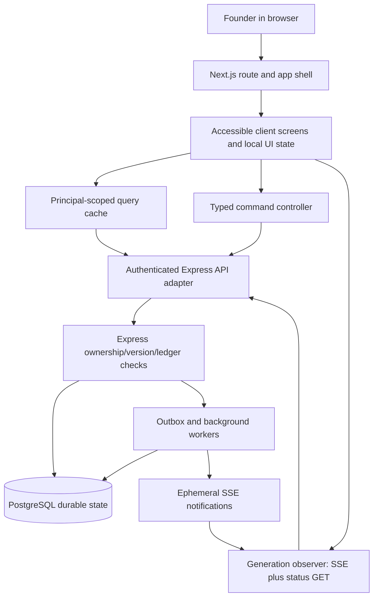

# Founder's Lens — LLD Phase 4C: Frontend State, API Integration & Recovery

**Document ID:** FL-LLD-FE-4C  
**Version:** 0.5 — approved final mapping design
**Status:** Approved — Documentation Only under FE4D-A08, revision `FL-P4-0.5-approved`, including FE4D-A01/A02/A03, P4-AM01–04 and P4-B01/B02. Runtime/provider/migration/accessibility/security/model gates remain unexecuted. See the [approval manifest](approved-revision-0.5.json) and [4D §19](frontend-integration-review.md#19-formal-phase-4-documentation-sign-off).
**Scope:** Next.js/TypeScript browser/server boundaries, state ownership, typed API integration, query caching, transactional UI, generation streaming and recovery, privacy, error behavior and frontend test contracts. **Documentation only; no application code.**

## 1. Authority, evidence and scope limits

**Current evidence:** actual PRD/SRS/HLD/ADR-013, API contracts/OpenAPI 0.3.0/48-route inventory, Clerk security design, Prisma/SQL, streaming/reliability, Phase 2D policy/manifests and approved Phase 3A–3D/11-file manifest were inspected. [4D](frontend-integration-review.md) owns inventory, gaps and approvals. This supersedes v0.1 unavailable-source caveats; no runtime/provider correctness is inferred.

### Binding contracts (not to redesign)

- Clerk authentication before any founder AI call; backend owns authorization and local account/idea lifecycle.
- One active generation per conversation; server states `PENDING`, `RUNNING`, `CANCEL_REQUESTED`, `COMPLETED`, `FAILED`, `CANCELLED` (terminal last three only).
- SSE is an **ephemeral** text channel: no durable token replay or SSE event IDs; browser disconnect never implicitly cancels a generation. DB-backed status and selected transcript are durable sources of truth.
- `POST` acceptance creates durable IDs atomically; accepted commands with `Idempotency-Key` replay their **original accepted HTTP result**, not a new current-state response.
- Version-sensitive mutations use the resource's correct `If-Match`/ETag, with missing 428, stale 412; `409` applies to invalid lifecycle/active conflict or scoped idempotency conflict.
- Existing legacy message representation is the default; explicit `assistantResponseVersion=2` can reveal one optional validated assistant card, strategy, citations and up to two prominent actions for eligible assistant rows. Older/user rows must not be invented as format 2.
- Memory and durable experiment/assumption changes are founder actions; AI suggestions do not persist business approval. `proactiveResearch=false` blocks **new automatic research admission**, not already accepted work.
- Approved snapshots are immutable; revised content creates a new draft/version. Privacy deletion blocks new work immediately; actual active-system purging has the approved 30-day target, backup handling separate.

## 2. Fundamentals, in plain language

| Concept | Human explanation | Example |
|---|---|---|
| **Client state** | Temporary facts held by the open interface | Unsent text, open dialog, which tab is selected |
| **Server state** | Data the backend owns and can confirm | Saved message, approved memory, export status |
| **Query cache** | A temporary local copy of fetched server data | Recently loaded conversations for one account |
| **Optimistic update** | Showing a change before the backend confirms it | A temporary “Sending…” message, clearly not yet saved |
| **Invalidation** | Marking cached data out of date so it is refreshed | Refreshing memory after successful acceptance |
| **Idempotency key** | An identifier that makes a retry of one command safe | Retrying a message after losing the response |
| **ETag / `If-Match`** | A version guard against overwriting someone else's edits | Two tabs editing a memory proposal |
| **SSE** | Live one-way server-to-browser updates | Temporary assistant text as it arrives |
| **Reconciliation** | Checking actual server state after a doubtful network outcome | Determining whether Send was accepted |
| **Principal** | The authenticated local account whose data is in use | Distinguishes one founder from another in caches |
| **Projection** | A particular permitted view of backend data | Basic messages versus opt-in structured messages |

**Mental model:** Browser displays and initiates; Express authorizes and commits; PostgreSQL is durable truth; independent workers perform generation/research/export; Redis/SSE may accelerate live updates but are not the persistent record.

## 3. Logical frontend component architecture



These are **logical modules, not separate services**. Never introduce a new Next.js business datastore, second generation state machine, model-provider call in the browser or separate frontend authority for privacy.

### Responsibility table

| Logical module | May do | Must not do |
|---|---|---|
| App shell / route guard | Render nonprivate public shell, redirect missing sessions, display navigation | Treat client route hiding as object authorization |
| Auth/session adapter | Obtain Clerk-supported short-lived credentials as needed; handle refresh and sign-out | Persist bearer tokens in localStorage or logs; guess SDK method names |
| Typed API adapter | Validate inputs/outputs, attach headers, normalize typed errors, prevent unsafe cross-origin redirects | Retry paid commands with fresh keys automatically; reconstruct unsupported API fields |
| Query/read controller | Cache authorized GET responses by principal and scope, paginate and invalidate | Share caches across identities, store private content in public/shared server caches |
| Command controller | Maintain stable client intent IDs; show pending/confirmed/uncertain states | Treat click, `fetch` dispatch or lost network as proof of commit |
| Generation observer | Read durable status; listen to safe SSE; resubscribe and reconcile | Set backend state from delta, promise token replay or cancel on disconnect |
| Draft/editor controller | Keep local unsaved draft; submit current `If-Match`, display conflicts | Silently overwrite concurrent edits or approve AI-proposed memory |
| Privacy boundary | Abort observers, clear memory/cache on sign-out/account switch/deletion | Claim full device erasure, remote provider revocation or backup deletion |
| Accessible presentation | Display server-backed states, optional card/source disclosures, status announcements | Render arbitrary model HTML or internal prompts/hidden reasoning |

## 4. Rendering, routing and authentication

**Proposed Next.js routing:** retain Phase 4A's idea-scoped deep links (`/app/ideas/[ideaId]/think`, `/overview`, `/learning`, `/snapshots`, conversation and snapshot IDs as applicable), with an authenticated app shell and responsive navigation from Phase 4B. Browser URLs carry only opaque IDs, never prompts, private titles, provider secrets or signed downloads. Browser history must retain selected idea/conversation and respect regeneration's logical-turn cursor.

**Rendering proposal:** server-render public/non-sensitive shell where practical; put composer, SSE, memory review, document edit, focus management and navigation drawers in small interactive client boundaries. Rendering on the Next.js server is not automatically private or authorized: any server-initiated private fetch must carry verified user session context and disable public/shared caching. Never embed private data into SEO metadata, publicly cached HTML, server build output, or shared static assets. Decide exact session transport only after verifying current Clerk and deployment versions.

**Reconciled transport:** direct HTTPS browser→Express with explicit Clerk session Bearer authentication, including authenticated fetch SSE, as already selected in approved API §2 and security §6. No ambient-cookie API authentication or BFF is selected. Browser acquisition, issuer/audience/authorized-party configuration, CORS and fresh-auth proof remain Pending Implementation/Provider Validation, not an unresolved choice to add a service. §20 defines request/SSR boundaries.

**No assumption about Clerk SDK method names.** Verify session token lifetime, refresh flow, sign-in transition, sign-out events, session/org switching and server-side auth validation with the pinned SDK. A logged-in browser does not prove an ACTIVE local account or ownership of a requested idea. 401 -> reauthentication; 403 -> operation forbidden/blocked lifecycle; foreign/missing resource -> neutral 404.

## 5. State inventory and ownership

| State | Source of truth | Browser lifespan | Rebuild / refresh trigger |
|---|---|---|---|
| Current principal/session | Verified Clerk + backend account | Session | Auth event, 401, identity switch |
| Ideas, conversations, messages | Express/PostgreSQL | Scoped query cache | Authorized GET, command confirmation, regeneration completion |
| Selected logical-turn transcript | Backend projection/cursor | Scoped page cache | Pagination, new completed response, representation change |
| Generation durable status | Generation GET | Active observer snapshot | Acceptance, SSE terminal hint, polling, foreground return |
| Live text fragments | Current SSE feed only | Ephemeral memory | New feed/attempt, transport loss, terminal commit; discard when reconciling |
| Memory/proposals, assumptions, experiments | Express/PostgreSQL | Scoped cache | Confirmed writes, idea deletion, account switch, version conflict |
| Research preference/jobs/evidence | Express/PostgreSQL | Scoped cache | Successful preference change, admitted job/status, evidence arrival |
| Snapshot versions, export jobs | Express/PostgreSQL | Scoped cache | Draft edit/approval/export status/download-grant event |
| Composer draft | Browser ephemeral memory by default | Until navigation/tab close depending on chosen UX | Send accepted or explicit discard; no private localStorage by default |
| Dialogs, sorting, focus, visual tabs | Browser UI | Current route/session | Navigation, focus restoration, dismissal |
| Idempotency key and clientSubmissionId | Browser command record | Until intent resolved | Stable across retry; delete safely after resolution |

**FE4C-D04 current approved principle:** only the session-scoped opaque recovery record in§19.2 may persist. Never persist private draft/cache/auth/body/grant. P4-AM01 now defines a pure authorized correlation GET;IDs alone still cannot replay the lost command,404 never permits automatic resend. TTL andbrowser/provider behavior remain provisional/unvalidated.

## 6. Query key, caching and invalidation contract

Proposed query keys are conceptual tuples, not library-specific code. Use `principalLocalId`, `ideaId`, `conversationId`, endpoint identity, filters/cursor and `assistantResponseVersion` where relevant. Session/account boundary must survive same-email re-signup: **never key only by email**. Do not use the key as proof of server ownership; Express still checks each request.

| Read / cache family | Scope keys | Invalidate after |
|---|---|---|
| Idea index/detail | Principal, idea, filter | Idea create/edit/delete, account lifecycle |
| Conversations | Principal, idea, conversation, list cursor | Conversation create/edit, idea deletion |
| Transcript | Principal, idea, conversation, logical cursor, representation version | Accepted submission (for user message), terminal generation, regeneration selection |
| Generation status | Principal, generation ID | SSE terminal hint + GET, refresh, cancellation status |
| Memory/proposals | Principal, idea, proposal/memory/version where relevant | Accept/edit/dismiss/remove, completion that created proposals |
| Assumptions, experiments, learnings | Principal, idea, filter/cursor | Confirmed mutation or linked observation |
| Research and evidence | Principal, idea, job/filter | Research admission/status terminal, evidence link changes |
| Snapshots | Principal, idea, snapshot/document/draft revision | Create/edit/review/approve/fork |
| Exports/grants | Principal, snapshot/export | Export terminal, object expiry; signed grant held only for immediate use, never in query/persistent cache |
| Preferences and deletion | Principal, policy/version | Saved settings, account deletion acceptance |

**Recommended cache behavior:** no cross-principal or cross-request persistent server caches; stale data may render as clearly stale during safe background refresh, **except** after sign-out, deletion acceptance, removed-memory context refresh, or permission errors—then clear sensitive projections immediately. Cancel in-flight reads on auth changes, and discard their late results using principal/generation identity guards. Do not globally cache Clerk bearer tokens. Avoid prefetching sensitive resources or fetching research source pages in the browser merely to populate previews.

**Important:** Removing a memory does not necessarily remove historical messages or approved snapshots. Refresh active-memory and derived summary caches, and exclude known-linked obsolete history according to the approved Phase 3 rules. Do not falsely label old approved content as automatically erased.

## 7. API request conventions and response classification

The actual API/OpenAPI/route inventory were inspected. §8 maps existing operations; §19–20 specify presentation/recovery without creating capabilities. §21 records exact field limitations. Proposed amendments are only in 4D §13; approved files remain untouched.

- API prefix is `/api/v1` once; Express owns it. `GET /health/*` and `POST /webhooks/clerk` are not frontend founder interactions.
- All founder API calls require current authenticated principal, owner-scoped server authorization and private/no-store response handling.
- Required command `Idempotency-Key` is generated for each *new intent* and never reused for different payloads; retained unchanged across safe same-intent retries. This key is not an authorization token.
- `If-Match` uses the exact resource version/ETag from the latest relevant GET, **not** a card version, unrelated parent or stale client-derived counter. For snapshot editing/approval this is the draft revision rather than immutable document version. For proposal acceptance it is the proposal version; the target-memory version is an additional server check.
- `202` means **accepted for asynchronous processing**, not completed. Read status via returned authorized references. `200/201` reflect the operation's contract; `204` has no response body.
- Never infer an API failure category solely from network exception text; classify timeout/connection loss after a request was sent as **unknown acceptance**.

| Outcome | UI behavior | Safe next move |
|---|---|---|
| 400 invalid/unsupported projection | Explain and correct request; no blind retry | Inspect typed error and restore compatible projection if permitted |
| 401 | Stop private subscriptions; clear/guard UI | Verified session refresh/re-sign-in; do not expose old data |
| 403 blocked/ineligible | Immediately gate affected commands, preserve only permitted deletion status | Explain limited access; no bypass |
| 404 foreign/missing | Neutral unavailable page | Navigate to owned ideas; no existence disclosure |
| 409 duplicate/active/lifecycle/conflicting payload | Show appropriate conflict, do not rotate keys automatically | GET and reconcile; only deliberate new intent gets new key |
| 412 stale version | Keep user edit, refresh canonical record, show comparison | Explicit user reconciliation; new deliberate save with updated ETag |
| 428 missing precondition | Integration defect; no silent blind write | Obtain correct version and retry only if intent safe/confirmed |
| 429 quota/rate limit | Show limit and any server guidance (`Retry-After`) | No autonomous extra paid request |
| 503 infrastructure/provider unavailable | Show unavailable/uncertain | GET known durable status or bounded safe retry policy |
| Request timeout, response lost | Accepted status **unknown** | Reuse same intent key if resubmission is supported; do not assert failure |

Backend error codes, `Location`, `Retry-After`, `ETag` and authorized status/event URLs are parsed as per canonical schema; never trust an unvalidated arbitrary URL for authenticated fetch or redirect. Whitelist trusted origin and expected path shape. Client must not follow a model-supplied action URL as a privileged API call.

## 8. Endpoint → UI operation matrix (design mapping)

Source-exact projection of all50 founder operations from [route inventory](../02-api-security/route-inventory.json) and [OpenAPI](../02-api-security/openapi.yaml). Paths already include /api/v1. Every row requires session Bearer,current local-account/idea lifecycle andowner authorization. JSON uses application/json;I=required Idempotency-Key,V=required If-Match;dash means absent,not public. P4-AM02 now reconciles current human/full Generation responses. Projection selectors apply only where API§19 declares them.

| UI surface | Method and full path | Request DTO | I | V | Success status: DTO | operationId |
|---|---|---|---|---|---|---|
| Settings/privacy | GET /api/v1/me | — | — | — | 200: UserAccount | getMe |
| Settings/privacy | PATCH /api/v1/me/preferences | PreferencesPatch | — | yes | 200: UserAccount | patchMePreferences |
| Settings/privacy | POST /api/v1/me/data-operations | DataOperationCreate | yes | — | 202: DataOperation | postMeDataOperations |
| Settings/privacy | GET /api/v1/me/data-operations/{operationId} | — | — | — | 200: DataOperation | getMeDataOperationsOperationId |
| Idea chooser/shell | GET /api/v1/ideas | — | — | — | 200: IdeaList | getIdeas |
| Idea chooser/shell | POST /api/v1/ideas | IdeaCreate | yes | — | 201: Idea | postIdeas |
| Idea chooser/shell | GET /api/v1/ideas/{ideaId} | — | — | — | 200: Idea | getIdeasIdeaId |
| Idea chooser/shell | PATCH /api/v1/ideas/{ideaId} | IdeaPatch | — | yes | 200: Idea | patchIdeasIdeaId |
| Idea chooser/shell | DELETE /api/v1/ideas/{ideaId} | — | — | — | 202: DataOperation | deleteIdeasIdeaId |
| Think | GET /api/v1/ideas/{ideaId}/conversations | — | — | — | 200: ConversationList | getIdeasIdeaIdConversations |
| Think | POST /api/v1/ideas/{ideaId}/conversations | ConversationCreate | — | — | 201: Conversation | postIdeasIdeaIdConversations |
| Think | GET /api/v1/conversations/{conversationId} | — | — | — | 200: Conversation | getConversationsConversationId |
| Think | PATCH /api/v1/conversations/{conversationId} | ConversationPatch | — | yes | 200: Conversation | patchConversationsConversationId |
| Think | GET /api/v1/conversations/{conversationId}/messages | — | — | — | 200: MessageList or StructuredMessageList | getConversationsConversationIdMessages |
| Think | POST /api/v1/conversations/{conversationId}/messages | MessageCreate | yes | — | 202: MessageSubmission | postConversationsConversationIdMessages |
| Think/recovery | GET /api/v1/conversations/{conversationId}/submissions/{clientSubmissionId} | — | — | — | 200: SubmissionCorrelation | getConversationsConversationIdSubmissionsClientSubmissionId |
| Think | GET /api/v1/generations/{generationId} | — | — | — | 200: Generation | getGenerationsGenerationId |
| Think | GET /api/v1/generations/{generationId}/events | — | — | — | 200: EventStream | getGenerationsGenerationIdEvents |
| Think | POST /api/v1/generations/{generationId}/cancel | — | yes | — | 200: Generation; 202: Generation | postGenerationsGenerationIdCancel |
| Think | POST /api/v1/conversations/{conversationId}/regenerations | RegenerationCreate | yes | — | 202: Generation | postConversationsConversationIdRegenerations |
| My Idea/memory | GET /api/v1/ideas/{ideaId}/memory | — | — | — | 200: MemoryList | getIdeasIdeaIdMemory |
| My Idea/memory | GET /api/v1/ideas/{ideaId}/memory-proposals | — | — | — | 200: ProposalList or ProposalListV2 | getIdeasIdeaIdMemoryProposals |
| My Idea/memory | PATCH /api/v1/memory-proposals/{proposalId} | ProposalPatch | — | yes | 200: MemoryProposal | patchMemoryProposalsProposalId |
| My Idea/memory | POST /api/v1/memory-proposals/{proposalId}/accept | ProposalDecision | yes | yes | 200: ConfirmedMemory | postMemoryProposalsProposalIdAccept |
| My Idea/memory | POST /api/v1/memory-proposals/{proposalId}/dismiss | ProposalDismiss | yes | yes | 200: MemoryProposal | postMemoryProposalsProposalIdDismiss |
| My Idea/memory | PATCH /api/v1/memory/{memoryId} | MemoryPatch | — | yes | 200: ConfirmedMemory | patchMemoryMemoryId |
| My Idea/memory | GET /api/v1/memory/{memoryId}/revisions | — | — | — | 200: MemoryRevisionList | getMemoryMemoryIdRevisions |
| My Idea/research | GET /api/v1/ideas/{ideaId}/assumptions | — | — | — | 200: AssumptionList | getIdeasIdeaIdAssumptions |
| My Idea/research | POST /api/v1/ideas/{ideaId}/assumptions | AssumptionCreate | — | — | 201: Assumption | postIdeasIdeaIdAssumptions |
| My Idea/research | PATCH /api/v1/assumptions/{assumptionId} | AssumptionPatch | — | yes | 200: Assumption | patchAssumptionsAssumptionId |
| My Learning | GET /api/v1/ideas/{ideaId}/experiments | — | — | — | 200: ExperimentList or ExperimentListV2 or ExperimentListV3 | getIdeasIdeaIdExperiments |
| My Learning | POST /api/v1/ideas/{ideaId}/experiments | ExperimentCreate or ExperimentCreateV3 | yes | — | 201: Experiment (old accepted1 replay) or ExperimentReceiptV3 (fresh3) | postIdeasIdeaIdExperiments |
| My Learning | PATCH /api/v1/experiments/{experimentId} | ExperimentPatch or ExperimentPatchV3 | — | yes | 200: Experiment or ExperimentV3 | patchExperimentsExperimentId |
| My Learning | POST /api/v1/experiments/{experimentId}/learnings | LearningCreate or LearningCreateV2 or LearningCreateV3 | yes | — | 201: Learning or LearningV2 or LearningV3 | postExperimentsExperimentIdLearnings |
| My Learning | GET /api/v1/ideas/{ideaId}/learnings | — | — | — | 200: LearningList or LearningListV2 or LearningListV3 | getIdeasIdeaIdLearnings |
| My Idea/research | GET /api/v1/ideas/{ideaId}/evidence | — | — | — | 200: EvidenceList | getIdeasIdeaIdEvidence |
| My Idea/research | GET /api/v1/ideas/{ideaId}/research-jobs | — | — | — | 200: ResearchJobList | getIdeasIdeaIdResearchJobs |
| My Idea/research | POST /api/v1/ideas/{ideaId}/research-jobs | ResearchRequest | yes | — | 202: ResearchJob | postIdeasIdeaIdResearchJobs |
| My Idea/research | GET /api/v1/research-jobs/{researchJobId} | — | — | — | 200: ResearchJob | getResearchJobsResearchJobId |
| My Idea/research | POST /api/v1/assumptions/{assumptionId}/evidence-links | EvidenceLinkCreate | — | — | 201: EvidenceLink | postAssumptionsAssumptionIdEvidenceLinks |
| My Idea/research | GET /api/v1/assumptions/{assumptionId}/evidence-links | — | — | — | 200: EvidenceLinkList | getAssumptionsAssumptionIdEvidenceLinks |
| My Idea/research | DELETE /api/v1/assumptions/{assumptionId}/evidence-links/{evidenceId} | — | — | — | 204: no body | deleteAssumptionsAssumptionIdEvidenceLinksEvidenceId |
| Snapshots | GET /api/v1/ideas/{ideaId}/snapshots | — | — | — | 200: SnapshotList | getIdeasIdeaIdSnapshots |
| Snapshots | POST /api/v1/ideas/{ideaId}/snapshots | SnapshotCreate | yes | — | 201: DocumentSnapshot | postIdeasIdeaIdSnapshots |
| Snapshots | GET /api/v1/snapshots/{snapshotId} | — | — | — | 200: DocumentSnapshot | getSnapshotsSnapshotId |
| Snapshots | PATCH /api/v1/snapshots/{snapshotId} | SnapshotPatch | — | yes | 200: DocumentSnapshot | patchSnapshotsSnapshotId |
| Snapshots | POST /api/v1/snapshots/{snapshotId}/approve | SnapshotApprove | yes | yes | 201: DocumentSnapshot | postSnapshotsSnapshotIdApprove |
| Snapshots | POST /api/v1/snapshots/{snapshotId}/exports | ExportCreate | yes | — | 202: ExportJob | postSnapshotsSnapshotIdExports |
| Snapshots | GET /api/v1/exports/{exportId} | — | — | — | 200: ExportJob | getExportsExportId |
| Snapshots | POST /api/v1/exports/{exportId}/download-grant | — | — | — | 200: DownloadGrant | postExportsExportIdDownloadGrant |

DELETE /api/v1/ideas/{ideaId} additionally requires X-Privacy-Policy-Version; missing400. SSE GET uses Accept:text/event-stream and rejects Last-Event-ID400, unacceptable media406. Lists use only the declared limit/cursor query parameters (limit1–100/default 25); do not invent server search/status/idea filters. Transcript alone opts into assistantResponseVersion=2; bind cursor to principal/resource/filter/representation. No probe/webhook belongs to founder navigation; /health/live,/health/ready and /webhooks/clerk account for the other three operations.

The table now covers all50 founder operations; three health/webhook operations remain outside screens. The new submission and relationship GETs are approved design contracts, not deployed endpoints. No standalone conversation delete, evidence detail/erase, research cancel, proposal detail GET, snapshot fork/review transition or generation-list action is introduced. Evidence/source drawers resolve authorized list records. Validate statusUrl/eventsUrl against the API origin/path; grants never receive API Bearer credentials.

Six operations now negotiate a projection. Memory-proposal GET remains1/2. Experiment-list GET and Learning GET/POST allow1/2/3; Experiment POST/PATCH allow1/3 (2 remains invalid). Default is1. Fresh legacy Experiment POST rejects409 EXPERIMENT_HYPOTHESIS_REQUIRED after accepted old replay resolution; create3 requires explicit hypothesis and returns only a small operational receipt, then list3 supplies current full content. PATCH3 retains If-Match. Learning1 reflection and Learning2 interpretation/observation schemas remain unchanged;3 adds durable source read-back, and all accepted versions capture the full set atomically. Unsupported selector/body400; cursor/fingerprint binds selection. [API§21](../02-api-security/api-contracts.md#21-approved-final-mapping-contracts--p4-b01-and-p4-b02) is current authority; no automatic key rotation or hidden retry follows an uncertain result.

Mutation classes: keyed commands replay original accepted responses after authorization, before stale-precondition/new-admission checks; changed semantic payload/If-Match requires a new explicit intent/key. Unkeyed PATCH is version-protected but repeating a succeeded patch may412; GET and compare rather than silently retry. Unkeyed conversation/assumption/evidence-link creates have no generic transport replay guarantee; preserve uncertainty and inspect authorized lists, never automatically resend. DELETE idea is domain lifecycle-idempotent despite no ledger header; download-grant POST is deliberately non-ledger because grants expire. No header is added indiscriminately to all POSTs.

## 9. Chat submission: frontend state machine and sequence

### 9.1 Local command states (separate from backend generation enum)

| Local state | Meaning | Allowed display / transition |
|---|---|---|
| `EDITING` | Founder is drafting | Enter text; no server work |
| `SUBMITTING` | Command dispatched; not yet acknowledged | “Sending…”; prevent accidental duplicate intent |
| `ACCEPTANCE_UNKNOWN` | Request may have committed despite transport failure | “Checking whether it was saved…”; retry **same** key/ID only when payload and auth are available |
| `ACCEPTED` | Received durable accepted message/generation IDs | “Saved, AI queued”; start observer |
| `OBSERVING` | Following active generation | Temporary deltas + durable state polling |
| `RESOLVED` | Confirmed terminal via GET | Refresh selected transcript / show failure / cancellation |

Local states must not replace or be persisted as the server's generation states. A duplicate click does not create a new intent. If the app reloads without a safely replayable original payload and key, do **not** resend a fabricated command. Fetch recent transcript/known status and ask founder to review if uncertain.

### 9.2 Sequence

```mermaid
sequenceDiagram
  participant F as Founder
  participant C as Browser controller
  participant A as Express API
  participant D as PostgreSQL
  participant W as Generation worker
  F->>C: Send message
  C->>C: Freeze payload and stable intent IDs
  C->>A: POST message + same scoped Idempotency-Key
  A->>D: Commit message, generation, ledger, outbox
  A-->>C: 202 stable IDs and authorized status/events refs
  C->>A: GET generation status + connect SSE
  A-->>C: Durable PENDING or RUNNING
  W->>D: Claim fenced attempt; invoke model
  W-->>C: Ephemeral safe SSE text/status
  W->>D: Guarded completed/failed/cancelled commit
  C->>A: GET status then selected transcript version 2
  A-->>C: Authoritative response and eligible card
  C-->>F: Show saved result or truthful failure
```

**Source-exact acceptance:** MessageCreate={clientSubmissionId UUID,content1..10000};MessageSubmission202 requires flat messageId,generationId,status=PENDING,statusUrl,eventsUrl andLocation. P4-AM02 reconciles all current cancel200/202 andregeneration202 bodies to full Generation;original replay is not current GET. Regeneration requires triggerMessageId,not a new USER body/ID. No assistant completion exists at acceptance.

### 9.3 Recovery cases

1. **Response lost after successful POST:** While tab/controller retains stable key, ID and original body, same-intent replay retrieves the original accepted result after reauthorization; never create another intent. Avoid automatic infinite retries.
2. **Browser refresh after acceptance:** If IDs are retained safely, GET status; otherwise reload selected transcript. Missing live fragments cannot be replayed.
3. **Full reload during unacknowledged POST:** Opaque ID persistence alone does not recover a lost body; current endpoint lacks guaranteed submission-ID lookup. Surface ambiguity and recent-transcript reconciliation; any new Send must be an explicit *new* founder action. Use §19’s conservative recovery; richer lookup/persistence is a proposed amendment/owner decision.
4. **SSE fails:** Keep generation running; status GET and bounded polling recover terminal truth. Do not declare FAILED from transport failure.
5. **Cancel after completion:** Server terminal state wins; show actual GET result. `CANCEL_REQUESTED` is not terminal.
6. **Regeneration:** Existing selected assistant stays until a newly completed eligible attempt is committed; logical turn order/cursor preserved.

## 10. SSE connection lifecycle and observer

- Use authenticated **fetch-based** streaming when bearer headers are required. Native `EventSource` does not allow arbitrary `Authorization` headers; do not put tokens in query strings. If a future first-party session-cookie proxy is selected, validate CSRF/cookie/cache semantics separately.
- Supported event names from Phase 2C: `generation.status`, `response.delta`, `generation.completed`, `generation.failed`, `generation.cancelled`, `stream.error`. Do not invent `card.delta`, durable token IDs or `Last-Event-ID` support.
- On attach: establish observer, then reconcile durable status; handle the subscribe/status race by checking status after subscription and periodically. Ensure exactly one active observer per current generation/principal in the tab; detach on navigation only, never send cancel implicitly.
- SSE message parsing must handle multi-line `data:`, fragmented UTF-8, comments/heartbeats, frame/event size limits and incomplete network chunks. Reject invalid payloads before rendering. Never allow raw structured JSON, internal tool calls, or HTML to render as conversational text.
- `chunkIndex` is monotonic **within a live feed only**. After a new connection, reset ephemeral fragment buffer; don't concatenate old and new feeds into an apparent exact answer. Prefer status placeholder until durable final GET.
- On terminal SSE notification, immediately GET durable generation status and selected transcript; do not treat an event as the final authoritative card/approved memory. If SSE end is missed, polling reaches terminal state.
- Respect browser visibility and accessibility: throttle noisy visual updates, announce major milestones not every token, preserve reading position when founder scrolls up, suspend unnecessary polls only if safe reconciliation resumes on return.
- On session expiry: close private transport, clear unauthorized state, obtain verified renewed auth before reconnect; do not promise instant revocation of external provider work.
- Proposed heartbeat/poll/backoff values must obey the existing Phase 2C server constraints. Do not invent numeric guarantees; record configuration in an implementation-facing adapter profile.

## 11. Mutation controllers, `If-Match`, and founder decisions

**Memory proposal:** request owned list projectionVersion2 for required actual version/proposedText/source. Derive quoted ETag "vN" only from that server version;missing/invalid required2 data is an integration error,not a guessed value. Legacy mutation responses remain unchanged;invalidate/refetch2 after commit. Accept/Dismiss still require their key andproposal If-Match,target memory version checked server-side;atomic approvedText supports Edit & Accept. Two-tab412 preserves local draft andrequires renewed explicit choice. No worker approves or restores REMOVED memory;source UNAVAILABLE/UNKNOWN exposes null IDs/role.

**Research toggle:** use conversation metadata ETag for `PATCH /conversations/{id}` `proactiveResearch=false`; pending UI may show “Updating…” but do not state “Off” until confirmed 200/appropriate success. When saved false, no *new* automatic admission; already accepted research may finish. Refresh affected conversation preference, research jobs and evidence at appropriate times. An unacknowledged toggle is not permission to pretend the backend changed.

**Assumptions/experiments/learnings:** distinguish AI suggestion from user's explicit Save; use existing authorized create/update endpoints; preserve evidence origin and unknowns. For non-keyed creates with no generic replay guarantee, show uncertain state and reconcile lists before allowing repeat; do not blindly duplicate.

**Snapshots:** draft edit uses snapshot `draftRevision` ETag; approval is explicit and version-guarded. Approved snapshot remains read-only and immutable; new content uses existing SnapshotCreate POST to allocate a new DRAFT version under the idea lock (API §14). No special fork request or sourceSnapshotId exists. Export is a separate accepted job; `COMPLETED` job does not guarantee an unexpired artifact. A fresh download grant requires owner and currently available artifact, with no signed URL in application navigation, logs or persistent caches; no guarantee is made about browser/network/download records. §20 defines bounded secure download handling. SnapshotCreate.content supplies the full typed document; a reviewed existing owned version may seed an unsaved editor, but creation is always a distinct explicit POST intent with server-allocated version. This is the documented new-version operation, not a synthetic fork endpoint. A reviewed source is not automatically current truth: show historical evidence/memory caveats.

**Idea/account deletion:** obtain verified fresh authentication for account deletion, then submit approved destructive intent. On acceptance, synchronously disable content actions, close streams, clear private caches/drafts, route to only permitted minimal status view. Do not keep re-fetching private content after lifecycle gate. Do not promise that all storage/backups vanish immediately; mention distinct 30-day active-system target and separate provider/backup expiry.

## 12. Structured responses, citations and rendering safety

- Ask for `assistantResponseVersion=2` only where card rendering is needed. Default v1 is strict and has `content:string`. v2 adds `assistantContent` only to eligible ASSISTANT messages; do not add guessed card/strategy to user or legacy rows.
- Validate discriminated variants `assumption`, `evidence`, `comparison`, `experiment` against *actual* canonical casing/DTO schema. At most one optional card; at most two prominent actions; never render a `cards[]` alias or raw model HTML.
- Display the authoritative `content` string even when no enrichment exists; an invalid enrichment requires safe text fallback **only** if permitted and independently validated by the backend contract. A fundamentally invalid assistant message must not be silently treated as saved validated truth.
- Citation IDs, source labels, dates/geography and qualification must come from authorized backend projections, not raw model-provided link URLs. “Source checked” is not “claim proven.” Avoid implicit fetch/previews of arbitrary website URLs.
- UI action intents are presentation-only. Map actions through allowlisted, preexisting founder-confirmed API commands. No autonomous memory approvals, experiment creation, export or provider fetch from card click without explicit action and appropriate confirmation.
- Hinglish text uses safe Unicode rendering, flexible wrapping and IME-safe composer handling; never infer user permissions from language or locale.

## 13. Privacy, security and accessibility

### 13.1 Privacy/security invariants

- No provider/model keys, webhook secrets, Redis credentials or database credentials in browser bundles.
- No full prompts, full conversations, source bodies, signed URLs, bearer tokens or hidden reasoning in analytics/error reports, logs, crash breadcrumbs, URL query strings or globally persistent state.
- Separate browser sessions/accounts even if email identical; clear principal-scoped state on sign-out and deletion, abort requests and reject stale late responses.
- Avoid service workers/offline caches for private API responses until a separately approved threat model exists. `no-store` semantics must be enforced at HTTP and Next.js data-cache boundaries as applicable.
- Treat all fetched data and AI output as untrusted for HTML execution; encode text and restrict external links. Browser-side validation is additional UX safety, not a replacement for backend schema/authorization.
- No arbitrary cross-origin authenticated redirects. Only allowed API host/path patterns for status/event/download flows; verify token scope using current auth adapter.
- Temporary draft and opaque pending-intent storage remain Phase 4 policy decisions; do not imply persistent local wipe is cryptographically guaranteed.

### 13.2 Accessibility contracts

- Keyboard-only Send, Stop, source disclosure, proposal review, snapshot review and deletion confirmation; clear focus destinations after mutation/dialog close.
- `aria-live` status or equivalent announced milestones (saved, thinking, stopping, completed, failure); no screen-reader announcement per SSE token.
- Preserve focus and readable transcript logical order after regeneration/pagination; an optimistic placeholder must be clearly labeled.
- Avoid color-only labels for accepted/pending/research uncertainty. Support reduced motion, 200%+ zoom, small-screen keyboard, long Hinglish/emoji text and IME composition.
- Error summary associates field issues with corresponding controls; 412 conflict UI exposes old-versus-new text intelligibly without silently merging.
- Actual WCAG compliance, color contrast and assistive-technology behavior require later tests, not asserted by this draft.

## 14. Failure and race register

| ID | Trigger | Required frontend result | Inherited guarantee / gap |
|---|---|---|---|
| FE4C-R01 | Lost response after chat POST committed | Replay with same key/body if available; status GET once IDs known | Phase 2C original acceptance replay |
| FE4C-R02 | Full reload with unknown acceptance | Inspect transcript; honest uncertainty, no fabricated safe auto-resend | Potential frontend policy gap |
| FE4C-R03 | Duplicate Send clicks/tabs | One local intent, server dedupe; show conflict if other active generation | Phase 2D uniqueness |
| FE4C-R04 | SSE disconnect / missed terminal | No cancel; status and selected transcript recover durable result | Phase 2C no-replay decision |
| FE4C-R05 | CANCEL_REQUESTED vs completion race | Reflect server CAS winner, no false cancelled state | Phase 2C state machine |
| FE4C-R06 | Expired session during stream | Stop private display and reauth; no unauthorized refetch | Clerk/security adapter proof pending |
| FE4C-R07 | Same-email different account | Empty new account; no old cached titles/messages | P2D-P03 |
| FE4C-R08 | Memory removed during generation | Context-change failure honored; no stale content finalized | P2D-P04/P3-P03 |
| FE4C-R09 | Two tabs approve same proposal | 412 or original-key replay; compare latest, no phantom approval | Proposal ETag/version |
| FE4C-R10 | Research toggle off at admission race | Confirm setting before stating Off; accepted jobs remain distinguished | Research admission guard |
| FE4C-R11 | Research job failed or stale citation | Uncertainty and provenance; no fabricated evidence | Phase 3 grounding |
| FE4C-R12 | Regeneration on latest eligible turn | One selected assistant, cursor stable, no duplicated history | Phase 2C logical transcript |
| FE4C-R13 | Approved snapshot edited | Existing remains immutable; approved fork flow only | API fork availability must be verified |
| FE4C-R14 | Export completed but artifact expired | Fetch fresh grant or start allowed new export, never cache old URL | P2D-P05 |
| FE4C-R15 | Account deletion while request pending | Gate UI, clear private cache, reject late results | Privacy lifecycle |
| FE4C-R16 | 429/503 or ambiguous provider charge | Bounded honest failure and no new hidden paid intent | P3-P04 |
| FE4C-R17 | Malicious HTML / fake card/action | Render text safely, reject invalid enriched fields | P3-P01 and response validation |
| FE4C-R18 | Browser offline with queued unsaved draft | Don't auto-send paid request on reconnect | FE4A-D04 / FE4C open policy |
| FE4C-R19 | 412 on snapshot/memory | Preserve unsaved edit and prompt reconciliation | If-Match CAS |
| FE4C-R20 | Parallel authenticated requests return after sign-out | Discard response by identity epoch; no stale render | Client safeguard plus server reauth |

## 15. Frontend acceptance specification (all planned; none executed)

| ID | Scenario | Test oracle / expected evidence |
|---|---|---|
| FE4C-01 | Authenticated and unauthenticated landing | No unauthenticated AI call or private SSR cache |
| FE4C-02 | Browser-to-Express auth | Correct verified token and no secret in URL/browser storage |
| FE4C-03 | Foreign idea direct link | Neutral 404 and no cached private content |
| FE4C-04 | Query key isolation | Principal/idea/version boundaries; stale in-flight request discarded |
| FE4C-05 | First message success | Original stable 202, saved label only after accepted response |
| FE4C-06 | POST response lost after commit | Same key/payload yields original accepted IDs; no duplicate message |
| FE4C-07 | Reload with unknown acceptance | No invented replay; clearly explain and reconcile recent transcript |
| FE4C-08 | SSE byte fragmentation/heartbeat | Correct parser; only safe response.delta shown |
| FE4C-09 | SSE disconnect and terminal loss | GET status/transcript recovers final; no implicit cancel |
| FE4C-10 | Cancel vs completion ordering | Correct PENDING/RUNNING/CANCEL_REQUESTED/terminal display |
| FE4C-11 | Authentication expires during SSE | No stale private delta after auth loss; reauth before reconnect |
| FE4C-12 | Selected transcript regeneration | Cursor and one selected response stay coherent |
| FE4C-13 | Default and opt-in transcript | Strict v1 unchanged; v2 enriches eligible assistant only |
| FE4C-14 | Malformed multiple cards/HTML | Never render unsafe enrichment or extra card |
| FE4C-15 | Citation source wrong idea/stale | No unauthorized link, appropriate caveat and unknown labeling |
| FE4C-16 | Research toggle version conflict | `If-Match` required; stale 412, no false Off state |
| FE4C-17 | Research admitted before setting off | Accepted job remains represented honestly |
| FE4C-18 | Accept/edit/dismiss memory proposal | Correct proposal ETag; user confirmation before durable promotion |
| FE4C-19 | Two-tab memory edit | Conflict comparison, no silent overwrite |
| FE4C-20 | Removed memory in cached summaries | Cache invalidated and linked history excluded as specified |
| FE4C-21 | Assumption/experiment card | Save creates no persistent effect until explicit authorized founder command |
| FE4C-22 | Draft snapshot edit versus approved | Guard draftRevision; approved remains immutable |
| FE4C-23 | PDF expired/download grant | No grant in application navigation/persistent cache; fresh scoped grant; external browser artifacts disclosed |
| FE4C-24 | Account deletion accepted during work | Access barred; cache and SSE disposed; truthful cleanup text |
| FE4C-25 | Same-email new subject/account | No former workspace content; all principal keys differ |
| FE4C-26 | 400/401/403/404/409/412/428/429/503 | Correct safe UI behavior, no indiscriminate retries |
| FE4C-27 | Offline, rapid clicks and 2 browser tabs | No accidental duplicated paid intents or silent server changes |
| FE4C-28 | Mobile keyboard and Hinglish IME | Composer control works at narrow viewport/zoom |
| FE4C-29 | Screen reader + reduced motion | Milestone announces, focus restoration, card semantics |
| FE4C-30 | Privacy inspection | No token/prompt/private source in telemetry; no grant in app navigation/global cache; external browser traces not guaranteed absent |
| FE4C-31 | Snapshot and memory 412 race | User draft remains available for explicit compare/resubmit |
| FE4C-32 | Old-client compatibility | Strict legacy DTO readers continue; unknown projection rejected safely |
| FE4C-33 | Stream transport disconnected but server still RUNNING | UI shows observer disconnected, not server failed |
| FE4C-34 | Response validated but generation context changed | No obsolete reply rendered as durable/saved |
| FE4C-35 | Navigation away and back to pending generation | Fresh authenticated status observer, no cancellation or false token replay |
| FE4C-36 | Accessibility on error/empty/saving states | Descriptive text, keyboard retry, focus and no color-only meanings |

**Implementation-stage tools (not prescribed code):** API schema fixture tests; controlled browser integration tests (e.g., Playwright), fake SSE transport including byte fragmentation, real PostgreSQL/BullMQ scenario suite for persistence races, two-account and two-tab fixtures, browser keyboard/assistive-technology/manual usability audits. Prove both UI state and durable server effects; no browser-only mock demonstrates exactly-once business behavior.

## 16. Traceability across phases

| Source family | Phase 4C owner boundary | Acceptance coverage |
|---|---|---|
| 4A FJ-01–08, FE4A-01–30 | Route, founder journeys and no pre-auth AI | FE4C-01–07,24–30 |
| 4B UI-01–20, FE4B-01–36 | Components, cardinality, screen states, accessible copy | FE4C-08–15,18–23,28–36 |
| Phase 2D auth/privacy/P2D-P01–05 | Principal scoping, deletion, version writes, immutable documents | FE4C-02–04,16–25,30–31 |
| Phase 2C generation/worker/SSE | 202/replay, status recovery, cancellation, selected transcript | FE4C-05–12,26–27,33–35 |
| Phase 3 P3-P01–05 | v2 structured projection, memory filtering, budgets, evidence | FE4C-13–15,20–21,32,34 |
| SRS FR-001–047 | UX projections of existing behaviors; server remains authoritative | Existing AT-001–046 plus FE4C suite |
| SRS NFR-014/019 | Accessibility, responsiveness/browser compatibility | FE4C-28–29,36 + manual reviews |

## 17. Phase 4C proposed decisions and explicit gaps

| ID | Decision / gap | Recommended disposition | Approval state |
|---|---|---|---|
| FE4C-D01 | Frontend transport architecture | Inherited direct session Bearer transport to Express; no BFF selected, pinned SDK/CORS verification pending | Inherited transport; Pending Implementation/Provider Validation |
| FE4C-D02 | Router depth and shell | Idea-scoped Next.js App Router, responsive shell; confirm nested conversation deep links | Pending UX/engineering review |
| FE4C-D03 | Query/cache manager | One logical read controller over typed fetch plus scoped in-memory cache; local React state for UI/forms, no selected third-party state library | Design recommendation; Pending Implementation/Provider Validation |
| FE4C-D04 | Draft and uncertain-intent persistence | Private text memory-only;bounded session opaque IDs andlookup per§19 | Approved FE4D-A03/P4-AM01;configuration/browser tests pending |
| FE4C-D05 | API selector/DTO and model casing | Match current canonical OpenAPI exactly; v2 projection opt-in; explicit schema-version mismatch behavior | Repository checked: see §8/21; explicit unresolved DTO gaps in 4D, no implied product change |
| FE4C-D06 | Generation observer | Authenticated fetch SSE + durable GET, no Last-Event-ID/replay, bounded polling | Inherited behavior; frontend mechanics pending technical review |
| FE4C-D07 | Safe automatic retries | Only bounded transport and same-intent replay; no auto-paid regeneration | Pending engineering calibration under approved P3-P04 |
| FE4C-D08 | Snapshot editing/fork route | Existing API§14 SnapshotCreate POST creates DRAFT next version under idea lock | Resolved design: API §14 existing SnapshotCreate POST allocates new version |
| FE4C-D09 | Conflict UX | Preserve draft, show latest canonical version and require explicit renewed action | Pending UX review |
| FE4C-D10 | Frontend monitoring | Minimal sanitized operational diagnostics, no private content | Security review of actual vendors/config pending |
| FE4C-D11 | Clerk integration details | Pin SDK/version/session transport, reauth and session switch behavior | Deployment/implementation verification gate |
| FE4C-D12 | Metrics / accessibility targets | No performance or compliance claims before measured verification | Implementation and UX validation gate |

**Not a Phase 2D/3 reopening:** These are frontend integration choices or evidence gaps. Existing owner-approved privacy, memory, research, cost and snapshot behavior remain unchanged.

## 18. Phase 4D handoff and exit criteria

Historical preparation instruction (completed for current v0.2 reconciliation): compare the actual repository, particularly `Docs/lld/02-api-security/openapi.yaml`, `api-contracts.md`, `route-inventory.json`, current Clerk/security design, `Docs/lld/03-streaming-reliability/streaming-contract.md`, `Docs/lld/05-ai-orchestration/approved-revision-0.3.json`, SRS UI and acceptance sections, plus 4A/4B. Resolve field names, error DTOs, header requirements, representation enums, version prefix, snapshot-fork capability and real accepted-return shapes. Produce a discrepancy register, decisions, cache/security cross-matrix and an FE4A/B/C acceptance mapping. No unexecuted test can be reported as passed.

**Phase 4C completion criteria (documentation):** reviewed owner/transport/cache choices; correct request/response/ETag/keys for every founder interaction; explicit uncertain-network behavior; truthful SSE/data status; safe privacy boundaries; accessible mobile/errors; tracked unresolved SDK/hosting and test gates; repository-indexed documentation revision. These designs are **Approved — Documentation Only** under FE4D-A08; execution remains unproven. Current outcomes supersede the historical handoff instructions; 4D owns exceptions.

---

**Final status:** v0.5, `FL-P4-0.5-approved` — Approved, Documentation Only under FE4D-A08. Both mapping blockers are closed in documentation; the legacy-create upgrade limitation remains explicit. No implementation, migration execution, certification or next phase is implied.

## 19. Canonical refresh, retry and live-recovery policy

### 19.1 Private text stays ephemeral; recovery identifiers may survive reload

FE4D-A03 approves only the bounded session record in§19.2. No transcript, draft, token, command body, grant or hash of private content is persisted. Unsent text/exact submitted bodies stay principal/idea/conversation-scoped memory and may be lost on refresh. A recovery record is not proof of commit or permission to resend/regenerate. Storage denial/tampering/expiry falls back to authorized history inspection and an explicit unknown state; no private-text persistence is added.

On explicit Send, freeze exact MessageCreate and one UUID clientSubmissionId plus a distinct8..128-character Idempotency-Key. Preserve them for that unresolved intent. Do not change text, scope, versioned headers or identifiers between replays. A bounded same-tab retry uses the exact command and key; do not create a fresh key on timeout/503/401 or automatic reconnect. Ledger retention is separately proposed14 days (not a browser guarantee); chat clientSubmissionKey uniqueness lasts while the message exists. Never infer that ledger expiry authorizes a different paid attempt. An unresolved intent is never automatically converted to regeneration. Confirmed resolution permits discarding the in-memory command, while server dedupe remains authoritative.

After reload validate the session record against the current verified local UUID/idea/conversation/expiry. If an original generationId is known, GET it; otherwise use the read-only submission lookup with the retained clientSubmissionId.200 correlates to the original attempt, then authorized Generation GET provides current state and transcript GET provides selected final output.404 is neutral/inconclusive even if repeated; no automatic POST, regenerated body, new key or paid retry follows. If no valid record survives, inspect paginated owned history without equating text/timestamps/absence with exact correlation. A later Send must be a deliberate new intent with uncertainty disclosed; it is never represented as replay of the lost body.

### 19.2 Approved minimal session-scoped record — numerical expiry provisional

FE4D-A03 explicitly approves sessionStorage records restricted to recordVersion=1,localAccountId,ideaId,conversationId,clientSubmissionId,key,createdAt,expiresAt and optional known messageId/generationId. Validate UUIDs,key8..128 and bounded timestamps on read; a provisional30-minute TTL never extends on reload/retry and must not outlive validated ledger availability. Key storage by local account/idea/conversation/submission, not email. Expire on startup/read; remove on authoritative resolution,sign-out,identity switch or account/idea deletion. No record is an auth token or cross-tab lock. A copied sessionStorage tab may contain the same identifiers: it can only perform authorized GETs, never auto-submit. Storage denial/fullness/tampering or lost IDs yields truthful unresolved recovery. Records contain no private text/title/source/prompt/credentials/grant/hash; no other browser storage is selected. Backend session/lifecycle authorization and provider/browser validation remain mandatory. The principle is approved; exact TTL/configuration and test results are not owner-ratified or measured.

### 19.3 Tabs, cancellation, regeneration and transport

One local intent across rapid duplicate clicks; UI disable is advisory, server uniqueness authoritative. Tabs that intentionally share an exact command retain identical submission ID/key/body and replay once. Independently entered identical text with distinct IDs represents distinct intent; never dedupe by text or imply backend detects semantic duplicates. An optional BroadcastChannel may send principal-scoped invalidation/active-work hints with opaque IDs only (never draft text/tokens); it provides no durable lock. Without shared durable command correlation, show server409 and reconcile; do not claim two tabs implement exactly-once intent capture.

Maintain one active observer per tab/principal/generation. SSE common payload fields are schemaVersion 1,generationId,emittedAt. Exact six event names and extras are in [streaming §2.2](../03-streaming-reliability/streaming-contract.md#22-sse-event-grammar); validate generation identity, enum, text and bounded event size before rendering. Frame parser handles UTF-8 splits, comments, multiline data and blank-line termination; server frames are compact single-line JSON. No id/retry field or Last-Event-ID. A new stream discards tentative fragment buffer and resets feed chunkIndex; gaps require status display, not invented text replay. Terminal status hints trigger GET Generation and selected transcript; duplicate hints are harmless. stream.error or EOF changes only connection state. On auth loss discard private fragments immediately; server rechecks lifecycle during long streams under its approved controls. Browser disconnect/navigation/unmount never sends cancel.

Stop uses its own keyed no-body POST cancel;202 shows CANCEL_REQUESTED until status GET,200 terminal shows the actual winner. Original-key replay may still202 after cancellation finished; GET gives current truth. Completion-first remains COMPLETED; cancel-first prevents later completion. Failed/cancelled streams never render tentative fragments as saved advice. Regenerate is explicit keyed POST with triggerMessageId for latest eligible USER turn only; no new USER row. Keep old selected answer visible until successful new selection; failed/cancelled regeneration preserves it. Use stable server sequence/logical cursor, not completion timestamps or invented turn IDs; reset/refetch pages on selector change or selection reconciliation. No endpoint lists attempt history in v1; do not invent a history panel. Poll/reconnect/backoff/deadlines are finite, configurable and provisional; follow Retry-After and existing Phase2C limits. After a bounded observation window, pause with manual Check status rather than claim backend failure. No automatic paid resend on reconnect/foreground/online.

## 20. Canonical authentication, state and private-data boundary

### 20.1 Request and rendering profile

Use the existing API Bearer-only decision, including same-origin deployments. Request a current short-lived session credential from the pinned Clerk integration for each request/stream connection; never manually mint one, persist it, put it in a URL or globally cache it. API fetch sends explicit Authorization, credentials omitted and no credential-bearing cross-origin redirect. Clerk's own authentication flow may use its cookies; this does not enable ambient-cookie authentication at Express. [Official Clerk request guidance](https://clerk.com/docs/guides/development/making-requests) distinguishes automatic same-origin cookies and explicit cross-origin Bearer headers; this project deliberately keeps API transport explicit.

Express verifies supported session token signature, issuer/time claims and configured audience/authorized parties, maps live Clerk subject to local account, rechecks lifecycle/ownership and ignores client user IDs. Origin/CORS alone is not authorization; Bearer-only API requests reduce ambient-cookie CSRF exposure but do not prevent XSS/token theft. Pin the SDK and authorized-party settings and verify denial fixtures per [Clerk verification guidance](https://clerk.com/docs/guides/sessions/manual-jwt-verification). A cookie/BFF transport would need a new ADR/security review including SameSite and CSRF controls; none is selected.

Cross-origin deployment requires exact configured web origins, preflight for Authorization/Content-Type/Idempotency-Key/If-Match/X-Privacy-Policy-Version and necessary methods; expose ETag/Location/Retry-After/X-Request-Id for browser reads. No wildcard credential rule. API does not use browser cookies, so credentials include is not the transport. SSE uses authenticated fetch, Accept:text/event-stream; token renewal requires a new authenticated connection, not mutating a live header. On expired/invalid auth, increment local auth epoch, blank private UI, abort requests/observers and reauthenticate. At most one bounded verified credential renewal for safe reads; command retries retain the exact frozen intent and key only when allowed. A newer token alone does not prove fresh account-delete authentication: use backend-accepted provider freshness/step-up proof; thresholds and exact SDK mechanism remain Pending Implementation/Provider Validation.

Next.js App Router renders public pages without private data. Private page loaders are request-scoped, verify supported server-side Clerk session and local access through Express, use private/no-store HTTP and pinned framework cache controls, and never serialize credentials or private data to public metadata/static build output. A shared layout redirect is not the authorization boundary; each private data fetch remains authorized. This matches [Next.js authentication guidance](https://nextjs.org/docs/app/guides/authentication); exact version/cache switches and Clerk server adapter remain untested. Default private content fetches may remain client-side behind an authenticated shell for simplicity; there is no requirement to SSR transcripts or add a BFF. API is always the business boundary.

### 20.2 State owner and invalidation races

Clerk owns authentication, PostgreSQL behind Express owns all business state, React/local UI controller owns transient forms/drafts/focus, and one typed read controller owns a scoped in-memory query cache. No Redux/Zustand/query dependency is selected; add one only with measured need and review. §5/6 own query keys/invalidation; add principalEpoch and scopeEpoch to every request/observer callback. Capture epochs at dispatch, reject responses if either changed even if resource IDs happen to match. New account UUID is distinct even for same email. Form expected versions and confirmed business versions are separate; never increment a cached version as proof of commit. Generation/research/export states remain distinct enums.

On sign-out/session swap: blank private view synchronously, advance epochs, abort, clear caches/drafts/editor/command/fragment/download state, detach observers, invalidate private router data and return to public sign-in. Idea deletion gates only that idea (and derived scoped cache); account deletion gates all. Other tabs receive minimal invalidation hints where available; focus/pageshow/back-forward restoration performs a gated fresh auth/local-state check before showing cached private content. A no-store response and event handler do not guarantee erasure of every browser/OS screenshot or BFCache implementation; browser behavior is a release validation gate. No default persistent private service-worker cache, session replay analytics or offline mutation queue. Do not restore removed memory into active summaries/chips; stored historical conversations/approved snapshots may legitimately quote it and must be labeled historical, not rewritten or called current saved fact. Context selection/epoch/finalization is backend authority under P3-P03; perfect semantic removal is not guaranteed.

### 20.3 Downloads and privacy lifecycle

Request a fresh DownloadGrant only on explicit action, hold URL in a short-lived function-local variable, never put it in router state/query cache/persistent storage/analytics. Validate HTTPS storage origin against deployment allowlist. Prefer bounded PDF fetch-to-Blob with credentials omitted and **no API Bearer**, reject unapproved redirects, use sanitized attachment filename, revoke object URL and clear references when done/aborted. Storage CORS/response headers and actual browser download behavior are Pending Implementation/Provider Validation; if unsupported, document/review a secure delivery profile rather than silently navigate to an arbitrary grant. Network/devtools/download manager records and files saved by the founder cannot be guaranteed absent or remotely erased. Do not promise a zero-history download.

Expired grant but AVAILABLE artifact: explicitly mint a new grant (no idempotency ledger). EXPIRED/PURGED artifact:409 ARTIFACT_UNAVAILABLE; explicit new export intent/key if snapshot remains accessible. Terminal FAILED export: explicit new key/job; replaying the old key only retrieves original 202 and failed job. Never mutate/truncate approved content to fit limits. Account export uses DataOperation's authorized download field, not the snapshot ExportJob grant endpoint. Account DELETE requires confirmed/policyVersion and verified fresh auth; ordinary access blocks at server commit even if 202 is lost. Permit only the existing narrow authenticated deletion-status exception; identity deletion may end all status access. Clear local sensitive data on known acceptance/lifecycle denial and expose uncertain deletion honestly, never continue ordinary optimistic writes. Active purge target 30 days is not a tested SLA; provider/backup retention remains separately disclosed, unchanged.

### 20.4 Resource authorization paths and display-only limitations

Every private data path is owner/lifecycle checked by Express: conversation→idea→account; generation→conversation→idea; proposal/memory/revision→idea; assumption/experiment/learning/evidence/research→idea; snapshot/export→snapshot→idea; account operation→current subject or narrow retained deletion receipt scope. Cross-resource links additionally require the same idea. The browser checks ideaId consistency only to prevent misleading presentation, never as substitute authorization. No route/query client userId is trusted. Private screen URLs have loading/empty/error/not-found states; inaccessible deep links clear scoped data before neutral404. Public marketing/auth pages contain no private prefetched resource or live AI.

Lists return {items,page}; page.nextCursor is opaque (null when exhausted). Follow only the returned cursor, not a calculated offset; empty page alone does not prove whether an uncertain command committed. Lists are stable cursor projections, not an API to query arbitrary source URLs. Signed cursors are opaque and bound to filters/representation; discard on parameter/principal changes. Memory and proposal lists supply available canonical versions for safe writes; absent required review metadata triggers the documented integration gap.4D §13 owns future amendments. Current account researchEnabled field is not a product-approved precedence rule over conversation.proactiveResearch; only the latter is exposed here.

## 21. Exact DTO/precondition checklist and known projection gaps

Use a strong quoted ETag "vN" from the relevant resource response, or its explicit server version under the documented deterministic mapping, never a guessed counter. Preferences uses preferencesVersion, conversation version→metadataVersion, confirmed memory version→currentVersion, assumption/experiment version, snapshots draftRevision (not document version). Every PATCH is versioned; proposal accept/dismiss and snapshot approve also require If-Match **and** keyed replay. After 412 keep local draft, fetch latest and ask explicit reconcile; a changed version/payload creates a new user intent/key for keyed actions. Missing428/malformed400 differ from stale412. Foreign objects404, known forbidden action/lifecycle403; inspect Error.error.{code,message,requestId,retryable,details?}. Retryable is guidance within bounded policy, not permission for a new paid operation.413/415/500 and SSE406 are covered as well as401/403/404/409/412/428/429/503.

SnapshotCreate/Patch={content:SnapshotContent}; Approve={confirmed:true}; existing approve returns 201 per OpenAPI, not an assumed200. SnapshotContent v1 title/documentDate/sections include id,heading,text,knowledgeClass,sourceEvidenceIds,missingInformation,sourceReferences. Source references are same-idea server-validated at save/approval; changed provenance409. REVIEWING is not a required wire transition. ExportCreate={format:pdf}. ProposalDecision permits approvedText for atomic edit-and-accept, avoiding an unnecessary PATCH-then-accept race; ordinary accept sends {}. ProposalPatch={proposedText}; Dismiss={reason?}. MemoryPatch is exactly text **or** status:REMOVED, never both; no model restore. ResearchRequest={question,geography?}; conversation toggle={proactiveResearch:boolean}, not account researchEnabled. Automatic research only through generation's trusted shared admission; browser never creates a second manual job on each delta.

Current API§21/OpenAPI0.5.0 resolves both approved mappings. Title is only plan.title; hypothesis stays required and separate. Use explicit create3 and the original minimal receipt; default1 fresh-create rejection is disclosed, not a new incomplete draft. Old read schemas stay unchanged; only3 may show unknown title:null. LearningEvidence and its capture marker preserve a distinct owner-confirmed set. Request Learning3 to see RECORDED plus sorted evidenceIds (including[]) or LEGACY_UNKNOWN/null; never infer sources from current assumption links. Marker false/true history cannot be reset through ordinary actions. Memory source/version approval remains unchanged. All runtime tests remain unexecuted.

### Current learning UI and privacy mapping

The current writer commits Learning, its distinct evidence set, capture marker and replay reference together; no partially saved source selection is displayed. A legacy row's unknown set is shown as not recorded, never as a confirmed empty selection. No separate association edit, marker toggle or silent source repair is offered. The server checks all evidence ownership before accepting any input representation. Ordinary updates/deletes are forbidden; account/idea privacy purge removes associations before either parent. New model count24 is a design artifact, not evidence of a migrated database. Existing session-recovery identifiers, research admission, one-card limit, context epochs, selected transcript and immutable snapshot rules remain unchanged. Planned F4D-18/29/36/38 and MAP cases cover the new behavior; all are Not executed.

### First-conversation creation without a synthetic endpoint

The single onboarding action sequences existing operations: explicit keyed IdeaCreate with a short editable title (a plain New idea label is a proposed UI default, not an AI-generated title), then unkeyed ConversationCreate (empty JSON allowed), then keyed MessageCreate with the retained free-text draft. These are three separate transactions, never an atomic create-and-chat promise. Do not duplicate the whole private draft into Idea.summary merely for recovery. If any response is uncertain, stop the chain and reconcile only through supported reads/replay; uncertain conversation creation is not automatically repeated. Any bounded history scan can stop with an honest unresolved state rather than treating an incomplete page as absence.

## P5-AM01 controlled deletion amendment - approved design

The current [independent deletion protocol](../04-integration-review/state-machines.md#p5-am01-approved-independent-deletion-admission-protocol) is normative for this later owner-approved amendment. Independent durable intent precedes primary deletion commit;202 still requires the committed DataOperation/lifecycle/idempotency/outbox transaction and immediate access blocking. Intent is not proof of primary commit. Scope/incarnation-bound conditional intent writes and existing Idempotency-Key converge on one operation; changed fingerprint409. Proven unavailable-before-intent and uncertain outcomes use sanitized existing503, never a false202 or automatic new-key resend. Existing primary status GET/404 cannot prove absent independent intent. No new endpoint/status DTO is promised.

Unresolved intents block private access and sensitive worker reads/finalization until safe reconciliation; unavailable/stale independent authority fails closed. Existing fresh-auth, ownership, contextEpoch, leaseEpoch, purge ordering and account-incarnation rules remain. The frontend retains only approved opaque recovery identifiers and shows uncertainty, not automatic resend. No private text in the independent record. Physical design reuses existing operation UUID/scope/receipt/checkpoint metadata: generated migration review must prove operation-ID reservation and bounded reference encoding; no new entity/column or executed SQL is asserted. No remote call belongs inside a primary transaction. Old accepted responses remain replayable only through current narrow authorization and suppression checks. Export-only operations are unaffected. The independent-store dependency changes availability and admission semantics; earlier Phase4/A07 member hashes remain historical, not current. Schema/role/provider/security/browser/restore tests remain unexecuted.
