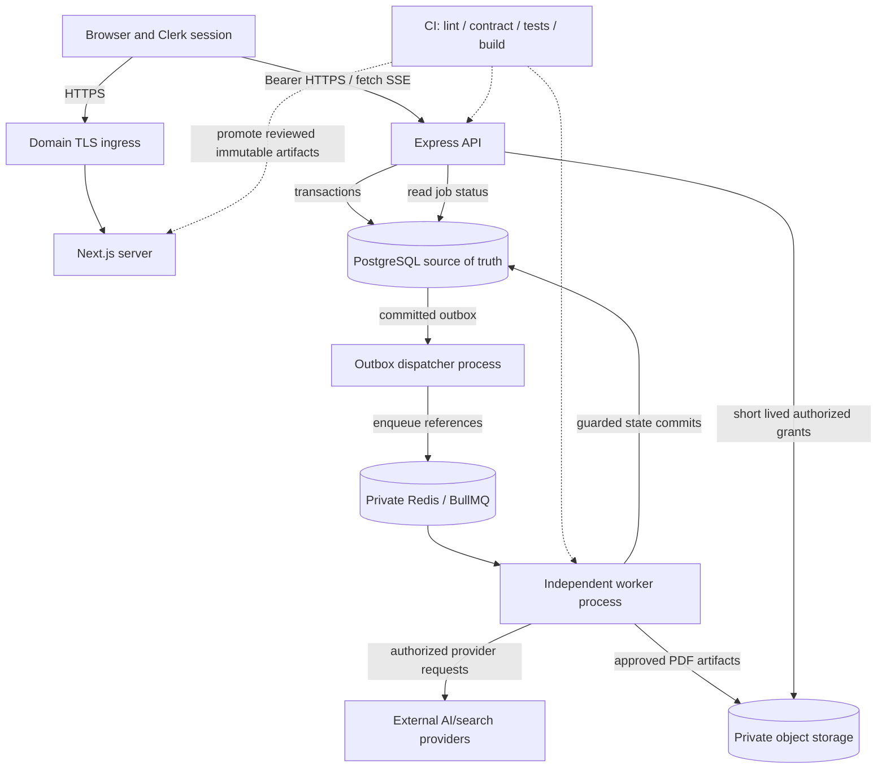
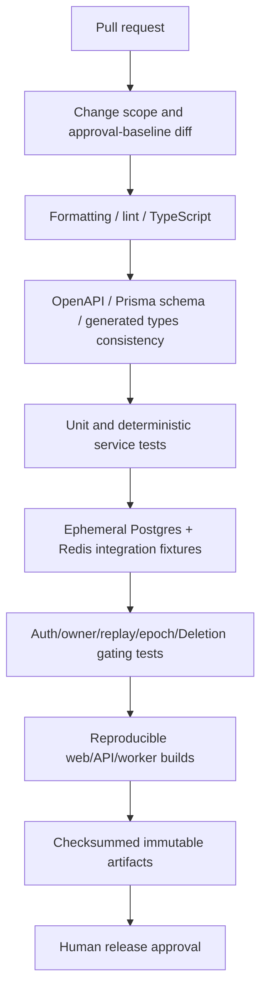

# Founder's Lens — LLD Phase 5C: Hosting, Cost, CI/CD & Operations

**Document ID:** FL-LLD-INF-5C  
**Version:** 0.4 - formal documentation baseline
**Status:** Approved - Documentation Only; FL-P5-0.4-approved. Runtime/provider/restore/security gates remain pending.
**Intended path:** `Docs/lld/07-infrastructure/hosting-cost-cicd-operations.md`  
**Authority:** Phase 2D `FL-P2D-1.0-approved`; Phase 3 `FL-P3-0.3-approved`; Phase 4 `FL-P4-0.5-approved`, as reported by owner. Phase 5A and 5B are proposals, not approved baselines. Reconcile with canonical repository before Phase 5D sign-off.  
**Research reference date:** 2026-11-16. Public terms and limits can change; verify at provisioning time.

## 1. Purpose, non-goals and mandatory constraints

Plan environments, provider feasibility, operating costs, continuous integration/continuous delivery (CI/CD), release/rollback, observability handoff and go/no-go gates for a modular monolith with Next.js frontend, Express API, independent dispatcher/AI/research/PDF/privacy workers, PostgreSQL/Prisma, Redis/BullMQ, private PDF storage, Clerk identity and external model/search providers.

**Hard project constraints:** Owner prefers ₹0 and no credit card; no unverified free public production promise. Preserve direct session Bearer browser→Express, REST plus authenticated fetch-SSE, PostgreSQL/outbox durability, independent worker deployment, idempotency, context/lifecycle epochs, strict ownership, deletion protection, immutable approved snapshots, controlled provider budgets and historical approved baseline fingerprints. Do not introduce microservices, serverless rewrites or new persistence systems merely to fit a promotional free tier.

**Non-goals:** No Dockerfiles, workflow YAML, environment creation, actual credentials, schema migrations, deployments or vendor commitment. Implementation-level values (replica counts, deadlines, CPU/memory sizes, RPO/RTO, build duration, price exchange rates) remain provisional until measured or quoted.

## 2. Fundamentals — precise questions and answers

| Question | Answer |
|---|---|
| What is hosting? | Renting or using computing resources that execute the application and make approved entry points reachable. |
| What is a container? | An isolated, portable packaging/runtime boundary for a process and its dependencies, not automatically a secure or persistent machine. |
| What is CI? | Continuous Integration: automatically checking proposed source changes with builds, linting, static checks and tests before merging. |
| What is CD? | Continuous Delivery/Deployment: preparing verified artifacts for release or promoting them to an environment through controls. |
| What is a deployment artifact? | A versioned, reproducible build/image with a traceable source revision and checksum. |
| Why separate API and workers? | HTTP latency and restarts must not halt or accidentally duplicate long-running authorized jobs; different processes can share one physical host. |
| Why not use free hosting as production by default? | Sleep, short retention, worker limitations, limited memory, billing eligibility, rate limits and lack of restore guarantees can violate application requirements. |
| How do we keep cost safe? | Admission quotas, bounded provider usage, billing alerts/thresholds, egress limits where available, and an explicit no-paid-provider default. |

## 3. Logical deployment topology and boundaries

Topology shows separate **process roles**, not a requirement for separate paid machines. The dispatcher is a distinct logical responsibility and can share a worker deployment if lifetime/failure semantics are preserved; its placement is a Phase 5D decision. Ingress/CORS/SSE behavior, deployment trust boundaries and DNS/TLS specifics need provider verification. No direct Redis or PostgreSQL endpoint is public.

## 4. Environment profiles and recommendation

| Profile | Intended audience | Architecture | Cost posture | Limitations |
|---|---|---|---|---|
| A. Local full-stack | Developer, interviewer demo, deterministic integration tests | Node/Next.js/Express processes or containers; Docker Compose PostgreSQL/Redis; independent workers and local S3-compatible storage emulator | No hosting subscription; computer, electricity, internet and any external API usage still cost | Not publicly reachable by default; laptop shutdown ends service; not production |
| B. Short-lived controlled demo | Selected reviewers | Provider-neutral deployed web/API/worker with temporary stores, or a secure time-boxed demonstration from local infrastructure | Provision only if eligibility and maximum exposure reviewed; use stubs for paid provider pathways | May not offer always-on services; privacy and sign-in must be reviewed |
| C. Production-capable | Future public founders | Durable managed/operated DB, persistent queue, private object store, independent workers, monitoring, backups and tested restores | Budget and payment method required to be decided | No verified ₹0/no-card solution for the complete always-on architecture |

**Recommended policy:** Profile A is the supported initial target. Profile B is optional and must not be advertised as production. Profile C remains a comparison target rather than a purchase decision.

## 5. Provider feasibility snapshot (research, not approval)

| Provider | Verified public offer / restriction | Fit for Founder's Lens | Decision |
|---|---|---|---|
| Render | Free web service available, sleeps after 15 minutes idle; free PostgreSQL database expires after 30 days; free service lacks durable local disk and one-off jobs | Useful for disposable HTTP demo, but poor full-stack durability/continuous workers | Explore only with fresh account/card eligibility and billing checks |
| Railway | Trial public documentation describes $5 one-time credit up to 30 days and a $1/month credit on later Free plan; verification applies and credit may run out | Possible temporary experiment, **not** proven always-on/no-card production | Conditional investigation; no permanent-free claim |
| Koyeb | One free web instance with 512 MB RAM/0.1 vCPU; cannot serve as a Worker Service; card verification requirement | Does not meet no-card requirement or independent background-worker needs as-is | Exclude for current strict constraints |
| Vercel | Hobby $0, restricted to personal/noncommercial use by published plan terms | Could host **frontend only**, subject to account eligibility and usage; independent BullMQ/Redis workers remain elsewhere | Optional noncommercial frontend demo; no full-stack endorsement |
| Cloudflare Workers | Free Workers plan limited by request, CPU and memory quotas (official docs: 100,000 req/day, 10 ms CPU, 128 MB memory) | Not a drop-in long-running BullMQ/Node worker; would require architectural adaptation not authorized here | Do not redesign stack to fit free quotas |
| GitHub Actions | GitHub Free pricing lists 2,000 hosted runner minutes/month for private repositories; public repos have separately published free policies | CI for planned code is plausible within usage limits; billing settings and actual availability unverified | Preferred initial CI candidate, not a deployment host |

Provider references, checked 2026-11-16:
- https://render.com/docs/free
- https://render.com/pricing
- https://docs.railway.com/pricing/free-trial
- https://www.koyeb.com/docs/reference/instances
- https://www.koyeb.com/docs/faqs/pricing
- https://vercel.com/pricing
- https://vercel.com/legal/terms
- https://developers.cloudflare.com/workers/platform/limits/
- https://github.com/pricing

**Important:** None of the preceding pages establishes account-specific no-credit-card eligibility for the entire stack. Promotional credits are temporary, may require verification, and cannot be modeled as indefinite free service. Verify paid API/search provider quotas separately and never equate free infrastructure with free AI generation.

## 6. Cost model — quantify before choosing a host

**Monthly operating cost = compute(frontend + API + workers + dispatcher) + PostgreSQL + Redis + artifact storage + storage/DB backups + network egress + observability + model/search usage + taxes/FX**, less any *actually applicable* credits. Costs vary with region and plan; do not fill unknowns with invented rates.

| Variable | Measurement / evidence required | Budget protection |
|---|---|---|
| Web/API compute | RAM/CPU/uptime/region, idle behavior | Keep local first; cap public demo duration |
| Worker compute | Jobs by type, concurrency, max runtime | Worker queue caps and pause/stop controls |
| PostgreSQL and backups | GB data, backup GB, retention and restore features | Retention review and dataset-size alerts |
| Redis | Memory, persistence, connection count | Bound queues/retries and set alert thresholds |
| Object storage | PDF GB, PUT/GET, egress, recovery copies | PDF size bounds, signed grants and cleanup policy |
| AI/search provider | Calls, tokens/queries, retries, model tier | One approved bounded plan per generation; explicit enablement and hard quota checks |
| CI | Runner minutes, build/storage/cache | Avoid unnecessary duplicate builds; secrets in trusted CI only |

**Expense controls:** Set default production-provider access *off* in dev/demo; require deliberate credentials, monthly owner-approved spend cap, provider-side budget/spend limit where supported, app-side quotas and paid-invocation counters, explicit action when quota reached, and alerts before exhaustion. Provider UI billing alerts are not a substitute for a hard financial guarantee. If platform cannot enforce strict cost ceiling, it fails the zero-surprise-cost gate.

**Exposure scenarios:** (1) All local with fixture model output—no recurring hosting bill; (2) local plus real external model/search calls—usage may be billed; (3) short public demo—multiple services and egress may cost even with free frontend; (4) sustained production—must obtain actual written pricing/eligibility and recovery commitments. Never promise the entire always-on application at ₹0.

## 7. CI workflow — design, no workflow file created

**Principles:** Fail closed on source-contract drift; least-privilege repository credentials; pin third-party CI actions by vetted revisions; use dependency/security scanning; avoid exposing secrets to untrusted fork pull requests; no private prompt or user content in logs/test reports. Use sanitized deterministic fixtures and isolated disposable data for CI. CI cannot substitute for running real Clerk, Prisma migrations, model and browser tests in a controlled environment.

**Contract checks:** 53 operation IDs / 50 founder-facing mappings are the latest owner-reported approved Phase 4 baseline counts, not runtime endpoints. Revalidate counts directly from the checked-out canonical OpenAPI on each pipeline run; do not embed stale counts as guaranteed invariants. Validate Zod/TypeScript/Prisma fields once implementation exists, including the approved Experiment version3/hypothesis policy, LearningEvidence same-idea constraints, compatibility, approval/retention, and the immutable PDF path.

## 8. CD promotion and release safety

1. A reviewed change merges to a protected main branch; CI passes. Design-approval hashes are verified if relevant spec files changed.
2. Build distinct image/runtime artifacts for web, API, worker and dispatcher roles from pinned dependencies; record checksums and source revision.
3. Before promotion, check environment/secrets, resource and cost quotas, backup/restore readiness and compatibility of database schema versus old/new application versions.
4. Migration runs only by explicit authorized release workflow, **not** automatically on every web request or worker boot. Adopt expand/migrate/contract for incompatible changes; test rollback after data writes.
5. Deploy using a sequence preserving API/worker compatibility; quiesce or drain long-running jobs as required. Keep old release available for rollback when possible.
6. Verify health/readiness, auth, DB access, queue dispatch, outbox lag, SSE, PDF storage, lifecycle fences and quota policies using a non-production fixture.
7. Promote public traffic only after smoke tests and security/privacy checks; maintain documented rollback and incident owner.

**Rollback warning:** Application-image rollback cannot inherently reverse a migrated database or refund an already-issued paid model request. Roll-forward or staged compatibility may be necessary; no automatic destructive restore on failed deployment.

## 9. Health, operations and incident ownership

| Signal | Goal | Action when unhealthy |
|---|---|---|
| Liveness | Process running, not necessarily dependency-ready | Restart only failing process where safe |
| Readiness | API can serve authorized requests; worker has necessary dependencies | Remove from traffic / pause job claim; don't falsely claim acceptance |
| Outbox dispatch age | Accepted jobs eventually enqueue | Investigate Redis outage/dispatcher, reconcile DB intents |
| Generation attempt state/age | Detect stuck or duplicate activity | Fence stale leases, reconcile from DB, avoid blind paid retry |
| Research limits/cost | Bound provider exposure | Deny new work and explain limitation truthfully |
| PDF artifacts | Approved source matches available object and hash | Reconcile status; explicit bounded retry if permitted |
| Deletion/purge lag | Detect lifecycle and privacy failures | Enforce immediate access gates, escalate incomplete purge |
| Backups/restore drill | Demonstrate actual recovery | Keep release gate pending until tested |
| HTTP/SSE errors | Separate lost network observation from backend finality | Recover with authorized GET, never auto-resend ambiguous POST |

Monitoring must redact credentials, founder text, private prompts and signed download URLs. Audit logs record permitted metadata rather than hidden chain of thought. On-call staffing and alert delivery destinations are undecided; do not claim 24/7 support.

## 10. Deployment security and privacy gates

- TLS and explicit allowed origins; verified Bearer tokens; no browser-held provider secret; do not introduce cookie/BFF auth as an undocumented deployment workaround.
- Private DB/Redis, restricted inbound network and egress where possible; encryption-in-transit and at-rest depends on provider capabilities, to be audited.
- Production secrets injected only through trusted runtime; rotate/revoke with a tested procedure. Protect against CI secrets exposure and malicious fork submissions.
- Principal/idea lifecycle fencing for every job and cache; no resume after account deletion or restored deletion tombstone invalidity.
- Backups do not erase instantly on deletion; maintain protected tombstone/restore reconciliation and approved deletion target disclosures.
- Private PDF storage and time-limited grants; do not assume ephemeral container disks are backup storage.
- Hosting geography, legal/compliance obligations and provider privacy disclosures require later explicit review, especially for India-focused founders; no claim of regulatory compliance without legal review.

## 11. Proposed deployment ADR decisions (not owner approved)

| ID | Recommendation | Decision gate |
|---|---|---|
| INF5C-D01 | Local Docker Compose development as the baseline; no paid host | Owner review in 5D |
| INF5C-D02 | Preserve separate deployable web/API/worker/dispatcher roles | Verify logical/physical mapping with 5A |
| INF5C-D03 | GitHub Actions as initial CI candidate | Verify repository eligibility, permissions and cost |
| INF5C-D04 | Cloud provider selection deferred | Obtain complete verified pricing/card/worker/DB/storage viability |
| INF5C-D05 | No auto-deploy to production; explicit promotion and rollback plan | Implementation/release review |
| INF5C-D06 | Hard app/provider job and spend bounds before live paid AI usage | Model-provider quota compatibility review |
| INF5C-D07 | No universal free production claim | Accepted constraint; no provider chosen |

## 12. Planned acceptance matrix (all unexecuted)

| ID | Scenario | Expected behavior / evidence |
|---|---|---|
| INF5C-01 | Complete local stack start/stop | All logical roles run and stop without losing durable authoritative state unexpectedly |
| INF5C-02 | Redis unavailable at command acceptance | Committed outbox remains recoverable; no acknowledged phantom job |
| INF5C-03 | API restart during live SSE | Client reconnects to authorized status; worker not falsely cancelled |
| INF5C-04 | Worker restart during paid model call | Lease/epoch fencing; bounded eligible retry with cost ambiguity recorded |
| INF5C-05 | Deploy old/new API/worker versions | Compatible data and events; no duplicate terminal selected messages |
| INF5C-06 | Schema migration failure | Controlled stop/rollback/forward procedure; no automatic destructive DB reset |
| INF5C-07 | Hosting free instance sleeps/expires | Demo explicitly signals unavailability; no production SLA implied |
| INF5C-08 | Exceeded provider AI quota | No additional unauthorized charge; truthful limit state |
| INF5C-09 | Accidental public DB/Redis exposure | Network/security gate fails before release |
| INF5C-10 | CI from untrusted fork | Protected credentials and secrets absent from attacker-controlled jobs |
| INF5C-11 | Expired PDF grant and object outage | New authorized grant only if object available; no public bucket fallback |
| INF5C-12 | Restore older backup containing deleted user | Lifecycle/tombstone reconciliation blocks redisclosure |
| INF5C-13 | Account deletion during queued job | Fresh lifecycle check denies output and paid work where possible |
| INF5C-14 | Release rollback after schema change | Expand/contract compatibility preserves approved data |
| INF5C-15 | Repo/OpenAPI/Prisma change without documented amendment | Contract/baseline validation gate rejects unexplained drift |
| INF5C-16 | No-card public deployment eligibility | Actual signup/plan/worker/DB/storage/verification evidence collected; unknown means no promise |
| INF5C-17 | Service restarts under usage or resource exhaustion | Monitored, cost caps and lifecycle-safe recovery demonstrated |
| INF5C-18 | Rotated credentials | No stale public tokens, leaks or unbounded outage; audited refresh |
| INF5C-19 | 100% browser/keyboard critical journey | Real device/assistive-technology execution required before launch |
| INF5C-20 | Cost alert / spending boundary | Chosen provider account/usage controls and app quotas tested; no blind paid retry |

All statuses: **Not executed**. These are proposed acceptance scenarios, not measured results. Existing Phase 5A/5B scenarios remain separately planned.

## 13. Traceability to approved phases and handoff

- **Phase 2D:** authoritative ownership, identity tombstones, immutable snapshots, idempotency and transactional outbox; reject changes to accepted API/DB contracts without separate amendment.
- **Phase 3:** paid-model call bounds, contextEpoch, strategy/research durable admission, safe fallback and no private hidden reasoning leakage; numbers remain provisional.
- **Phase 4:** direct Bearer, HTTP status contracts, explicit structured responses, authorized fetch-SSE, no auto-paid resend, recoverable versions, `LearningEvidence` design and legacy experiment creation error.
- **Phase 5A:** independent processes, local-first, TLS/network/health and portable containers.
- **Phase 5B:** DB/Redis/object storage recovery, backups, secret rotation, deletion-safe restore, RPO/RTO undecided.

**5D reconciliation checklist:** Confirm canonical paths, chosen CI eligibility, deployment/worker model, SSE ingress timeout behavior, cost/account conditions, restored-data privacy, storage encryption/retention, migration strategy and outstanding accepted AI-D14 editorial HLD exception. Verify proposed decisions against source exact repo; no baseline manifests are changed by this draft.

## 14. Phase 5C decision status and next steps

**Draft recommendation:** Adopt local-first full-stack development; GitHub Actions *as a candidate* CI provider; provider-neutral Docker/runtime packaging; explicit protected production promotion; no default paid models; no selected cloud hosting. This can be approved at the design level without pretending a ₹0 public production host has been found.

**Open for owner/Phase 5D review:** CI provider/repo visibility; whether a public demo is needed; account eligibility and payment method restrictions; acceptable spend for model/search; deployment region/data residency; backup RPO/RTO/retention; on-call readiness; secrets management provider and logging retention. No hard numeric SLA, final provider, hosting cost or execution success is implied.

**Status:** Approved - Documentation Only; FL-P5-0.4-approved. Runtime/provider/restore/security gates remain pending.

## 15. Current repository reconciliation (v0.2, In Review)

Use [Phase5D section13](infrastructure-integration-review.md#13-current-repository-reconciliation-and-operational-closure) for current operational defaults, release evidence, incident handling and owner decisions. Earlier provider snapshots/external documentation references are historical, not verified present-day prices, no-card entitlements or recommendations to purchase. No provider comparison was refreshed or account provisioned in this reconciliation. Local-first synthetic fixtures and zero paid calls are recommended; external provider admission requires explicit opt-in, bounded reservations and owner-approved spending ceiling. CI provider remains a candidate, with local checks available and no dependency on a paid plan. Fork workflows receive no secrets or privileged release token. Releases require compatible API/worker/schema windows, manual promotion, separate migration role and tested recovery; image rollback cannot destructively reset LearningEvidence or privacy gates. No implementation, CI execution, provider validation or Phase5 approval is claimed.

## Current operational decision closure - v0.3

The owner's operational directions are approved for design only. [Phase5D section14](infrastructure-integration-review.md#14-operational-approvals-and-deletion-coverage-proposal) is authoritative: local-first portable Compose, public demo/cloud deferred, automated controlled backups, provisional RPO/RTO, private local PDF adapter, uncommitted development secrets, GitHub Actions candidate subject to verification, fail-closed paid-call budgets and founder as initial development operator. Earlier pending-direction wording is historical; numerical/provider/runtime gates remain pending. Candidate FL-P5-0.3-review is not approved. P5-AM01 proposes independent pre-commit suppression intent and uncertain-intent handling; it requires owner approval before changing frozen contracts. Async outbox alone cannot prove rollback-safe coverage. No infrastructure, billing or Phase6 authorization is implied.

## P5-AM01 approved controlled amendment

Owner approval now supersedes previous pending-proposal labels; Phase5D section15 and the approved state-machines P5-AM01 protocol govern. Independent durable scope/incarnation-bound intent is required before accepted primary deletion commit. Uncertain intents block access; independent-authority outages/stale reads fail closed. Intent is not proof of primary commit;202 still requires primary commit. Restore complete independent coverage and suppression before reopening, retain existing worker/context fences and account recreation rules. Provider durability/keys/listing/partition proof remains pending. Candidate FL-P5-0.4-review is not package-approved; no infrastructure or Phase6 work.

## Formal Phase 5 approval - current status

FL-P5-0.4-approved - Approved, Documentation Only. Evidence is the owner''s explicit Phase5 formal documentation sign-off instruction in this conversation. No date, timestamp, signature or Git commit is inferred. Earlier draft/pending/package-unapproved statements are preserved historical stages; this status and Phase5D section16 govern. The versioned approved-revision-0.4.json manifest freezes this baseline. Numerical RPO/RTO, retention/provider decisions and all runtime tests remain pending. No implementation, spending, migration, deployment or Phase6 authorization.
