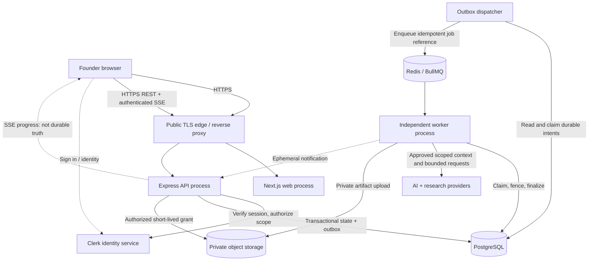
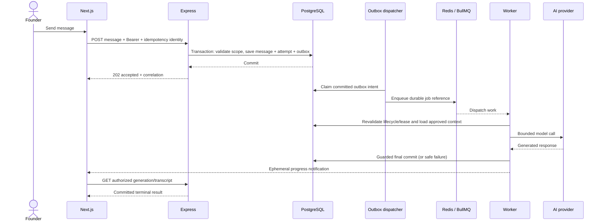

# Founder's Lens — Phase 5A: Infrastructure Fundamentals & Deployment Architecture

**Document ID:** FL-LLD-INF-5A  
**Version:** 0.4 - formal documentation baseline
**Status:** Approved - Documentation Only; FL-P5-0.4-approved. Runtime/provider/restore/security gates remain pending.
**Upstream authority:** Approved `FL-P2D-1.0-approved`, `FL-P3-0.3-approved`, `FL-P4-0.5-approved` as reported by owner. Reconcile exact active files/manifest before a later sign-off.  
**Audience:** Founder, engineering reviewers and future Codex implementer.

## 1. Purpose and scope

Define the conceptual deployment architecture of Founder's Lens, including runtime roles, service boundaries, local and production profiles, trust boundaries, configuration, networking, failure behavior, cost constraints, operational requirements and verification plans. This document intentionally does not select a hosting provider, prescribe specific paid services, add implementation files or claim a deployable system.

**In scope:** Next.js web runtime; Express TypeScript API; independent worker processes; transactional outbox dispatcher; PostgreSQL/Prisma; Redis/BullMQ; private PDF object storage; Clerk; external AI/search providers; HTTPS/SSE transport; identities and secrets; operational startup/shutdown; observability interfaces; local-first deployment proposal.

**Out of scope:** Exact provider pricing, capacity sizing, production SLA, CI/CD implementation, Terraform, Dockerfiles, compose files, SQL execution, secrets provisioning, model integration, security penetration tests, backup restore proof and live deployments. Phase 5B/5C/5D own detailed designs and closure.

## 2. Fundamentals: concise Q&A

**Q1. What is infrastructure?** The compute, network, storage and operating facilities that run the software. The frontend, API and worker are applications; PostgreSQL, Redis, object storage, container runtimes and servers support them.

**Q2. What is a process?** A running program with an operating-system lifecycle. One codebase may produce multiple processes: HTTP API, queue dispatcher and AI/PDF/research/privacy workers.

**Q3. What is a container?** A packaged runtime with application dependencies and an isolated process environment. Container isolation is not itself a security boundary equivalent to a separate machine or account.

**Q4. What is a deployment?** Making a particular application build available in an environment with configuration, networking, credentials, database schema and operational checks.

**Q5. What is the difference between a queue and an outbox?** The outbox is a durable intent committed inside the business database transaction; BullMQ/Redis coordinates job scheduling and workers. A worker may see jobs more than once and must use DB-side idempotency, ownership and fencing.

**Q6. Why separate the worker from the API?** The API must respond quickly and retain HTTP capacity while model calls, research, PDFs and privacy purges run independently with bounded retries, cancellation checks and durable progress.

**Q7. Does a free tier guarantee a free production system?** No. Database, Redis, always-on workers, object storage, network egress, domains and especially AI/search-provider usage may incur charges or require payment methods. Local execution can minimize hosting cost but cannot guarantee zero provider charges.

## 3. Architecture — logical runtime topology

Diagram is logical, not a specified network layout. Avoid depending on browser access to PostgreSQL, Redis, AI credentials or object storage internals. Download grants must be narrow, authenticated and short-lived; their exact architecture is Phase 5B work.

### 3.1 Runtime responsibility matrix

| Runtime | Core duty | Must not do | Scale/failure consideration |
|---|---|---|---|
| Next.js web | Route rendering, accessible UI and session-bound API client | Authorize another founder's data or hold model secret | May restart without destroying committed user work; private response caching guarded |
| Express API | Auth, ownership checks, Zod input validation, commands, reads, SSE observer | Perform expensive model work inline; trust client owner IDs | Admission/reads stay responsive; DB dependent |
| Outbox dispatcher | Move committed intents to queue with safe retry | Treat Redis enqueue as business-state authority | Duplicate dispatch safe; reconcile unqueued intents |
| Worker runtime | AI/research/PDF/privacy jobs, budgets, leases, epoch checks, final DB commit | Approve memory/snapshots, bypass lifecycle gates | Independent concurrency/resource caps and graceful termination |
| PostgreSQL | Source of truth, transactions, versions, outbox, lifecycle and approvals | Be exposed to browser | Protected backups, recovery tests, controlled migrations |
| Redis/BullMQ | Queue and transient delivery coordination | Be sole evidence that a command was accepted/finalized | Redis durability/eviction policy and recovery behavior reviewed |
| Private object storage | Approved PDF artifacts and controlled temporary files | Serve unrestricted public links | Retention, signed access, upload integrity and purge tested |
| Clerk | Authentication identity provider | Replace application ownership checks | Revocation, token verification, outages tested |
| AI/research provider | External processing under approved quotas/policies | Direct access to all founder data | Provider data policies, costs, timeouts and trust controls reviewed |

### 3.2 Architectural invariants inherited from Phases 2–4

1. Direct browser-to-Express Bearer requests and authenticated HTTP fetch-based SSE; no newly invented BFF or cookie fallback.
2. Account/idea scoping is enforced on every private resource at the API and worker lifecycle boundary.
3. PostgreSQL confirms command acceptance/final outcome; SSE fragments are transient and never replayed as committed truth.
4. `Idempotency-Key`, accepted-outcome replay, `If-Match`, and generation epoch/lease controls remain authoritative.
5. Worker processing, PDF export, deletion and research are durable, authorized and bounded; automatic research follows saved conversation settings.
6. Never rewrite immutable approved snapshot versions; new versions use the existing create flow.
7. Historical approval manifests remain unchanged. Approved Phase 4 additions include versioned projections, submission lookup and learning-evidence/experiment mappings; no source-specific schema is invented here.

## 4. Proposed environment profiles

### 4.1 Local learning/development: preferred first environment

- Run Next.js and Express locally, ideally in native Node development processes for iteration speed.
- Run PostgreSQL and Redis locally, optionally in Docker Compose. Use a separately started worker and outbox dispatcher, even when on the same machine.
- Prefer an object-storage-compatible local emulator for non-sensitive PDFs and test fixtures; do not claim equivalence with production signed URLs or durability.
- Use separate **development-only** Clerk credentials and nonproduction AI/provider configuration; no real founder data or live secrets in fixtures.
- Define an offline/stub mode for architecture testing so routine integration tests cannot accidentally trigger paid provider calls. Stubs do not count as provider/model quality validation.
- Support deliberate clean startup, shutdown, re-run and dependency outage tests. Nothing requires a cloud account merely to design this environment, but local Docker availability/resources must be checked.

### 4.2 Ephemeral integration/test environment

Optional dedicated isolated deployment to test real component interoperability, migration paths, expiry/cancellation races and real providers under tight, opt-in cost limits. It must not share production accounts, DB, storage buckets, queues or credentials. If no free/no-card provider qualifies, run it locally; don't degrade security controls merely to achieve ₹0.

### 4.3 Future production environment — conceptual only

- HTTPS/TLS ingress and appropriate reverse proxy/resource limits.
- Independently supervised web/API/dispatcher/worker processes; workers must not rely on requests keeping a serverless function alive.
- Restricted private database and Redis network access, separate service credentials and environment isolation.
- Persistent volumes or managed services for PostgreSQL; private artifact store; encryption and restoration policies.
- Job failure/retry dashboards, readiness/liveness checks, structured logs, alerts, resource quotas and change rollback procedures.
- Verified deletion/privacy/backup handling and operational support processes before release.

**Provider choice deferred:** no host, cloud region, domain, billing, runtime SLA, managed database or managed queue has been selected.

## 5. Request and failure sequences

### 5.1 Submit-to-final sequence

**Important:** This is a logical ordering; notifications may arrive during generation and after finalization. A lost 202, SSE disconnect or queue outage must never be interpreted as permission for automatic paid resubmission.

### 5.2 Failure and recovery table

| Failure | System response at design level | Verification requirement |
|---|---|---|
| DB unavailable | Fail closed for reads/writes requiring DB; don't claim accepted work without commit | Drop DB during transaction; assert no false 202 |
| Redis unavailable after DB commit | Keep outbox intent durable; retry dispatch without duplicating accepted command | Kill Redis between commit/enqueue; replay and recover once |
| Dispatcher restarts | Resume scanning durable pending intents; duplicate enqueue safe | Crash after enqueue before marking intent dispatched |
| Worker crashes after provider call | Retry only under approved budget and idempotent fencing; avoid double-finalize and unauthorized paid calls | Crash before DB finalization; count provider calls |
| SSE disconnects | Generation continues; frontend obtains authorized GET status; no fragment replay guarantee | Disconnect mid-output and after terminal event loss |
| Clerk session expires | Stop private observation until fresh verification, clear/guard scoped cache | Expired token and account switch test |
| Approved PDF storage fails | Export reflects failure/retry state; snapshot remains immutable | Upload failure and grant expiration test |
| Account/idea deletion races worker | Immediate access gate; epoch/lease checks reject late private completion; purge remains recoverable | Deletion after enqueue and before final commit |

## 6. Networking, ingress and trust boundaries

- Only public HTTPS endpoints for frontend and API should face the internet; exact domain/subdomain and cross-origin configuration are pending.
- PostgreSQL and Redis must have no unauthenticated public access. Least-privilege service identities and scoped secrets are required.
- Express verifies identity and owns resource-level authorization. Network routing, Clerk sign-in and Next.js route guards do not replace this.
- Authenticate SSE with an explicit Bearer-capable fetch stream; do not put tokens in URL query strings. A reverse proxy must support appropriate long-running responses and flush behavior.
- Browser-to-storage artifact access uses narrowly scoped grants with expiry; provider-specific CORS and download behavior must be proven.
- Worker egress to AI/search providers must pass budget/privacy/input constraints; retrieved evidence remains untrusted.
- Define TLS, origin policy, rate limiting, body limits, proxy timeouts and security headers during Phase 5B/5C. No universal defaults are approved here.

## 7. Process lifecycle and deployment safety

Startup order is not equivalent to readiness: dependencies may be running but not able to serve requests. Define dependency health checks and readiness probes; only admit traffic when DB/schema/auth adapter are compatible. Dispatcher and workers should pause/fail safely when dependencies are unavailable. Compose health conditions can help in local setups but do not substitute for application retry logic.

Graceful shutdown should stop accepting new commands, drain/close SSE observers, stop taking new queue jobs, release/finish work in a bounded manner and preserve idempotent restart behavior. A migration is an explicit controlled deployment step, not something every web replica performs on boot. For evolution, use additive/compatible database changes, old/new process compatibility and rollback checkpoints. Exact timeouts are deferred.

For the selected Redis-backed BullMQ design, plan persistence (preferably AOF), a `noeviction` policy, reconnect behavior, redacted job payloads, queue-error alerts and graceful worker shutdown; verify against pinned runtime versions. This guidance comes from BullMQ's current production guide, not from application test evidence.

## 8. Secrets, data and privacy — requirements for Phase 5B

| Concern | Minimal requirement | Open detail |
|---|---|---|
| Clerk signing/verification | Correct session token type, issuer/keys and audience where applicable | Pinned SDK and provider settings |
| DB credentials | Private least-privilege app/migration credentials | Provider rotation scheme |
| Redis credentials | Restricted authenticated connections and separate environments | TLS and managed/self-hosted profile |
| Model/search keys | Worker-only, never exposed in browser or logs | Providers, limits, retention terms |
| Storage credentials | Worker/API narrowly scoped access; private objects | Provider, KMS/encryption, CORS |
| Backups | Encrypted backups, restore drills, separate provider retention expectations | Frequency, RPO/RTO, purge interaction |
| Personal data | No user content in queue payloads/logs/telemetry where avoidable | Redaction rules and retention schedule |

RPO (recovery point objective) is the maximum acceptable data loss window; RTO (recovery time objective) is the maximum acceptable recovery delay. Neither has been approved numerically.

## 9. Cost-aware architecture decision

**Approved constraint:** prefer ₹0 and no payment card; do not assume free, always-on cloud hosting exists for all five service roles and external AI usage. Establish cost ceilings and opt-in provider calls before deployment.

| Option | Advantages | Limitations | Current disposition |
|---|---|---|---|
| Local Docker-assisted development | No cloud-host charge, faithful multiple-process architecture, reproducible demos | Laptop must run, internet reachability limited, local disk not resilient, AI/provider fees still possible | Recommended default for early learning and build |
| Single self-hosted machine | Portable containers, full process control, fewer moving pieces | Machine administration, backups, reliability, public TLS and availability burden | Candidate later, not committed |
| Split managed services | Offloaded DB/Redis/storage operations, independent scaling | Multiple bills, cards/provider limits, cold starts and egress complexity | Compare in Phase 5C only |
| Purely serverless frontend/API | Easy scaling for some HTTP use cases | Persistent workers, SSE timeouts and process supervision still needed; not sufficient alone | Not the complete current architecture |

**Policy:** no provider recommendation is a verified free entitlement; check current provider terms, geographic availability, card requirements and data handling before a purchase or provisioning decision. External AI is not intrinsically free.

## 10. Preliminary deployment packaging (not implementation)

Conceptual units: `web`, `api`, `outbox-dispatcher`, `worker`, `postgres`, `redis`, `object-storage` (or adapter/emulator locally). The API and worker may share a compiled codebase but must have distinct startup commands, credentials, health metrics, concurrency and restart policies. It may later be sensible to split PDF rendering from model workers due to CPU/memory usage, while retaining one logical worker architecture. Do not force Kubernetes, service mesh or microservices for the MVP.

Proposed configuration principles:
- Environment variables for non-secret endpoints and typed startup validation; secrets through env/secret store without checked-in values.
- Private and public environment variable classification; browser builds never embed model/database credentials.
- No request-driven automatic Prisma schema migration.
- Same versioned API contracts and database migrations across web/API/worker release windows.
- Backend deployment readiness checks verified, not merely container-running checks.

## 11. Phase 5A ADR candidates (not approved)

- **INF-01 — Local-first, multi-process development.** Proposed: native Node web/API, containerized PostgreSQL/Redis, independent dispatcher/worker; object-store emulator only for tests.
- **INF-02 — Provider-neutral container portability.** Proposed: runnable on one machine first; no Kubernetes requirement.
- **INF-03 — DB-first operational truth.** Inherited: outbox and durable job state survive Redis disruptions, with reconciliation.
- **INF-04 — Production requires explicit cost and security proof.** Proposed: do not certify a no-card/free-production deployment without provider verification.
- **INF-05 — Secret separation and private network.** Proposed: no direct browser-to-storage-system credentials or public DB/Redis.

No owner Phase 5A approval is inferred; these are recommendations for a subsequent review.

## 12. Acceptance and verification matrix — not executed

| ID | Test / review scenario | Acceptance principle | Status |
|---|---|---|---|
| INF5A-01 | Start only PostgreSQL/Redis; launch API and worker later | Safe readiness, no false service-ready state | Not executed |
| INF5A-02 | DB failure during message acceptance | No 202 without committed state | Not executed |
| INF5A-03 | Redis failure between outbox commit and enqueue | Durable intent eventually redispatched safely | Not executed |
| INF5A-04 | Dispatcher crash at enqueue/mark boundary | Duplicate dispatch never duplicates logical work | Not executed |
| INF5A-05 | Worker restart during model generation | Lease/fencing and budget rules honored | Not executed |
| INF5A-06 | SSE lost while generation runs | No implied cancellation; recover committed status | Not executed |
| INF5A-07 | Account/idea deletion during worker activity | Immediate access restriction and late-result rejection | Not executed |
| INF5A-08 | Expired Clerk token on API/SSE | Private access denied; no token in URL | Not executed |
| INF5A-09 | Malicious/foreign object or link | No cross-owner access, private object grants | Not executed |
| INF5A-10 | Full restore from backups in isolated environment | Referential integrity and agreed RPO/RTO demonstrable | Not executed |
| INF5A-11 | Graceful shutdown of API/dispatcher/workers | No lost committed commands or incomplete unauthorized finalization | Not executed |
| INF5A-12 | Start under zero external provider calls | No unapproved paid research/model invocation | Not executed |
| INF5A-13 | Data retention, purge and object lifecycle | No unqualified deletion guarantee; restore/purge conflicts handled | Not executed |
| INF5A-14 | Real browser/mobile and accessible SSE | Browser and accessibility gates pass on selected deployment | Not executed |
| INF5A-15 | Cost and no-card provider eligibility | Document verified free/paid limits before provisioning | Not executed |

## 13. Dependencies, open questions and handoff

1. **Phase 5B:** Storage adapter and private grants, backup/restore, retention and secrets, multi-environment isolation, RPO/RTO review, migration execution controls and deletion workflow operationalization.
2. **Phase 5C:** Compare *current* provider eligibility (free vs paid, India availability, cards, region, worker/SSE support), infrastructure cost model, TLS/proxy policy, deployment pipeline, rollout/rollback and monitoring thresholds.
3. **Phase 5D:** Reconcile with final approved P2/3/4 active files, log exact decisions, independently validate reference counts, record unresolved gaps and seek owner sign-off.
4. **AI-D14:** Approved worker architecture governs; accepted HLD direct-API-to-model diagram exception still awaits a controlled editorial amendment.
5. **Legacy experiments:** Version-3 hypothesis input is the approved design; old create clients without hypothesis must upgrade and receive the documented conflict outcome. No migration execution is inferred.
6. **Potential adoption risk:** current BullMQ can offer other backends, but Founder's Lens *approved configuration* remains BullMQ plus Redis plus PostgreSQL outbox. Do not silently swap queue backends in Phase 5.
7. **Provider/runtime validation:** No current Clerk SDK, Docker runtime, Prisma migration, BullMQ persistence, storage grant, AI usage cost, operational restore or accessibility behavior is certified by this document.

## 14. Traceability / authoritative references

- Phase 4D v0.2 integration review (reviewed earlier; later Phase 4 approvals and owner-reported manifest supersede its draft status).
- Next.js deployment: https://nextjs.org/docs/app/getting-started/deploying (Node/Docker and static export tradeoffs).
- Docker Compose health/dependency behavior: https://docs.docker.com/compose/gettingstarted/ and https://docs.docker.com/reference/compose-file/services/.
- BullMQ production guidance: https://docs.bullmq.io/guide/going-to-production.
- BullMQ architecture: https://docs.bullmq.io/guide/architecture.

**Verification status:** External docs consulted for conceptual support. Approved Founder's Lens repository Phase 5 work was not inspected in a live local Codex worktree. The upstream Phase 4 baseline is based on the owner's explicit validated Codex sign-off report. The document is a Phase 5A **draft**; it is not an approved infrastructure solution and contains no executable infrastructure configuration.

## 15. Current repository reconciliation (v0.2, In Review)

The actual canonical directory is Docs/lld/07-infrastructure-and-deployment/. Earlier intended paths and source-unavailable claims are historical preparation evidence. [Phase5D section13](infrastructure-integration-review.md#13-current-repository-reconciliation-and-operational-closure) owns current findings, operational decisions, traceability and validation. Independent web/API/dispatcher/worker roles remain within one modular monolith; no new service or database is selected. Privacy work must remain scanner-recoverable independently of Redis. Live-only SSE preserves GET recovery and never cancels generation on disconnect. Local Docker-compatible packaging is proposed; no configuration is implemented. API/worker readiness requires schema/auth compatibility, while liveness must not trigger endless restart loops during provider outages. A shutdown stops admission/claims and preserves fenced unfinished attempts rather than inventing success. AI-D14 and all runtime gates remain pending as documented in5D. Phase5 is not approved.

## Current operational decision closure - v0.3

The owner's operational directions are approved for design only. [Phase5D section14](infrastructure-integration-review.md#14-operational-approvals-and-deletion-coverage-proposal) is authoritative: local-first portable Compose, public demo/cloud deferred, automated controlled backups, provisional RPO/RTO, private local PDF adapter, uncommitted development secrets, GitHub Actions candidate subject to verification, fail-closed paid-call budgets and founder as initial development operator. Earlier pending-direction wording is historical; numerical/provider/runtime gates remain pending. Candidate FL-P5-0.3-review is not approved. P5-AM01 proposes independent pre-commit suppression intent and uncertain-intent handling; it requires owner approval before changing frozen contracts. Async outbox alone cannot prove rollback-safe coverage. No infrastructure, billing or Phase6 authorization is implied.

## P5-AM01 approved controlled amendment

Owner approval now supersedes previous pending-proposal labels; Phase5D section15 and the approved state-machines P5-AM01 protocol govern. Independent durable scope/incarnation-bound intent is required before accepted primary deletion commit. Uncertain intents block access; independent-authority outages/stale reads fail closed. Intent is not proof of primary commit;202 still requires primary commit. Restore complete independent coverage and suppression before reopening, retain existing worker/context fences and account recreation rules. Provider durability/keys/listing/partition proof remains pending. Candidate FL-P5-0.4-review is not package-approved; no infrastructure or Phase6 work.

## Formal Phase 5 approval - current status

FL-P5-0.4-approved - Approved, Documentation Only. Evidence is the owner''s explicit Phase5 formal documentation sign-off instruction in this conversation. No date, timestamp, signature or Git commit is inferred. Earlier draft/pending/package-unapproved statements are preserved historical stages; this status and Phase5D section16 govern. The versioned approved-revision-0.4.json manifest freezes this baseline. Numerical RPO/RTO, retention/provider decisions and all runtime tests remain pending. No implementation, spending, migration, deployment or Phase6 authorization.
