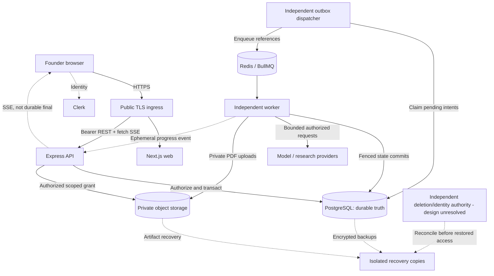

# Founder's Lens — LLD Phase 5D: Infrastructure Integration, Risk & Sign-off Review

**Document ID:** FL-LLD-INF-5D  
**Version:** 0.4 - formal documentation baseline
**Status:** Approved - Documentation Only; FL-P5-0.4-approved. Runtime/provider/restore/security gates remain pending.
**Review inputs:** Phase 5A v0.1, Phase 5B v0.1, Phase 5C v0.1 (the three source files provided in this conversation).  
**Claim boundary:** The three Phase 5 drafts were directly inspected. Earlier approved Phase 2D/3/4 baseline identifiers and architectural rules are reported in those drafts and the project record; this review **does not claim a byte-for-byte audit of the owner's current local repository, active OpenAPI, or final approval manifests**. Codex must perform source-exact reconciliation before any Phase 5 sign-off.  
**Scope:** design reconciliation, unresolved decisions, cross-phase dependencies, acceptance planning, handoff. No application code, infrastructure, deployment, migrations, live hosting purchase, runtime/security/backup testing, or Phase 5 approval.

## 1. Executive assessment

**Current assessment:** repository reconciliation is recorded in section13. Earlier source-unavailable statements and open-source-verification labels below are historical intake evidence. Phase5 remains In Review, not approved. The existing independent suppression mirror is required by Phase2D; its completeness/recovery protocol still blocks public restore readiness. No prior approved specification is amended here.

**Outcome:** The 5A–5C design is coherent enough for owner and repository review, **not yet ready for unconditional documentation sign-off**. Its central design is a modular monolith deployed as independently supervised Next.js, Express API, outbox dispatcher and worker roles. PostgreSQL remains the business source of truth, Redis/BullMQ coordinates at-least-once background work, and private object storage holds PDF artifacts. Local-first operation is the provisional default; the cloud provider and exact recurring costs are unselected.

The review finds **no demonstrated fundamental contradiction** among the three source drafts, but identifies missing operational contracts and unverified interfaces that would make a purported production-ready design misleading. No acceptance test in the three documents has executed.

| Dimension | Finding | Disposition |
|---|---|---|
| Architecture boundaries | Consistent web/API/dispatcher/worker separation and durable outbox | Reconciled in documentation; runtime proof pending |
| Authentication and SSE | Direct Bearer API and authenticated fetch-based SSE consistent in drafts | Inherited; ingress/SDK/browser tests pending |
| Durable jobs / paid AI | DB authority, fencing and bounded retry correctly emphasized | Precise restart/cost ambiguity policy requires cross-contract check |
| Privacy restore | Tombstone/epoch protection identified, but **independent source of restoration authority not specified** | **Design blocker INF5D-05** |
| Backups/object recovery | No chosen RPO, RTO, retention, encrypted backup method or drill | Owner/provider-dependent gates |
| ₹0/no-card hosting | Local first; public hosting not guaranteed free | Design direction viable; provider decision deferred |
| CI/CD | GitHub Actions is a candidate, not an approved or tested provider | Decision pending |
| Release/security gates | Sound conceptual checks, but exact runbooks/configuration absent | Design elaboration needed before implementation |
| Prior baselines | Reported as preserved by Phase 5 drafts | Codex must verify actual manifests and authoritative current schemas |

## 2. Evidence inventory and precedence

| Source | Sections directly reviewed | Design authority |
|---|---|---|
| 5A `infrastructure-fundamentals-deployment-architecture.md` | §§1–14; topology, profiles, runtime responsibilities, sequences, trust boundaries and **INF5A-01–15** | Proposed runtime topology and operational invariants |
| 5B `storage-secrets-backup-recovery.md` | §§1–16; data authority, DB/Redis/objects, secret boundaries, deletion-safe restore, **INF5B-01–18**, **INF5B-D01–08** | Proposed storage/recovery requirements |
| 5C `hosting-cost-cicd-operations.md` | §§1–14; provider feasibility snapshot, cost model, CI/CD, release operations, **INF5C-01–20**, **INF5C-D01–07** | Proposed hosting, CI/CD and operational requirements |
| Earlier approval history | Phase 2D `FL-P2D-1.0-approved`, Phase 3 `FL-P3-0.3-approved`, Phase 4 `FL-P4-0.5-approved` as reported by owner | Higher-priority approved design; exact live file/manifest verification still pending |

**Precedence:** Explicit owner approvals and active ADRs → PRD/SRS → approved HLD, DB/API/streaming/security/AI/frontend specifications and manifests → Phase 5 proposals. Phase 5 must not invent a new auth mechanism, endpoint, migration, or AI provider behavior to accommodate a hosting option.

## 3. Infrastructure fundamentals — concise Q&A

**Q1. What exactly gets deployed?** Four application execution roles (`web`, `api`, `outbox-dispatcher`, `worker`), plus PostgreSQL, Redis and private object storage or locally suitable equivalents. These are logical roles, not necessarily seven separate paid machines.

**Q2. Why is the dispatcher separate?** It reads business events already committed to PostgreSQL and safely dispatches references to BullMQ. If Redis is unavailable, the accepted work is still represented by committed outbox records.

**Q3. What if Redis loses everything?** Treat PostgreSQL job/outbox state as authority, reconcile *eligible* work, then enqueue with duplicate-safe identities and worker finalization guards. A provider call may have incurred cost before a crash; never promise exactly-once billing.

**Q4. Is a backup enough?** No. A backup is useful only if an isolated, tested restore can recover coherent DB/object state without exposing accounts or memories previously deleted.

**Q5. Is the project deployable free forever?** Unproven. Local development can avoid cloud-hosting charges, but public uptime, AI/search usage, backup storage, network transfer and signup requirements can cost money.

**Q6. What is CI/CD?** Continuous integration (automated checks on changes) and continuous delivery/deployment (controlled promotion of built artifacts). The Phase 5C candidate is GitHub Actions, not a confirmed service choice.

## 4. Reconciled runtime topology

**Diagram limitation:** The independent deletion/identity authority is a required recovery *property*, not a newly approved microservice or datastore. It must be mapped to the existing approved Phase 2D identity tombstone/webhook/lifecycle design and to a restore-safe location before sign-off.

### 4.1 Process/network responsibilities

| Role | Inbound exposure | State held | Failure handling |
|---|---|---|---|
| Web | Public HTTPS via ingress | Transient principal-scoped UI state | No durable founder command data; cache gates |
| API | Authenticated public HTTPS | DB transactions, authorization, status reads/SSE | No false 202 before commit; request limits, safe failure |
| Dispatcher | Private only | Claimed outbox work | Restart/reconcile, duplicate-safe enqueue |
| Worker | Private queue consumer, controlled outbound | Leases, paid quotas, finalizers | Lifecycle/epoch checks, bounded recovery, no blind paid retry |
| PostgreSQL | Private network | Authoritative account/idea/business state and outbox | Backup/restore, migration and lifecycle integrity |
| Redis | Private network | Queue coordination | Persistence, noeviction, recreation from DB intents |
| Object storage | Private/signed narrow access | PDF bytes | DB/object reconciliation and integrity checks |

## 5. Source-exact discrepancy and risk register

Severity means impact if left unresolved when claiming a complete infrastructure design. **Design reconciled** does not mean executed. IDs are newly assigned by this 5D review.

| ID | Severity | Source evidence | Gap/impact | Resolution or recommendation | Status |
|---|---|---|---|---|---|
| INF5D-01 | Medium | 5A§4.1 and §10; 5C§4/11 | Native Node vs Compose wording may be read as two competing architectures | One **local profile**: Node for web/API, containers for DB/Redis, independent dispatcher/worker; optional full-container packaging later | Design reconciled; verify portability |
| INF5D-02 | High | 5A§3/7, 5C§8 | Deployment order and readiness only conceptual | Specify readiness per role and DB/schema compatibility, graceful drain and migration release windows | Technical design pending |
| INF5D-03 | High | 5A§5.2/7; 5B§6; 5C§9 | Dispatcher crash after enqueue but before acknowledgment may redeliver | DB-outbox reconciliation + stable identity + idempotent guarded business effects; test interleavings | Design consistent; test pending |
| INF5D-04 | High | 5A§5.2; 5B§6; 5C§8/9 | Paid call completed before worker crash creates cost uncertainty | Preserve attempt, token/call budget and lease fences; bounded explicit retries under approved orchestration, do not claim provider exactly-once billing | Cross-contract/provider review pending |
| **INF5D-05** | **Critical** | 5B§3/9/11 and INF5B-D05; 5C§10 | Restoring an old DB may also restore old tombstone state, risking deleted-account resurrection | Design immutable/independent deletion authority and recovery reconciliation **using approved Phase 2D contracts**, with restore ingress blocked until checks pass | **Open design blocker** |
| INF5D-06 | High | 5B§5/12/15 | No DB backup technique, schedule, recovery point/time or encryption/retention decision | Create local and future-production profiles with owner-reviewed RPO/RTO and drill evidence; don't fabricate SLA | Pending owner/provider selection |
| INF5D-07 | High | 5B§7; 5C§10 | No object-store provider, grant mechanics, consistency and disaster recovery specifics | Define minimal provider-neutral storage interface and cross-record reconciliation; then verify selected provider | Pending provider/security review |
| INF5D-08 | High | 5A§8; 5B§8; 5C§10 | Secret distribution/rotation and CI trust are provider-dependent | Secret inventory, runtime scoping, rotation and fork-PR isolation; no browser/provider key exposure | Policy clear; integration pending |
| INF5D-09 | High | 5A§6; 5C§3/8 | SSE ingress buffering, timeout and auth refresh not specified | Require fetch Bearer streaming, heartbeat/flush/proxy timeout compatibility and GET reconciliation | Pending selected ingress proof |
| INF5D-10 | Medium | 5A§9; 5C§5/6 | Public hosting/no-card eligibility and prices not certified | Local-first default; maintain time-stamped provider evidence, no zero-cost production guarantee | Decision pending |
| INF5D-11 | Medium | 5C§7/11 | Github Actions eligibility, repo visibility and secret controls not finalized | Candidate CI only; choose after actual repo account/cost review | Pending owner/provider review |
| INF5D-12 | High | 5A§7/10; 5C§8 | Migration deployment and image rollback could be mistakenly assumed symmetric | Expand/migrate/contract, no web-boot migration; schema rollback not automatic | Design consistent; migration tests pending |
| INF5D-13 | High | 5B§3/7/9; 5C§9 | PDF metadata state and bytes can diverge | Checksum/object existence before AVAILABLE; reconcile missing and orphaned artifacts; avoid arbitrary grant | Design consistent; test pending |
| INF5D-14 | High | 5A§3.2; 5B§9; 5C§10 | Deletion gates may be bypassed by stale browser/worker/restore | Fresh owner/lifecycle/epoch checks at command/dispatch/finalize; external restore reconciliation | Design consistent except INF5D-05 |
| INF5D-15 | Medium | 5A§4/10; 5B§11 | Local object store emulator may imply production parity | Label local PDF/storage mock as test-only; verify real grant/expiry/encryption independently | Design clarified |
| INF5D-16 | Medium | 5C§7/8/9 | CI assertions and release evidence formats are unpinned | Define static/DB/contract/security gates and artifact/rollback trace without fabricating passing tests | Documentation detail pending |
| INF5D-17 | High | 5C§6/9/11 | Cost bounds unspecified while live model/search calls may charge | Default provider calls off in fixtures; explicit opt-in, quotas, alerts and provider billing proof before enabled use | Policy recommendation pending adoption |
| INF5D-18 | Medium | 5B§15; 5C§10 | Region, data residence, privacy/provider obligations not verified | Mark locality/regulatory and provider-processing decisions pending actual hosting plan and legal review | Pending |
| INF5D-19 | Medium | 5C§9; 5A§7 | On-call ownership/log retention/incident communications absent | At MVP define operator, severity categories, runbooks and escalation contact; avoid claiming staffed SLA | Pending owner/ops planning |
| INF5D-20 | Medium | 5A§3.2/14; 5C§13 | Historical Phase 2D/3/4 source compatibility not checked in the owner's current repo | Codex source-exact inspection: manifests, Phase 4 schema amendment hashes, API auth, jobs/DDL and accepted AI-D14 exception | **Verification gate before approval** |

**Resolution count:** Three findings are reconciled at principle level (INF5D-01/03/15); ten others have compatible design direction but require specification or execution proof; the rest require explicit owner/provider/authority decisions. **No finding is certified as implemented or test-passed**.

## 6. Owner decision register — for deliberate review

| ID | Decision | Recommended default | Approval state |
|---|---|---|---|
| INF5D-A01 | First development environment | Local-first, no paid hosting, independent services; Docker for Postgres/Redis, Node for app processes | **Pending Owner Approval** |
| INF5D-A02 | Cloud provider commitment | Defer; do not choose a provider without verifiable no-card/price/worker compatibility | Pending Owner Approval |
| INF5D-A03 | CI provider | GitHub Actions as *candidate*, subject to repository plan, entitlement and secret-safety check | Pending Owner Approval |
| INF5D-A04 | External AI/search spending | Off by default for development tests; explicit per-provider opt-in and budget controls for real calls | Pending Owner Approval |
| INF5D-A05 | Public demo before production | Decide whether laptop/local demo is sufficient or publicly reachable demo is required | **Owner input required** |
| INF5D-A06 | Backup and recovery objectives | Separate dev and future prod; choose measured RPO/RTO after impact and affordability analysis | Pending Owner Approval |
| INF5D-A07 | Backup retention, deleted-data recovery | Follow approved active-system purge target and separate provider/backup retention disclosures; choose backup schedule later | Pending Owner/Policy Review |
| INF5D-A08 | Secret and object-store provider | Local-only placeholders now; provider-dependent selection deferred | Pending Owner Approval |
| INF5D-A09 | Production releases | Manual protected promotion, no auto-deploy or destructive auto migration | Pending Owner Approval |
| INF5D-A10 | Phase 5 package approval | Only after repository reconciliation, resolved documentation blockers and separate explicit authorization | **Not granted** |

Approval of these **directions** would not approve a specific hosting invoice, security control implementation, price claim, SLA or provider contract.

## 7. Cross-specification consistency matrix

| Requirement / invariant | 5A | 5B | 5C | Review verdict |
|---|---|---|---|---|
| Express direct Bearer / verified scoped reads | §§3.2/6 | §8 | §10 | Consistent; Clerk and proxy tests pending |
| Transactional acceptance and outbox | §§3/5 | §§3/6 | §§3/9 | Consistent; SQL/runtime tests pending |
| Worker independent from web/API | §§3/4 | §§1/6 | §§3/4 | Consistent; release artifact layout pending |
| PostgreSQL authoritative over Redis | §§3.2/5 | §§3/6 | §§3/9 | Consistent; reconciliation drill pending |
| SSE ephemeral with authorized GET | §§3.2/5 | §§3/6 | §§3/9 | Consistent; proxy/refresh testing pending |
| Owner/lifecycle/epoch privacy fences | §§3.2/5 | §§3/9 | §§3/10 | Consistent; restore authority unresolved |
| Approved snapshots immutable / private grant | §§3.2/5 | §§3/7 | §§3/10 | Consistent; object proof pending |
| Recover after failures without unlimited paid calls | §§5/7 | §§6/11 | §§6/9 | Consistent principle; retries/provider limits provisional |
| No full stack guaranteed ₹0 online | §§4/9 | §11 | §§5/6/14 | Consistent, no vendor selected |
| Historical baselines untouched by Phase 5 | §§3.2/14 | §14 | §13 | Declared, repo hash verification pending |

## 8. Acceptance and failure-injection plan (planned only)

Retain the source IDs **INF5A-01–15**, **INF5B-01–18**, **INF5C-01–20**: **53 source scenarios**, all unexecuted. This review adds **20 integrated scenarios INF5D-01–20**, all also unexecuted. Reuse source cases rather than silently overwrite their expected results.

| ID | End-to-end scenario | Expected invariant | Verification and required evidence |
|---|---|---|---|
| INF5D-01 | Start local roles independently, terminate API | Worker continues safe work; committed DB state survives | Compose/native process fixtures; DB inspection |
| INF5D-02 | Accept message with DB down | No accepted 202 without commit | DB fault injection and transaction assertions |
| INF5D-03 | Redis down after DB commit | Pending outbox remains and later enqueues | Dispatcher resume fixture, DB/queue IDs |
| INF5D-04 | Dispatcher dies after enqueue before ack | One logical job effect despite duplicate dispatch | Concurrency/fencing barriers |
| INF5D-05 | Worker dies after external paid call | No double terminal commit; unknown cost handled honestly | Fake charge counter and real provider policy review |
| INF5D-06 | SSE proxy drops/flushes or token expires | Authorized GET reconciles; no mutation replay or token leak | Real ingress/browser auth/timeout test |
| INF5D-07 | Backup restore older than account deletion | Deleted user remains inaccessible before restore opens | Independent tombstone/lifecycle authority, isolated restore drill |
| INF5D-08 | Backup restore older than memory removal | Removed memory excluded from current context; historical caveat stays | Restore and model context/lineage fixtures |
| INF5D-09 | Redis state erased | Eligible outbox/job work rebuilt; paid attempts not blindly rerun | Queue wipe, DB state compare, provider counters |
| INF5D-10 | Snapshot artifact missing or checksum wrong | No AVAILABLE/download claim; approved source immutable | DB/object mismatch fixtures |
| INF5D-11 | Expired or foreign PDF grant | Fresh authorized grant only for owned available object | Signed-URL/object storage negative tests |
| INF5D-12 | Versioned schema deploy and rollback | Old/new API/worker compatibility preserved | Staging migration and rollout fixtures |
| INF5D-13 | Credential rotation or leak | Revoked keys fail; no secret in client/image/CI logs | Secret scanner + rotation drill |
| INF5D-14 | Malicious fork PR in CI | No production secret, write token or release path | CI permission policy negative tests |
| INF5D-15 | Account deletion during queued AI/PDF | Gate denies late result; purge remains restartable | Deletion-epoch/worker interleavings |
| INF5D-16 | Provider quota exhausted or cost cap reached | No extra unapproved provider call; truthful terminal state | App quota + real provider billing checks |
| INF5D-17 | No-card host option evaluated | No availability/cost claim without sign-up/terms/feature proof | Dated provider comparison; no provisioning needed for documentation |
| INF5D-18 | Browser/keyboard/mobile critical path | Full journey accessible; no false completion from stream | Real assistive-technology/browser matrix |
| INF5D-19 | Backup key missing, restore impossible | Fail closed; recovery procedure and escalation documented | Isolated key-loss scenario |
| INF5D-20 | End-to-end release incident and rollback | No destructive schema auto-reset; incident/audit events complete | Staging promotion and rollback drill |

**Important:** Diagram reviews, regex checks and simulated UI events are not substitutes for DB-level constraints, Clerk token verification, recovery drills, browser/assistive-technology testing or provider billing reconciliation. All source and integrated scenarios remain **Not executed**.

## 9. Recovery and security design gates

### 9.1 Disaster recovery

Specify and approve a per-environment backup method/frequency, RPO (maximum tolerated data loss) and RTO (maximum tolerated restoration time), encryption, key escrow, separation of backup credentials, access logs, artifact recovery, and an isolated periodic restore demonstration. Choose numbers only after expected users/data, budget, provider and incident consequences are understood. A backup cannot prove recoverability by itself.

**Mandatory privacy blocker:** Restoring a pre-deletion DB image must not reactivate an account or idea that was later deleted. Document where independently retained tombstones/revocations and signed webhook history survive a rollback; verify this against the approved Phase 2D design. A system-wide restore cannot be enabled for private traffic until post-restore identity/lifecycle reconciliation and access gates pass. Avoid claiming an independent component that is not part of the approved design; identify the protected source/operation precisely in the next revision.

### 9.2 Live streaming and ingress

Support HTTP(S) Bearer-capable fetch SSE, proxy streaming without unbounded buffering, verified auth renewal, request timeout/heartbeat compatibility and no tokens in URL. Losing SSE neither cancels generation nor commits any streamed fragment. Terminal result comes from authorized GET.

### 9.3 Safe jobs, provider costs, deletion

Re-enqueue only DB-eligible work with owner/idea lifecycle, context epoch and lease checks. Treat crash-after-paid-call as an irreducible cost ambiguity unless provider supplies a proven idempotency guarantee. Fail closed on unclear budget/usage state rather than silently recharging. On purge, remove linked evidence and private objects as permitted by approved data-operation order. Do not promise instant destruction of provider backups.

### 9.4 Delivery and rollback

Prefer protected CI, pinned dependencies, artifact fingerprints, separate migration steps, tested old/new compatibility and rollback/roll-forward plans. No startup-time Prisma migration; no automatic production release on untrusted input. Provider eligibility and real cost accounting are prerequisites for a chosen public environment.

## 10. Requirements and acceptance traceability

| Earlier contract | Phase 5 verification focus | Scenarios |
|---|---|---|
| Phase 2D command acceptance, idempotency, concurrency/outbox | Durable 202, dispatcher restart, no duplicate business effects | INF5D-02/03/04/09 |
| Phase 2D privacy lifecycle/tombstones | Restore-safe deletion and restricted reads, new account isolation | INF5D-07/08/15 |
| Phase 3 AI orchestration, budget/fences | Bounded AI/research calls, safe finalization and cost ambiguity | INF5D-05/09/16 |
| Phase 4 Bearer/fetch-SSE and frontend privacy | Ingress auth, scope-gated browser reentry, no auto resend | INF5D-06/18 |
| Phase 4 versioned learning/experiment and private PDFs | Migration compatibility, immutable snapshot and object integrity | INF5D-10/11/12 |
| Approved docs/manifests / AI-D14 exception | Fingerprint check; preserve worker-based flow; track HLD editorial work | INF5D-20 and repo-only static review |
| 5A–5C provider/budget/operational requirements | Local boot, CI secret isolation, eligibility proof, backup restore | INF5D-01/13/14/17/19/20 |

**Traceability limitation:** This is a conceptual matrix, not an audited row-by-row mapping of every current SRS FR/AT ID. Codex must generate a source-exact requirements matrix against the actual repository before claiming Phase 5 package closure.

## 11. Validation report

### What this review actually performed

- Opened and examined all **three actual Phase 5A/5B/5C Markdown files** supplied in the current environment, including their diagrams, decisions and acceptance matrices.
- Counted **15 + 18 + 20 = 53** planned source acceptance scenarios and retained their identifiers by reference.
- Compared source responsibilities and identified cross-cutting agreements and operational design gaps; did not modify the three source drafts.
- Prepared this fourth draft and its integrated review matrix. No provider booking, purchase, CI workflow, Docker/SQL migrations or runtime service changes were performed.

### Pending source-exact and executable verification

- Hash check approved Phase 2D/3/4 manifests, active OpenAPI/route inventory, approved schema/SQL, source documentation and policy.
- Confirm Phase 2D independent restore-safe identity/deletion authority and proposed Phase 4 LearningEvidence constraints, not merely document labels.
- Run real repository Markdown link, OpenAPI syntax/refs/operation mapping, SRS mapping, document fingerprint and whitespace checks.
- Run container/runtime/migration/security/CI/Clerk/provider/browser/assistive-technology, backup/restore and cost tests **later at implementation**.

**There are zero runtime tests passed, zero provider selections and zero completed recovery drills in this document.** Static checks reported in previous phases are historical evidence, not newly rerun here.

## 12. Disposition and handoff

**Phase 5 status:** 5A, 5B, 5C and 5D are drafts. **No Phase 5 owner approval, approval manifest or release authorization has been granted.** The next step is to copy the 5D document into the repository, then have Codex reconcile 5A–5D with active Phase 2D/3/4 files, especially the restore-safe deletion authority, API/SSE contracts, user cost policies and approved schema amendments.

The owner should review INF5D-A01–A09. Do not automatically approve INF5D-A10. Record inherited AI-D14 as accepted pending controlled HLD editorial clarification. The legacy experiment create-upgrade policy remains an active compatibility risk, not an infrastructure decision to silently override.

**Readiness verdict:** Ready for **canonical-repository reconciliation and owner decision review**; **not ready for unconditional Phase 5 documentation sign-off or claims of production feasibility**.

## 13. Current repository reconciliation and operational closure

This section supersedes earlier intake-only statements, not historical decisions. Current authority: [PRD](../../requirements/PRD.md), [SRS](../../requirements/SRS.md), [HLD](../../architecture/HLD.md), [Express ADR](../../architecture/adr/013-express-typescript-api.md), [physical design](../01-database/physical-design.md), [security](../02-api-security/architecture-and-security.md), [API](../02-api-security/api-contracts.md), [streaming](../03-streaming-reliability/streaming-contract.md), [reliability](../03-streaming-reliability/idempotency-and-concurrency.md), [privacy states](../04-integration-review/state-machines.md) and [frontend review](../06-frontend/frontend-integration-review.md). Phase4 approved design has24 models and53 API operations; LearningEvidence, independent required experiment hypothesis and legacy-create409 remain binding. No approved technical file is changed by Phase5.

### Deletion-safe restoration procedure and blocker

Phase2D state-machines, “Restore, partial failures and completion semantics”, already requires externally mirrored suppression receipts, complete accepted-request reconciliation and closed access if completeness cannot be established. Physical design sections12–13 retains DataOperation receipts and IdentityTombstone, scoped purge leases and object cleanup manifests. Thus an independent recovery source is an inherited requirement, not a new datastore proposal. Use a separately protected namespace/version history in the existing private object storage; restoring the DB or PDF namespace must not roll it back. A second bucket/account is a deployment option, not selected or provisioned here. Local tests use synthetic records and a separate protected copy; a copy on the same failed disk is not independent recovery.

1. Operator closes public ingress and disables API admission, dispatcher, workers, webhook application and downloads. Preserve surviving primary/WAL, deletion-operation metadata and storage inventory before destructive restore. Establish an incident recovery cutoff; prevent new accepted commands while reconciling.
2. Recover suppression records and HMAC key versions using independently retained credentials/keys, not credentials restored inside the application DB. Verify hashes, versions, operation IDs, scope, account incarnation and complete watermark coverage through the cutoff. Store no founder text, email or Bearer tokens in suppression evidence. Mirror acceptance and subsequent progress/completion idempotently; completion alone cannot cover pending deletions.
3. Compare independent records against surviving primary/WAL and webhook/provider records. Clerk state alone cannot prove idea or memory removal. Missing receipt ranges, uncertain accepted requests, missing keys or rolled-back suppression history keep service closed. **INF5D-05 remains a recovery-readiness blocker** until the operator can demonstrate this coverage. There is no atomic DB/object-store transaction and no claim that the mirror has zero loss. A synchronous acknowledgement protocol or dedicated independently recoverable acceptance journal would require a controlled amendment to approved admission semantics; neither is silently introduced.
4. Restore DB in an isolated network with fresh service credentials. Reapply tombstones and account/idea gates before enabling any private reader. Reconcile authorized new account incarnations separately; never restore deleted data into a newly signed-up empty account. For memory-removal coverage that cannot be reconstructed, keep affected contexts inaccessible rather than infer safe content from an old backup.
5. Discard/quarantine old Redis queues, Pub/Sub state and cached grants. Do not restore queued payloads as authority. Rotate/revoke old worker credentials and stop old processes; advance/reclaim database fences through reviewed lifecycle procedures. Rebuild only eligible durable jobs after suppression reconciliation, never blindly repeat uncertain paid calls. Reverify webhook signatures/deduplication/tombstones; old events cannot recreate users.
6. Re-drive the existing privileged privacy operation with scope/lease checks. Remove LearningEvidence before its parents, respect response/attempt FK order, erase object versions through acknowledged inventories, and preserve immutable snapshot behavior outside authorized purge. Checkpoint each bounded batch. DB or Redis failures do not clear access gates; Redis is not needed to scan/re-drive deletion operations.
7. Compare DB and storage inventories, current identity mappings, receipts and context epochs. Confirm suppressed scopes cannot be read, used as AI context, exported or granted downloads. Expiring a grant is not proof of deleting bytes. Record backup residual horizons truthfully; no perfect erasure or provider compliance claim.
8. Operator records incident ID, recovered backup/version hashes, cutoff/watermark, missing-range assessment, purge counts, storage acknowledgements and verifier result without private content. Reopen only after all coverage checks pass. Resume ingress, webhook processing, dispatcher and workers in controlled order with cost admission still bounded. Failed checks return to closed reconciliation, not ACTIVE resets.

Independent receipt retention must cover every recoverable backup/manual copy and incomplete operation. Phase2D's90-day/minimum-backup-horizon and7-day backup figures remain proposals where not explicitly approved; the approved30-day active-system purge target is separate. Key escrow and suppression-copy expiry must not precede dependent backup expiry. Provider retention, residency, durability and legal exceptions remain Pending Owner Approval/Provider Validation.

### Current disposition of all original findings

Original severity/source evidence in section5 is retained. The table supplies current resolution, affected files, owner gate and verification; matching test IDs refer to section8 scenarios, not the finding with the same number. All runtime tests are Not executed.

| Finding | Current resolution / affected specifications | Owner gate / disposition | Verification |
|---|---|---|---|
| INF5D-01 | 5A local Node or container packaging preserves independent roles | Resolved in documentation; A01 local profile pending | Test01 independent process restart |
| INF5D-02 | 5A readiness requires compatible DB/schema/auth; drain admission before jobs, leave uncompleted work fenced | Resolved design; implementation validation pending | Tests01/12/20 rollout/drain |
| INF5D-03 | 5A/5B stable outbox identities plus DB dedup/fences, Redis not authority | Resolved design; runtime pending | Tests03/04/09 |
| INF5D-04 | 5C preserve attempt/cost ambiguity; bounded retries cannot guarantee one provider charge | Resolved design; provider validation pending | Tests05/16 counters |
| INF5D-05 | 5B and current restore procedure use inherited independent mirror; accepted-loss-window coverage not proven | Blocker: Pending Implementation/Provider Validation; any changed admission protocol needs owner-controlled amendment | Tests07/08/19 plus gap scenarios below |
| INF5D-06 | 5B per-environment encrypted backups with measured objectives | A06/A07 Pending Owner Approval | Test07 timed restore and copy inventory |
| INF5D-07 | 5B private object adapter: put/checksum/head/delete exact versions/grant, authorized by API | A08 provider selection pending; technical validation pending | Tests10/11 |
| INF5D-08 | 5B role-specific secrets, independent backup keys, no fork secrets | Resolved design; rotation/provider validation pending | Tests13/14 |
| INF5D-09 | 5A fetch Bearer SSE, no buffering/token URLs; GET recovery | Pending ingress validation | Test06 |
| INF5D-10 | 5C local-first no-card constraint; no current free-host entitlement claim | A01/A02/A05 pending; provider comparison deferred | Test17 |
| INF5D-11 | 5C CI candidate only; local checks remain viable | A03 Pending Owner Approval | Test14 and entitlement review |
| INF5D-12 | 5C expand/compatible release; no boot migrations or destructive auto rollback | Resolved design; migration validation pending | Tests12/20 |
| INF5D-13 | 5B grants require owned AVAILABLE artifact/checksum; reconcile orphan versions | Resolved design; storage runtime pending | Tests10/11 |
| INF5D-14 | 5A/5B lifecycle/context/lease gates plus current restore procedure | Resolved live design; restore blocker05 retained | Tests07/08/15 |
| INF5D-15 | 5B emulator is fixture-only, no production parity guarantee | Resolved in documentation | Test11 on real selected store later |
| INF5D-16 | 5C release evidence described below; no invented CI pass | Resolved design; CI validation pending | Tests12/14/20 |
| INF5D-17 | 5C external calls default off recommendation and bounded reservation | A04 Pending Owner Approval | Test16 budget/exhaustion |
| INF5D-18 | 5B region/terms and backup residual disclosure require actual provider | Pending Owner Approval/Provider Validation | Provider/legal review; no compliance claim |
| INF5D-19 | 5C project owner proposed operator, no staffed SLA; recovery runbooks below | Pending Owner Approval for contact/coverage | Test20 incident exercise |
| INF5D-20 | Actual manifest chains/current Phase4 contract checked; AI-D14 unchanged | Resolved static source reconciliation, runtime pending | Manifest aggregate/member-chain checks |

### Operational defaults for owner review

These elaborate A01–A09, not approval. Exact numerical settings are provisional engineering starting points.

| Decision | Recommended default / authority | Status / verification |
|---|---|---|
| Environment A01/A05 | Local synthetic-data demo; no public tunnel/private founder data until release gates | Pending Owner Approval; local isolation exercise |
| Backup A06/A07 | Proposed daily encrypted development dump plus pre-migration copy; proposed7-day rolling horizon for all copies; independent suppression/key copy | Pending Owner Approval; restore drill/copy inventory; never silently override retention |
| Recovery A06 | Development RPO24h/RTO1 working day as proposed targets only; public-service targets unset | Pending Owner Approval and timed drill; deletion coverage has no allowed resurrection window |
| Storage A08 | Local fixture adapter now; future private provider-neutral object store, separate suppression protection | Pending provider selection; hash/grant/purge tests |
| Secrets A08 | Local ignored secret files/OS credential store, no committed values; separate runtime/migration/privacy/backup identities | Engineering recommendation; rotation drill; rotate on exposure, overlap safe key versions |
| CI A03/A09 | Local checks first; GitHub Actions candidate, manual protected promotion, fork PR no secrets/write token | Pending Owner Approval/entitlement validation |
| Concurrency | Start one job per heavy worker process; stop new claims on shutdown, bounded drain then fenced recovery | Provisional; load/crash tests choose actual grace period |
| Connections | Budget sum of all process pools below DB capacity with migration/recovery reserve; proposed pool5 per role only if capacity permits | Provisional; include replica count and monitoring, no fixed production promise |
| Observability | Redacted operation/job IDs, queue age, outbox lag, lease failures, deletion overdue, storage failures and budget denial; owner as proposed operator | Pending owner contact/coverage and retention; test alert delivery |
| Costs A04 | Zero external paid calls in routine fixtures; explicit provider opt-in and positive owner-approved ceiling before real calls | Pending Owner Approval; absent ceiling fails closed, no unapproved credit card |

Release evidence should record source revision, image digest, contract/schema compatibility, actual checks with exit codes, secret-scan result, backup reference, manual approver and rollback plan. Never populate results until executed. Roll back compatible images; retain additive columns/associations and privacy gates. Incident priorities: privacy/security exposure closes access first; data integrity failure stops writes; provider/Redis outage pauses eligible work without losing durable intent. Rotate compromised credentials and retain minimal redacted evidence; operator coverage is not an availability guarantee.

### Requirements and supplemental acceptance

SRS NFR-001–005 and FR-001–005 map to authenticated ownership, durable acceptance and deletion (tests02/03/07/15). NFR-012/013/018 and FR-045–047 map to release/observability/recovery (tests01/09/12/20). NFR-015 and FR-025–028 map to privacy/context restoration (tests07/08/19). NFR-016 and FR-041–044 map to snapshot/storage integrity (tests10/11). NFR-014/019 retain browser/accessibility test18; AI quality and numerical SLOs are not infrastructure-validated. Existing exact Phase4 FR/AT traceability is inherited, not renumbered.

| Scenario | Invariant / responsible component | Verification method / execution |
|---|---|---|
| INF5D-R01 accepted deletion before mirror crash | No reopen with uncertain coverage; operator/privacy service | Restore older DB, remove acceptance receipt, assert closed ingress; Not executed |
| INF5D-R02 suppression store rolled back/key lost | DB backup alone cannot authorize access; recovery operator | Missing-version/key fixture and independent-copy recovery; Not executed |
| INF5D-R03 old jobs/credentials and delayed webhook | No late commits or identity resurrection; identity/worker services | Replay old Redis/events after fences/rotation; Not executed |
| INF5D-R04 new signup after deletion | New empty incarnation cannot inherit old data; identity service | Restore old mapping plus new identity fixture; Not executed |
| INF5D-R05 partial DB/object purge and Redis outage | Checkpoint resumes, links removed first, no false completion; privacy worker | Fail batches/uploads/acknowledgements and restart; Not executed |
| INF5D-R06 removed memory lacks recoverable history | Affected contexts remain blocked; context/recovery services | Restore stale revision, deny context until complete suppression proof; Not executed |

**Readiness:** ready for owner decision review, not Phase5 approval. Recovery completeness/provider/retention decisions prevent unconditional sign-off or public deployment claims. AI-D14 remains accepted pending controlled HLD editorial amendment. No Phase6 or implementation is authorized.

### Executed reconciliation validation

Custom static checks completed:310 local Markdown file/anchor targets resolve; OpenAPI YAML parses,714 local references resolve and53 operation IDs are unique. Phase2D/3/4 manifest aggregate fingerprints and original manifest bytes verify. All23 Phase4 approved files and its preserved dependency fingerprints verify against current bytes; earlier amended Phase2D/3 members are historical, not falsely asserted current. Only the four Phase5 documents and Docs/README.md change in this reconciliation. git diff --check passes with informational LF/CRLF notices. All20 original finding IDs and20 original acceptance IDs are retained; the six supplemental restore scenarios are planned only. No current provider price/eligibility validation, deployment, security, backup restoration, migration, browser or model tests ran. Earlier external-source citations are historical and require later refresh before provider selection. No approved Phase5 manifest is created.

## 14. Operational approvals and deletion coverage proposal

Current authority supersedes pending operational-direction wording in sections6/13, while preserving it as history. Candidate revision: **FL-P5-0.3-review - NOT YET APPROVED**. Owner evidence is the explicit operational-decisions instruction in this conversation; no approval date, signature or commit is inferred. INF5D-A10 package sign-off remains not granted.

### Approved direction register

| ID | Approved design direction | Remaining gate |
|---|---|---|
| INF5D-A01 | Local-first portable Docker Compose architecture; native development processes may retain the same boundaries | Compose/runtime/resource validation |
| INF5D-A05 | Public demonstration deferred until implementation and safe environment validation | Separate public-release authorization |
| INF5D-A02 | Cloud provider deferred; no card/paid resources authorized | Eligibility/security/cost review |
| INF5D-A06 | Automated access-controlled backups and documented restores; real restore test before public deployment | Exact RPO/RTO provisional, measured then approved |
| INF5D-A07 | Backup direction approved, no new numerical retention policy approved | Backup/suppression horizon and independent protection selection |
| INF5D-A08-storage | Private local PDF adapter; future provider-neutral private object contract | Provider/grant/integrity tests |
| INF5D-A08-secrets | Uncommitted local environment files; managed deployed secrets | Actual role scoping, rotation/escrow verification |
| INF5D-A03 | GitHub Actions approved as proposed CI direction, not verified entitlement | Account/eligibility/fork-secret checks |
| INF5D-A04 | No unapproved paid calls; explicit budgets/quotas and fail-closed admission | Numerical ceilings and runtime enforcement tests |
| INF5D-A11 | Founder initial development operator | Public incident/release ownership before launch |

These approvals do not ratify section13's numerical pool sizes, concurrency, backup frequency, RPO/RTO or retention examples. INF5D-01/06/10/11/17/19 no longer await approval of these directions; their implementation/provider/numerical gates remain. All20 original findings and acceptance scenarios are retained. INF5D-05 now has a precise proposed resolution below, **Pending Owner Approval**, not a proven implementation closure. AI-D14 remains an accepted pending controlled HLD editorial amendment.

### Failure windows and surviving evidence

Current API acceptance is the committed lifecycle/DataOperation/idempotency transaction and202; independently mirrored completion is required later. State-machines explicitly forbids reopening when accepted-but-unmirrored coverage is uncertain. An asynchronous outbox is in the same primary rollback boundary and cannot prove gap-free independent coverage.

| Failure window | Current surviving evidence / safe reopening | Proposed protocol evidence / action |
|---|---|---|
| Deletion commits before mirror | Primary/WAL/outbox only; if all lost, no completeness proof, keep closed | Independent pre-commit suppression intent already durable; reapply deletion |
| Mirror ack lost | Object may exist; don't infer failure or success from timeout | Read same deterministic operation key/version; verify payload hash, no new scope |
| Primary crashes during replication | Replication may lag; old backup misses accepted operation | Independent intent survives separately, even if DB commit outcome unknown |
| Outbox delayed/duplicate | Does not establish independent coverage | Same operation updates mirror idempotently; outbox only schedules work |
| Suppression store unavailable | Current gate may commit but cannot later prove coverage | Proposed new deletion acceptance unavailable; no202 without evidence; ambiguous writes retain uncertainty |
| Backup predates deletion | Restored DB lacks gates/tombstones | Load complete protected ledger through incident cutoff, gate/purge before reads |
| Old Redis/outbox replay | Restored job may be stale; no authority to reactivate | Quarantine Redis, rebuild eligible DB work after suppression, new leases and stopped old workers |
| Account recreation | Old subject mapping may reappear | Scope by configured instance and account incarnation; deliberate new signup empty; old tombstone never migrates private data |
| Independent store/key lost | No authoritative completeness proof | Stay closed; recover protected history/keys or do not reopen affected service |
| Concurrent generation finalizes | DB lifecycle/context/lease ordering decides live race | Existing fence applies at deletion DB commit; independent intent alone is not a claimed atomic cross-store gate |

### Recommended minimal protocol - P5-AM01, Pending Owner Approval

Trade-off: merely waiting for a mirror after DB commit before returning202 protects acknowledged replies, but can still lose a committed gate whose reply timed out. Recommend **durable independent suppression intent before the primary deletion transaction**, using the already required private suppression namespace, not a new database/service. This deliberately changes deletion admission dependency and uncertainty semantics and requires controlled approval.

1. Authenticate, fresh-auth check where required, validate confirmation/policy and current owner/scope using the existing contracts. Reauthorize on every retry. Derive immutable operation/scope/incarnation identifiers and bind existing idempotency key/fingerprint; no client-supplied owner identity. A pending same-key intent must resolve to the same operation, and changed payload remains409.
2. Conditionally persist a minimal independent intent: schema/key version, opaque subject HMAC and account incarnation, idea scope if applicable, operation ID, policy version, fingerprint digest and integrity metadata. No private text/email/session key. Verify durable read-back/acknowledgement under a selected store contract before DB commit. Store must support conditional immutable create and complete versioned enumeration; provider proof is pending.
3. Commit the existing lifecycle gate, DataOperation, lease/context invalidation, ledger and outbox atomically, referencing the intent.202 follows successful DB commit only. Immediate access blocking remains at that commit. No database transaction spans a remote call. If final authorization fails after intent creation, never silently discard it: quarantine scope for operator reconciliation; default recovery suppression is conservative and may delete an uncertain legitimate intent. This user-visible availability/uncertainty trade-off needs owner approval.
4. A remote timeout means acceptance unknown, not safe failure. Query the same operation; never auto-create a new intent. A proven pre-intent failure returns sanitized retryable503 without202. If intent exists but DB outcome is unknown, show uncertainty and preserve correlation. Scope gates on startup/recovery reconcile such intents before admitting private traffic. A live cross-store instantaneous gate is not guaranteed during this interval; extending that guarantee to every read would be another reviewed availability/contract change.
5. Mirror progress and completion idempotently. Do not erase an uncompleted intent by TTL or use a later completion-only manifest as proof of acceptance coverage. Independent namespace keys/version history/credentials must survive DB and artifact rollback. Prevent new acceptance during recovery cutoff; enumerate all intents and verify provider inventory/watermarks through that cutoff. A watermark alone without complete record inventory is not proof.
6. Restore isolated; merge independent suppression, recreate gates/tombstones, re-drive existing scoped purge, reconcile object versions and memory context epochs, then rebuild eligible jobs. Missing keys/history/coverage keeps ingress closed. Retain existing account-incarnation rules, worker finalization fencing and approved snapshot purge exceptions. No automatic restore of old account content into a new signup.

The proposed implication is conditional: if every committing deletion must first create durable immutable intent, and the independent store and complete history survive the modeled DB loss, each such deletion has recovery evidence. Simultaneous independent-store/key loss, malicious deletion, unverified listing consistency and operational bypass remain outside that claim. No mathematical zero-resurrection guarantee or measured durability is asserted. Accepted memory removals are a distinct coverage requirement: this proposal does not silently alter their API. Restores lacking independent removal history keep affected AI contexts blocked; extending pre-intents to memory removal needs a separate controlled decision.

### Exact controlled baseline proposal

No frozen file is edited. P5-AM01 requests owner review of these prospective amendments:

| Affected path / section | Current versus proposed change | Compatibility / migration / tests |
|---|---|---|
| Docs/lld/04-integration-review/state-machines.md - deletion/restore | DB-commit acceptance with later mirroring -> independent pre-intent prerequisite, conservative unknown-intent handling | New availability dependency; R01/R02/R07 |
| Docs/lld/01-database/physical-design.md sections12/13 | Existing DataOperation/receipt -> bind independent operation intent in existing bounded metadata if compatible | No new entity selected; verify checkpoint schema/operation-ID reservation before approval; R07 |
| Docs/lld/02-api-security/api-contracts.md section17 and OpenAPI /api/v1/me/data-operations POST |202 after DB commit retained, but new prerequisite/503/uncertainty contract and fresh-auth replay rules explicit | Preserve existing accepted replay; no silent new key; R07/R08 |
| Docs/lld/02-api-security/openapi.yaml and route-inventory.json | Existing operation only -> document dependency/error/recovery semantics, no new endpoint | Existing Error/202 shapes preferred; any needed new correlation projection requires separate review |
| Docs/lld/02-api-security/architecture-and-security.md section16 | Tombstone/webhook scoping -> independent intent authenticity/incarnation/key protection | Delayed events cannot provision deleted identity; R03/R04 |
| Docs/lld/03-streaming-reliability/idempotency-and-concurrency.md | Primary ledger/outbox -> independent-intent correlation plus DB atomic commit, no exactly-once provider claim | Verify concurrent same-key intent and rollback; R07 |
| Docs/lld/06-frontend/frontend-state-api-integration.md deletion/recovery | Existing accepted/unknown UI -> account for pre-intent/DB-unknown denial without automatic resend | No implementation or Phase4 approval reinterpretation; R08 |
| Corresponding database/API/privacy acceptance files | Add the proposed failure-window tests after authorization | All tests unexecuted |

Exact current raw fingerprints for these files remain those of the preserved Phase4 approved manifest. Before/after fingerprints for this task's authorized Phase5/index edits are recorded separately in operational-closure-0.3.json. That audit record is not an approved Phase5 manifest. Proposed files have no fabricated after-hash because they are unchanged.

### Additional planned acceptance and traceability

INF5D-R01–R06 remain planned. R07: concurrently repeat the same authenticated deletion, lose intent acknowledgement and DB commit reply, restore old primary, verify one scope/operation and no reopening without complete independent evidence; API/privacy/restore components, deterministic barriers/store-fault fixtures, Not executed. R08: stale auth/foreign scope/changed fingerprint, store unavailable, orphaned pre-intent and browser refresh; auth/command/frontend components, negative contract and uncertainty fixtures, Not executed. These extend SRS FR-001–005,NFR-001–005/015/018 and existing privacy FSEC-15; they do not claim an SRS requirement was runtime-verified.

**Readiness:** operational directions recorded; FL-P5-0.3-review is ready for owner review, not approved. P5-AM01 and orphan-intent consequences require explicit owner approval, followed by controlled baseline edits. Independent storage/keys/coverage proof, retention parameters, restore testing and all runtime/security/provider gates remain open. No Phase6 or spending authorized.

## 15. P5-AM01 owner approval and controlled implementation boundary

**P5-AM01: Approved - Documentation Only**, by explicit owner instruction in this conversation; no date/signature/commit inferred. This supersedes section14's pending proposal status. The normative protocol and evidence-state/failure matrix is now in state-machines under P5-AM01. INTENT_DURABLE,COMMITTED,UNRESOLVED,RECONCILED_SUPPRESSED describe independent evidence, not new database lifecycle enums. No orphan intent reopens access. Existing202 requires primary commit; independent intent alone never claims committed deletion. No new endpoint/provider/database is selected.

INF5D-05's design-approval blocker is closed; independent authority durability/freshness/enumeration/key recovery and real restore testing remain Pending Implementation/Provider Validation. All20 original findings/scenarios and operational direction approvals remain. Independent availability now gates private scope access as well as deletion acceptance; this compatibility impact is explicit. P5-DEL-01–11 cover all specified failure windows, remain Not executed and are traced to existing SRS/privacy requirements. Memory-removal restore coverage remains a separate fail-closed context limitation, not a newly approved mirror mechanism. AI-D14 remains accepted pending controlled HLD editorial amendment.

Candidate **FL-P5-0.4-review - NOT APPROVED** is ready for final owner documentation review with deployment/provider/retention and all runtime gates deferred. No final Phase5 sign-off or approval manifest is created. Controlled old/new fingerprints are in p5-am01-controlled-amendments-0.4.json, which is an amendment register only. No schema/SQL/migration execution or Phase6 work.

## Formal Phase 5 approval - current status

FL-P5-0.4-approved - Approved, Documentation Only. Evidence is the owner''s explicit Phase5 formal documentation sign-off instruction in this conversation. No date, timestamp, signature or Git commit is inferred. Earlier draft/pending/package-unapproved statements are preserved historical stages; this status and Phase5D section16 govern. The versioned approved-revision-0.4.json manifest freezes this baseline. Numerical RPO/RTO, retention/provider decisions and all runtime tests remain pending. No implementation, spending, migration, deployment or Phase6 authorization.

## 16. Formal Phase 5 documentation approval

**FL-P5-0.4-approved - Approved, Documentation Only.** The owner explicitly approves Phase5A-D, operational directions, P5-AM01 and supporting controlled amendments in the current formal-sign-off instruction. No approval date/timestamp, signature or commit is supplied or inferred. INF5D-A10 is now Approved - Documentation Only. Earlier pending statuses and unchanged audit JSON describe historical stages, not the current approval. INF5D-05's design decision is accepted; actual independent-authority coverage/durability and restore validation remain unexecuted release gates.

The approved-revision-0.4.json manifest includes all current Phase5 specifications, both controlled operational/amendment records and supporting technical specifications changed by P5-AM01. The index is supporting navigation only. It records raw-byte SHA-256 hashes, byte lengths and deterministic aggregate SHA-256 over lexically ordered JSON.stringify(files), entries keyed path,sha256,bytes. It excludes itself to avoid circular hashing. Administrative sign-off edits have their own old/new fingerprints, preserving earlier register bytes. Later changes require a controlled new revision; do not silently regenerate an approved manifest.

Static checks verified local Markdown targets/anchors, OpenAPI YAML/references/operation uniqueness, all50 founder route mappings, amendment fingerprints, historical aggregates and Phase4 unchanged-versus-authorized-drift accounting. The protocol retains pre-commit independent intent, primary-commit202/access gate, unresolved suppression, scope/incarnation/idempotency and closed restoration until coverage is verified. Source assertions are not executable correctness proofs. Exact final counts are recorded in the manifest. Git whitespace checks pass with informational LF/CRLF notices.

Deferred: PostgreSQL/SQL/migration tests; independent storage durability/complete enumeration/key recovery and backup drills; worker/queue/crash recovery; Clerk/session/provider verification; authorization/security; browser/mobile/accessibility; AI quality and spending controls; hosting/cost eligibility. All remain unexecuted. Numerical recovery/retention and provider choices remain provisional where not approved. AI-D14 remains accepted pending controlled HLD editorial correction; HLD bytes preserved. Legacy experiment creation clients still require the documented upgrade. No production readiness or zero-resurrection guarantee is claimed. No implementation, installation, spending, cloud provisioning, migrations, deployment or Phase6 work is authorized.
