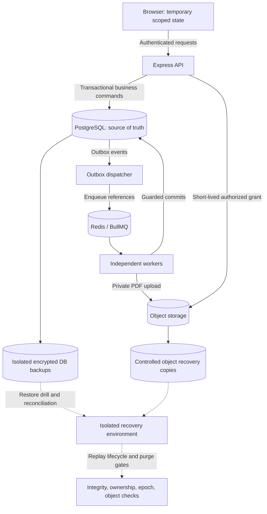

# Founder's Lens — Phase 5B: Storage, Secrets, Backup & Recovery

**Document ID:** FL-LLD-INF-5B  
**Version:** 0.4 - formal documentation baseline
**Status:** Approved - Documentation Only; FL-P5-0.4-approved. Runtime/provider/restore/security gates remain pending.
**Authority:** Approved Phase 2D (`FL-P2D-1.0-approved`), Phase 3 (`FL-P3-0.3-approved`), Phase 4 (`FL-P4-0.5-approved`) as reported by the owner; Phase 5A v0.1 proposed. Reconcile against the actual canonical repository before sign-off.  
**Intended path:** `Docs/lld/07-infrastructure/storage-secrets-backup-recovery.md`

## 1. Purpose and boundaries

Specify a portable storage and recovery architecture for the Next.js/Express modular monolith, independent outbox/AI/research/PDF/privacy workers, PostgreSQL/Prisma, Redis/BullMQ, private PDF object storage, Clerk identity, and external model/search providers. This is a **design proposal**, not a promise of production durability or zero-cost hosting. Preserve existing approval, deletion, immutable snapshot, epoch, idempotency, and privacy requirements. No provider selected; no schemas or configuration executed.

**Decisions deferred:** Provider selection and charges (5C), precise backup schedule/retention and RPO/RTO, encryption key infrastructure, recovery access roles, regional residency, object-store versioning, queue rebuild implementation, migration rollout, evidence retention specifics and actual restore proofs. Do not invent binding SLAs.

## 2. Fundamentals in brief

| Term | Meaning | Founder's Lens implication |
|---|---|---|
| Durable data | Information expected to survive process restart | PostgreSQL is authoritative for founder state |
| Object storage | Private store for files/blobs | Approved snapshot PDF artifacts, not database rows |
| Backup | Separately recoverable copy | Not equivalent to a working restore |
| RPO | Recovery point objective: maximum acceptable potential data loss window | Must be chosen and measured, not inferred from backup frequency alone |
| RTO | Recovery time objective: target time to restore service | Requires timed drills and dependency recovery |
| Secret | Credential or token granting access | Keep on trusted servers; never bundle into browser |
| Outbox | Transactional record of work to dispatch | Lets jobs be safely re-enqueued after Redis loss |
| Data lifecycle | Rules for active, deleted, purged and backup-resident copies | Backups may retain data temporarily under a separate policy |

## 3. Storage authority and ownership

| Data | System of record | Other copies and rules | Failure / recovery |
|---|---|---|---|
| User identity linkage and deletion tombstones | PostgreSQL plus Clerk as identity provider | Signed webhook inbox and scoped lifecycle gates | Reconcile signed webhooks; prevent account resurrection |
| Ideas, conversations, messages, experiments, learning, evidence, approved memory | PostgreSQL | Browser copies temporary and principal-scoped | Restore authoritative data; invalidate stale browser data |
| Generation attempts, final selected assistant messages, research jobs, outbox and idempotency ledger | PostgreSQL | Redis contains execution state, not final business truth | Redis jobs rebuilt from eligible DB intents; never replay paid work blindly |
| Immutable approved snapshot metadata/content hash | PostgreSQL | Approved source record never overwritten | Restore consistent version and references |
| PDF binary/artifacts | Private object storage | DB stores artifact metadata, status, owner scope and object locator | Reconcile DB metadata with actual object availability; regenerate only from approved immutable source if policy/contract permits |
| Queue / transient event transport | Redis/BullMQ | No authoritative chat transcript in Redis | Rebuild from outbox/job records, deduplicate and fence workers |
| Provider secrets | Managed runtime secret injection | No local source control, browser JavaScript or logs | Rotate/revoke and restart affected runtimes safely |
| Observability logs | Minimal configured log destination | Redaction, access restriction and retention policy | Logs are not an alternative durable user-data store |

**Invariants:** All reads/writes require current authenticated owner/idea scope. A copied or restored record is not permission to resurrect data removed through a deletion request. Database and object storage must be restored and reconciled as one logical system, while acknowledging their separate transactional boundaries.

## 4. Logical storage and recovery diagram

Backups must be isolated from ordinary application credentials where possible. The diagram describes required protection boundaries, not provisioned resources.

## 5. PostgreSQL durable design

1. Preserve relational constraints: ownership/same-idea references, unique ids, canonical versions, idempotency ledger, lifecycle, deletion tombstones, epoch fencing and approved snapshot immutability. Phase 4's `LearningEvidence` and experiment mapping are **approved design artifacts**, not migrated tables.
2. Use transaction boundaries for command acceptance + outbox and other atomic transitions. No external model call inside a long database transaction.
3. Maintain a documented migration plan: snapshot before changes, backward-compatible expand/migrate/contract where needed, mixed-version compatibility, rollback and restore procedure. Requiring a migration is not evidence that it has been tested.
4. Make backups encrypted and access controlled; choose logical/physical and point-in-time-recovery approaches only after provider and cost evaluation. Snapshot backups alone do not provide arbitrary point-in-time recovery.
5. Track integrity checks: FK/unique constraints, orphaned approved snapshot artifact references, pending outbox age, deletion gates and lifecycle consistency. Use non-destructive fixtures in isolated tests.

## 6. Redis / BullMQ recovery

Redis is a queue coordinator, **not** the source of truth. Require explicit persistence/availability settings suitable for the chosen hosting profile and monitor queue lag, failures and stalled jobs. A DB-committed outbox event must remain eligible for reconciliation even if Redis is unavailable during initial dispatch.

Recovery sequence (proposed): (1) restore DB authority; (2) stop/suspend workers; (3) validate current account/idea lifecycle and context epochs; (4) reconcile outbox and job states; (5) enqueue eligible work with stable deduplication identity; (6) restart workers with concurrency and cost bounds; (7) observe terminal outcomes. Do not promise exactly-once execution: use **at-least-once delivery plus guarded idempotent effects**. Paid provider invocation cannot always be rolled back, so retry policies must be bounded and honest.

## 7. Private PDF object storage

- Store metadata, artifact availability, checksum/hash, owner/idea scope and immutable approved snapshot version in PostgreSQL; store bytes privately outside the web runtime.
- Use server-issued narrowly scoped, short-lived grants for authorized downloads. A valid or expired grant and actual object existence are different states. Never expose bucket-wide read credentials or sign arbitrary founder-supplied paths.
- Verify upload checksum and final object existence before declaring an artifact AVAILABLE. A worker crash between upload and DB commit must be reconciled; orphan cleanup must not delete referenced approved artifacts.
- Treat object-store deletion, lifecycle expiry, failed upload, orphan artifacts and storage outages independently from PDF render job completion.
- Plan private storage recovery copies and object retention together with approved snapshot retention and deletion policy; do not assert that every deleted historical artifact disappears from backups instantly.

## 8. Secrets, authentication and encryption

| Secret or trust material | Permitted location | Guardrails |
|---|---|---|
| Clerk verification/configuration secrets | API/approved trusted server runtime | Verify issuer/audience/session using current SDK guidance and pinned integration testing; avoid browser disclosure |
| Model/search provider keys | Only authorized worker runtime | Scope usage; prevent accidental paid retry; no logs/prompts embedding keys |
| DB user credentials | API, dispatcher, approved workers as needed | Least privilege, protected connections, rotation process |
| Redis credentials | Dispatcher/workers, approved runtime | Private network; encryption and auth per provider deployment |
| Object-store credentials | Storage worker and grant-signing service | Separate scoped read/write permissions; no public container |
| Cookie/session/client tokens | Browser session mechanisms per approved Clerk/Bearer architecture | Do not persist bearer tokens in application long-term storage; signed/HTTPS transport |
| Backup encryption keys | Restricted operational control plane | Independent access, recovery procedure and rotation test |

Document secret inventory, owners, purposes, rotation triggers, expiry and incident response; do not commit `.env` files with real values. Encryption in transit and at rest must be verified for the actual provider. **Key rotation and key loss** are separate recovery risks.

## 9. Privacy deletion vs backups and restore

Inherited Phase 2D principles: active records remain until deletion, with a **30-day active-system purge target** rather than an all-copies guarantee; account/idea access is gated promptly after accepted deletion; backup/provider retention is separately disclosed; account recreation does not resurrect prior content; removed memory is excluded from future active context through version/epoch/lineage protections with stated limits; approved snapshots remain immutable until separately purged.

Recovery design must ensure a restore **cannot silently undo a deletion**:

1. Maintain a restricted, durable deletion/tombstone and purge ledger with a recovery plan independent of ordinary restored active tables; exact design needs repository verification and isolation controls.
2. Before restored service is accessible to ordinary users, reconcile deletion requests, tombstones, ownership, user re-creation semantics and in-flight jobs; reapply required purge and lifecycle gates.
3. Do not re-enable removed memory, old account identity linkage, signed download grants or worker jobs merely because a backup contains them.
4. Track evidence of purge completion and backup/provider retention windows separately. Don't claim instant destruction of archival copies or third-party provider data.

**Hard warning:** Restoring an older DB snapshot without replaying later deletion controls is a privacy incident risk; treat deletion reconciliation as a release gate for any restore.

## 10. Incident playbooks (design stage)

| Incident | Immediate containment | Recovery direction | Truthful user impact |
|---|---|---|---|
| PostgreSQL unavailable | Stop new durable acceptance; avoid claiming success | Recover DB from verified backup/PITR; check ledgers, versions and purge gates | Writes unavailable; prior acceptance uncertainty may remain |
| Redis unavailable | Stop queue dispatch/worker attempts; keep DB outbox | Reconcile outbox and restart queues after DB validation | AI/research/export delayed; accepted work not assumed lost |
| Worker crash during model call | Fence old attempt; inspect durable state | Resume only if policy allows, with bounded paid retry/cost checks | Incomplete work or uncertain external charge |
| PDF upload succeeds but DB update fails | Reconcile object and DB job state | Reattach validated artifact or clean orphan according to policy | Export may remain pending/failed until verified |
| Object storage unavailable | Disable granting unusable downloads; maintain immutable metadata | Restore objects or explicitly regenerate only from approved source | Approved snapshot record may exist while PDF unavailable |
| Compromised secret | Revoke/rotate, isolate access, preserve audit evidence | Revalidate permissions, invalidate affected grants/sessions where possible | Restrict access pending investigation |
| Accidental deletion or bad migration | Freeze writes if necessary | Isolated restore test, migration rollback/repair, deletion reconciliation | Recovery window depends on actual backup policy |
| Backup restore reveals deleted-account data | Block serving restored system | Reapply independent tombstones and purges before access | Must not re-expose deleted content |

Every playbook requires named operators, decision authority, alert triggers and runbook steps at Phase 5C/5D or implementation time; none has been executed.

## 11. Local-first, no-card cost profile

**Proposed local profile:** Next.js, Express, dispatcher and workers as independently runnable processes; local PostgreSQL and Redis containers/volumes; private local or self-hosted object-store-compatible development storage; fake/disabled paid model and search adapters for most tests; sample data only. Use local encryption/secrets hygiene and avoid implying laptop data is production-reliable. Test shutdown/restore using disposable fixtures, not founder data.

**Cloud profile:** Select only after confirming provider pricing, credentials/card eligibility, storage/network quotas, continuously running workers, queue persistence and backup availability. No verified ₹0 always-on production configuration is claimed. Zero hosting expense does not imply zero model/search/API expense.

## 12. Recovery objectives and evidence plan

RPO/RTO, backup schedule, retention, snapshot storage, encryption algorithms/keys and cost ceilings are intentionally **provisional** until a hosting profile and risk appetite are chosen. Candidates may be compared in 5C, but must not be marked met without measured drills.

For each recovery drill collect: environment ID, synthetic dataset identifier, backup source/time, restore command/runbook revision, start/end timestamps, resulting integrity checks, deletion replay checks, artifact checks, outstanding outbox/job reconciliation and actual data loss/time. Do not treat a successful database import as a complete restore.

## 13. Acceptance scenarios — planned, not executed

| ID | Scenario | Expected design invariant | Evidence required |
|---|---|---|---|
| INF5B-01 | DB backup restore | Owner- and version-consistent durable records restored | Isolated PostgreSQL restore + FK/version checks |
| INF5B-02 | Restore predates account deletion | Deleted account stays gated and purge is reapplied | Independent tombstone fixture + blocked read |
| INF5B-03 | Restore predates removed-memory action | Removed memory not used as current AI context | Epoch/lineage and model-context fixture |
| INF5B-04 | Redis wiped after accepted command | Outbox re-enqueues eligible work once logically | Dispatcher/worker integration with DB effects |
| INF5B-05 | Duplicate job after worker restart | No duplicate committed assistant result | Idempotency + finalization fence barriers |
| INF5B-06 | Worker crashes around paid provider call | Bounded, auditable retry without false zero-cost claim | Fake provider charge counter + DB state |
| INF5B-07 | PDF stored but DB commit lost | Orphan reconciled without accidental user exposure | Object-list/DB fixture and checksum |
| INF5B-08 | DB says AVAILABLE but object missing | No successful download claim; truthful repair path | Storage fault-injection test |
| INF5B-09 | Expired download grant | Renew only after fresh owner authorization | Storage grant and owner scope fixtures |
| INF5B-10 | Cross-idea/cross-account object attempt | No metadata or bytes leakage | Signed URL misuse/authorization checks |
| INF5B-11 | Secret leak or rotation | Revoked secret unusable; legitimate access recovers | Rotation/revocation drill with mocks/sandbox |
| INF5B-12 | Backup key unavailable | Restore fails safely with documented escalation | Isolated encryption-key loss simulation |
| INF5B-13 | New account created with old email | No old data resurrection | Identity tombstone and re-creation tests |
| INF5B-14 | Migration rollback | Retain transaction/ledger and compatibility invariants | Staged migration + rollback fixtures |
| INF5B-15 | Long-running outage | No unbounded queue/provider retries | Concurrency quota and failure-duration integration |
| INF5B-16 | Backup encryption/access | Unauthorized backup read denied | Access policy and encryption verification |
| INF5B-17 | Purge of learning evidence links | Links removed in correct order with parents | FK/purge helper transactional DB test |
| INF5B-18 | Recovery of approved snapshot versions | Immutable hash/version unchanged; artifact state accurate | DB/object cross-check and checksum |

All 18 scenarios are **Not executed**; design fixtures and real provider/runtime verification are future work.

## 14. Traceability and reconciliation gates

- **Phase 2D:** P2D-P01–05 lifecycle, identity tombstones, scoped deletion and backups; database physical/SQL constraints, idempotency and snapshot immutability.
- **Phase 3:** durable generation attempt/outbox, approved memory lineage, model provider budgets and worker commit fencing.
- **Phase 4:** browser private cache clearing, authenticated downloads, `LearningEvidence` schema design, experiment versioned creation, user-controlled approval.
- **Phase 5A:** runtime segmentation, local-first portability, separate dispatcher/worker and public-private network boundaries.

Before 5D sign-off, check exact active schema and route names; confirm whether approved deleted-identity tombstones and purge ledgers remain independent of restored DB backups, verify object-store capability and failure handling; resolve backup consistency, retention, recoverability, operations ownership and deployment costs. Preserve historical approved files/manifests, mark changes as controlled amendments.

## 15. Outstanding decisions and risks

| ID | Decision | Recommended direction | Status |
|---|---|---|---|
| INF5B-D01 | Backup method and frequency | Select based on provider, RPO and restore drill | Pending owner/hosting design |
| INF5B-D02 | RPO/RTO | Pick realistic targets with cost and evidence | Pending owner/hosting design |
| INF5B-D03 | Backup retention and isolation | Match privacy commitments, minimization and cost | Pending policy review |
| INF5B-D04 | Private object storage and grants | Provider-neutral S3-compatible interface only if suitable | Pending provider/security verification |
| INF5B-D05 | Independent deletion/tombstone recovery | Restore-safe gating with authority outside older snapshots | Pending design verification against existing Phase 2D |
| INF5B-D06 | Secret delivery and rotation | Provider-appropriate secret manager or restricted local injection | Pending hosting decision |
| INF5B-D07 | Redis persistence policy | Configure after deployment profile selection | Pending provider/runtime verification |
| INF5B-D08 | Storage region and regulatory requirements | Review applicable commitments before deployment | Pending security/compliance review |

## 16. Design readiness

**Phase 5B v0.1 drafted for owner and repository review.** No storage/secret infrastructure was provisioned, no object bytes uploaded, no backup generated, no recovery drill or migration executed, and no provider compliance certified. Phase 5C should evaluate real cost/operational options; Phase 5D should reconcile this document with the actual approved repository and record unresolved product and security gates without claiming production readiness.

## 17. Current repository reconciliation (v0.2, In Review)

The actual canonical directory is Docs/lld/07-infrastructure-and-deployment/. Earlier source-unavailable and intended-path statements are historical. [Phase5D section13](infrastructure-integration-review.md#13-current-repository-reconciliation-and-operational-closure) is the canonical restoration runbook and decision register. Approved Phase2D state-machines already requires an independently mirrored suppression manifest in existing private storage, including reconciliation of accepted incomplete deletions before reopening. PostgreSQL-only tombstones and Clerk state alone are insufficient after an old restore. No additional database is proposed. Independent version protection, keys, receipt coverage and retention must survive the DB/PDF restore boundary. INF5D-05 remains a recovery-readiness blocker where completeness cannot be established; keep service closed, not merely warn the user. Ordinary snapshot immutability does not prevent scoped authorized privacy purge. LearningEvidence is deleted before Learning/EvidenceRecord. Backup expiry is separate from the approved30-day active-system target; earlier proposed retention figures are not newly approved. No perfect erasure, completed restore or production storage parity is claimed.

## Current operational decision closure - v0.3

The owner's operational directions are approved for design only. [Phase5D section14](infrastructure-integration-review.md#14-operational-approvals-and-deletion-coverage-proposal) is authoritative: local-first portable Compose, public demo/cloud deferred, automated controlled backups, provisional RPO/RTO, private local PDF adapter, uncommitted development secrets, GitHub Actions candidate subject to verification, fail-closed paid-call budgets and founder as initial development operator. Earlier pending-direction wording is historical; numerical/provider/runtime gates remain pending. Candidate FL-P5-0.3-review is not approved. P5-AM01 proposes independent pre-commit suppression intent and uncertain-intent handling; it requires owner approval before changing frozen contracts. Async outbox alone cannot prove rollback-safe coverage. No infrastructure, billing or Phase6 authorization is implied.

## P5-AM01 approved controlled amendment

Owner approval now supersedes previous pending-proposal labels; Phase5D section15 and the approved state-machines P5-AM01 protocol govern. Independent durable scope/incarnation-bound intent is required before accepted primary deletion commit. Uncertain intents block access; independent-authority outages/stale reads fail closed. Intent is not proof of primary commit;202 still requires primary commit. Restore complete independent coverage and suppression before reopening, retain existing worker/context fences and account recreation rules. Provider durability/keys/listing/partition proof remains pending. Candidate FL-P5-0.4-review is not package-approved; no infrastructure or Phase6 work.

## Formal Phase 5 approval - current status

FL-P5-0.4-approved - Approved, Documentation Only. Evidence is the owner''s explicit Phase5 formal documentation sign-off instruction in this conversation. No date, timestamp, signature or Git commit is inferred. Earlier draft/pending/package-unapproved statements are preserved historical stages; this status and Phase5D section16 govern. The versioned approved-revision-0.4.json manifest freezes this baseline. Numerical RPO/RTO, retention/provider decisions and all runtime tests remain pending. No implementation, spending, migration, deployment or Phase6 authorization.
