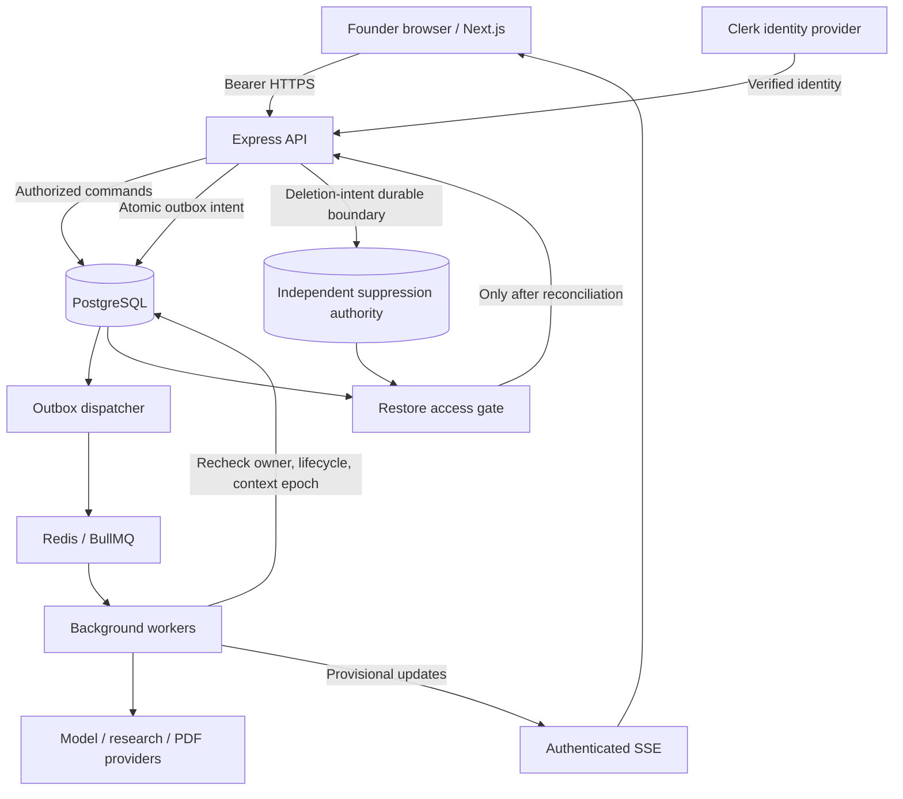
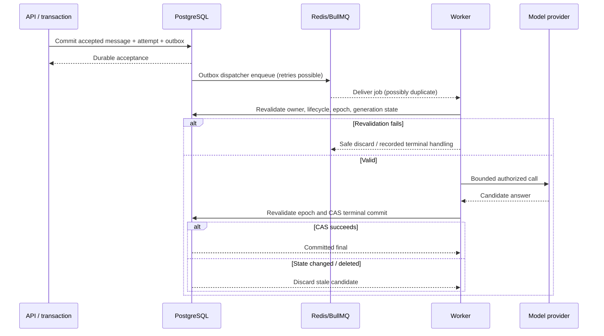
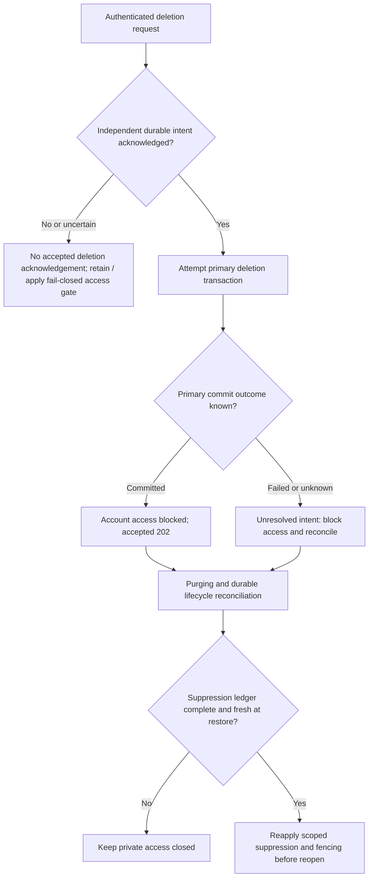

# Founder's Lens — LLD Phase 6B: Security, Privacy & Reliability Verification

**Document ID:** FL-LLD-QA-6B  
**Version:** 0.3 - formal documentation baseline
**Status:** Approved - Documentation Only; FL-P6-0.3-approved. All runtime tests remain Not Executed.
**Canonical directory:** Docs/lld/08-testing-quality/; current review and decisions in Phase6D section16.
**Authority:** PRD/SRS and approved Phase 2D, Phase 3, Phase 4 and Phase 5 design baselines outrank this draft. Phase 6A establishes the test strategy. No change to approved behavior is authorized here.

> **Source and verification limits:** This document uses the locally available Phase 6A draft, earlier project design material, and the owner's report of `FL-P5-0.4-approved`. This session has not independently read the final canonical Phase 5 manifest, latest OpenAPI, or latest Prisma/SQL revisions; therefore exact route/field spellings, inheritance mappings and compatibility behavior are **reconciliation targets for Phase 6D**, not independently certified facts. None of the tests below has run. Test results must not be inferred from documentation consistency checks.

## 1. Purpose and boundaries

Phase 6B translates Founder's Lens's highest-risk design promises into **executable test specifications** for a later implementation: authentication, authorization, privacy, consent, database invariants, queue/idempotency safety, AI context isolation, deletion/recovery and cost protection. A **test oracle** is an independently verifiable expected result—usually a database invariant, response status or absence of side effects—rather than just a screen message.

**In scope:** Express/Clerk authentication, idea and account ownership, PostgreSQL constraints, memory proposal approval, research/evidence provenance, structured response isolation, BullMQ/outbox generation, exports, P5-AM01 independent deletion intent, restore safety, frontend private cache, billing controls, adversarial inputs, secrets and audit evidence.

**Out of scope:** writing production/test code, actual security penetration testing, migrations, infrastructure creation, real provider calls, declaring regulatory compliance, producing a production risk score, approving numeric thresholds or changing frozen API semantics.

### 1.1 Test vocabulary

| Term | Plain meaning |
|---|---|
| Threat model | Structured examination of who could cause harm, what they could reach and which trust boundary they could cross |
| IDOR / BOLA | Accessing an object by ID without checking ownership; a high-priority API risk |
| Fail closed | Deny private access when required authorization or deletion evidence is missing/uncertain |
| TOCTOU | Time-of-check/time-of-use race: a permission was valid earlier but changed before a later commit |
| Fault injection | Controlled simulation of a crash, timeout, duplicate delivery or network partition |
| Test fixture | Synthetic, repeatable actors and records that produce known test results |
| Suppression authority | Independent durable deletion-intent evidence used to prevent restoration of previously deleted access |
| Idempotency | Repeating the same logical request does not create new business effects |
| Optimistic concurrency | Version guard preventing a stale edit from overwriting a newer record |

## 2. Security and privacy architecture under test

**Trust boundaries:** (1) anonymous browser to authenticated API; (2) authenticated identity to idea ownership; (3) accepted command to durable DB transaction; (4) DB outbox to at-least-once queue workers; (5) trusted prompt/context to untrusted external evidence/model output; (6) private database to independent suppression authority and backup restoration; (7) private storage to temporary download grant.

**Core assertion:** a component's success signal is not sufficient unless the *authoritative outcome* is correct. Examples: receiving `202` does not prove generation completed; receiving an SSE delta does not prove an assistant message committed; a deletion intent does not prove the primary deletion transaction committed.

## 3. Test fixtures and evidence standards

Use synthetic principals **Founder A** and **Founder B**, with at least two ideas for A; a recreated account with the same email but a distinct identity; conversations, messages, memories, experiments, LearningEvidence links, artifacts and independently recorded deletion intents. Seed both valid and deliberately foreign resource identifiers. Include legacy and versioned API payloads and projection selectors.

Use real disposable PostgreSQL and Redis for race, durability and schema tests. Use deterministic model/research fakes to observe *whether a provider call was made*, plus network partitions, fake clocks, process kill points and controlled transaction barriers. Reserve real Clerk and third-party provider verification for explicitly authorized staging tests; do not expose real user information or purchase model usage by default.

Each eventual test record must include: `testId`, source requirement/contract path, implementation revision, environment/fixture versions, precise failure injection, actual/expected response, DB effects, provider call count, redacted evidence, outcome and defect. Valid outcomes: `NOT_EXECUTED`, `PASS`, `FAIL`, `BLOCKED`, `SKIPPED_WITH_REASON`. **All Phase 6B tests currently: NOT_EXECUTED.**

## 4. Threat-driven verification matrix

| Threat / failure | Boundary | Test oracle | Required layer |
|---|---|---|---|
| Forged, expired or wrong-party Clerk token | Browser→API / SSE | Reject before private read or job admission; no tokens in URLs | Provider/API integration |
| Foreign idea, message, evidence or snapshot ID | Identity→owned object | Neutral denial; no existence leak or DB side effects | API/DB + security |
| Same-email account recreation | Identity mapping | No old owner binding, chat, cache or memory restored | API/DB/restore |
| Input injection or malformed JSON | HTTP→validation | Bounded validation failure; no privilege escalation or unsafe SQL | Contract/security |
| Reused idempotency key with different request | HTTP→durable transaction | Reject conflict; no second message, outbox or paid job | Real DB + API |
| Stale memory/experiment update | Versioned write | `If-Match`-governed denial; user intent preserved; no overwrite | Real DB + API |
| Poisoned research content | Untrusted source→AI context | Treat as data; no hidden instructions, unauthorized actions or secrets | Worker fixture + red-team eval |
| Worker retry after cancellation/deletion | Queue→DB | Epoch/state rechecks prevent stale final commit and selection | Real DB/Redis race |
| Restored old backup | Primary DB→reopened access | Independent suppression coverage reconciled or access stays closed | Isolated restore drill |
| Expired or leaked PDF grant | Storage→recipient | Expired/foreign grant denied; no lasting public URL | Storage + API |
| Browser BFCache/account swap | Cache→UI | Private content blanked and stale callbacks discarded | Browser security E2E |
| Unapproved paid retry | Worker→provider | No extra billable request from queue retry/reconnect without permitted policy | Worker fake + budget gates |

### 4.1 Negative test principle

Every permit-path scenario should have a deny-path counterpart: correct owner versus foreign owner; current version versus stale; approved memory versus removed; live account versus deletion-requested; available suppression authority versus unavailable; approved artifact versus missing/expired grant. Check DB state and other side effects after denial—not only the HTTP code.

## 5. Authentication, authorization and API abuse tests

**5.1 Authentication:** Verify absent/malformed/expired/signature-invalid/wrong-audience/wrong-issuer/wrong-party tokens; auth refresh during SSE; signed Clerk webhook verification, duplication and replay; mismatched recreated identities. Verify the actual deployed Clerk SDK token and claims rather than inventing a middleware API. Requests use approved explicit Bearer transport; do not silently adopt cookie/BFF authentication.

**5.2 Ownership:** Exercise all protected resource families: account, idea, conversation, message, generation, memory, assumption, experiment, learning, evidence, evidence link, research job, snapshot, export and temporary download. Test foreign IDs, same-user different-idea IDs, deleted resources and nested parent mismatches. Any obscured `404` must not disclose the foreign title, owner ID, count, existence or timing-sensitive details unnecessarily. Every background worker must independently scope DB reads and updates, not trust IDs supplied by the browser or queued job payload.

**5.3 HTTP transport and input:** Validate allowed origins and preflight for bearer REST/SSE; no bearer in query parameters; deny redirects that disclose credentials; validate body limits, content types, unknown fields and request schema versions; rate/quota controls in both HTTP admission and worker call budgets. Verify signed URL domain, expiry, scope and cache headers. Use security scanning for accidental keys and private responses; no claim of universal injection immunity from static checks.

**5.4 Relevant statuses:** Differentiate `401` unauthenticated, `403` denied where documented, neutral `404`, `409` state conflict, `412` stale version, `428` absent version, `429` quota and `503` service failure. A network timeout or `404` submission lookup **does not prove a write failed** and cannot authorize automatic paid resend. The approved `409 EXPERIMENT_HYPOTHESIS_REQUIRED` legacy path must be tested alongside accepted original-key response replay.

## 6. Database integrity, concurrency and consent

**DB-01 Ownership:** foreign keys, composite same-idea constraints and restricted queries reject cross-idea links even when the API is bypassed by a test harness.

**DB-02 Memory:** approving or editing a proposal needs founder action, actual proposal revision, expected target revision and a verified owner. Missing version fails closed. Test two tabs, approval versus removal, source deleted/foreign, lineage filtering, old historical chats/snapshots unchanged and in-flight contextEpoch invalidation.

**DB-03 Experiments/learning:** version-3 create keeps `plan.title` separate from independently required hypothesis. Validate read-back of method and success criteria; legacy hypothesis-less fresh create returns the approved error, while preaccepted same-key request replays its original result. `LearningEvidence` joins enforce same-idea uniqueness and atomic capture. `evidenceLinksRecorded=false` means legacy unknown; true with zero links means deliberately empty. Prevent ordinary resets that erase this distinction. Migration of legacy synthetic fixtures must be tested before release.

**DB-04 Snapshot integrity:** approved snapshot content/hash/version immutable; edits create a new draft through existing creation route; approval is an explicit guarded action. Export failure never mutates the snapshot; grant expiry does not imply artifact expiry.

**DB-05 Transactional outbox:** inject failure after message commit before queue enqueue, after enqueue before dispatch acknowledgement and during duplicate delivery. Assert accepted command/outbox/replay record consistency, eventual recovery policy and no duplicate durable business effect. Do not claim exactly-once provider billing; define invocation/budget bounds and measure them.

## 7. Worker reliability and lifecycle races

Planned race barriers: two submissions competing for one active generation; cancel before/after completion; regeneration selection; Redis redelivery; worker death after model call but before commit; deletion during context construction/provider call/final commit; research toggle and admission transaction; snapshot approval versus export. Capture each possible ordering with terminal DB state, selected response, provider-call counters and events. SSE disconnection alone never cancels the worker, and new SSE connections do not replay old private fragments.

**Cost safety:** fake provider detects repeated invocation; worker budget/lease/idempotency policy must bound retries. Distinguish business deduplication from whether a provider billed an already-started call. Do not claim exactly-once paid invocations across unrecoverable provider response loss.

## 8. P5-AM01: independent deletion-intent and restoration verification

The design distinguishes **durable intent**, **primary committed deletion**, **unresolved**, and **reconciled suppression**. Deletion acceptance cannot be based only on an asynchronous outbox mirror. Independently durable evidence is required before the primary deletion transaction can commit as accepted. An independent intent **is not proof of primary commit**; unresolved evidence must block affected access pending reconciliation.

**Important nuance:** A failed or uncertain independent write must not be reported as an accepted deletion; the exact interim access-gate rule must follow the approved Phase 5 contract. It is unacceptable to claim the mechanism protects against all conceivable partitions or ledger-key loss without tested coverage/availability assumptions.

### 8.1 Failure-window matrix — executable specifications

| ID | Injected event | Expected safe evidence and access outcome | Verification |
|---|---|---|---|
| P6B-R01 | Independent intent write fails before ack | No false accepted `202`; protected/private operations obey documented fail-closed rule | API + independent fixture |
| P6B-R02 | Independent ack lost; write may exist | Resolve uncertainty by idempotent lookup/reconciliation; no duplicate destructive command | Ledger + API |
| P6B-R03 | Intent durable, primary transaction rolls back | Unresolved suppression persists; no access restoration without explicit reconciliation | DB + ledger |
| P6B-R04 | Primary commit succeeds, API response lost | Original acceptance recoverable; no duplicate purge or new identity binding | API + DB + ledger |
| P6B-R05 | Crash after commit before async mirror/outbox dispatch | Independent evidence still covers deletion; old backup suppressed | Restore drill |
| P6B-R06 | Restore primary from backup older than deletion | Reconcile independently complete ledger before exposing private routes | Real isolated restore |
| P6B-R07 | Missing ledger segment / unavailable keys | Fail closed; no public/private reopen based on stale or partial coverage | Partition + restore |
| P6B-R08 | Stale ledger read or store partition | Do not treat stale snapshot as completeness proof | Faulted authority |
| P6B-R09 | Duplicate/out-of-order purge and webhook events | No resurrection, wrong-account association or duplicate unsafe effects | Worker + identity |
| P6B-R10 | Recreate account using old email/identity hints | Fresh owner namespace; old records remain inaccessible | API + DB + restore |
| P6B-R11 | Delete during generation/PDF/research | Context/lifecycle fences prevent stale finalization and disclosures | DB/worker race |
| P6B-R12 | Independent intent exists but its scope is ambiguous/corrupt | Hold affected access closed until evidence verified; do not guess identity | Ledger security audit |

### 8.2 Acceptance boundary and completeness proof obligations

Before reopening restored private access, require evidence that: (a) independent authority data and keys are accessible and authentic; (b) completeness and enumeration for the recovery interval are established; (c) all potentially accepted intents/commits are reconciled; (d) applicable accounts/ideas are suppressed and purge work re-driven; (e) old queue and browser effects cannot disclose data; (f) audit evidence records the reconciliation outcome without copying sensitive payloads. These are **test requirements**, not certified properties of an unselected storage product.

Protect independent suppression records from unauthorized deletion; specify retention/key rotation/recovery in a deployment-specific design before production. Backup copies alone are not proof of a complete suppression ledger.

## 9. AI-context, research and output security

**Context isolation:** create two founders with highly distinctive synthetic secrets; ensure context for one idea never includes foreign idea/chat/memory/research records. Run memory removal during context construction, model call and final commit; epoch guard invalidates stale output. A removed memory may remain in historical transcript or already-approved PDF according to approved policy; test that such history is not presented as current approved context, without claiming perfect removal of all paraphrases.

**Prompt injection:** test malicious sources commanding the model to reveal system prompts, call unapproved tools, import foreign memories, initiate paid searches, alter deletion status or approve a snapshot. Untrusted source text is evidence, not instruction authority. Verify allowlisted assistant action structure, exactly one primary strategy, zero/one permitted card and at most two prominent actions; no unapproved mutation executes merely because a model suggested it.

**Evidence fidelity:** include stale, non-India and low-quality sources; ensure nullable provenance is shown honestly, `SOURCE_CHECKED` is not treated as proven truth, and missing source IDs cannot become invented citations. Test strict legacy `content:string` and explicit versioned structured response independently.

**Model evaluations:** the Phase 3 six-criterion, 0–2 SRS rubric and candidate thresholds are uncalibrated design proposals. Keep model quality scores separate from P0 safety, owner isolation and deletion hard gates. Real paid evaluations require explicit budget approval and versioned cases.

## 10. Secrets, data exposure and downloadable artifacts

- **Secrets:** ensure Clerk keys, database URLs, Redis credentials, model API keys and suppression authority keys never ship in browser bundles, URLs, SSE payloads, logs or committed fixture files. Test rotation and revoked credential behavior in isolated environments.
- **Logging:** use correlation IDs and structured redaction. Never include raw prompts, AI hidden reasoning, full message bodies, provider secrets or deleted-memory payloads in routine logs. Error responses must not leak SQL details or foreign resource names.
- **Artifacts:** test owner-bound export grants, expiration, no cross-account replay, redirect/CORS behavior, private object access, storage integrity and cleanup under deletion. PDF generation from untrusted content must be bounded and isolated; malicious markup/links cannot trigger arbitrary privileged fetches.
- **Privacy and retention:** test active-system purge targets separately from backup/provider retention. No claim of instant physical erasure from historical backups. Verify restored data is gated until suppression reconciliation and authorized purge rules apply.

## 11. Prioritized acceptance catalog — all NOT EXECUTED

| Test ID | Priority | Scenario | Verification layer / authoritative assertion |
|---|---|---|---|
| P6B-01 | P0 | Expired/forged/wrong-party Bearer REST and SSE | Provider API; zero private records/jobs |
| P6B-02 | P0 | Cross-account and cross-idea IDs in all resource families | API + DB; neutral denial and no side effects |
| P6B-03 | P0 | Recreated identity with same email | DB + restore; no old ownership recovered |
| P6B-04 | P0 | Duplicate message idempotency replay | API + real DB; one logical effect |
| P6B-05 | P0 | Same idempotency key, different body | API + DB; protected conflict, zero second effect |
| P6B-06 | P0 | Submission lookup 404 during concurrent commit | API + barriers; no auto-resend |
| P6B-07 | P0 | Stale memory If-Match and explicit approval | DB + API; no unauthorized version mutation |
| P6B-08 | P0 | Removed memory used by in-flight generation | Worker + DB; epoch fence at finalization |
| P6B-09 | P0 | Experiment v3/legacy creation and replay | API + DB; distinct title/hypothesis and documented 409 |
| P6B-10 | P0 | LearningEvidence same-idea, uniqueness, legacy unknown | Real schema + API; correct linked and empty state |
| P6B-11 | P0 | Duplicate queue and outbox publish failure | Real DB/Redis; eventual safe processing |
| P6B-12 | P0 | Cancel/completion/regen races | DB + worker barriers; single authoritative selection |
| P6B-13 | P0 | Deletion races with generation and export | DB + worker; no stale commit or download |
| P6B-14 | P0 | Old backup restore without ledger completeness | Isolated restore; private access remains closed |
| P6B-15 | P0 | Independent intent acknowledged, primary commit fails | Ledger + DB; unresolved suppression enforced |
| P6B-16 | P0 | Ledger unavailable/stale/uncertain acknowledgement | Ledger fault; no unsafe deletion acceptance or reopen |
| P6B-17 | P0 | Foreign snapshot PDF grant or expired link | Storage + API; denial, approved hash unchanged |
| P6B-18 | P0 | Malicious research source and forbidden AI action | Worker fake + policy check; no privileged side effect |
| P6B-19 | P0 | Browser sign-out/BFCache/auth swap races | Browser E2E; no old private paint or leakage |
| P6B-20 | P0 | No-paid-call-by-default and bounded retry | Worker fake; provider call counts match policy |
| P6B-21 | P1 | Poison job, Redis restart, queue backlog | Integration/ops; no lost durable accepted work |
| P6B-22 | P1 | Secret rotation, security headers, CORS, signed webhook | Provider/security fixtures; no secret exposure |
| P6B-23 | P1 | Source attribution and structured response limits | Contract + AI harness; no fabricated provenance |
| P6B-24 | P1 | PDF render timeout, corrupt object, new export retry | Worker/storage; explicit safe recovery |
| P6B-25 | P1 | Backup retention/access audit and redacted test artifacts | Recovery/security; no production data in tests |
| P6B-26 | P1 | Data migration of legacy learning/experiment states | Real migration DB; semantic preservation |
| P6B-27 | P1 | Cross-tab refresh/stream loss, no duplicate command | Browser + API; durable status reconciled |
| P6B-28 | P1 | Clocks/expiry/revocation and delayed requests | API/DB; version/lifecycle controls win |

**Traceability:** P6B-01–28 supplement, rather than replace, QA6A-01–30, Phase 2D API/DB/reliability tests, Phase 3D AI cases, Phase 4D browser cases and Phase 5D/P5-AM01 restoration scenarios. Codex must map these IDs to the *actual* canonical SRS requirement and acceptance IDs in Phase 6D. No claim is made that a specific total fully covers the latest 53 operations.

## 12. Release gates and execution ordering

**Hard release blockers:** any proven cross-owner disclosure, deletion resurrection, missed independent-intent gate, unexpected approved snapshot mutation, unapproved memory approval, corrupted durable transaction, unbounded paid retry or model-triggered privileged action. Missing executed evidence for a required P0 privacy/recovery gate also blocks a claim of production readiness.

**Implementation-stage execution order:** (1) threat review and test harness; (2) auth and DB ownership; (3) idempotency/outbox and worker races; (4) memory/experiment/learning version semantics; (5) independent suppression intent and old-backup restore drills; (6) browser privacy, PDF and third-party provider validation; (7) bounded AI adversarial evaluations. Develop the deletion/restore harness early; do not leave recovery architecture untested until the end.

**CI:** fast static/unit/contract tests on proposed PRs; real PostgreSQL/Redis integration where changes affect those boundaries; pre-release fault/restore/browser/provider/security tests in isolated environments. GitHub Actions remains a candidate, not a selected or verified paid plan. Keep provider tests opt-in and default-deny paid AI usage.

## 13. Evidence and incident handoff

When a test fails: preserve minimal redacted request IDs, fixture IDs, transaction/job states and dependency versions; report observed-versus-expected; assign severity and owner; create a reproducible regression scenario. S0: private-data leak, deleted-account exposure, or uncontrolled financial effect; S1: integrity or consent violation. Do not hide a failed privacy test behind an aggregate pass rate or automatic retries. Phase 6C owns telemetry, alert taxonomy, operational dashboards and AI evaluation reporting; Phase 6D owns formal source-level reconciliation and approval preparation.

## 14. Owner/engineering decisions and remaining uncertainties

| ID | Pending decision or verification | Proposed disposition |
|---|---|---|
| QA6B-D01 | Canonical endpoints/DTOs and storage details | Reconcile latest OpenAPI/Prisma/P5 manifest in Phase 6D before approving exact test contract |
| QA6B-D02 | Suppression authority consistency, key recovery and complete enumeration | Provider-neutral minimum requirements now; real durability and partition tests before release |
| QA6B-D03 | Security toolchain (SAST, dependency scan, dynamic scans) | Choose minimally sufficient tools during implementation planning, measure false positives |
| QA6B-D04 | Browser/Clerk integration compatibility | Test actual pinned SDK, origins and auth token behavior before accepting provider gate |
| QA6B-D05 | Crash-injection/test environment operator | Explicit isolated environment owner and clean-up protocol before destructive tests |
| QA6B-D06 | Production-rate/quotas, RPO/RTO, cost thresholds | Remain provisional; empirical calibration and explicit owner approval required |
| QA6B-D07 | Evidence/AI evaluation redaction policy | No private founder conversations in fixtures, reports or model evaluation corpus |
| QA6B-D08 | Canonical SRS/Phase 2–5 test traceability | Phase 6D repository reconciliation required; no invented coverage figures |

## 15. Interview preparation: exact answers

**Q: Why do you need real database tests rather than mocks?** SQL constraints, transaction ordering, uniqueness, and concurrent writes can behave differently from simulated repositories; only a real PostgreSQL test establishes their behavior.

**Q: How do you test at-least-once queues?** Deliver the same job repeatedly and crash the worker at specific commit boundaries. Assert one durable business effect, correct terminal state and bounded external calls; never claim delivery itself is exactly once.

**Q: What is the hardest privacy problem?** Restoring a database snapshot from before an account deletion. We require independently durable deletion intent and a fail-closed reconciliation gate; we must deliberately test accepted-but-unmirrored and uncertain-intent windows before any public release.

**Q: How is AI prompt injection tested?** Treat retrieved pages and model output as untrusted. Provide adversarial fixtures and assert that authorization, tool admission, memory approval, snapshot approval and deletion state remain under backend/owner control.

**Q: Is the application security-tested today?** No. The architecture is documentation-approved and static documentation checks were reported. Phase 6B specifies future security/privacy/reliability tests; none has been executed.

---

**Handoff:** Phase 6C — Observability, incident readiness, AI evaluation and cost/quality telemetry. Then Phase 6D — cross-document reconciliation, source-exact test traceability and owner review. Formal Phase 6 approval remains pending.

## Current repository reconciliation

Phase6D section16 supersedes historical source-unavailable/intake statuses and owns the current discrepancy register, API/requirements traceability and validation. Actual canonical path is Docs/lld/08-testing-quality/. Phase3 six-dimension0-2 rubric governs AI quality; privacy/security/cost/deletion failures are independent hard release blockers. Approved P5-AM01 distinguishes durable intent from committed deletion; unresolved suppression blocks access and restore, not merely alerts. Local-first Compose, deferred public demo/cloud, GitHub Actions proposed direction and founder development operator are inherited Phase5 decisions; actual eligibility/public incident responsibility remain pending. All runtime/database/browser/SDK/security/AI/recovery/performance scenarios remain Not Executed. No provider/tool is installed or selected. Candidate FL-P6-0.2-review - Not Approved; no Phase7 authorization.

## Current operational direction approvals

The owner explicitly approved the six Phase6 operational directions in this conversation. Phase6D section17 owns current decision references/dispositions and supersedes earlier pending-direction labels. Telemetry minimizes personal data with short documented retention, exact durations provisional; only authorized operators may access it, with access-audit evidence. Ordinary logs exclude founder prompts/message bodies, credentials, hidden AI context and private download grants, including automatic exceptions. Prefer minimal TypeScript-compatible tools, exact libraries/versions unselected. Browser plan covers Chromium,Firefox,WebKit plus real mobile/assistive technology when devices are available; unavailable combinations remain explicitly untested. All numerical thresholds require calibration and explicit acceptance. Founder owns development incidents; public roles/escalation must be assigned before launch. Directions are approved design only, not installed tools, secure operational storage, executed tests or final package approval. Candidate FL-P6-0.3-review - Not Approved. Existing security/privacy/deletion/spend hard gates and exact Phase3 six-dimension0-2 rubric remain binding. No frozen specification amendment or Phase7 work.

## Formal documentation approval - current status

FL-P6-0.3-approved - Approved, Documentation Only. Owner evidence is the explicit Phase6 formal documentation sign-off instruction in this conversation. No date/timestamp, signature or Git commit is inferred. Phase6D section18 and approved-revision-0.3.json govern current package status. Earlier pending/draft/review labels remain historical; no runtime finding is closed by approval. All database/migration/security/SDK/worker/restore/browser/accessibility/AI/performance/provider/cost-control verification remains Not Executed. Exact numerical targets remain provisional; AI-D14 remains accepted pending controlled HLD editorial amendment. No implementation, installation, spending, migration, test execution, monitoring provisioning, deployment or Phase7 authorization.
