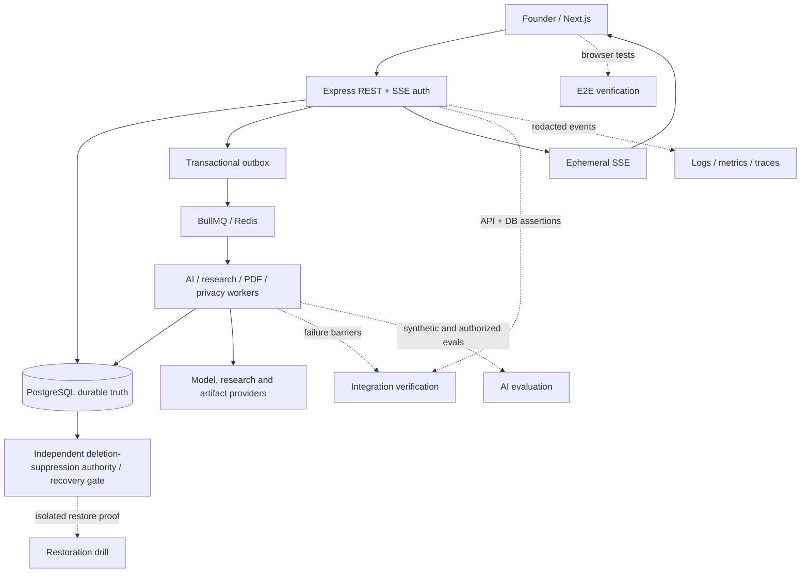

# Founder's Lens — LLD Phase 6D: Testing, Security & Observability Integration Review

**Document ID:** FL-LLD-QA-6D  
**Version:** 0.3 - formal documentation baseline
**Status:** Approved - Documentation Only; FL-P6-0.3-approved. All runtime tests remain Not Executed.
**Canonical directory:** Docs/lld/08-testing-quality/; current review and decisions in Phase6D section16.
**Review sources directly inspected:** Phase 6A `testing-strategy-quality-architecture.md` v0.1, Phase 6B `security-privacy-reliability-verification.md` v0.1, Phase 6C `observability-incident-response-ai-evaluation.md` v0.1. The locally available earlier SRS/architecture material and owner's reported `FL-P5-0.4-approved` approval are context, **not independent verification of the current canonical repository**. All latest OpenAPI/Prisma/SQL, phase approvals and amendments must be re-opened by Codex before sign-off.

> **Governance boundary:** This is a design review of proposed tests, not test execution. No code, test suite, cloud resources, provider credentials, monitoring service, evaluation runs, penetration tests or migration were created. No test or safety guarantee has passed by virtue of being documented.

## 1. Executive assessment

**Phase 6 is ready for repository reconciliation and owner decisions, not unconditional sign-off.** The 6A test architecture, 6B security/privacy/failure suite and 6C observability/AI evaluation plan share the same principles: PostgreSQL is authoritative for durable state; authenticated owner-scoped operations and independent deletion suppression fail closed; expensive work is bounded; untrusted AI/model inputs never approve memory or perform privileged work; and runtime proof is essential before release.

Three primary reconciliation gates remain: (1) actual canonical Phase 2D–5 contract, schema and approved-hash verification; (2) the exact *approved* six-dimension Phase 3 AI evaluation rubric and provisional thresholds—6C explicitly warns about an older incompatible 0–4 scoring draft; and (3) executable, independent P5-AM01 deletion-suppression completeness and restoration evidence, which no static check can prove. The third is a **release verification blocker**, not necessarily a design contradiction. Provider selection, numerical goals, telemetry retention, accessibility matrix and incident responsibility also remain decisions.

## 2. What each Phase 6 document owns

| Source | Canonical responsibility within Phase 6 | Reviewed scenario IDs |
|---|---|---|
| 6A: Testing Strategy & Quality Architecture | Test levels, environments, fixtures, quality gates, traceability framework, test evidence, execution order | `QA6A-01`–`QA6A-30` (30) |
| 6B: Security, Privacy & Reliability Verification | Threat model, owner-isolation and negative assertions, concurrency/fault injection, independent deletion coverage, privacy and artifact safety | `P6B-01`–`P6B-28` (28) |
| 6C: Observability, Incident Response & AI Evaluation | Safe structured events/metrics/traces, incident response, paid-usage controls, quality corpus/rubric/regression, evaluation privacy | `Q6C-01`–`Q6C-24` (24) |
| 6D: This document | Cross-source consistency, discrepancy disposition, integrated test matrix, approval decisions, owner handoff and validation plan | `Q6D-01`–`Q6D-30` (30 proposed integrated cases; cross-reference existing suites) |

**Preservation:** All 82 distinct source scenario IDs must be retained through repository reconciliation. The 30 integrated Q6D cases below are cross-cutting *orchestration* scenarios, not a substitute or automatic increase in unique requirement coverage. Never add the matrices together to claim 112 independent behaviors tested.

## 3. System under test and evidence boundaries

The suppression authority link in this diagram represents **coverage and reconciliation dependencies**, not permission for an asynchronous PostgreSQL mirror to establish safe delete acceptance. P5-AM01 requires independently durable intent *before* primary commit, with fail-closed uncertainty. Its precise protocol must be verified against the current approved baseline.

A browser-only test cannot establish database transaction integrity. A mock model cannot prove provider billing. An OpenAPI parse cannot prove secure authorization. A green dashboard cannot prove independent deletion-ledger enumeration. Each claim needs the appropriate **test oracle** (an independently checked expected result).

## 4. Verified draft agreements (not runtime verification)

1. 6A/6B/6C agree on strict owner isolation, active-lifecycle checks and privacy-safe credential handling.
2. Same-key idempotency must avoid duplicate business effects; *at-least-once* queue delivery is expected and does not mean exactly-once provider calls.
3. `If-Match`/record-version checks protect stale memory or other updates; explicit founder approval is separate from AI suggestions.
4. Redis/SSE/browser caches are never authoritative for saved content. After SSE loss, authorized GET/state reconciliation wins; no automatic paid resend.
5. Research admission and usage must honor existing account/idea/conversation constraints and authorized quotas; no paid evaluation by default.
6. Approved PDF snapshots remain immutable; export job, stored artifact and expiring download grant are distinct states.
7. P5-AM01 deletion suppression requires access closure until independent coverage is proven before a restored service reopens.
8. Redacted logs, low-cardinality metrics and restricted tracing must not contain private prompts, raw conversations, tokens or signing secrets.
9. AI usefulness and infrastructure correctness have different tests; a privacy/security hard failure cannot be compensated by a high AI-quality score.
10. All three drafts label their acceptance scenarios as planned or not executed.

## 5. Discrepancy and decision register

**Disposition taxonomy:** `Aligned in draft`; `Pending canonical repository verification`; `Pending Owner/Engineering Decision`; `Pending implementation/provider proof`; `Accepted deferred risk`. A documented test plan does not close a validation gate.

| Finding | Priority | Source / observed issue | Recommendation and owner | Status |
|---|---|---|---|---|
| Q6D-F01 | P0 | 6A source note; 6B source note; 6C source note: current canonical OpenAPI/Prisma/SQL and manifest versions not inspected in these drafts | Codex verify latest Phase 2D–5 manifests, approved amendments, exact operation names and schemas; revise only Phase 6 drafts | Pending canonical repository verification |
| Q6D-F02 | P0 | 6C §8.3 distinguishes approved 0–2 rubric from historical 0–4 draft | Read approved Phase 3D and manifest; reproduce six dimension names, 0–2 scoring and provisional targets exactly; never merge historical scale | Pending canonical repository verification |
| Q6D-F03 | P0 | 6A §2, 6B §8, 6C §6/11: P5-AM01 true suppression enumeration/durability unproven | Add independent coverage oracle, restore-readiness interlock and fault barriers; release blocked absent real evidence | Pending implementation/provider proof |
| Q6D-F04 | P0 | 6A §7, 6B §11, 6C §11 independent ID catalogs | Preserve 30+28+24 IDs; map every ID to actual SRS/accepted phase tests; avoid false unique-coverage counts | Pending canonical repository verification |
| Q6D-F05 | P0 | 6A §6; 6B §5/6: exact legacy experiment version-3/409 semantics require schema evidence | Pin approved request version negotiation, `EXPERIMENT_HYPOTHESIS_REQUIRED`, prior accepted replay and DB constraints | Pending canonical repository verification |
| Q6D-F06 | P0 | 6A §7; 6B §6: LearningEvidence join and `evidenceLinksRecorded` marker are design artifacts | Read current Prisma/guards; test same-idea FK, uniqueness, unknown-vs-empty and purge order on real migrations | Pending canonical repository verification / execution |
| Q6D-F07 | P0 | 6A §5/7; 6B §7: outbox and worker idempotency must survive crash windows | Real database+Redis barriers at commit/publish/claim/finalize; separate logical dedup from provider-spend proof | Aligned in draft; execution pending |
| Q6D-F08 | P0 | 6A §7; 6B §11; 6C §11: memory removal/epoch fences | Confirm Phase 3 lineage-based context filtering and race contract; assert no stale **selected** response; preserve historical-content caveat | Pending canonical repository verification / execution |
| Q6D-F09 | P0 | 6C §4 telemetry envelope is proposed, not approved API DTO | Validate events/log keys against redaction rules; choose trace propagation and telemetry access without introducing public data fields | Pending Owner/Engineering Decision |
| Q6D-F10 | P0 | 6C §8 AI evaluation corpus and scores unexecuted | Synthetic, India/Hinglish and adversarial fixtures; separate structural hard gates and six-dimension quality score; explicit real-model authorization | Pending implementation/provider proof |
| Q6D-F11 | P0 | 6A §9, 6B §12: CI quality gates have no pinned tool versions or running pipeline | Specify minimum reproducible local/CI pipeline; treat all tools as candidates until implementation plan | Pending Engineering Decision |
| Q6D-F12 | P0 | 6B §12: fail closed on privacy violation, even without complete P0 test evidence | Write release decision rubric: required P0 proof absent ⇒ not production ready; no waiver by high score | Aligned in draft; pending execution |
| Q6D-F13 | P1 | 6C §5–6: SLO/alert targets are provisional | Select measurable SLIs; defer numerical thresholds to calibration and owner approval | Pending Owner/Engineering Decision |
| Q6D-F14 | P1 | 6C §7/13: telemetry retention and deletion scope unsettled | Minimize by default; define retention, RBAC, deletion purge and third-party processor boundaries before production | Pending Owner/Privacy Decision |
| Q6D-F15 | P1 | 6B §10; 6C §4: automatic error capture could leak private payloads | Redaction canaries in request, exception, trace, AI-provider error and artifact flows | Aligned in draft; execution pending |
| Q6D-F16 | P1 | 6A §4; 6B §3: fixture sources and environments not provisioned | Disposable isolated PostgreSQL/Redis, synthetic principals, deterministic clocks, fake provider, safe teardown rules | Pending Engineering/Implementation Decision |
| Q6D-F17 | P1 | 6A §7, 6B §11: browser/assistive-tech matrix not selected | Specify supported browser/device/IME/keyboard/reader combinations; run manual tests, not only automation | Pending Owner/Engineering Decision |
| Q6D-F18 | P1 | 6C §6/13: incident owner and escalation channel undefined for public release | Founder as development operator; before public demo specify incident owner, contact/notification process and safe containment | Pending Owner/Operational Decision |
| Q6D-F19 | P1 | 6A §9; 6C §8–9: real-model eval and paid provider testing could incur costs | Fake provider by default; account/budget approval required for any billable evaluation and billing assertion | Aligned in draft; provider validation pending |
| Q6D-F20 | P1 | Prior AI-D14 accepted HLD worker-flow editorial clarification remains pending | Carry inherited exception without silently modifying frozen HLD; verify controlled change separately | Accepted deferred editorial task |

## 6. Integrated acceptance matrix — all NOT EXECUTED

Execution status of every `Q6D-*` case: **NOT_EXECUTED**. Source IDs in parentheses point to scenarios already designed; their actual canonical SRS mapping must be verified by Codex.

| ID | Scenario / failure injection | Authoritative oracle | Related source tests | Layer |
|---|---|---|---|---|
| Q6D-01 | Forged/expired/wrong audience Bearer on REST/SSE | No protected payload or worker effects | QA6A-02, P6B-01 | API + Clerk fixture |
| Q6D-02 | Cross-founder and wrong-idea resource IDs | Neutral denial and no foreign data or side effect | QA6A-01, P6B-02 | API + DB |
| Q6D-03 | Same-key message repeat, same request | Exactly one accepted logical message/attempt and replayed outcome | QA6A-03, P6B-04 | DB + API |
| Q6D-04 | Same key, changed request | No second effect and contract-defined error | QA6A-04, P6B-05 | DB + API |
| Q6D-05 | Lost 202 and concurrent lookup 404 | No automatic resend or false nonacceptance claim | QA6A-07, P6B-06, Q6C-02 | Network + DB barriers |
| Q6D-06 | Crash after outbox commit, before publish | Dispatch recovery preserves durable accepted work | QA6A-05, P6B-11, Q6C-04 | DB + Redis |
| Q6D-07 | Duplicate deliveries and worker lease expiry | No duplicate selected final message or business effect | QA6A-06, P6B-11 | DB + worker |
| Q6D-08 | Cancel/complete/regeneration race | Correct single DB winner and transcript selection | QA6A-08, P6B-12 | DB + worker |
| Q6D-09 | SSE ends/disconnects before final commit | UI reconciles via authorized GET; no persisted false final | QA6A-07, P6B-27 | Browser + API |
| Q6D-10 | Stale/missing `If-Match` on memory update | Conflict/no stale write; founder draft retained | QA6A-09, P6B-07 | API + DB |
| Q6D-11 | Memory proposal versus direct approval | No auto approval; source/provenance and version safe | QA6A-10, P6B-07, Q6C-12 | API + DB |
| Q6D-12 | Memory removal during AI context build | Epoch/lineage fencing; no stale selected answer | QA6A-10, P6B-08, Q6C-16 | DB + worker |
| Q6D-13 | Structured response malformed/actions untrusted | Schema and action limits enforced; no privileged mutation | QA6A-11, P6B-23, Q6C-13 | Contract + worker |
| Q6D-14 | `proactiveResearch` toggled off during admission | No new auto jobs after commit; accepted/manual separate | QA6A-12, Q6C-14 | DB + worker |
| Q6D-15 | Prompt injection in research source | No tool escalation, foreign IDs or hidden context leak | QA6A-13, P6B-18, Q6C-14 | AI security |
| Q6D-16 | Snapshot approval/edit/export/download races | Approved hash immutable; authorized grant only | QA6A-14/15, P6B-17/24, Q6C-21 | API + DB + storage |
| Q6D-17 | Independent intent write fails | Do not acknowledge durable deletion; no unsafe access | QA6A-16, P6B-16 | Authority + DB |
| Q6D-18 | Intent durable but DB commit fails | Intent unresolved and access-blocking pending reconciliation | QA6A-17, P6B-15, Q6C-09 | Authority + DB |
| Q6D-19 | DB deletion commit succeeds, reply lost | Authorized status recovery; no double purge/acceptance | QA6A-16/17, P6B-16 | API + fault |
| Q6D-20 | Restore backup older than deletion | Independent complete enumeration/reconciliation before access | QA6A-18, P6B-14, Q6C-07/08 | Isolated restore |
| Q6D-21 | Suppression authority partition or stale response | Fail closed and alert; not green-ready | QA6A-18, P6B-16, Q6C-08 | Network partition |
| Q6D-22 | Account recreation after suppression | Fresh empty account and no resurrected associations | QA6A-19, P6B-03 | DB + auth |
| Q6D-23 | Experiment v3 and legacy request | Independent title/hypothesis, safe legacy 409, replay old outcome | QA6A-20/21, P6B-09 | API + DB |
| Q6D-24 | LearningEvidence capture/purge | Same-idea FK, unique links, recorded=false legacy unknown | QA6A-22, P6B-10/26 | Schema + API |
| Q6D-25 | Sign-out/back-forward account switch | No old user private paint or late response leak | QA6A-23, P6B-19, Q6C-23 | Browser + auth |
| Q6D-26 | Keyboard/IME/zoom/screen readers | Critical journeys complete, announcements restrained | QA6A-24/30, Q6C-11 | Browser + manual accessibility |
| Q6D-27 | Redaction canaries in telemetry | No prompt, token, grant or protected text captured | QA6A-29, P6B-25, Q6C-05/20 | Logs + security |
| Q6D-28 | AI evaluation version regression and rater mismatch | Exact approved rubric; report disagreements, hard gates separately | QA6A-13/26, Q6C-15/17/18/24 | Offline eval |
| Q6D-29 | Unapproved paid retry / quota spike | Bounded provider calls, no paid action without approval | QA6A-26, P6B-20, Q6C-10/19 | Worker + accounting |
| Q6D-30 | Restoration incident/tabletop and response | Correct containment, evidence, responsible person, reopening criteria | QA6A-27/28, P6B-25, Q6C-19/22 | Ops + restore |

## 7. Evidence standards and quality gates

| Gate | Minimum future evidence | Failure disposition |
|---|---|---|
| Documentation/static | Exact source fingerprint, OpenAPI references and mappings, no duplicate IDs, schema syntax, links, traceability | Cannot claim canonical design freeze |
| API/DB critical | Actual PostgreSQL transaction/constraint assertions and authenticated API responses from isolated fixtures | Blocks relevant merge/release |
| Queue/worker | Real Redis + DB fault barriers, output/attempt counts, final state checks | Blocks reliability release |
| Privacy/deletion | Real independent-authority fault/restore tests, complete-coverage proof, redacted artifacts | **Hard release block** |
| Frontend/a11y | Browser and assistive-tech evidence for critical journeys | Blocks access-critical release |
| Provider | Explicitly authorized and bounded real-provider tests plus provider-specific integration evidence | No provider-ready claim absent proof |
| AI usefulness | Versioned approved six-dimension rubric, held-out synthetic/Hinglish/India fixtures, multiple raters and regression analysis | No model-quality claim absent evidence; hard safety failures cannot be offset |
| Cost | Observed usage and controlled limits, no unapproved paid retries | Hard block on spend-policy violation |
| Operational release | Assigned owner, on-call/incident response, alert delivery, secrets/restore drill, reviewed rollback | No production-ready claim absent evidence |

**Priority definition (proposed):** `P0` = violations affecting owner isolation, durable integrity, privacy/deletion, explicit approval, unbounded paid work or release-critical recovery; `P1` = essential reliability, evidence quality and usability checks; lower priorities require explicit reviewed rationale. Reconcile with the actual inherited priority nomenclature, not replace it.

## 8. Requirements and approved-baseline reconciliation matrix

| Contract family | Exact documents for Codex to inspect | Required proof and Phase 6 coverage |
|---|---|---|
| Product | `Docs/requirements/PRD.md`, `SRS.md` | Map actual 47 FR/AT pairs (per prior report), NFRs and UI/accessibility obligations to QA6A/P6B/Q6C/Q6D, distinguish planned from executable |
| Database | Logical, physical, Prisma and SQL constraints in `Docs/lld/01-database/` | Transaction/outbox, epochs, migrations, LearningEvidence, title/hypothesis, deletion and tombstone constraints |
| API/auth | `Docs/lld/02-api-security/` OpenAPI, route inventory, security/test specs | Verify current reported 53 operation IDs, 50 founder routes, error/status/headers/DTOs and versioned projections—not assume historical counts |
| Streaming/reliability | `Docs/lld/03-streaming-reliability/` | At-least-once, idempotency, cancellation/regeneration, terminal GET vs ephemeral SSE |
| Approved cross-system | `Docs/lld/04-integration-review/` + Phase 2D manifest | Owner/idea boundaries, deletion lifecycle, historical decision evidence |
| AI | `Docs/lld/05-ai-orchestration/` + Phase 3 manifest | Approved six-dimension rubric, strategy/one-card/two-action, lineage, budget policy and evaluation gates |
| Frontend | `Docs/lld/06-frontend/` + Phase 4 manifest | Refresh recovery, cache/scope epochs, signed grants, legacy experiment compatibility, accessibility |
| Infrastructure | `Docs/lld/07-infrastructure-and-deployment/` + Phase 5 manifest | P5-AM01 suppression authority, operational gates, backups/restoration, cost and deferred numerical settings |

**Traceability rule:** Every live SRS requirement and each approved critical contract invariant needs at least one planned verification at the correct layer, plus explicit execution status, test owner, evidence link and later observed result. A catalog's existence is not execution or proof of coverage. Codex must generate an exact source-based matrix rather than claiming mappings from inferred IDs.

## 9. Test data, environments and sequencing

**Environment profiles (proposal):**

1. Static validation in developer machine/CI: TypeScript/schema lint, OpenAPI, documented policies. No providers or sensitive data.
2. Unit/contract harness: deterministic fake clocks, synthetic model and research responses, mocked external transports.
3. Disposable isolated integration: actual PostgreSQL with applied design migrations, actual Redis, Express, independently run workers, synthetic Clerk/auth fixtures; destructive tests strictly isolated.
4. Browser E2E: authenticated test identities and fully scoped synthetic data, tested mobile/desktop input and accessibility tooling.
5. Recovery/incident test bed: sacrificial backups, independent suppression authority, deliberately isolated network and restoration gates; **never** restore destructive fixtures into real user data.
6. Authorized provider validation: only after cost budget, credentials, region/retention/privacy and test purpose are approved.

**Run order:** source/static checks → unit/contract → DB+API integration → worker/fault tests → browser/accessibility → isolated restoration/abuse drills → authorized provider/evaluation → release review. Required security hard gates do not become optional when a stage is expensive.

**Fixture minimum:** two unrelated founders; two ideas per principal; parent/child/foreign resources; inactive/deleted owner; pre/post approval memory; competing versioned updates; archived and live generations; research off; legacy experiment and new v3; LearningEvidence legacy unknown/empty/populated; expired export grants; slow/failing model/provider; incomplete independent deletion ledger; stale or restored database; different local time and long Hinglish text.

## 10. Observability, privacy and AI evaluation integration

- **Event taxonomy:** retain 6C's proposed safe event envelope; `correlationId`/`requestId` can link API, outbox, worker and export stages. High-cardinality private identifiers should not become metric labels. Confirm exact fields against canonical privacy policy before approval.
- **Metrics:** count requests, accepted generations, terminal outcomes, queue lag, retries, spends, suppression-coverage read failures, restoration gates and export failures. Never infer saved success from SSE closure or provider HTTP success.
- **Traces:** explicit parent/link context across asynchronous outbox/worker, sampled and access-restricted; no prompt bodies, raw source content, tokens or private signed URLs.
- **Alerts:** privacy/deletion incomplete coverage and unauthorized spend are hard incidents. Queue lag and provider failures are operational alerts with calibrated thresholds rather than invented production promises.
- **AI evaluation:** use versioned synthetic and authorized corpus subsets; record strategy/card/action validity, source grounding, memory correctness, India-aware/Hinglish quality, respectful challenge and uncertainty according to *approved* rubric. Do not rewrite six rubric labels based on this illustrative summary. Calibrate numerical thresholds only through approved future process.
- **Incident response:** assign roles for triage, containment, evidence retention, key rotation and reopening approval before a public release. Define private telemetry retention and deletion obligations before selecting any external vendor.

## 11. Owner and engineering decision register

| ID | Decision required | Recommended direction | State |
|---|---|---|---|
| Q6D-A01 | Phase 6 verification principles and risk-first priority | Keep DB-truth, owner isolation, deletion fail-closed and paid-call consent as hard gates | Recommended; pending owner approval |
| Q6D-A02 | Local integration test topology and CI | Disposable PostgreSQL+Redis with synthetic data/fake providers; GitHub Actions candidate only | Recommended; pending engineering feasibility |
| Q6D-A03 | Tool choices and versions | Select minimal TypeScript-compatible unit, integration, E2E, schema, security and accessibility tools during implementation planning | Pending technical review |
| Q6D-A04 | Exact Phase 3 AI evaluation rubric | Copy approved six dimensions verbatim, 0–2 each; do not import old 0–4 draft | Pending current-repo source verification |
| Q6D-A05 | Provisional AI-quality thresholds and SLO/RPO/RTO | Preserve already approved provisional status; calibrate later, no fabricated pass | Deferred owner numerical decision |
| Q6D-A06 | Private logs, access and retention | Minimize payloads, restrict access, review telemetry retention and deletion behavior | Pending privacy/owner review |
| Q6D-A07 | Restore and suppression completeness proof | Mandatory fault/restore evidence before launch; fail closed if unknown | Design inherited P5-AM01; execution pending |
| Q6D-A08 | Monitoring/CI/cloud vendor and paid test budget | Remain provider-neutral with no automatic paid spend | Inherited budget constraint; technical/provider verification pending |
| Q6D-A09 | Accessibility and browser support matrix | Include keyboard, zoom, mobile, screen reader, IME and BFCache in critical journeys | Pending technical/browser selection |
| Q6D-A10 | Incident response ownership before public demo | Founder development operator; explicit accountable owner and contact rules before public access | Pending owner operational assignment |
| Q6D-A11 | Final Phase 6 documentation sign-off | Only after source reconciliation, blocker disposition and owner authorization | **Not approved** |

## 12. Phase 6 change management and non-goals

- The three drafts are **not** an authorization to modify approved Phase 2D–5 APIs, DB schemas, AI prompt architecture, operational protocols or historical manifests.
- Any observed mismatch with a frozen baseline needs: exact source/section evidence, severity and impact, a minimal proposed amendment, owner approval if it changes accepted behavior, separate immutable fingerprint history, and revised tests. Do not repair by silently altering older manifests.
- Preserve P5-AM01 intent-before-commit and fail-closed restore semantics. Preserve legacy experiment create 409 behavior, LearningEvidence privacy/unknown marker, and default-versus-opt-in structured AI response contract.
- Preserve AI-D14 HLD worker diagram as **accepted editorial correction pending**; do not use historical direct-model arrow to change worker authority.
- Numerical quotas, RTO/RPO, test throughput, log retention, model pass targets and public hosting selection remain explicitly provisional/deferred unless the actual approved repo demonstrates otherwise.

## 13. Static review performed for this draft

**Directly inspected:** complete local Markdown source files for Phase 6A, 6B and 6C (names above). Extracted the scenario catalog numbering and reviewed source sections for scope, gating, governance, privacy, model evaluation and open decisions. Total **82 planned source scenarios**, with **30 integrated Q6D scenarios proposed here**. These are document counts only, not successful tests.

**Not independently verified here:** live canonical OpenAPI/Prisma/SQL, current approval-manifest bytes/hashes, current phase decision log, full SRS-to-test pairs, cross-repository local links, deployment/provider behavior, actual browser accessibility, paid provider usage, suppression authority persistence, restoration. These require Codex on the actual repository.

**Validation to run in Codex:** Markdown links/anchors; exact 6A–6D scenario ID uniqueness; inherited requirements/acceptance mappings; actual 53-operation OpenAPI (recount, do not assume); final schemas for v3 Experiment, LearningEvidence and deletion; Phase 2D/3/4/5 manifest integrity and declared amendments; approved AI scoring rubric; Git diff/whitespace; source status consistency. Publish exact results and list exceptions.

## 14. Readiness and sign-off gates

| Gate | Current result |
|---|---|
| Draft-to-draft consistency | **Initial review complete**, with explicit unresolved source/rubric/operational decisions |
| 82 original cases preserved | All three source catalogs identified; repository reconciliation not yet performed |
| 30 integrated cases defined | Draft completed; **not executed** |
| Current canonical contract verification | **Pending Codex repository reconciliation** |
| Approved Phase 3 rubric verification | **Pending Codex repository reconciliation** |
| P5-AM01 design requirement | Inherited; real suppression durability and restoration proof pending |
| Provider/hosting/CI/budget selection | Deferred/verification pending |
| Runtime/security/accessibility/evaluation results | **All not executed** |
| Owner Phase 6 documentation approval | **Not granted** |

**Overall:** Phase 6D v0.1 is ready to add to the repository for source-exact reconciliation, not a final approval or production readiness decision. Phase 7 implementation planning must not be represented as already started.

## 15. Suggested repository reconciliation handoff

Ask Codex to inspect current approved SRS, OpenAPI, database artifacts, Phase 3 rubric and Phase 2D–5 signed-off manifests; retain all 6A/6B/6C test IDs; reconcile this register and all 30 Q6D cases; provide actual SRS and prior-acceptance traceability; resolve differences in 0–2 versus historical 0–4 scoring; confirm P5-AM01 source mapping; run static checks; and report owner decisions before any Phase 6 sign-off. Do not create test suites or execute model/provider/cloud work. No approved manifest without a later owner instruction.

## Current repository reconciliation

Phase6D section16 supersedes historical source-unavailable/intake statuses and owns the current discrepancy register, API/requirements traceability and validation. Actual canonical path is Docs/lld/08-testing-quality/. Phase3 six-dimension0-2 rubric governs AI quality; privacy/security/cost/deletion failures are independent hard release blockers. Approved P5-AM01 distinguishes durable intent from committed deletion; unresolved suppression blocks access and restore, not merely alerts. Local-first Compose, deferred public demo/cloud, GitHub Actions proposed direction and founder development operator are inherited Phase5 decisions; actual eligibility/public incident responsibility remain pending. All runtime/database/browser/SDK/security/AI/recovery/performance scenarios remain Not Executed. No provider/tool is installed or selected. Candidate FL-P6-0.2-review - Not Approved; no Phase7 authorization.

## 16. Current canonical reconciliation and review disposition

Current source precedence is unchanged: owner decisions/ADRs,PRD/SRS,HLD,LLD,OpenAPI and tests. Original sections1-15 describe intake preparation; this section controls current status. Candidate **FL-P6-0.2-review - Not Approved**. No frozen contract was modified. Current approved source evidence: Phase3D section9.1 exact rubric; API section21 version3/legacy409; physical section18/Prisma LearningEvidence marker; state-machines P5-AM01 independent intent and restore gate; Phase4C privacy/opaque recovery; Phase5D section16 deferred runtime gates. HLD/ADR-013 Express boundaries and AI-D14 accepted pending editorial exception remain.

### Finding closure and decision disposition

Original priorities, exact source sections and recommendations remain in section5. This table supplies current closure, affected Phase6 documents and verification. No runtime gate is closed.

| Finding | Canonical evidence / current resolution | Affected files / verification / disposition |
|---|---|---|
| Q6D-F01 | Approved manifest aggregates and current amendment chains checked | 6A-D/source hashes; resolved static documentation |
| Q6D-F02 | SRS12.3/Phase3D9.1 six0-2/12 rubric, provisional90/95/90 targets | 6C8.3 corrected; Q6D28; resolved documentation |
| Q6D-F03 | state-machines P5-AM01 requires complete independent authority before reopening | 6B/6C/Q6D17-22; runtime/provider release blocker |
| Q6D-F04 | Original82 source and30 integrated IDs retained; current trace matrices below | 6D; static traceability resolved, all cases unexecuted |
| Q6D-F05 | API21/Prisma required hypothesis independent from plan.title; fresh legacy409, original replay | 6A/6B/Q6D23; design mapped, DB/API execution pending |
| Q6D-F06 | Prisma LearningEvidence pair PK/same-idea FKs and false unknown versus captured empty | 6B/Q6D24; design mapped, SQL/migration proof pending |
| Q6D-F07 | reliability original acceptance/outbox/lease fences, no exactly-once billing | 6B/Q6D03-08; design resolved, crash tests pending |
| Q6D-F08 | Phase3 context filtering/contextEpoch; no perfect semantic removal | 6B/6C/Q6D12; design mapped, race/AI tests pending |
| Q6D-F09 | No new public telemetry DTO; proposed internal envelope only | 6C/Q6D27; Pending Owner/Engineering Decision on propagation/access |
| Q6D-F10 | Approved rubric/eval governance not measured scores | 6C/Q6D28; Pending Implementation/Provider Validation |
| Q6D-F11 | Phase5 approved GitHub Actions direction, entitlement/tools unverified | 6A/6D; implementation/tool pinning pending, not new CI product approval |
| Q6D-F12 | Privacy/security/spend hard failures never offset by scores | 6A-C/Q6D17-29; design resolved, release evidence pending |
| Q6D-F13 | Numerical SLO/RPO/RTO remain provisional | 6C; owner calibration deferred |
| Q6D-F14 | Telemetry retention/deletion/processor boundaries not ratified | 6C/Q6D27; Pending Owner/Privacy Decision |
| Q6D-F15 | Private payloads/tokens excluded even in exception capture | 6B/6C/Q6D27; redaction testing pending |
| Q6D-F16 | Synthetic isolated PostgreSQL/Redis fixtures; no runtime setup done | 6A/6B; tool/environment implementation pending |
| Q6D-F17 | Phase4B15 browser/keyboard/mobile/reader plan inherited; pin available versions later | 6A/6C/Q6D26; browser/manual verification pending |
| Q6D-F18 | Founder approved development operator; public responsibility not assigned | 6C/Q6D30; public incident/contact owner decision pending |
| Q6D-F19 | Approved no unapproved spending; fake provider default | 6C/Q6D29; budget/provider execution pending |
| Q6D-F20 | AI-D14 unchanged approved editorial exception | 6D; Accepted deferred risk, controlled HLD amendment pending |

Q6D-A04 is resolved by exact inherited rubric, not a new owner decision. Q6D-A02/A08 inherit local-first and proposed CI/no-spend directions, with technical feasibility pending. Q6D-A10 development ownership is inherited; public assignment remains pending. A01 verification strategy and A06 telemetry policy still await owner review; A03 tools/A09 actual device availability remain technical decisions; A05 numerical targets deferred; A07 mandatory restore proof unexecuted; A11 final package approval not granted.

### Integrated verification additions

P5-AM01's independent INTENT_DURABLE/COMMITTED/UNRESOLVED/RECONCILED_SUPPRESSED classifications are evidence states, not new DataOperation/Generation enums. Q6D17-22 must assert intent alone never yields202, old primary404 never proves absent intent, private reads/finalization fail closed under stale/missing authority, same-key conditional writes converge and uncertainty never clears suppression. Use an independent synthetic intent inventory as oracle, inject lost acknowledgement/primary commit/old restore/duplicate dispatch/key corruption/stale enumeration and partitions. The source under test cannot be its sole coverage oracle. All cases Not Executed.

Generation remains PENDING,RUNNING,CANCEL_REQUESTED,COMPLETED,FAILED,CANCELLED; test terminal immutability and guarded DB winner, not arrival order of SSE. Research-disabled setting blocks new automatic admission, not already accepted/manual work. Structured responses require explicit opt-in, exactly one primary strategy, at most one optional card and two prominent actions. Research evidence stays attributed, not confirmed memory. Snapshots require founder approval/hash immutability; export retry/grant/object availability are separate. Observe budget reservation, attempted call and charged outcome separately; uncertain billing is not zero. Accessibility requires real keyboard/IME/readers/mobile/zoom/reduced-motion evidence. Unit fakes do not replace PostgreSQL FK/trigger or real recovery tests.

Release decisions require actual evidence per layer: unit policy/schema fixtures; real PostgreSQL transactions/constraints/roles; API contract/status/header fixtures; Redis/worker fault barriers; browser/E2E and manual accessibility; authorized bounded provider tests; human-reviewed held-out AI dataset. Missing critical evidence or confirmed privacy/security/deletion/unbounded-spend violation blocks public release irrespective of aggregate score. Logs/traces use restricted opaque correlations; no founder content, tokens, signed URLs or high-cardinality private metrics. Telemetry retention/vendor selection requires owner review, not an implicit infrastructure amendment.

### Exact API-to-verification inventory

All rows are planned, Not Executed. Every founder operation requires Clerk authentication/current owner and lifecycle checks; foreign resources deny neutrally. Baseline statuses/DTOs below remain authoritative, not new test-driven endpoints. All errors, cursor bounds and unsupported projections require negative fixtures.

| Operation | Required headers beyond Bearer | Body / response | Suites / planned oracle |
|---|---|---|---|
| GET /api/v1/me |  | none / UserAccount | Q6D01-02/14; exact OpenAPI status/schema and DB/no-side-effect assertions |
| PATCH /api/v1/me/preferences | If-Match | PreferencesPatch / UserAccount | Q6D01-02/14; exact OpenAPI status/schema and DB/no-side-effect assertions |
| POST /api/v1/me/data-operations | Idempotency-Key | DataOperationCreate / DataOperation | Q6D17-22; exact OpenAPI status/schema and DB/no-side-effect assertions |
| GET /api/v1/me/data-operations/{operationId} |  | none / DataOperation | Q6D17-22; exact OpenAPI status/schema and DB/no-side-effect assertions |
| GET /api/v1/ideas |  | none / IdeaList | Q6D01-02/14; exact OpenAPI status/schema and DB/no-side-effect assertions |
| POST /api/v1/ideas | Idempotency-Key | IdeaCreate / Idea | Q6D01-02/14; exact OpenAPI status/schema and DB/no-side-effect assertions |
| GET /api/v1/ideas/{ideaId} |  | none / Idea | Q6D01-02/14; exact OpenAPI status/schema and DB/no-side-effect assertions |
| PATCH /api/v1/ideas/{ideaId} | If-Match | IdeaPatch / Idea | Q6D01-02/14; exact OpenAPI status/schema and DB/no-side-effect assertions |
| DELETE /api/v1/ideas/{ideaId} |  | none / DataOperation | Q6D01-02/14; exact OpenAPI status/schema and DB/no-side-effect assertions |
| GET /api/v1/ideas/{ideaId}/conversations |  | none / ConversationList | Q6D01-02/14; exact OpenAPI status/schema and DB/no-side-effect assertions |
| POST /api/v1/ideas/{ideaId}/conversations |  | ConversationCreate / Conversation | Q6D01-02/14; exact OpenAPI status/schema and DB/no-side-effect assertions |
| GET /api/v1/conversations/{conversationId} |  | none / Conversation | Q6D01-02/14; exact OpenAPI status/schema and DB/no-side-effect assertions |
| PATCH /api/v1/conversations/{conversationId} | If-Match | ConversationPatch / Conversation | Q6D01-02/14; exact OpenAPI status/schema and DB/no-side-effect assertions |
| GET /api/v1/conversations/{conversationId}/messages |  | none / MessageList (default/1) or StructuredMessageList (opt-in/2) | Q6D03-09; exact OpenAPI status/schema and DB/no-side-effect assertions |
| POST /api/v1/conversations/{conversationId}/messages | Idempotency-Key | MessageCreate / MessageSubmission | Q6D03-09; exact OpenAPI status/schema and DB/no-side-effect assertions |
| GET /api/v1/generations/{generationId} |  | none / Generation | Q6D03-09; exact OpenAPI status/schema and DB/no-side-effect assertions |
| GET /api/v1/generations/{generationId}/events |  | none / EventStream | Q6D03-09; exact OpenAPI status/schema and DB/no-side-effect assertions |
| POST /api/v1/generations/{generationId}/cancel | Idempotency-Key | none / Generation | Q6D03-09; exact OpenAPI status/schema and DB/no-side-effect assertions |
| POST /api/v1/conversations/{conversationId}/regenerations | Idempotency-Key | RegenerationCreate / Generation | Q6D03-09; exact OpenAPI status/schema and DB/no-side-effect assertions |
| GET /api/v1/ideas/{ideaId}/memory |  | none / MemoryList | Q6D10-12; exact OpenAPI status/schema and DB/no-side-effect assertions |
| GET /api/v1/ideas/{ideaId}/memory-proposals |  | none / ProposalList (default/1) or ProposalListV2 (opt-in/2) | Q6D10-12; exact OpenAPI status/schema and DB/no-side-effect assertions |
| PATCH /api/v1/memory-proposals/{proposalId} | If-Match | ProposalPatch / MemoryProposal | Q6D10-12; exact OpenAPI status/schema and DB/no-side-effect assertions |
| POST /api/v1/memory-proposals/{proposalId}/accept | Idempotency-Key, If-Match | ProposalDecision / ConfirmedMemory | Q6D10-12; exact OpenAPI status/schema and DB/no-side-effect assertions |
| POST /api/v1/memory-proposals/{proposalId}/dismiss | Idempotency-Key, If-Match | ProposalDismiss / MemoryProposal | Q6D10-12; exact OpenAPI status/schema and DB/no-side-effect assertions |
| PATCH /api/v1/memory/{memoryId} | If-Match | MemoryPatch / ConfirmedMemory | Q6D10-12; exact OpenAPI status/schema and DB/no-side-effect assertions |
| GET /api/v1/memory/{memoryId}/revisions |  | none / MemoryRevisionList | Q6D10-12; exact OpenAPI status/schema and DB/no-side-effect assertions |
| GET /api/v1/ideas/{ideaId}/assumptions |  | none / AssumptionList | Q6D01-02/14; exact OpenAPI status/schema and DB/no-side-effect assertions |
| POST /api/v1/ideas/{ideaId}/assumptions |  | AssumptionCreate / Assumption | Q6D01-02/14; exact OpenAPI status/schema and DB/no-side-effect assertions |
| PATCH /api/v1/assumptions/{assumptionId} | If-Match | AssumptionPatch / Assumption | Q6D01-02/14; exact OpenAPI status/schema and DB/no-side-effect assertions |
| GET /api/v1/ideas/{ideaId}/experiments |  | none / ExperimentList (default/1) or ExperimentListV2 (opt-in/2) or ExperimentListV3 (opt-in/3) | Q6D23-24; exact OpenAPI status/schema and DB/no-side-effect assertions |
| POST /api/v1/ideas/{ideaId}/experiments | Idempotency-Key | ExperimentCreate / Experiment (historical accepted1 replay) or ExperimentReceiptV3 (fresh3) | Q6D23-24; exact OpenAPI status/schema and DB/no-side-effect assertions |
| PATCH /api/v1/experiments/{experimentId} | If-Match | ExperimentPatch / Experiment (default/1) or ExperimentV3 (opt-in/3) | Q6D23-24; exact OpenAPI status/schema and DB/no-side-effect assertions |
| POST /api/v1/experiments/{experimentId}/learnings | Idempotency-Key | LearningCreate / Learning (default/1) or LearningV2 (opt-in/2) or LearningV3 (opt-in/3) | Q6D23-24; exact OpenAPI status/schema and DB/no-side-effect assertions |
| GET /api/v1/ideas/{ideaId}/learnings |  | none / LearningList (default/1) or LearningListV2 (opt-in/2) or LearningListV3 (opt-in/3) | Q6D23-24; exact OpenAPI status/schema and DB/no-side-effect assertions |
| GET /api/v1/ideas/{ideaId}/evidence |  | none / EvidenceList | Q6D01-02/14; exact OpenAPI status/schema and DB/no-side-effect assertions |
| GET /api/v1/ideas/{ideaId}/research-jobs |  | none / ResearchJobList | Q6D01-02/14; exact OpenAPI status/schema and DB/no-side-effect assertions |
| POST /api/v1/ideas/{ideaId}/research-jobs | Idempotency-Key | ResearchRequest / ResearchJob | Q6D01-02/14; exact OpenAPI status/schema and DB/no-side-effect assertions |
| GET /api/v1/research-jobs/{researchJobId} |  | none / ResearchJob | Q6D01-02/14; exact OpenAPI status/schema and DB/no-side-effect assertions |
| POST /api/v1/assumptions/{assumptionId}/evidence-links |  | EvidenceLinkCreate / EvidenceLink | Q6D01-02/14; exact OpenAPI status/schema and DB/no-side-effect assertions |
| DELETE /api/v1/assumptions/{assumptionId}/evidence-links/{evidenceId} |  | none / null | Q6D01-02/14; exact OpenAPI status/schema and DB/no-side-effect assertions |
| GET /api/v1/ideas/{ideaId}/snapshots |  | none / SnapshotList | Q6D16; exact OpenAPI status/schema and DB/no-side-effect assertions |
| POST /api/v1/ideas/{ideaId}/snapshots | Idempotency-Key | SnapshotCreate / DocumentSnapshot | Q6D16; exact OpenAPI status/schema and DB/no-side-effect assertions |
| GET /api/v1/snapshots/{snapshotId} |  | none / DocumentSnapshot | Q6D16; exact OpenAPI status/schema and DB/no-side-effect assertions |
| PATCH /api/v1/snapshots/{snapshotId} | If-Match | SnapshotPatch / DocumentSnapshot | Q6D16; exact OpenAPI status/schema and DB/no-side-effect assertions |
| POST /api/v1/snapshots/{snapshotId}/approve | Idempotency-Key, If-Match | SnapshotApprove / DocumentSnapshot | Q6D16; exact OpenAPI status/schema and DB/no-side-effect assertions |
| POST /api/v1/snapshots/{snapshotId}/exports | Idempotency-Key | ExportCreate / ExportJob | Q6D16; exact OpenAPI status/schema and DB/no-side-effect assertions |
| GET /api/v1/exports/{exportId} |  | none / ExportJob | Q6D16; exact OpenAPI status/schema and DB/no-side-effect assertions |
| POST /api/v1/exports/{exportId}/download-grant |  | none / DownloadGrant | Q6D16; exact OpenAPI status/schema and DB/no-side-effect assertions |
| GET /api/v1/conversations/{conversationId}/submissions/{clientSubmissionId} |  | none / SubmissionCorrelation | Q6D03-09; exact OpenAPI status/schema and DB/no-side-effect assertions |
| GET /api/v1/assumptions/{assumptionId}/evidence-links |  | none / EvidenceLinkList | Q6D01-02/14; exact OpenAPI status/schema and DB/no-side-effect assertions |

Non-founder operations (same OpenAPI inventory; not private founder Bearer endpoints):

- healthLive (GET /health/live): health/readiness reveals no secrets; webhook requires provider signature/timestamp/inbox deduplication, not founder-session auth. Test under Q6D01/06/22 and P6B identity fixtures; Not Executed.

- healthReady (GET /health/ready): health/readiness reveals no secrets; webhook requires provider signature/timestamp/inbox deduplication, not founder-session auth. Test under Q6D01/06/22 and P6B identity fixtures; Not Executed.

- clerkWebhook (POST /webhooks/clerk): health/readiness reveals no secrets; webhook requires provider signature/timestamp/inbox deduplication, not founder-session auth. Test under Q6D01/06/22 and P6B identity fixtures; Not Executed.

### SRS requirements-to-integrated-case mapping

Exact FR/AT pairs inherited from current Phase4D traceability; this is a verification plan, not a completeness claim about implemented tests.

| SRS requirement | Acceptance reference | Phase6 integration scenarios | Status |
|---|---|---|---|
| FR-001 | AT-001 | Q6D01-02/17-22 | Not Executed |
| FR-002 | AT-001 | Q6D01-02/17-22 | Not Executed |
| FR-003 | AT-002 | Q6D01-02/17-22 | Not Executed |
| FR-004 | AT-003 | Q6D01-02/17-22 | Not Executed |
| FR-005 | AT-004 | Q6D01-02/17-22 | Not Executed |
| FR-006 | AT-005 | Q6D03-09/25-26 | Not Executed |
| FR-007 | AT-006 | Q6D03-09/25-26 | Not Executed |
| FR-008 | AT-007 | Q6D03-09/25-26 | Not Executed |
| FR-009 | AT-008 | Q6D03-09/25-26 | Not Executed |
| FR-010 | AT-009 | Q6D03-09/25-26 | Not Executed |
| FR-011 | AT-010 | Q6D03-09/25-26 | Not Executed |
| FR-012 | AT-011 | Q6D03-09/25-26 | Not Executed |
| FR-013 | AT-012 | Q6D03-09/25-26 | Not Executed |
| FR-014 | AT-013 | Q6D03-09/25-26 | Not Executed |
| FR-015 | AT-014 | Q6D03-09/25-26 | Not Executed |
| FR-016 | AT-015 | Q6D13-15/28-29 | Not Executed |
| FR-017 | AT-016 | Q6D13-15/28-29 | Not Executed |
| FR-018 | AT-017 | Q6D13-15/28-29 | Not Executed |
| FR-019 | AT-018 | Q6D13-15/28-29 | Not Executed |
| FR-020 | AT-019 | Q6D13-15/28-29 | Not Executed |
| FR-021 | AT-020 | Q6D13-15/28-29 | Not Executed |
| FR-022 | AT-021 | Q6D10-12/24 | Not Executed |
| FR-023 | AT-022 | Q6D10-12/24 | Not Executed |
| FR-024 | AT-023 | Q6D10-12/24 | Not Executed |
| FR-025 | AT-024 | Q6D10-12/24 | Not Executed |
| FR-026 | AT-025 | Q6D10-12/24 | Not Executed |
| FR-027 | AT-026 | Q6D10-12/24 | Not Executed |
| FR-028 | AT-027 | Q6D10-12/24 | Not Executed |
| FR-029 | AT-028 | Q6D23-24 | Not Executed |
| FR-030 | AT-029 | Q6D23-24 | Not Executed |
| FR-031 | AT-030 | Q6D23-24 | Not Executed |
| FR-032 | AT-031 | Q6D23-24 | Not Executed |
| FR-033 | AT-032 | Q6D23-24 | Not Executed |
| FR-034 | AT-033 | Q6D14-15/28-29 | Not Executed |
| FR-035 | AT-034 | Q6D14-15/28-29 | Not Executed |
| FR-036 | AT-035 | Q6D14-15/28-29 | Not Executed |
| FR-037 | AT-036 | Q6D14-15/28-29 | Not Executed |
| FR-038 | AT-037 | Q6D14-15/28-29 | Not Executed |
| FR-039 | AT-038 | Q6D14-15/28-29 | Not Executed |
| FR-040 | AT-039 | Q6D14-15/28-29 | Not Executed |
| FR-041 | AT-040 | Q6D16 | Not Executed |
| FR-042 | AT-041 | Q6D16 | Not Executed |
| FR-043 | AT-042 | Q6D16 | Not Executed |
| FR-044 | AT-043 | Q6D16 | Not Executed |
| FR-045 | AT-044 | Q6D27/29-30 | Not Executed |
| FR-046 | AT-045 | Q6D27/29-30 | Not Executed |
| FR-047 | AT-046 | Q6D27/29-30 | Not Executed |

NFR-001-005/015/020 map auth/privacy/DB/recovery Q6D01-24; NFR-006/007 performance targets require later load evidence, not static timing claims; NFR-008-011 map six-dimension evaluation Q6D15/28 and corrections/memory Q6D11-12; NFR-012/013/018 map observability/cost/CI Q6D27/29-30; NFR-014/019 map keyboard/mobile Q6D26; NFR-016 maps snapshot parity Q6D16; NFR-017 maps contract/schema validation across all API rows. Source catalogs QA6A01-30,P6B01-28,Q6C01-24 remain the detailed subcases; integrated cases reference them in section6.

### Executed static validation report

Custom source checks pass:325 local Markdown file/anchor targets; OpenAPI YAML parse and714 local references;53 unique operation IDs;50 founder inventory route and required Idempotency-Key/If-Match mappings. All47 FR/AT trace rows are present. Original20 Q6D-F findings,30 QA6A,28 P6B,24 Q6C and30 Q6D cases remain; no scenario execution is inferred. Historical Phase2D-5 manifest aggregates verify; the latest18-file Phase5 approved baseline, preserved historical manifests and audit-record fingerprints verify. Only Phase6A-D and Docs/README.md change; no frozen specification or historical approval record is edited. git diff --check passes with informational LF/CRLF notices. These are custom structural checks, not full OpenAPI conformance, Prisma/SQL validation or actual tests. All database,security,SDK,worker,recovery,AI,performance,browser/accessibility cases remain Not Executed. No provider prices/eligibility refreshed. No approved Phase6 manifest, implementation or Phase7 work.

## Current operational direction approvals

The owner explicitly approved the six Phase6 operational directions in this conversation. Phase6D section17 owns current decision references/dispositions and supersedes earlier pending-direction labels. Telemetry minimizes personal data with short documented retention, exact durations provisional; only authorized operators may access it, with access-audit evidence. Ordinary logs exclude founder prompts/message bodies, credentials, hidden AI context and private download grants, including automatic exceptions. Prefer minimal TypeScript-compatible tools, exact libraries/versions unselected. Browser plan covers Chromium,Firefox,WebKit plus real mobile/assistive technology when devices are available; unavailable combinations remain explicitly untested. All numerical thresholds require calibration and explicit acceptance. Founder owns development incidents; public roles/escalation must be assigned before launch. Directions are approved design only, not installed tools, secure operational storage, executed tests or final package approval. Candidate FL-P6-0.3-review - Not Approved. Existing security/privacy/deletion/spend hard gates and exact Phase3 six-dimension0-2 rubric remain binding. No frozen specification amendment or Phase7 work.

## 17. Owner operational approvals and final-review readiness

Evidence: the owner's explicit six operational decisions in the current conversation. No date, timestamp, signature or commit is inferred. This section controls current decisions; sections11/16 pending labels remain historical review evidence where superseded below. Candidate **FL-P6-0.3-review - Not Approved**. Q6D-A11 final package sign-off is not granted.

| Owner decision reference | Approved direction | Residual gate / finding disposition |
|---|---|---|
| Q6D-A06-R01 | Minimize personal data, short documented telemetry retention | Q6D-F14 direction resolved; exact durations, backup/processor scope and operational deletion remain provisional/privacy-reviewed |
| Q6D-A06-R02 | Authorized operators only, auditable operational-data access | Q6D-F09 access principle resolved; envelope/trace propagation and exact role implementation remain technical verification |
| Q6D-A03-R01 | Minimal TypeScript-compatible test toolchain | Q6D-F11 direction resolved; no specific library/version installed/approved; CI entitlement/pinning pending |
| Q6D-A09-R01 | Chromium,Firefox,WebKit; real mobile/assistive-tech when supported devices available | Q6D-F17 scope resolved; versions/device availability/manual execution pending, no coverage claim |
| Q6D-A05-R01 | Performance/reliability/quality/evaluation numbers provisional until measured and explicitly accepted | Q6D-F13 numerical governance resolved; calibration and owner numerical acceptance deferred |
| Q6D-A10-R01 | Founder development incident owner | Q6D-F18 development assignment resolved; public-release incident roles/contact/escalation still required |

No new material architectural decision is needed for these directions. Q6D-A01 risk-first verification principles remain a review item for full-package sign-off, not permission to weaken inherited privacy/security/cost guarantees. Proposed telemetry event fields/vendor choice and any retention exceptions require separate technical/privacy disposition. Historical Q6C/QA6A pending decisions should be read through this register; no runtime finding is resolved by the approvals. AI-D14 remains accepted pending controlled HLD editorial correction.

### Operational verification requirements

Define retention per operational data class and purpose before enabling capture: ordinary redacted logs, restricted diagnostic traces, operator access-audit and evaluation artifacts. All must have explicit expiry/deletion configuration and accountable operator; unspecified duration is not permission for indefinite collection. Do not invent a legal minimum or guarantee backup erasure. Audit access metadata is minimized too; exclude record content and token/query payloads. Test expiry with clocks, deletion inventory including replicas/exports/processors, access denial/privilege changes and audit tamper evidence; all Not Executed. Security incidents may require a reviewed restricted evidence hold; no blanket retention exception is approved.

Apply redaction before transport/storage and inspect nested exception/SDK/APM captures, queue errors, URLs/headers and model-provider failures with synthetic canaries. Do not use founder/idea identifiers as metric labels; opaque correlations remain restricted operational data, not anonymous by assertion. Separate test/development from private production data and credentials. Default fixtures use synthetic two-owner/two-idea records, fake clocks and fake providers; hold-out AI cases cannot be prompt-tuned against. Real providers need explicit bounded spend approval.

PostgreSQL assertions must exercise actual composite ownership FKs, unique links, immutable revisions/snapshots, versions and lifecycle locks; mock-only tests cannot establish these invariants. Redis/outbox fixtures need barriers before/after publish/ack/claim/finalize and lease expiry; verify original accepted outcomes and selected transcript, not only queue counts. P5-AM01 authority fixtures independently enumerate accepted intents, inject stale/missing/corrupt evidence and partitions, and require blocked access/restoration until coverage is proven. ContextEpoch/leaseEpoch and incarnation tests prevent stale memory/worker/account effects; intent is not a committed deletion. Exact API/SRS matrices in section16 remain current; no endpoint/schema changes.

AI rubric remains exactly: intent understanding; usefulness of intervention; evidence/uncertainty; naturalness/brevity; respectful challenge; memory/correction fidelity. Score0 missing/harmful,1 partial,2 meets criterion,total12. NFR-009/010/011 targets remain provisional90% at10/12,95% next-reply corrections,90% memory type/provenance, never measured results. Human-reviewed samples and adjudication are mandatory; a model judge cannot be sole oracle. Security/privacy/deletion/unsupported privileged action/unapproved-spend violations block release independently of scores. Performance/reliability targets need environment/version/load/sample evidence and explicit ratification, not arbitrary pass lines in a test fixture.

Browser plan needs pinned engine versions, actual mobile device/OS and reader combinations, keyboard/IME/zoom/reflow/reduced-motion, sign-out/BFCache/cross-account race and private-download tests. WebKit automation is not proof of real iOS accessibility. Record unavailable devices and untested paths rather than infer coverage from an engine run. Incident exercises include fail-closed containment, safe audit, credential rotation and recovery reopening evidence; the founder's development role is not a staffed public SLA.

**Readiness:** ready for formal owner documentation sign-off review; no unresolved new product-direction blocker. Full-package approval, exact telemetry configuration/retention, tools/devices/providers, public incident assignment and all runtime acceptance/calibration remain pending. All20 findings,82 source scenarios,30 integrated scenarios and47 FR/AT rows are preserved. No code,test execution,tool installation,monitoring deployment or Phase7 work; no approved Phase6 manifest.

### Executed operational-closure static checks

Final custom static checks:326 local Markdown file/anchor references resolve; OpenAPI YAML parses and714 local references resolve;53 operation IDs unique,50 founder method/required-header mappings agree. All47 SRS FR/AT pairs reference existing IDs. All20 finding IDs,30 QA6A,28 P6B,24 Q6C and30 Q6D scenario IDs are preserved. Four historical Phase2D-5 manifest aggregates verify; original manifest bytes and the latest18-file Phase5 baseline plus preserved historical-record fingerprints remain unchanged. Exactly Phase6A-D and Docs/README.md change. git diff --check passes; LF/CRLF notices are informational. These are documentation/source checks, not full schema conformance or executable verification. All PostgreSQL/Redis/SDK/security/browser/AI/restore/performance/provider tests remain Not Executed. No telemetry operation, secure retention deployment, tool installation or incident system is asserted. No approved Phase6 manifest is created.

## Formal documentation approval - current status

FL-P6-0.3-approved - Approved, Documentation Only. Owner evidence is the explicit Phase6 formal documentation sign-off instruction in this conversation. No date/timestamp, signature or Git commit is inferred. Phase6D section18 and approved-revision-0.3.json govern current package status. Earlier pending/draft/review labels remain historical; no runtime finding is closed by approval. All database/migration/security/SDK/worker/restore/browser/accessibility/AI/performance/provider/cost-control verification remains Not Executed. Exact numerical targets remain provisional; AI-D14 remains accepted pending controlled HLD editorial amendment. No implementation, installation, spending, migration, test execution, monitoring provisioning, deployment or Phase7 authorization.

## 18. Formal Phase 6 documentation sign-off

**FL-P6-0.3-approved - Approved, Documentation Only.** Q6D-A11 is Approved - Documentation Only, by the owner's explicit current Phase6 formal sign-off instruction. This covers Phase6A-D v0.3, the six operational directions in section17 and reconciled findings/test strategy. Q6D-A01 verification principles are included in this documentation approval; telemetry implementation, precise retention, tools/versions, measured targets and public incident assignments remain deferred gates. No approval timestamp, signature or commit was supplied or inferred. Earlier package-pending statements are preserved historical stages, not current approval status.

The versioned approved-revision-0.3.json manifest freezes exactly four technical specifications. Docs/README.md is separately fingerprinted supporting navigation. Exact raw-byte SHA-256 fingerprints, byte lengths and a deterministic aggregate over lexically ordered JSON.stringify(files), entry keys path,sha256,bytes, identify the approved baseline. Self-exclusion avoids circular hashing. Administrative sign-off changes record previous/new fingerprints. Preserve this manifest verbatim; future approved content changes require an explicit controlled revision. No prior approved technical file, historical manifest or amendment register is rewritten.

Final static verification checks the six decision references,20 original findings,82 source scenarios and30 integrated cases,47 SRS FR/AT rows, all53 operation IDs and50 founder method/header mappings. Local Markdown references/anchors and OpenAPI syntax/local references resolve. Approved six-dimension0-2 rubric matches Phase3D9.1; privacy/security/deletion/unapproved-spend remain independent hard release blocks. Current Phase5 approved-file fingerprints and all four historical manifest aggregates/bytes verify, with prior authorized amendment drift interpreted through their historical records. Exact final counts are in the manifest. These are custom structural/source checks, not full OpenAPI conformance or executable validation. Git whitespace checks pass with informational LF/CRLF notices.

All actual PostgreSQL/SQL/Prisma/migration, Clerk/session/security/authorization, Redis/BullMQ/outbox crash/race, independent suppression-store durability/enumeration/key recovery/restore, browser/mobile/accessibility, AI quality/research, monitoring/alerts/spending-control and provider/deployment tests remain **Not Executed**. Numerical quality/reliability/performance/RPO/RTO and retention settings remain provisional until calibrated/reviewed and explicitly accepted. Unavailable devices remain untested. Founder development-incident ownership does not establish public response roles or a staffed SLA. AI-D14 remains an accepted pending controlled HLD editorial amendment. No production-readiness or zero-resurrection guarantee is implied.

No application code, tests, dependencies, infrastructure, migrations, spending, deployment or Phase7 work is authorized or performed by this sign-off.
