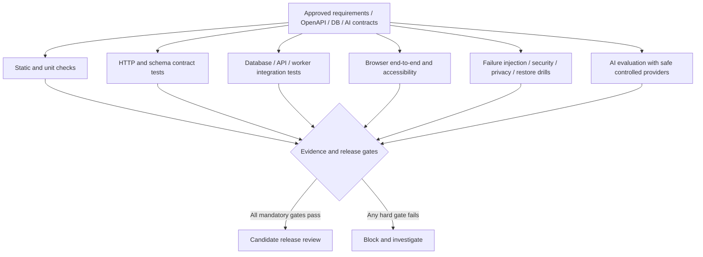
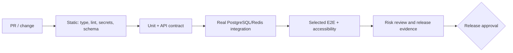

# Founder's Lens — LLD Phase 6A: Testing Strategy & Quality Architecture

**Document ID:** FL-LLD-QA-6A  
**Version:** 0.3 - formal documentation baseline
**Status:** Approved - Documentation Only; FL-P6-0.3-approved. All runtime tests remain Not Executed.
**Canonical directory:** Docs/lld/08-testing-quality/; current review and decisions in Phase6D section16.
**Authority:** Approved SRS and Phase 2D/3/4/5 contracts outrank this draft. Do not change frozen behavior merely to accommodate a test.

> **Source-integrity note.** This draft was informed by the supplied SRS and earlier Phase 3–5 draft files accessible in this conversation, plus the owner's report that `FL-P5-0.4-approved` now exists. The full latest Phase 5 approval manifest, current canonical OpenAPI, Prisma, SQL, and updated Phase 4 technical amendments have **not** been independently inspected in this session. Exact route names, DTO fields, approved test IDs, hash counts and P5-AM01 protocol details must be reconciled against the actual repository in Phase 6D. Nothing below is an executed or verified test.

## 1. Purpose, scope and non-goals

The purpose of Phase 6A is to define **how correctness will be established and evidenced** before Founder's Lens is released. Phase 6A defines: test levels and ownership, environments, realistic data fixtures, execution order, isolation, test evidence, CI gates, release-blocking severity, coverage and traceability, and a minimal verification portfolio. Phase 6B will elaborate security/privacy/reliability threat cases; 6C will elaborate operational observability and AI model evaluation; 6D will reconcile everything and prepare owner sign-off.

**In scope:** Next.js UI, Express/TypeScript REST API, Clerk authentication, PostgreSQL/Prisma/SQL, transactional outbox, BullMQ/Redis, generation/research/PDF/privacy workers, model/research providers, private artifact storage, structured responses, deletion recovery and accessibility. **Out of scope:** coding test suites, choosing final tooling, invoking paid model APIs, deploying any environment, validating runtime behavior, changing approved product decisions, making universal security/conformance claims.

### 1.1 Human glossary

| Term | Short explanation | Example |
|---|---|---|
| Unit test | Tests one behavior using controlled dependencies | Strategy selector chooses one valid strategy |
| Integration test | Tests real cooperation between components | Express + PostgreSQL insert message and outbox together |
| Contract test | Tests the exact request/response agreement | `202` response matches current approved OpenAPI schema |
| End-to-end (E2E) | Runs a founder journey across real interfaces | Sign in → create idea → send → review response |
| Failure injection | Deliberately triggers a failure to test recovery | Worker dies after database commit |
| Fixture | Controlled data state required to run a test | Two different founders with two separate ideas |
| Quality gate | Evidence requirement before merging or releasing | No failing ownership-isolation test |
| Determinism | Same setup produces the same expected outcome | Fixed fake-clock and controlled model output |
| RPO / RTO | Allowed recovery data loss / recovery time | Proposed target must be measured, not assumed |

## 2. Quality principles and source of truth

**QA-P01 — Durable authority.** PostgreSQL-committed state is authoritative for messages, selected assistant responses, memory, experiment records, exports and deletion lifecycle. SSE fragments, Redis queues and browser caches are not.

**QA-P02 — Fail closed for privacy.** Missing/stale authorization, deletion-suppression coverage, foreign resource ownership, or memory version guards must never yield privileged data or automatic approval. Tests must check observable state **and** database effects.

**QA-P03 — At-least-once without duplicate business effects.** Crash, retry, and duplicate queue delivery are expected; the test target is correct idempotency and bounded expensive work, not magical exactly-once delivery.

**QA-P04 — Explicit consent.** Founders approve memory and snapshots; a streamed suggestion or card does not execute a durable action without their authorized command.

**QA-P05 — Honest evidence.** A passed Markdown/OpenAPI/static assertion is recorded only as a static assertion. Mocked-provider results cannot prove real provider behavior. Browser automation cannot alone prove DB integrity. An AI score cannot substitute for a hard privacy gate.

**QA-P06 — No paid tests by default.** Fake model/search providers are used in regular CI. Real-provider evaluation needs explicit approved budget and separate controlled credentials.

**QA-P07 — P5-AM01 restoration safety.** Restoration is gated by independent durable deletion-suppression evidence; unknown or incomplete coverage is a blocking failure, not a best-effort warning. Protocol-specific assertions must be checked against the final approved Phase 5 amendment before implementation.

## 3. Test architecture — what runs at each level



| Layer | What to verify | Main dependencies | What it cannot prove |
|---|---|---|---|
| Static | Type safety, OpenAPI validation, schema compatibility, docs/decision traceability, lint and secret scanning | Source and tooling | Real integrations and restoration |
| Unit | Pure validators, mappings, state transitions, strategy and error rendering | Fakes and deterministic clocks | SQL locks, network races |
| API contract | Methods, routes, auth, headers, errors, DTO/projection versions, stable response shape | Express test instance and approved OpenAPI | Real DB transactions unless backed by DB |
| Persistence integration | Ownership constraints, transactions, optimistic concurrency, immutable snapshots, same-idea links | Real disposable PostgreSQL with actual migration set | UI behavior and provider quirks |
| Queue/worker integration | Outbox dispatch, duplicate delivery, epoch fencing, cancellation and terminal commits | Real PostgreSQL + Redis + worker | Real external-model correctness |
| E2E/browser | Founder journey, route scope, SSE display, accessibility, auth and cache cleanup | Real browser + test auth + integrated stack | All rare interleavings or backup integrity |
| Failure/security/restore | Crash windows, unauthorized read, backup rollback, independent suppression authority, injection and rate policies | Isolated ephemeral environment + fault controls | All possible adversaries / provider outages |
| AI evaluation | Response structure, relevance, evidence provenance, Hinglish, memory control, safety | Curated test corpus + versioned prompts/models | Deterministic model behavior in production |

**Prioritization:** Most cases should live in fast unit and API contract checks. Ownership, data integrity, queue, and deletion safety require real-component integration tests even when slower. A small set of critical journeys should run in actual browsers; do not build an enormous brittle UI-only suite.

## 4. Environment and test data design

### 4.1 Profiles

| Environment | Purpose | Data and network policy | Exit requirements |
|---|---|---|---|
| Developer local | Fast feedback | Docker-backed disposable PostgreSQL/Redis; fake AI/search; local storage adapter | Tests do not touch real user data |
| CI unit/contract | Every PR | Ephemeral credentials, no external billable calls | Reproducible, isolated, failure exits nonzero |
| CI integration | Important PRs and merge gates | Actual migrations/constraints in fresh DB, Redis/workers, fake provider; test clocks and chaos hooks | Database/queue assertions and cleanup succeed |
| Staging / ephemeral E2E | Real browser/auth/provider compatibility checks | Synthetic accounts/ideas, scoped secrets, bounded egress | No data leaks or unauthorized operations |
| Pre-release recovery drill | Disaster recovery and P5-AM01 coverage | Dedicated throwaway backup, independently provisioned suppression source, deliberately old snapshots | Reconciliation before external access proven |
| Production smoke | Post-release minimal read-only and synthetic checks | No destructive test on real customer data | Alerts and rollback criteria actionable |

**No environment is currently claimed to exist.** Provider selection and hosting costs remain deferred. Use separate identity tenants/configurations where supported and verify actual Clerk token behavior at the provider gate.

### 4.2 Fixture catalog

- **Identity:** founder A and founder B; same-email account recreation; expired/revoked token; signed Clerk webhook duplicate/out-of-order payloads.
- **Ownership:** two ideas per founder, foreign idea/conversation, deleted idea, active and deletion-requested accounts.
- **Conversation:** empty transcript, multiple messages, legacy `content:string` and opt-in structured response, selected and superseded generations.
- **Memory:** proposed/approved/removed revisions, stale version, absent or redacted source, in-flight generation referencing removed memory.
- **Research:** disabled automatic admission, admitted in-flight job, source from wrong geography/age, insufficient evidence, corrupted or malicious source text.
- **Learning:** separate experiment title/hypothesis/method/criteria; legacy experiment creation `409 EXPERIMENT_HYPOTHESIS_REQUIRED`; linked Evidence, `LearningEvidence` uniqueness and same-idea constraints; `evidenceLinksRecorded` legacy unknown vs confirmed empty.
- **Snapshots/PDF:** draft, approved immutable version, new draft version, export failure, expired download grant, missing storage object.
- **Reliability:** persisted accepted request with lost response, duplicate idempotency key with same/different payload, stale `If-Match`, queue redelivery, worker crash, slow provider and simulated network cuts.
- **Recovery:** backup older than deletion, independently durable suppression intent, primary commit failed/uncertain/committed, missing ledger segment, lost mirror acknowledgement, account recreation, post-restore stale workers.

Never use real production conversation text as fixtures. Seed data must be deterministic, namespaced, redacted in logs and disposable. Passwords/tokens/provider secrets must not appear in snapshots or CI artifacts.

## 5. Canonical test journey: message to AI answer

```mermaid
sequenceDiagram
  participant F as Founder/browser
  participant A as Express API
  participant D as PostgreSQL
  participant Q as Outbox/Redis
  participant W as AI worker
  participant E as SSE observer
  F->>A: POST message, bearer, idempotency key
  A->>A: Validate identity, ownership, version/state
  A->>D: Transaction: message + attempt + outbox + replay record
  D-->>A: Committed acceptance
  A-->>F: 202 accepted (not final)
  D->>Q: Dispatch eligible outbox intent
  Q->>W: May deliver more than once
  W->>D: Recheck lifecycle, context epoch, selection
  W->>W: Build allowed context; model call
  W-->>E: Live provisional deltas
  E-->>F: Live display only
  W->>D: Guarded terminal commit or safe discard
  F->>A: Authorized GET generation / transcript
  A->>D: Read durable final state
  A-->>F: Committed outcome
```

**Test obligations:** verify authorization before side effects; one accepted logical message despite same-key retries; exactly the intended durable records and outbox intent; no provider call for rejected/foreign requests; worker fencing before model invocation and finalization; terminal selection only after valid commit; lost SSE does not cause duplicate paid work; cancellation races produce one authoritative winner; a lookup returning 404 remains inconclusive and does not auto-resend.

## 6. Contract, state and schema verification

### 6.1 API

Generate or maintain schema assertions against actual canonical OpenAPI, including all current operations and approved compatibility projections. Every documented operation requires: correct authentication mode, ownership, input bounds, method, route, required headers, status codes, error taxonomy, response schema, and the expected idempotency/concurrency behavior. Include `projectionVersion=2` and version 3 experiment creation only where approved by actual current contract. Check that default legacy schemas remain strict and unchanged where promised.

### 6.2 Database

Apply **real** versioned migrations to a fresh database; test constraints not only application-side validation. Verify same-idea composite foreign keys, uniqueness, snapshot immutability, memory revision concurrency, LearningEvidence link semantics, outbox atomicity, account deletion guards and allowed state transitions. Test migration from synthetic legacy data, including empty/unknown source distinction; never claim that designing Prisma or SQL proves a migration works.

### 6.3 State machine and races

Use controlled barriers/latches and two concurrent sessions to make races repeatable. Assert database results after interleavings for: two message submissions; cancellation vs completion; regeneration vs selection; stale memory approval; deletion vs worker finalization; research-off toggle vs admission; snapshot approval vs edits; suppression intent vs commit vs restore.

## 7. Minimum acceptance portfolio — all PLANNED, NONE EXECUTED

Each row specifies a test *design*, not successful behavior. Reuse/cross-link canonical existing scenario IDs rather than renumbering them in the repository; the `QA6A` identifiers below are local draft identifiers.

| Draft ID | Priority | Scenario and required outcome | Verification layer |
|---|---|---|---|
| QA6A-01 | P0 | Foreign founder cannot read/write another idea; no side effects or existence leak | API + DB + security |
| QA6A-02 | P0 | Invalid/expired Clerk credential rejected on REST and authenticated SSE | Provider + API |
| QA6A-03 | P0 | Same-key exact message replay creates one logical message and accepted work | API + DB |
| QA6A-04 | P0 | Different body with reused idempotency identity cannot silently execute | API + DB |
| QA6A-05 | P0 | Crash after message/outbox commit but before queue publish eventually dispatches safely | DB + worker fault |
| QA6A-06 | P0 | Duplicate/late queue delivery cannot duplicate final selection/business effects | DB + worker fault |
| QA6A-07 | P0 | SSE loss does not cancel backend, replay private fragments or auto-create a new generation | API + browser |
| QA6A-08 | P0 | Cancel/complete/regenerate races resolve to one durable selected state | DB + worker race |
| QA6A-09 | P0 | Stale/absent/malformed `If-Match` produces appropriate non-overwriting outcome | API + DB |
| QA6A-10 | P0 | Memory requires founder action; removed memory blocked from future current context, guarded by epochs | API + DB + AI worker |
| QA6A-11 | P0 | AI output follows structured strategy/card/action constraints; default legacy transcript unchanged | Contract + worker |
| QA6A-12 | P0 | Research disabled blocks **new automatic** admissions after settings commit, not accepted/manual jobs | DB + worker race |
| QA6A-13 | P0 | Evidence/source is attribution, not unverified truth; malicious text cannot alter authority | AI evaluation + security |
| QA6A-14 | P0 | Approved snapshot immutable; creating next version never mutates old hash | API + DB |
| QA6A-15 | P0 | PDF grant is private/short-lived; failed export retry requires a new explicit intent | API + storage |
| QA6A-16 | P0 | P5-AM01 independent intent must be durable before primary deletion acceptance | Storage + DB fault |
| QA6A-17 | P0 | Intent committed independently, primary commit lost: unresolved account access blocked until reconciled | Failure injection |
| QA6A-18 | P0 | Older DB restore with incomplete suppression coverage must not expose restored private content | Isolated restore drill |
| QA6A-19 | P0 | Account recreation cannot resurrect prior records or identity association | API + DB + restore |
| QA6A-20 | P0 | Legacy experiment create lacking hypothesis returns documented 409; accepted prior key replays outcome | API contract + DB |
| QA6A-21 | P0 | Versioned create round-trips title/hypothesis/method/criteria without semantic conflation | API + DB |
| QA6A-22 | P0 | LearningEvidence links enforce same idea, uniqueness, delete/purge and unknown-vs-empty state | DB + API |
| QA6A-23 | P0 | Sign-out/deletion clears private browser state and late callbacks cannot redraw it | Browser E2E |
| QA6A-24 | P0 | Critical workflows usable with keyboard, screen reader, zoom, IME and reduced motion | Manual accessibility + E2E |
| QA6A-25 | P1 | Outbox/queue Redis restart, poison jobs, limited retries and DLQ/repair behavior | Integration + ops |
| QA6A-26 | P1 | Delayed provider / quota failure creates honest response with no unapproved paid retry | Worker + AI evaluation |
| QA6A-27 | P1 | Backups restore with verified artifacts, storage grants and lifecycle fences | Restore drill |
| QA6A-28 | P1 | Health/readiness/drain behavior under worker and DB dependency failures | Integration + ops |
| QA6A-29 | P1 | Observability attaches correlation IDs without private prompts or tokens | Integration + security |
| QA6A-30 | P1 | Cross-browser mobile/narrow viewport and long Hinglish composition preserve functionality | Browser E2E |

**Hard-gate rule:** Any demonstrable P0 privacy, ownership, deletion-resurrection, durable-commit, immutable-approval or uncontrolled-paid-execution violation blocks release irrespective of aggregated pass percentages.

## 8. AI-specific quality verification boundary

Keep **structural correctness** separate from **response quality**:

- **Structural:** exactly one primary strategy, zero or one optional card, two or fewer prominent actions, allowed source/reference IDs, schemaVersion correctness, strict opt-in response format, no hidden reasoning leakage. Test with deterministic provider fixtures.
- **Context/privacy:** only approved idea-specific memories, correct owner/epoch/lifecycle, source-traced removal behavior, malicious retrieved text treated as untrusted. Test with carefully staged memory and research fixtures.
- **Qualitative:** founder-centered questioning, evidence caveats, respectful challenge, India-specific relevance, English/Hinglish understanding, actionable experiments and correction handling. Evaluate against versioned, human-reviewed test prompts and SRS rubric.
- **Model/provider:** bounded calls, quotas and budget, observable errors, no automatic paid retry. Real model runs only in an explicitly authorized bounded evaluation environment.

The previously proposed SRS-based six-criterion 0–2 scoring rubric (12-point total) and Phase 3 suggested thresholds are **provisional**; they are not measured quality claims or universally valid release thresholds. Human reviewer calibration and explicit hard privacy gates take precedence.

## 9. CI / CD and quality gates

### 9.1 Proposed pipeline order



**Pull-request baseline:** static scanning, typecheck, unit tests, OpenAPI/contracts and relevant DB integration. **Pre-release:** comprehensive browser/a11y, provider compatibility, privacy/security, migrations, outbox/crash, P5-AM01 restoration and bounded AI evaluation. **Post-release:** non-destructive synthetic smoke and monitoring. Exact cadence and platform (GitHub Actions is a proposed candidate), runner resources and numerical thresholds require later selection and empirical calibration.

### 9.2 Gate taxonomy

| Gate | Must demonstrate | Consequence if absent |
|---|---|---|
| Documentation consistency | Manifest and amendment chain integrity, up-to-date source-to-test links | Do not claim baselined scope |
| Contract | Compatible request/response/auth/headers, controlled schema versioning | Block merge/release of affected component |
| Persistence | Real migrations, constraints, multi-transaction invariants | Block release |
| Privacy/security | Isolation, deletion gates, secret scope, misuse controls | Block release |
| Recovery | Old-backup restore + independent suppression coverage + key recovery | Block deployment with recovery claims |
| Accessibility | Critical journeys verified using keyboard and supported assistive tech | Block accessibility acceptance |
| AI reliability/quality | Structured guarantees, safety/privacy gates and approved evaluation evidence | Block affected AI release |
| Observability | Health, alerts, audit-safe correlation and incident runbooks exist | Block unattended public launch |
| Cost | Explicit approved paid-provider budget and limits | Block billable provider execution |

Avoid arbitrary “100% coverage” policies. Define high-risk path coverage based on requirement traceability and executed outcomes; record missing branches and residual risk explicitly.

## 10. Evidence, reporting and defect triage

For every test record: stable ID; requirement ID(s); design version/manifest; test environment and dependency versions; fixture identifier; exact steps/seed; expected vs actual; outcome (`NOT_EXECUTED`, `PASS`, `FAIL`, `BLOCKED`, `SKIPPED_WITH_REASON`); artifact pointers (redacted); run/commit metadata only when real; issue link; owner and next action. Do not insert invented timestamps or hashes.

**Severity:** `S0` data privacy breach/account resurrection/uncontrolled financial effect → release stop; `S1` core business invariant failure/data corruption → release stop; `S2` major recoverable feature failure → fix before affected release or formally accept risk; `S3` cosmetic/minor → triage. Severity is risk-informed, not a substitute for requirement priority.

**Flaky tests:** quarantine with an owner, issue and expiry; never silently retry failures until green. A failing security or privacy test cannot be demoted to flaky without proving the nondeterministic cause. Real destructive restore tests run only in disposable environments with explicit guardrails.

## 11. Testability requirements for implementation planning

Design for testability without adding production-only bypasses:

1. Adapter boundaries for AI/search/storage and clock injection; fake providers used only in tests.
2. Correlation IDs across HTTP, outbox, queue, worker and final commit, with sensitive payload redaction.
3. Controlled worker hooks or barriers restricted to nonproduction environments for race and crash tests.
4. Stable fixture seed/cleanup and strict separation of identities, databases and storage prefixes.
5. Observable accepted/committed/final lifecycle statuses; no browser assertions based solely on SSE delivery.
6. Database-backed reconciliation inspection for outbox, idempotency and deletion intents.
7. Dedicated restore drill environment capable of withholding the independent suppression authority and simulating stale snapshots.
8. Provider contract tests with bounded credentials; do not allow test secrets into browser bundles or logs.

## 12. Traceability and implementation ordering

**Canonical traceability owner:** the approved SRS requirement IDs, Phase 2D integration acceptance matrix, Phase 3D AI evaluation cases, Phase 4D frontend scenarios and Phase 5D restoration cases. During Phase 6D, Codex must attach exact IDs and source paths to each QA6A case and identify uncovered requirements. This draft does not fabricate a fully reconciled 53-operation or 47-FR coverage report.

Suggested build-and-test slices (not authorization to implement):

1. Schema/migrations and account/idea ownership + forbidden-resource tests.
2. Basic idea/conversation/message commands with idempotency, outbox and worker harness.
3. Generation selection/SSE/status, cancellation and retries with crash barriers.
4. Memory, research and experiment/learning relation/versioning tests.
5. Snapshot/PDF export immutability and download safety.
6. Account deletion, independent suppression intent, restoration tests and account recreation.
7. Full accessible browser journey and bounded AI quality evaluation.

**Do not defer privacy/recovery tests entirely until the end:** implement their harness and early contracts alongside the relevant persistence/identity foundations, then execute full restore drills before release.

## 13. Decisions, unknowns and sign-off requirements

| ID | Decision / dependency | Proposed direction | Status |
|---|---|---|---|
| QA6A-D01 | Test framework choices | Select lowest-complexity tooling compatible with TypeScript, Prisma and Next.js; measure CI cost first | Pending technical selection |
| QA6A-D02 | Real integration environment | Disposable actual PostgreSQL and Redis; deterministic fake providers | Proposed, pending review |
| QA6A-D03 | Public demo/release policy | No public release until privacy/security/recovery/a11y gates produce real evidence | Proposed, pending review |
| QA6A-D04 | Model evaluation thresholds | Preserve Phase 3 provisional rubric; calibrate on labeled corpus | Deferred numerical approval |
| QA6A-D05 | RPO/RTO and backup retention | Align Phase 5 approved provisional design; benchmark via drills | Deferred numerical/provider approval |
| QA6A-D06 | Independent deletion ledger validation | Verify P5-AM01 evidence completeness, durability, enumeration and restore interlock | P0 execution blocker; design approved |
| QA6A-D07 | CI/CD environment and credentials | GitHub Actions candidate only, zero unapproved spending | Provider verification pending |
| QA6A-D08 | Accessibility support matrix | Set browser/assistive-tech versions and verify critical journeys | Pending test-environment choice |
| QA6A-D09 | Canonical source mapping | Reconcile against current repository manifests, OpenAPI, schema and all inherited tests | Required before Phase 6 approval |

**Entry to Phase 6B:** Phase 6A draft reviewed for completeness; exact identifiers mapped in the repository; no assumption that tests ran.

**Phase 6A approval is not granted by this draft.** Full Phase 6 will require security/privacy detailed checks (6B), AI/operational observability (6C), source-exact reconciliation and an explicit owner sign-off (6D). All planned acceptance scenarios above are `NOT_EXECUTED`.

## 14. Interview-ready design summary

**Q: What is your test strategy?** “I prioritize risk-based verification: fast unit and contract tests for feedback, real PostgreSQL/Redis integration for persistence and queue correctness, browser end-to-end tests for founder journeys, and failure-injection drills for deletion recovery. I separate AI structural guarantees and privacy safety from subjective output quality.”

**Q: Why not test everything with mocks?** “Mocks can't prove SQL constraints, race ordering, job recovery, provider-token handling or suppression-ledger durability. They are useful for fast, repeatable tests, but critical invariants require real components.”

**Q: What happens if CI is green but deletion recovery was never tested?** “The release is blocked for that risk. Passing static and unit tests cannot prove that restoring an old backup won't expose deleted information.”

**Q: What's currently proven?** “The project's documentation manifests and consistency checks were reported verified by Codex. Runtime correctness, migration, security, recovery, accessibility and AI evaluations have not been executed.”

---

**Handoff to 6B:** Threat-driven security, privacy and reliability test architecture; identity/deletion abuse cases, authorization, SQL/Prisma constraints, worker race and P5-AM01 fault injection; no implementation or test execution.


## Current repository reconciliation

Phase6D section16 supersedes historical source-unavailable/intake statuses and owns the current discrepancy register, API/requirements traceability and validation. Actual canonical path is Docs/lld/08-testing-quality/. Phase3 six-dimension0-2 rubric governs AI quality; privacy/security/cost/deletion failures are independent hard release blockers. Approved P5-AM01 distinguishes durable intent from committed deletion; unresolved suppression blocks access and restore, not merely alerts. Local-first Compose, deferred public demo/cloud, GitHub Actions proposed direction and founder development operator are inherited Phase5 decisions; actual eligibility/public incident responsibility remain pending. All runtime/database/browser/SDK/security/AI/recovery/performance scenarios remain Not Executed. No provider/tool is installed or selected. Candidate FL-P6-0.2-review - Not Approved; no Phase7 authorization.


## Current operational direction approvals

The owner explicitly approved the six Phase6 operational directions in this conversation. Phase6D section17 owns current decision references/dispositions and supersedes earlier pending-direction labels. Telemetry minimizes personal data with short documented retention, exact durations provisional; only authorized operators may access it, with access-audit evidence. Ordinary logs exclude founder prompts/message bodies, credentials, hidden AI context and private download grants, including automatic exceptions. Prefer minimal TypeScript-compatible tools, exact libraries/versions unselected. Browser plan covers Chromium,Firefox,WebKit plus real mobile/assistive technology when devices are available; unavailable combinations remain explicitly untested. All numerical thresholds require calibration and explicit acceptance. Founder owns development incidents; public roles/escalation must be assigned before launch. Directions are approved design only, not installed tools, secure operational storage, executed tests or final package approval. Candidate FL-P6-0.3-review - Not Approved. Existing security/privacy/deletion/spend hard gates and exact Phase3 six-dimension0-2 rubric remain binding. No frozen specification amendment or Phase7 work.


## Formal documentation approval - current status

FL-P6-0.3-approved - Approved, Documentation Only. Owner evidence is the explicit Phase6 formal documentation sign-off instruction in this conversation. No date/timestamp, signature or Git commit is inferred. Phase6D section18 and approved-revision-0.3.json govern current package status. Earlier pending/draft/review labels remain historical; no runtime finding is closed by approval. All database/migration/security/SDK/worker/restore/browser/accessibility/AI/performance/provider/cost-control verification remains Not Executed. Exact numerical targets remain provisional; AI-D14 remains accepted pending controlled HLD editorial amendment. No implementation, installation, spending, migration, test execution, monitoring provisioning, deployment or Phase7 authorization.
