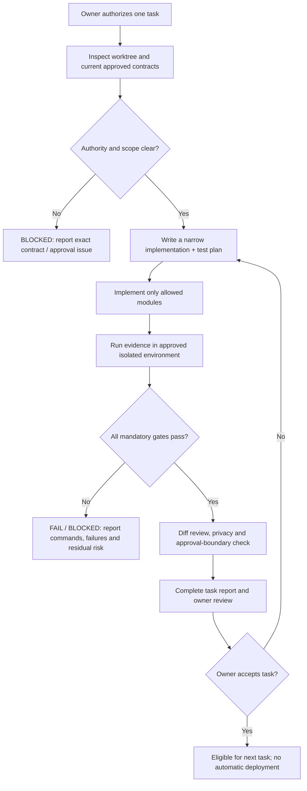

# Founder's Lens — LLD Phase 7C: Codex Task Specifications & Quality Gates

**Document ID:** FL-LLD-IMP-7C  
**Version:** 0.2 - formal documentation baseline
**Status:** Approved - Documentation Only; FL-P7-0.2-approved. M00 and all implementation remain unauthorized.
**Proposed repository path:** `Docs/lld/09-implementation-planning/codex-task-specifications-quality-gates.md` (Codex must verify the actual repository convention)  
**Audience:** Founder, Codex implementation agent, software architect, security and test reviewers  
**Scope:** Task contract, task decomposition, bounded agent permissions, implementation quality gates, acceptance evidence, design-change escalation, and review handoffs. **No application code, dependency installation, migration execution, provider call, test execution or deployment.**

> **Source boundary.** This document was drafted after directly inspecting Phase 7A v0.1 (`implementation-strategy-repository-architecture.md`) and Phase 7B v0.1 (`implementation-milestones-vertical-slices.md`). Their M00–M11 milestone names, dependencies and 36 `IMP7B-01`–`IMP7B-36` proposed evidence IDs are preserved. The latest canonical local Windows repository, its approved OpenAPI, Prisma/SQL files and approval manifests were **not directly verified for this draft**. Phase 7D and the implementation preflight must reconcile all references against the actual repository, including approved Phase 2D–6 revisions. No illustrative code path or task number below creates an API/DB contract.

## 1. Executive policy

A **Codex task** is a single, auditable change request with a bounded result, known architectural authority, an explicit allowed-change scope, required negative/failure tests, and a completion report. It is not an invitation to implement the next convenient feature or refactor unrelated files. Finish one task and review its evidence before starting another. The owner separately authorizes actual implementation after Phase 7 sign-off.

**Never substitute:** a passing type check for a real PostgreSQL constraint, a mocked worker for a crash-recovery test, a locally successful AI call for safe paid usage, a UI screenshot for accessibility proof, or an approved documentation manifest for working software.

**Hard defaults:** only synthetic data; deterministic fake external providers; no paid model/search calls; no real founder accounts; no cloud provisioning; no production migration; no unapproved package; no silent edits to approved design or approval manifest; no private message or secret logging.

## 2. Fundamentals — precise Q&A

| Interview question | Correct practical answer |
|---|---|
| What is a task specification? | A contract stating the intended behavior, exact authority, allowed changes, required proof and stop conditions for one coding change. |
| What is a quality gate? | A check that must succeed before a task or milestone may advance. |
| What is contract drift? | Code or tests disagreeing with the approved API, data or state contract; the solution is to stop and reconcile the specification, not guess. |
| What is a vertical slice? | A small founder-visible action traversing whichever UI/API/DB/worker layers are necessary, with evidence at each relevant layer. |
| What is a deterministic fake? | A test substitute whose responses and failure modes are controlled and repeatable, not a real paid external integration. |
| What is a failure injection? | Deliberately triggering a controlled crash, timeout, race or rejected operation to inspect recovery. |
| What is a release blocker? | A condition that independently prevents public access; privacy, security, deletion safety and unauthorized spending are hard blockers. |
| Why preserve historical manifests? | They prove the approved documentation baseline; new amendments must be traceable rather than rewriting approval history. |

## 3. Authority and decision boundaries

1. **Canonical repository preflight is mandatory.** Inspect `Docs/README.md`, current Git status, approved manifests `FL-P2D-1.0-approved`, `FL-P3-0.3-approved`, `FL-P4-0.5-approved`, `FL-P5-0.4-approved`, `FL-P6-0.3-approved`, actual OpenAPI/route inventory, Prisma/SQL, relevant human-readable contracts and test plans. Verify that the named files exist and current fingerprint chains hold. Do not use this Phase 7C draft as the source of exact DTO fields.
2. **Human-approved decisions outrank illustrative plans.** Keep Express (ADR-013), direct browser-to-Express session Bearer, PostgreSQL authority, outbox + BullMQ/Redis, live-only SSE, independent workers and no BFF or new microservice.
3. **Implementation is separately gated.** Owner approval of this design does not authorize coding, migrations, providers, spending, public hosting or release. Each future coding task must be explicitly launched and reviewed.
4. **Design mismatch escalation.** If a schema, provider constraint or edge case requires changing an approved contract, stop. Describe the conflicting evidence, options, impact and proposed controlled amendment; no speculative implementation.
5. **AI-D14:** the pending controlled HLD direct-model-arrow editorial correction is tracked, not silently edited during feature work.

## 4. Single-task lifecycle



**Task states:** `DRAFT` → `AUTHORIZED` → `IN_PROGRESS` → `PASS` / `FAIL` / `BLOCKED` → `OWNER_ACCEPTED`. A planned test remains `NOT_RUN` until its actual command, target environment and result exist. `PASS` is conditional on the specified evidence, not on an assistant assertion.

## 5. Standard Codex implementation-task contract

Every future task must use these fields. Fields referencing API or Prisma types must be populated from the inspected current repository, **not inferred** from this document.

```text
Task ID: IMP7C-Mxx-Tyy
Milestone / vertical slice:
Objective and founder-visible outcome:
Explicit owner authorization and scope:
Prerequisite task IDs and evidence:
Source of truth: exact approved manifest revision + source paths/sections:
SRS FR/AT IDs:
Canonical OpenAPI operation IDs, HTTP methods, paths, headers, DTOs, statuses:
Prisma models, SQL guards, transactions and ownership predicates:
Phase 6 test scenario IDs and IMP7B evidence IDs:
Expected state changes and non-effects:
Allowed files/modules:
Forbidden files/actions:
Auth, lifecycle, idea-scope and deletion boundaries:
Idempotency, concurrency, cancellation and race considerations:
External provider / cost policy: deterministic fake by default:
Tests: unit / contract / real DB / worker / browser / security / recovery:
Faults and negative cases:
Commands to run and environment requirements (derived at task start):
Artifacts/evidence required (redacted):
Acceptance conditions and stop triggers:
Result: NOT_RUN | PASS | FAIL | BLOCKED | NOT_APPLICABLE
Owner acceptance: PENDING until explicitly recorded
```

### 5.1 Task prompt template (copy for future implementation, not to execute now)

> **Future Codex instruction:** Implement only `[Task ID]` after explicit owner authorization. First read current approved specifications and `git status`; return an exact file allowlist and verification plan. If a contract, migration, paid-provider, secret, provider SDK, environment or security decision is ambiguous, stop and ask for a controlled decision. Use deterministic synthetic fixtures; do not access real founder data or make paid external calls. Do not modify approved docs/manifests except through separately authorized amendment. Run only relevant authorized tests; record commands, outputs, environment, failures and unexecuted tests. Submit a concise diff summary and ask for owner acceptance. Do not automatically proceed to the next task.

## 6. Global engineering quality gates

| Gate | Required evidence before acceptance | Stop/fail condition |
|---|---|---|
| G0 — Baseline | Current manifest integrity and route/schema mapping; worktree diff inspected | Approved contract mismatch, unknown worktree edits |
| G1 — Scope and imports | Review limited changed files, imports and package/secret boundaries | Browser imports server-only credentials, unexpected service/library |
| G2 — Build and types | Real commands, exit codes; relevant static/TypeScript/schema checks | Failed checks or claimed results without actual run |
| G3 — Behavioral contract | HTTP method/header/status/DTO fixture checks, negative responses | Undeclared endpoint/field, unverified compatibility |
| G4 — Security/authorization | Owner/idea/lifecycle checks with at least two synthetic principals | Cross-founder access, unsafe deleted-account behavior |
| G5 — Concurrency/persistence | Real local PostgreSQL transactional, FK and stale-version tests where relevant | Duplicate effect, stale overwrite, broken invariants |
| G6 — Background reliability | Outbox/Redis/worker dedup, crash and selection tests for async tasks | Lost committed work, second final commit, paid retry ambiguity |
| G7 — UX/browser/accessibility | Relevant browser and keyboard evidence; honest provisional state labels | False Saved/Completed state or blocking critical accessibility issue |
| G8 — Privacy and telemetry | Secret/log inspection, cache invalidation, provenance and scope evidence | Private prompt/token/debug data leakage |
| G9 — Cost and providers | Fake adapters, quota-denial tests; provider permission separately verified | Unapproved model/search invocation or billable retry |
| G10 — Review and handoff | Exact test matrix, diff, unresolved issues and explicit owner acceptance | Missing proof, unexplained changes or automatic next milestone |

**Application:** Some gates are `NOT_APPLICABLE` for a pure repository setup task, but the task must explain why. A `NOT_RUN` required gate cannot be relabeled `PASS`; it remains a blocker to acceptance at the level that needs it. Integration and real restoration proof cannot be satisfied by pure unit mocks.

## 7. Task-by-task execution plan (all tasks PLANNED, not authorized)

Each milestone has two proposed bounded tasks. The list is a **starting decomposition**; Codex must refine file allowlists and exact contract IDs against the canonical repo at M00, rather than treating task names as authority. All `IMP7B-*` references are proposed evidence obligations from Phase 7B.

### M00 — Approved-baseline preflight

**IMP7C-M00-T01 — Inspect repository and approval chain.** Verify Git status; discover existing code and documentation; validate Phase 2D–6 manifests and controlled amendment chains; list version mismatches and acceptable AI-D14 exception. **Allowed:** read-only inspection, a separately authorized implementation planning report. **Do not:** reformat approved docs, scaffold code or assume an empty project. **Evidence:** actual manifest verification and diff inventory. **Gate:** G0/G10. **Maps:** IMP7B-01.

**IMP7C-M00-T02 — Produce exact code-to-contract matrix.** Map *current* 53 reported operations (50 founder-facing reported) to SRS FR/AT, DTO/headers, Prisma and Phase 6 tests; update counts if actual authoritative repo differs and stop on unexplained drift. **Allowed:** planning/evidence artifact only. **Evidence:** route-by-route matrix and implementation task dependencies. **Gate:** G0/G3/G10. **Maps:** IMP7B-02.

**Stop condition:** no code scaffold until current contract/manifest and actual repository state are verified.

### M01 — Minimal local workspace and independently running processes

**IMP7C-M01-T01 — Create minimal verified workspace.** After explicit coding authorization, scaffold only necessary Next.js frontend, Express API, worker and outbox-dispatch lifecycle entry points, with shared TypeScript configuration as needed. Verify package versions and a single lockfile; avoid premature shared packages. **Allowed:** workspace/tooling/new shell files; **forbidden:** business routes, paid integrations, production secrets, deployment. **Gate:** G0–G2/G8/G10. **Maps:** IMP7B-03/04.

**IMP7C-M01-T02 — Local dependencies and process health.** Provide local-only PostgreSQL/Redis configuration, deterministic fake interfaces, readiness/shutdown boundary and tests; ensure private services are not unintentionally internet-exposed. **Gate:** G1/G2/G6 as applicable/G8/G10. **Maps:** IMP7B-03/05.

**Stop condition:** provider, Docker or OS problems reported with evidence; no unapproved cloud fallback.

### M02 — Persistence, identity and authorization

**IMP7C-M02-T01 — Implement reviewed local schema and constraints.** Inspect approved Prisma schema, SQL guards and P4-B02 LearningEvidence mapping before generating local-development migrations; separately authorize any schema execution on an isolated DB. Test uniqueness, same-idea links, versions and rollback behavior with real PostgreSQL. **Gate:** G0/G2/G5/G8/G10. **Maps:** IMP7B-06.

**IMP7C-M02-T02 — Identity, ownership and deletion access gates.** Add Clerk authentication adapter only after SDK verification, owner/idea/lifecycle authorization and P5-AM01 independent-authority fail-closed interface. Validate synthetic cross-account cases and expiry; do not falsely declare full restore proof. **Gate:** G3/G4/G5/G8/G10. **Maps:** IMP7B-07/08.

**Stop condition:** unknown Clerk trust claims, unsafe suppression boundary or destructive migration plan.

### M03 — Create and reopen ideas/conversations

**IMP7C-M03-T01 — Authorized idea and conversation API slice.** Implement only actual canonical methods, response DTOs and version/idempotency requirements needed for idea and conversation creation/list/read, including safe non-keyed-create ambiguity. **Gate:** G3–G5/G10. **Maps:** IMP7B-09/11.

**IMP7C-M03-T02 — Minimal founder navigation and re-entry.** Build accessible Think/idea chooser and conversation route using session-scoped browser cache; test direct URL, refresh, foreign/missing idea and back-forward behavior. **Gate:** G1/G4/G7/G8/G10. **Maps:** IMP7B-09/10/11.

### M04 — Durable message acceptance (without AI calls)

**IMP7C-M04-T01 — Atomic message submission.** Implement canonical request validation, submission identity, idempotency ledger, message sequence, generation attempt and transactional outbox in *one appropriate DB transaction*. Assert original-result replay, payload-mismatch rejection and concurrent request behavior. **Gate:** G3/G4/G5/G6/G10. **Maps:** IMP7B-12/13.

**IMP7C-M04-T02 — Unknown-acceptance UX and read-only lookup.** Implement approved owner-scoped submission lookup and lost-202 recovery; no auto-resend after refresh or inconclusive 404; session-scoped opaque identifier handling per privacy policy. **Gate:** G3/G4/G7/G8/G10. **Maps:** IMP7B-14.

**Stop condition:** one click can create two durable user messages/paid job intents; do not continue to real AI.

### M05 — Durable job processing and fake generation

**IMP7C-M05-T01 — Outbox dispatcher and resilient queue handoff.** Implement outbox claiming, publication, retriable dispatch and observability against real local PostgreSQL and Redis; inject publish crash and duplicate delivery. **Gate:** G5/G6/G8/G10. **Maps:** IMP7B-15/16.

**IMP7C-M05-T02 — Fake worker, generation lifecycle and cancel/regenerate.** Enforce approved six-state lifecycle, lease/context-epoch checks, selected-response final commit, explicit cancellation/regeneration and complete Generation DTO/status; prove races and duplicate execution with deterministic fake model. **Gate:** G3/G4/G5/G6/G9/G10. **Maps:** IMP7B-16/17.

**Stop condition:** queue replay causes duplicate selected response or status reports a noncommitted completion.

### M06 — Approved context, structured response and live SSE

**IMP7C-M06-T01 — Context builder and guarded assistant finalization.** Load only authorized, active, approved memory and idea-specific context; enforce lineage/epoch and untrusted-research boundaries; validate one primary strategy, 0–1 card, ≤2 prominent actions and legacy/opt-in transcript compatibility. **Gate:** G3–G6/G8/G9/G10. **Maps:** IMP7B-18/20/21.

**IMP7C-M06-T02 — Authenticated live-only SSE observer.** Implement bearer-authenticated streaming, provisional fragments, terminal status notifications and authoritative GET reconciliation; test disconnects, absent terminal event, expiry and reconnect without fragment replay. **Gate:** G3/G4/G6/G7/G8/G10. **Maps:** IMP7B-19.

**Stop condition:** browser displays partial streaming data as a committed saved response.

### M07 — Memory review and bounded research

**IMP7C-M07-T01 — Version-safe memory proposal workflows.** Implement minimal provenance projection, actual proposedText/version, explicit accept/edit/dismiss with If-Match and target-version checks; removal excludes active context through lineage/fencing. Test two tabs and foreign/deleted source. **Gate:** G3–G5/G8/G10. **Maps:** IMP7B-22/23.

**IMP7C-M07-T02 — Research admission and source display.** Implement committed conversation-level proactive research toggle, durable bounded research job, quota denial, evidence provenance, safe external-content handling and synthetic search results; no implicit global research flag or paid service. **Gate:** G3–G6/G8/G9/G10. **Maps:** IMP7B-24.

### M08 — Assumptions, experiments, evidence and learning

**IMP7C-M08-T01 — Experiment and evidence API roundtrip.** Implement approved v3 experiment title and independent hypothesis; fresh legacy create 409 `EXPERIMENT_HYPOTHESIS_REQUIRED`, original accepted replay; save/read method, success criteria and same-idea linked evidence. **Gate:** G3–G5/G8/G10. **Maps:** IMP7B-25/27.

**IMP7C-M08-T02 — Learning capture and return journey.** Implement distinct observation/interpretation, approved LearningEvidence association and `evidenceLinksRecorded` legacy-unknown versus explicit-empty semantics, atomic linking, duplicate control and authorized readback. Prove purge ordering. **Gate:** G3–G5/G7/G8/G10. **Maps:** IMP7B-26/27.

**Stop condition:** missing historical evidence is silently converted to “none,” or a title substitutes for an absent hypothesis.

### M09 — Approved snapshots and private PDF delivery

**IMP7C-M09-T01 — Immutable snapshot approval/versioning.** Implement creation through existing POST, guarded draft approval and immutable approved content/hash, new draft creation without fork endpoint. Test stale-version and racing approvals. **Gate:** G3–G5/G8/G10. **Maps:** IMP7B-28.

**IMP7C-M09-T02 — Bounded fake PDF export and short-lived download grant.** Durable export/outbox/worker, private artifact adapter and scoped expiring grants; test failed job explicit reissue with new key, stored-hash immutability and foreign/expired grants. No public object bucket. **Gate:** G3–G6/G8/G9/G10. **Maps:** IMP7B-29/30.

### M10 — Deletion safety and recovery proof

**IMP7C-M10-T01 — Independent deletion-intent acceptance and purge execution.** Implement P5-AM01 verified independent authority, durable intent before primary commit, committed/unresolved/reconciled suppression states, idempotent deletion, lifecycle fencing and limited status recovery. Rehearse lost reply, primary commit failure and stale worker work in a truly isolated test environment. **Gate:** G3–G6/G8/G10; **privacy hard gate**. **Maps:** IMP7B-31/33.

**IMP7C-M10-T02 — Real old-backup restoration exercise.** Back up primary DB, commit a deletion with independent authority, restore a *pre-deletion* backup in isolation, prove closed access until ledger completeness and suppression reconciliation, including unavailable/partitioned independent authority. Use actual independently durable failure boundary, not one PostgreSQL database posing as two independent stores. **Gate:** G4/G5/G6/G8/G10; **release hard blocker**. **Maps:** IMP7B-32/33.

**Stop condition:** coverage is unverifiable and private access could reopen; do not release or claim recovery safety.

### M11 — End-to-end quality and release assessment

**IMP7C-M11-T01 — Founder journeys, security and accessibility.** Run full authenticated cross-layer flows on a test environment, multiple browser engines and available mobile/assistive tech; demonstrate no unsafe cross-owner access, stale cache, broken keyboard focus or false final status. **Gate:** G3–G8/G10. **Maps:** IMP7B-34/36.

**IMP7C-M11-T02 — AI, cost, monitoring and recovery decision packet.** Evaluate approved six 0–2 dimensions using versioned synthetic/evaluation data; independently assess privacy/security/deletion/spending hard gates, cost accounting, alerts and documented restore evidence. Provisional thresholds remain proposals pending calibration. Produce release decision packet; no automatic public deployment. **Gate:** G4–G10. **Maps:** IMP7B-35/36.

## 8. Detailed acceptance matrix (task-to-existing evidence)

| Milestone | Codex task IDs | Phase 7B evidence IDs | Primary evidence kind | Current status |
|---|---|---|---|---|
| M00 | M00-T01/T02 | 01–02 | Approved manifests, operation/requirement inventory | NOT_RUN |
| M01 | M01-T01/T02 | 03–05 | Local process, type, readiness and import isolation | NOT_RUN |
| M02 | M02-T01/T02 | 06–08 | Real local DB, two-principal auth, deletion gate | NOT_RUN |
| M03 | M03-T01/T02 | 09–11 | API/browser idea and conversation journey | NOT_RUN |
| M04 | M04-T01/T02 | 12–14 | Ledger concurrency, lost-202 recovery | NOT_RUN |
| M05 | M05-T01/T02 | 15–17 | Queue crash, redelivery, cancellation races | NOT_RUN |
| M06 | M06-T01/T02 | 18–21 | Context, streaming, schema and budget tests | NOT_RUN |
| M07 | M07-T01/T02 | 22–24 | Memory version/provenance, research admission | NOT_RUN |
| M08 | M08-T01/T02 | 25–27 | Experiment and learning field roundtrip | NOT_RUN |
| M09 | M09-T01/T02 | 28–30 | Snapshot immutability and private grants | NOT_RUN |
| M10 | M10-T01/T02 | 31–33 | Independent suppression and real old-backup restore | NOT_RUN |
| M11 | M11-T01/T02 | 34–36 | E2E/accessibility, evaluated AI and release packet | NOT_RUN |

**Validation mapping instruction:** At the real M00 preflight, expand every `IMP7B-##` into `actual SRS FR/AT → current OpenAPI operationId → Prisma model/SQL guard → Phase 6 scenario ID → exact test command/evidence`. Do not invent operationIds or claim already-complete case-level mappings. The task IDs above are proposed and do not replace the approved Phase 6 matrix.

## 9. Evidence and report format

Every implementation agent must produce a **reviewable task completion record**:

```text
Task ID / status:
Owner authorization source:
Repository revision / worktree summary:
Approved design versions inspected:
Files changed (exact list):
Contract version / DTO / DB mappings confirmed:
Tests executed (command, environment, exit code, results):
Tests required but NOT_RUN (and reason):
Negative/failure/race evidence:
Security/privacy/cost gate results:
Known limitations / follow-up decisions:
Unapproved providers, migrations and spending: NONE (unless independently authorized)
Diff/commit info (actual only; never invented):
Owner acceptance: PENDING
```

A task should not claim `PASS` if its essential verification did not run. If tests are blocked by unavailable tooling, report `BLOCKED` with precise setup prerequisites. Redact tokens, prompts, personal data and secrets from logs and attachments.

## 10. Review sequence and stop-the-line escalation

- **Before each task:** confirm explicit authorization, exact scope, worktree baseline, current contracts and cost/provider restrictions.
- **During task:** if an approved API, storage mapping, deletion guarantee or version condition conflicts with reality, stop before implementing a workaround; produce a discrepancy proposal.
- **After implementation:** test the narrow feature plus its negative and one relevant failure/race; perform diff/privacy review.
- **Between tasks:** require a recorded owner acceptance and fresh context on any modified contract. Never continue from M04 to paid AI just because fake generation works.
- **Before public access:** independently complete real privacy recovery, security, accessibility, spending and AI evaluation gates; public hosting/provider configuration needs separate decision.

## 11. Phase 7C documentation acceptance checklist

- [ ] Current repository and Phase 2D–6 approved manifest chain verified by Codex during Phase 7D / M00.
- [x] Proposed 24 task IDs cover M00–M11 without merging unrelated change boundaries.
- [x] Original Phase 7B `IMP7B-01`–`IMP7B-36` coverage preserved; all **NOT_RUN**.
- [x] Tasks distinguish allowed and prohibited work and name relevant gate categories.
- [x] P4-B01 legacy 409, P4-B02 evidence marker and P5-AM01 independent suppression appear as explicit obligations.
- [x] SSE finality, versioning, idempotency, privacy and cost restrictions appear before provider enablement.
- [x] Templates specify command-level evidence and truthful runtime statuses.
- [ ] Exact operation IDs, DTOs, Prisma names and Phase 6 test IDs filled from current approved repo (not possible from this draft alone).
- [ ] Task and framework choices reviewed for compatibility before implementation.
- [ ] No application implementation or test execution claimed.

## 12. Decisions to carry into Phase 7D

| Decision/gap | Proposed treatment | Next authority |
|---|---|---|
| Repository layout and package manager | Minimal monorepo; verify actual project and versions first | M00/M01 owner-controlled implementation choice |
| Clerk and frontend session transport | Direct session Bearer retained; verify real SDK implementation | Approved security contract and provider test |
| Local independent suppression authority | Must meet P5-AM01 independent durability/enumeration; cannot be simulated by same rolled-back DB | Phase 7D architecture compatibility and M10 fault proof |
| Experiment legacy-create rollout | Fresh unsupported legacy create returns specified 409; original accepted commands replay | Current OpenAPI and compatibility tests |
| AI model/search/paid spend | Fake providers by default; no unapproved paid work | Separate explicit owner approval |
| Real storage, public cloud, numeric targets | Deferred, provider-neutral; no guarantee of ₹0 public stack | Phase 5/6 operational decision gates |
| AI-D14 HLD editorial correction | Accepted, pending controlled HLD amendment | Separate documentation change |

## 13. Phase 7C integration handoff

**Files to reconcile in Phase 7D:** Phase 7A, 7B and this 7C document; canonical `Docs/README.md`; approved Phase 2D–6 manifests; current OpenAPI/route inventory, Prisma/SQL, Phase 6D traceability and relevant decision logs.

**Required Phase 7D outputs:** source-exact task/contract traceability, milestone dependency audit, release and migration authorization boundaries, open decisions, validation plan, discrepancy register and documentation sign-off readiness. Do not approve Phase 7 without explicit owner instruction; do not create an implementation project or start M00 coding in a documentation-only task.

**Current disposition:** **Phase 7C v0.1 drafted; NOT APPROVED.** All 24 task cards and 36 Phase 7B evidence IDs remain proposed, **NOT_RUN**, pending canonical repository reconciliation.


## Current canonical reconciliation

Actual directory: Docs/lld/09-implementation-strategy/. Phase7D section14 owns current findings, task/API/SRS/evidence maps and readiness. Earlier source-unavailable/intake statements are historical. Candidate FL-P7-0.2-review - Not Approved. Original12 milestones,24 parent tasks,36 Phase7B evidence IDs and18 findings retained. M02 suppression-aware access is prerequisite to private features; M10 completes real deletion/restore proof. Child verification steps preserve parent IDs and require explicit future allowed-path authorization. All runtime/tests remain NOT_RUN. No M00,scaffold,dependency,migration,provider,deployment orimplementation authorized.


## Formal documentation approval - current status

FL-P7-0.2-approved - Approved, Documentation Only under IMP7D-A01. Evidence is the owner''s explicit Phase7 formal documentation sign-off instruction in this conversation, subject to successful static verification. No approval timestamp, signature or Git commit is inferred. Phase7D section15 and approved-revision-0.2.json govern current status. Earlier draft/pending/unapproved labels are preserved historical review stages, not current package status. Approval covers the plan only; all24 task cards and36 behavior scenarios remain unexecuted. M02 suppression-aware access remains prerequisite; M10 independent deletion/restore proof remains a release gate. Exact tools, future code allowlists, provider choices, runtime evidence and AI-D14 remain deferred as documented. No M00,coding,scaffolding,installation,migration,runtime tests,provider calls,spending,provisioning ordeployment authorized.
