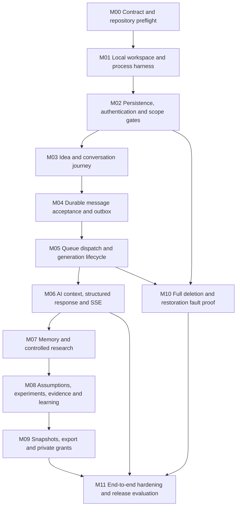

# Founder's Lens — LLD Phase 7B: Implementation Milestones & Vertical Slices

**Document ID:** FL-LLD-IMP-7B  
**Version:** 0.2 - formal documentation baseline
**Status:** Approved - Documentation Only; FL-P7-0.2-approved. M00 and all implementation remain unauthorized.
**Proposed repository path:** `Docs/lld/09-implementation-planning/implementation-milestones-vertical-slices.md` (verify actual directory in Codex)  
**Audience:** Founder, implementation lead, Codex, QA/security reviewers  
**Scope:** Sequence, dependencies, vertical slice definitions, acceptance criteria, verification evidence, cost and privacy stop conditions. **No executable code, installed packages, migrations, test execution, provider calls or deployment.**

> **Source and certainty boundary:** This plan is derived from the actual available Phase 7A v0.1 document and the owner's reported approved Phase 2D–6 revisions. The updated canonical Windows repository, final OpenAPI/Prisma source and approval manifests are **not available for direct verification here**. Codex must reconcile every milestone and API field against the active approved repository before implementation. Named milestone IDs, package layout and proposed scope are **planning recommendations, not new approved contracts**. The actual Phase 7A document was inspected, including its eight strategic phases, outbox/worker graph, hard quality gates and sixteen proposed checks.

## 1. Executive recommendation

Implement Founder's Lens as **small vertical slices**, where each slice delivers one founder-observable behavior across the necessary frontend, Express API, domain rules, PostgreSQL, independent workers and tests. The earliest milestones establish trust boundaries and prove reliable state transitions with **synthetic data and fake providers**. Add external models, public hosting and production configuration only after explicit authorization and safety gates.

**Principles:**

1. Preserve the Next.js, Express, Clerk, Prisma/PostgreSQL, BullMQ/Redis, outbox and independent worker design.
2. Build **one accepted operation at a time**, not all API routes or all screens at once.
3. PostgreSQL owns durable truth; browser state and SSE fragments are provisional.
4. Verify ownership, lifecycle and deletion gates in each relevant slice—not as a late security patch.
5. Require version safety, idempotency and no unapproved paid work before introducing real provider traffic.
6. Trace each completed slice to a canonical SRS requirement, OpenAPI operation, DB mapping and Phase 6 planned test.
7. One passing unit test does not imply integration, browser, privacy, provider or release readiness.

## 2. Terminology — quick interview-ready Q&A

| Question | Answer |
|---|---|
| What is a vertical slice? | A small, usable behavior across the layers needed to deliver it, with its own verification evidence. |
| What is a milestone? | A review checkpoint grouping one or more related slices that prove a coherent capability. |
| What is a dependency? | A capability that must exist or be verified before a subsequent slice can be safely implemented. |
| What is a fixture? | Controlled synthetic test data or deterministic provider output. |
| What is a gate? | A specific check whose failure prevents advancing the slice. |
| What is a fake adapter? | A deterministic substitute for a paid or unavailable external provider that exercises the same application boundary. |
| What is a vertical demo? | A manually repeatable founder journey backed by real local components, with mocks clearly disclosed. |
| Why delay live model calls? | To prove durable admission, privacy, recovery and budget controls without accidental spending. |

## 3. Overall dependency map



**Interpretation:** M10's comprehensive recovery proof depends on several working components, but **basic deletion suppression and access fencing must be developed and tested from M02 onward**. M07/M08 may be split or resequenced once actual route and DB dependencies are verified. M11 cannot bypass any security/privacy/spending hard gate.

## 4. Milestone catalog and definitions of done

All proposed test statuses are `NOT_RUN`. No duration estimates or numeric performance promises are approved.

### M00 — Repository and approval preflight

**Founder-visible outcome:** None; safe starting point.

**Deliverables:** Verify the current Git worktree, approved manifests and declared amendments; inventory current code; list the actual 53 operations/50 founder routes as currently approved; inspect the Prisma schema/SQL guards, privacy ledger, frontend routes and Phase 6 verification matrix. Record known blockers, including AI-D14 as an accepted pending editorial exception. Select no tool or provider by guesswork.

**Gate:** Every proposed implementation target cites the current canonical document, path and contract version. No overwriting existing work. Previous approval manifest bytes preserved.

**Planned proof:** IMP7B-01 manifest/contract hash checks; IMP7B-02 source-to-task mapping and worktree inspection.

**Stop if:** manifest mismatch, unclear scope, unseen working code, or contradictions between approved schema and wire contracts.

### M01 — Minimal monorepo and local harness

**Founder-visible outcome:** Locally runnable, non-business app shells with health/readiness endpoints.

**Deliverables:** Minimal workspace; independently startable `web`, `api`, `worker`, and outbox dispatcher logical process; isolated PostgreSQL/Redis for local tests; synthetic fixture setup; configuration validation and secret hygiene. Create shared packages only when immediately required. Prefer a deterministic local fake for AI, research and artifact storage. Validate graceful shutdown and startup readiness.

**Gate:** Processes start and stop separately; API readiness does not falsely report healthy when critical dependencies are unavailable; no real model credentials or calls; no secrets in client output.

**Planned proof:** IMP7B-03 start/stop/smoke; IMP7B-04 browser/server import and configuration isolation; IMP7B-05 loss-of-dependency readiness.

**Stop if:** startup requires a credit card, unapproved provider, exposed DB/Redis port or hidden paid call.

### M02 — Durable persistence, identity and ownership

**Founder-visible outcome:** Founder signs in and can access only their own authorized workspace (not yet full chat).

**Deliverables:** Translate approved Prisma/SQL design into reviewed development migrations, apply only to an isolated local database with explicit implementation permission; Clerk session verification through a server adapter; owner/idea/same-scope checks; account state lifecycle; basic deletion access gate and integration boundary for P5-AM01 independent suppression. Establish trustworthy token handling, audit-safe errors and isolated two-principal fixtures.

**Gate:** Every private access is server-authorized; expired/invalid credentials fail; foreign or deleted resources reveal no private content. Current P4-B02 join constraints and P5-AM01 protocol are not deferred into unbounded later work. **P5-AM01's real independent durability proof remains a specific later release blocker.**

**Planned proof:** IMP7B-06 real DB constraints and owner tests; IMP7B-07 auth expiry/foreign-resource isolation; IMP7B-08 deletion-gate failure and fail-closed test.

**Stop if:** SDK behavior cannot be verified, migration would violate a contract, or independent suppression cannot be safely represented under the selected local trust model.

### M03 — Create and reopen an idea and conversation

**Founder-visible outcome:** An authenticated founder creates an idea, creates a conversation, leaves and returns to their saved work.

**Deliverables:** Implement only the currently approved create/list/detail operations needed for the journey; responsive minimal Think route and idea switch; actual Express DTO validation, headers and response semantics; read cache scoped to principal and idea. Handle partially completed onboarding without inventing an atomic idea+conversation endpoint. Remember: conversation creation may not have a replay ledger.

**Gate:** Refresh and deep links show only authorized saved state; same-name accounts never share caches; lost unkeyed create response never triggers an automatic duplicate POST.

**Planned proof:** IMP7B-09 complete local browser journey; IMP7B-10 401/404 and wrong-idea link; IMP7B-11 partial-create/lost-reply handling.

### M04 — Commit a message without invoking AI

**Founder-visible outcome:** Founder sends a message, sees correct `Sending` → `Accepted` status, and can reload the saved message; no AI response yet.

**Deliverables:** Canonical MessageCreate and submission identity, stable idempotency key and durable ledger, message sequence, transactionally committed generation attempt and outbox intent, exact accepted-response replay and authorized read-only submission correlation lookup. Implement honest `ACCEPTANCE_UNKNOWN`; no blind retry or automatic paid resubmission. Use canonical routes/DTOs from the updated 53-operation OpenAPI, not invented examples.

**Gate:** One logical message/attempt for exact same-key replay; a different request using the same identity does not overwrite the first; lost `202` doesn't create another message; 404 lookup remains inconclusive during races.

**Planned proof:** IMP7B-12 PostgreSQL lost-response and replay test; IMP7B-13 concurrent same/different request test; IMP7B-14 refresh/lookup/no-auto-resend browser test.

### M05 — Outbox, queue and deterministic generation lifecycle

**Founder-visible outcome:** A queued message eventually receives a fixed fake answer, with truthful status; Stop can be requested.

**Deliverables:** Outbox dispatcher, BullMQ/Redis coordination, worker lease and context-epoch checks; generation six-state machine and selection semantics; durable worker finalization. Fake model returns deterministic text. Implement cancel/regenerate using the current full `Generation` response contract. Model crashes before/after queue publication, during worker execution and just before/after final commit.

**Gate:** At-least-once delivery cannot double-commit selected answers; duplicate worker dispatch is safe; the API never waits for a live model; backend status wins cancellation/completion races; original idempotency outcome retained. Separate proof needed for provider-call deduplication before enabling paid providers.

**Planned proof:** IMP7B-15 outbox recovery; IMP7B-16 worker duplicate/crash barriers; IMP7B-17 cancel/regeneration race with selected transcript.

### M06 — Approved AI context, response validation and live observation

**Founder-visible outcome:** An authorized, context-aware fake AI reply streams and is then confirmed in the saved transcript.

**Deliverables:** Approved transcript/context assembly, active approved memory selection, provenance/lineage and context-epoch fencing; versioned primary strategy and optional singleton card, at most two prominent actions; strict default legacy transcript versus opt-in structured response. Untrusted retrieved text is data only; no tool authority. SSE emits live-only progress, while authorized GET reconciles terminal results. Add bounded provider adapter and cost-deny gate **without enabling paid calls**.

**Gate:** Temporary fragments never appear as committed final answer; disconnect never automatically cancels or triggers resubmission; removed memory cannot re-enter active context through known lineage; unknown strategy/schema rejected safely; no private chain-of-thought exposed.

**Planned proof:** IMP7B-18 context/epoch/removal race; IMP7B-19 SSE disconnect and GET reconciliation; IMP7B-20 default/structured response contract fixtures; IMP7B-21 zero-call budget-denied test.

### M07 — Explicit memory review and controlled research

**Founder-visible outcome:** Founder sees why memory is suggested, accepts/edits/dismisses it intentionally, and can turn proactive research off.

**Deliverables:** Proposal version/proposedText/provenance projection; `If-Match`, atomic approved-text update, old proposal/target-version race handling; removal and future-context exclusion. Conversation proactive research setting, durable bounded admitted jobs, source-provenance display and uncertainty. Begin with fake search/provider; research remains budget-controlled, authorized and untrusted.

**Gate:** No AI auto-approval; wrong-owner provenance never disclosed; missing version disables unsafe review; accepted research jobs and manual jobs are not retroactively cancelled by setting Off; no unapproved paid model/search calls.

**Planned proof:** IMP7B-22 two-tab proposal version conflict; IMP7B-23 source-deleted/foreign provenance; IMP7B-24 research-off admission boundary and safe evidence rendering.

### M08 — Assumptions, experiments, evidence and learning

**Founder-visible outcome:** Founder records a hypothesis, plans an experiment, records what happened, links evidence, and reopens the same learning record after refresh.

**Deliverables:** Approved assumption/evidence flows, same-idea evidence link reads; experiment creation with v3 `plan.title` and independently required hypothesis; legacy fresh create rejection `409 EXPERIMENT_HYPOTHESIS_REQUIRED`; current response compatibility; distinct observation/interpretation fields and `LearningEvidence` join. Marker `evidenceLinksRecorded=false` represents legacy unknown sources; new capture `true` even if empty. Honor explicit founder confirmation.

**Gate:** No title-as-hypothesis fabrication; no phantom source count; roundtrip preserves method/success criteria and learning evidence; cross-idea link prohibited; approved privacy purge ordering holds.

**Planned proof:** IMP7B-25 experiment v3/legacy/replay matrix; IMP7B-26 observation/interpretation and evidence roundtrip; IMP7B-27 same-idea FK, duplicates and privacy purge.

### M09 — Immutable Idea Snapshots and secure PDF export

**Founder-visible outcome:** Founder reviews, explicitly approves a snapshot, exports a PDF, and can create a new draft version without editing the approved one.

**Deliverables:** Snapshot creation via existing POST, draft revision/version checks, approval transaction, immutable content/hash, export job/outbox/worker and private artifact adapter, short-lived authorized download grants. Test failure and retry with original keyed job versus explicit new export request. No invented fork endpoint or automatic AI-generated snapshot feature.

**Gate:** Approved snapshot cannot be modified; older hash remains stable; expired grants cannot retrieve private files; export success and artifact existence are distinguished; download grants never leak across founders.

**Planned proof:** IMP7B-28 snapshot approval/race and new-version test; IMP7B-29 export failure/retry and artifact grant expiry; IMP7B-30 cross-owner private download.

### M10 — Privacy deletion, independent suppression and restoration fault proof

**Founder-visible outcome:** A founder can request deletion and loses normal private access as required; backup restoration cannot silently reactivate deleted information.

**Deliverables:** Finish deletion/reconciliation/purge workers and accepted-status recovery; prove P5-AM01 independent durable intent before primary deletion commit; distinguish intent/committed/unresolved/reconciled suppression; exercise an actual isolated restore from a backup older than deletion, separate suppression authority, partitions and stale read. Fence in-flight generations and resurrected queue work. Ensure deletion cleanup respects account recreation and backup/provider retention caveats.

**Gate:** **Hard release blocker.** A restored system cannot reopen private access until independently verifiable suppression coverage and reconciliation have completed; unresolved/unknown states fail closed. A fake Redis/DB-only test cannot prove independent durability.

**Planned proof:** IMP7B-31 write-success/commit-fail and lost-ack tests; IMP7B-32 old-backup restoration with independent evidence; IMP7B-33 partial authority/partition/identity-recreate tests.

### M11 — Operational hardening, evaluation and release evidence

**Founder-visible outcome:** Candidate demo/release build with explicit readiness evidence—not automatic production access.

**Deliverables:** Full founder-journey E2E, keyboard/accessibility/mobile and three-browser plan; full API/DB/worker security and performance; six-dimension 0–2 approved AI quality rubric with separately governed provisional thresholds; monitoring alerts, private telemetry, provider spend evidence, backups/restore playbook, incident response and operational responsibilities. Public demo/provider/hosting selection remains separately owner-approved.

**Gate:** Security, privacy, deletion and unapproved-spending failures are independently blocking, regardless of model quality average or green unit tests. Numerical targets cannot be claimed achieved without measurements.

**Planned proof:** IMP7B-34 browser/accessibility checks; IMP7B-35 evaluated AI dataset, hard gates and cost reconciliation; IMP7B-36 end-to-end operational restore/security release packet.

## 5. Slice acceptance card — reusable task contract

Each implementation-ready slice should be specified using this template in Phase 7C:

```text
Slice ID / milestone:
Founder-visible outcome:
Canonical SRS requirements and acceptance IDs:
Canonical OpenAPI operation IDs, routes, DTOs, statuses, headers:
Prisma entities, SQL guards and transaction boundary:
API/domain/worker/frontend owners:
Authentication, owner/lifecycle/idea-scope checks:
Idempotency, If-Match and failure/race handling:
External adapters and paid-cost policy:
Allowed file edits / forbidden edits:
Test IDs, environment, fixtures and run commands:
Evidence produced / exact stop conditions:
Status: NOT_RUN | PASS | FAIL | BLOCKED | NOT_APPLICABLE
```

**Never author the final route/DTO/schema values from this planning document alone.** Phase 7C must derive them from the checked approved OpenAPI and Prisma source.

## 6. Test layers and evidence per milestone

| Evidence class | Typical execution stage | What it proves | What it does NOT prove |
|---|---|---|---|
| Static contract/type checks | Every changed slice | Declared types, schema, import boundaries | Runtime DB/provider behavior |
| Pure unit/state tests | Domain-rule slices | Deterministic rules | Real concurrency or persistence |
| Database integration | M02 onward | FK/uniqueness/transaction/race behavior | Browser or model quality |
| Queue/worker fault test | M04 onward | Outbox redelivery, fencing, commit races | Provider billing dedup without provider evidence |
| API contract/security | M02 onward | DTO, auth, errors, lifecycle | End-user accessibility |
| Browser E2E | M03 onward | Real founder navigation and visible state | Independent backup recovery |
| Real restore/fault proof | M10 and before any public access | P5-AM01 restoration safety in tested configuration | Universal guarantee for all providers |
| AI evaluation | M06 design, measured M11 | Scored quality for test dataset/model version | Privacy/security hard-gate compliance |

All execution statuses currently **NOT_RUN**.

## 7. Working agreements for incremental Codex development

1. **Preflight:** inspect Git status, approved manifests, exact operation IDs, affected Prisma entities and accepted exceptions.
2. **Small change:** one observable behavior, with a limited file/module allowlist.
3. **Tests first or alongside:** include the negative case and one relevant failure/race; do not substitute mocks for required DB/worker evidence.
4. **Explain invariants:** summarize what could never happen (e.g., foreign read, second commit, approved snapshot mutation).
5. **Report truthful results:** actual commands, environment, exit status and residual risk; never claim tests passed if unavailable.
6. **Stop for contract drift:** if implementation reveals an approved DTO/schema ambiguity, request a controlled design amendment.
7. **Separate approvals:** documentation, implementation, migrations, provider purchases, public release and privacy recovery proof are distinct authorizations.
8. **Privacy defaults:** synthetic fixtures; no founder prompts, bearer tokens, hidden reasoning or secrets in ordinary logs.
9. **Cost defaults:** fake providers; deny paid invocation until explicit budget and credentials approved.
10. **Boundary checks:** no Prisma/Clerk server secrets in Next.js client bundles; no Express business rules in components.

## 8. High-priority risk-first schedule

The milestone order is **dependency-led, not calendar-committed**. Suggested grouping:

| Wave | Milestones | Exit criterion |
|---|---|---|
| Foundation | M00–M02 | Verified contracts, isolated local processes, cross-owner access tests |
| First complete product thread | M03–M06 | Founder can create idea, send message, observe fake AI generation and reload durable result |
| Structured founder learning | M07–M08 | Approved memory and evidence-backed experiment/learning roundtrip |
| Artifacts and privacy resilience | M09–M10 | Immutable snapshot/PDF and proven suppression-aware restore |
| Release assessment | M11 | Evidence-based decision; no automatic deploy or public access |

**Avoid false parallelism:** API and frontend work may be parallel only after the exact DTO contracts and authorization semantics are fixed. A staged mock must never pretend to be a working backend for release acceptance.

## 9. Cross-cutting invariants carried from approved architecture

- **Ownership:** Every private read/write and worker action is bound to authenticated account, idea ownership and active lifecycle.
- **Idempotency:** Original accepted outcomes are replayed for same logical command where specified; unkeyed creates cannot be retried generically.
- **Concurrency:** State changes use approved atomic/version guards and explicit stale-response handling.
- **AI pipeline:** Worker execution is asynchronous, outbox-backed and bounded; tentative SSE text is not committed truth.
- **Memory:** Explicit founder approval; removed memories excluded from active future context through known lineage and epochs; historical records have independent retention.
- **Evidence:** Retrieved material is untrusted and requires source/uncertainty disclosure.
- **Snapshots:** Approved versions are immutable; a new draft uses existing creation flow.
- **Deletion:** P5-AM01 independent intent and fail-closed restoration; do not equate an asynchronous mirror with full crash coverage.
- **Observability:** Redacted logs and auditable restricted operator access.
- **Quality:** The six approved 0–2 AI dimensions remain provisional until genuinely evaluated; security/privacy/deletion/spending are hard gates.
- **Budget:** Local-first, zero unapproved paid calls, no chosen cloud provider.

## 10. Planned scenario register (Phase 7B only)

These are **36 unique proposed planning/evidence IDs**, not executed tests or a replacement for the canonical Phase 6 acceptance matrix.

| ID range | Target | Status |
|---|---|---|
| IMP7B-01–02 | Baseline inspection and contract trace | NOT_RUN |
| IMP7B-03–05 | Workspace, isolation and readiness | NOT_RUN |
| IMP7B-06–08 | Persistence, identity and lifecycle gates | NOT_RUN |
| IMP7B-09–11 | Idea/conversation browser path | NOT_RUN |
| IMP7B-12–14 | Durable messages and submission recovery | NOT_RUN |
| IMP7B-15–17 | Outbox/worker lifecycle and races | NOT_RUN |
| IMP7B-18–21 | Context, streaming, structured response, cost denial | NOT_RUN |
| IMP7B-22–24 | Memory and research provenance | NOT_RUN |
| IMP7B-25–27 | Experiment/learning and links | NOT_RUN |
| IMP7B-28–30 | Snapshots, exports and private artifacts | NOT_RUN |
| IMP7B-31–33 | Deletion and suppression-aware recovery | NOT_RUN |
| IMP7B-34–36 | Accessibility, AI evaluation and release proof | NOT_RUN |

### 10.1 Tracing rule

For each planned case, Phase 7C must produce a mapping:

`IMP7B test ID → exact SRS FR/AT → approved API operation ID → DB/worker boundary → Phase 6 test ID → actual evidence (when executed)`.

No generic label such as “tests passed” is sufficient without the individual provenance.

## 11. Open owner/engineering decisions (do not silently select)

| Decision | Current position | Resolution gate |
|---|---|---|
| Package manager and runtime version | Deferred, single compatible lockfile required | M00/M01 controlled choice |
| Local provider stubs and test framework | Minimal, deterministic, synthetic | M01 compatibility review |
| Independent suppression authority implementation | Provider-neutral, must support real durable independent evidence | M02 design proof and M10 fault proof |
| Legacy experiment version/client migration | Fresh legacy create returns 409; no fabricated hypothesis | M08 contract integration and rollout plan |
| Real Clerk/session tooling | SDK/transport must be verified | M02 sandbox/provider proof |
| AI/search provider and budget | No paid calls by default | Separate owner authorization before real integration |
| Deployment and public demo | Deferred and provider-neutral | Separate Phase 5/6 release decision |
| Numerical quality/recovery/cost targets | Provisional | Calibrate from executed tests |
| AI-D14 HLD diagram | Accepted controlled editorial fix pending | Track separately; don't silently edit baseline |

## 12. Acceptance criteria for Phase 7B document itself

- [ ] Milestones have an explicit founder-visible outcome, dependencies and failure/stop gates.
- [ ] Every approved runtime boundary is owned by at least one milestone.
- [ ] M04 precedes M05/M06, protecting paid-model admission with durable message/retry semantics.
- [ ] No privacy-sensitive feature waits for M11 to receive authorization/lifecycle protection.
- [ ] P4-B01, P4-B02 and P5-AM01 appear with exact approved business meanings.
- [ ] OpenAPI schema fields and operation IDs are mapped later from the real repository, not guessed in this draft.
- [ ] All 36 proposed IMP7B evidence IDs are preserved and NOT_RUN.
- [ ] Phase 7C can convert each slice into a bounded Codex prompt with independently verifiable completion criteria.
- [ ] Historical approved documents and manifest bytes remain unchanged.
- [ ] No code, tool installation, migrations, tests or deployment occurred during this planning task.

## 13. Codex repository reconciliation handoff

Before approving or implementing this plan, instruct Codex to:

1. Read the live **Phase 7A and 7B** documents and the latest approved Phase 2D–6 manifests, plus current OpenAPI, route inventory, Prisma and SQL constraints.
2. Verify actual implementation-repo state and whether `apps/`, `packages/`, a workspace lockfile or existing tests already exist. Preserve unrelated worktree changes.
3. Replace provisional source mappings with actual operation IDs, approved DTO/schema names, and SRS/Phase 6 case references.
4. Validate that M02's early privacy gates and M10's full suppression restore proof are staged safely; flag any unmet high-priority privacy prerequisite.
5. Challenge every claimed vertical slice for executable definition of done and hidden dependency, and add a controlled discrepancy register for unresolved design contracts.
6. Reconcile M08 against experiment v3 and `LearningEvidence`, and M06 against the exact approved AI response rubric/version constraints.
7. Confirm the full Phase 7B plan does not authorize paid providers, cloud hosting, app code or migrations.
8. Report static documentation validation, owner decisions, implementation risks and unresolved dependencies separately.

**Phase 7B disposition:** Draft ready for canonical repository reconciliation and Phase 7C task specification; **NOT APPROVED**. All proposed implementation/test steps remain **NOT RUN**.


## Current canonical reconciliation

Actual directory: Docs/lld/09-implementation-strategy/. Phase7D section14 owns current findings, task/API/SRS/evidence maps and readiness. Earlier source-unavailable/intake statements are historical. Candidate FL-P7-0.2-review - Not Approved. Original12 milestones,24 parent tasks,36 Phase7B evidence IDs and18 findings retained. M02 suppression-aware access is prerequisite to private features; M10 completes real deletion/restore proof. Child verification steps preserve parent IDs and require explicit future allowed-path authorization. All runtime/tests remain NOT_RUN. No M00,scaffold,dependency,migration,provider,deployment orimplementation authorized.


## Formal documentation approval - current status

FL-P7-0.2-approved - Approved, Documentation Only under IMP7D-A01. Evidence is the owner''s explicit Phase7 formal documentation sign-off instruction in this conversation, subject to successful static verification. No approval timestamp, signature or Git commit is inferred. Phase7D section15 and approved-revision-0.2.json govern current status. Earlier draft/pending/unapproved labels are preserved historical review stages, not current package status. Approval covers the plan only; all24 task cards and36 behavior scenarios remain unexecuted. M02 suppression-aware access remains prerequisite; M10 independent deletion/restore proof remains a release gate. Exact tools, future code allowlists, provider choices, runtime evidence and AI-D14 remain deferred as documented. No M00,coding,scaffolding,installation,migration,runtime tests,provider calls,spending,provisioning ordeployment authorized.
