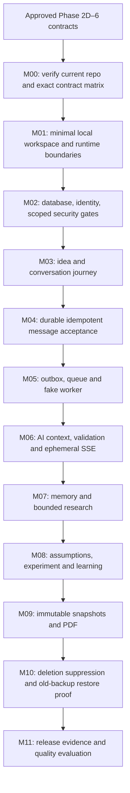

# Founder's Lens — LLD Phase 7D: Final Implementation Readiness & Integration Review

**Document ID:** FL-LLD-IMP-7D  
**Version:** 0.2 - formal documentation baseline
**Status:** Approved - Documentation Only; FL-P7-0.2-approved. M00 and all implementation remain unauthorized.
**Proposed canonical path:** `Docs/lld/09-implementation-planning/implementation-readiness-integration-review.md` (verify actual repository convention)  
**Scope:** Phase 7A–7C integration, dependency and task scrutiny, coverage and quality gates, source reconciliation, owner decisions, controlled development handoff.

> **Evidence boundary.** This review directly inspected the locally available Phase 7A, 7B and 7C v0.1 Markdown drafts, as well as available older project documentation. It has **not** independently verified the current Windows repository, current `Docs/README.md`, the approved Phase 2D–6 JSON manifests, the latest canonical OpenAPI/route inventory, or current Prisma/SQL after controlled Phase 4/5 amendments. The owner's Codex reports establish *reported* approvals `FL-P2D-1.0-approved`, `FL-P3-0.3-approved`, `FL-P4-0.5-approved`, `FL-P5-0.4-approved`, `FL-P6-0.3-approved`; the exact approved bytes must be checked by Codex. Do not treat a proposed plan as an approved code contract.

## 1. Executive readiness decision

**Phase 7 planning is internally coherent and ready for canonical repository reconciliation; it is NOT yet ready for unconditional documentation sign-off or application coding.** Phase 7A defines the modular-monolith implementation boundaries, Phase 7B defines twelve ordered vertical-slice milestones, and Phase 7C defines 24 separately authorized task cards plus engineering quality gates. All 36 Phase 7B evidence IDs remain **NOT_RUN**.

**The critical distinction:** Phase 7 documentation sign-off, once explicitly granted, approves *a plan*. It does not authorize M00/M01 scaffolding, dependency installation, migrations, provider invocation, deployment, or a public release. The first coding task requires separate explicit owner authorization and must pass the source-exact M00 preflight.

### 1.1 Source inventory

| Source inspected | Version/status at inspection | Responsibility | Review conclusion |
|---|---|---|---|
| `implementation-strategy-repository-architecture.md` (7A) | v0.1, In Review | Modular-monolith, monorepo and trust/import boundaries | Coherent; folder/package choices remain recommendations |
| `implementation-milestones-vertical-slices.md` (7B) | v0.1, In Review | M00–M11 milestones and `IMP7B-01`–`IMP7B-36` evidence | All milestone IDs present; more exact source mapping needed |
| `codex-task-specifications-quality-gates.md` (7C) | v0.1, In Review | Two tasks per milestone; G0–G10 gates; task reporting | 24 task cards and bounded authorization model present |
| Latest approved repository contracts | Not independently available here | Exact method/DTO/DB/status/privacy/AI behavior | **Mandatory Codex verification before sign-off/coding** |

## 2. Fundamentals — short interview-ready answers

| Question | Answer |
|---|---|
| Why vertical slices? | Each milestone proves a thin founder journey across required boundaries instead of leaving a large untested API or UI layer. |
| Why implement message acceptance before AI? | Durable idempotent acceptance and recovery prevent duplicate paid generations and false Saved states. |
| Why use deterministic fake model/search providers first? | Tests can prove orchestration, failures and cost denial without spending or depending on external nondeterminism. |
| What is a stop-the-line gate? | A mismatch with approved architecture stops the task; it is reported for a controlled decision rather than silently coded around. |
| What is a phase sign-off? | A fingerprinted owner-approved document baseline, **not** evidence that application tests have run. |
| Why test real PostgreSQL/Redis later? | Mocking cannot prove constraints, transactional durability, outbox redelivery and crash ordering. |

## 3. Proposed architecture-to-task map

This is an **overall sequencing outline**, not a claim that security begins at M10. The P5-AM01 fail-closed access boundary, authorization and no-paid-call policy must be present from the earliest applicable implementation tasks. The complete independent restore fault proof is M10 and remains a release blocker until actually executed.

## Local implementation acceptance — 2026-11-26

**P6 closed for the local authenticated workspace.** The designated Clerk
account created and edited an idea, created a conversation, submitted a message,
and reloaded its committed history. The local database and worker verified
transactional submission, a published outbox event, BullMQ processing, and a
selected assistant reply. The authenticated browser observed
`generation.completed` for attempt `862ed3f9-f59d-4019-82ff-2630013998e9`
and output message `1ca29a8a-abd5-46e2-8e0e-a4e1758e108f`. Disposable
integration tests cover retry, duplicate submission, ownership denial, SSE
reconnect, and worker recovery.

**M06 is in progress.** The offline workspace has verified live SSE, bounded
conversation context, and a persisted v2 assistant projection with a strategy
and follow-up question. The local follow-up implementation adds contextual
offline text and an optional experiment card. The designated browser confirmed
the card survived reload. Attempt `be060c0e-8504-4948-a1eb-880fc67943d1`
committed selected v2 output `ac5a48e4-cd0e-4d18-b24a-6201c190094b` with
`REFLECT` strategy, one published event and one settled offline receipt.
The local context reader includes
only the selected earlier answer in the same conversation, idea and context
epoch. Revised or removed memory closes the historical context window until
lineage-aware revalidation is available. Version 1 remains text-only.
The offline memory reader records bounded revision and approval provenance under
the same one-use lease grant. The offline transcript validates stored
references against same-idea source-checked evidence and exact support.
The local synthetic Groq Free mode adds bounded context, structured response
validation and shared Redis quotas. The twelve-case dry run and mocked provider
checks passed. Live quality evaluation still requires confirmation of the key's
organization plan, limits and data controls. Evidence creation, provider citation
finalization and the founder-facing memory approval journey remain open.

The stabilization and remediation runs verified all four builds, 286 default
test passes and separate disposable PostgreSQL, Redis, authority and browser
suites. The Redis quota test covers independent clients and retention after
reconnect. Linux application and secret checks passed on PR #13 after the
migration checksum and scanner corrections. Idea Management PR #11 merged to
staging at `c40ace6601ce7b3c9b78497e27b0c10855f79595` after its exact runtime
equivalence was approved. Conversation Management PR #12 also passed its
required checks and merged to staging at
`536a61a939b271decdf500228860d00a37300ba6`. PR #13 brings the accepted local
offline journey and synthetic Groq evaluation tooling into the staging source
tree. Deployment remains read-only. The exact staging image equivalence entries
for this stack expire on 2026-12-25 at 12:32:47 UTC. Hosted workspace writes and
live Groq evaluation retain separate activation requirements.

The merged baseline is `62140461a4075a07f6dacb47ffb9d53ac352a361`.
The evaluation harness now includes a thirteenth synthetic case for contextual
follow-up. The initial quality pass and metrics are defined in the
[local runtime runbook](../../../scripts/p9-local-runtime.md#groq-free-evaluation).
Record live results only after the key's organization and quota have been
verified. See the [deployment guide](../../../DEPLOYMENT.md#hosted-idea-write-readiness)
for the separate staging write proposal.

The local MVP readiness pass rechecked the two previously accepted attempts
against the designated Clerk binding. Both remained completed and selected,
with one execution attempt each, published outbox records, provider receipts
and persisted v2 messages. A separate disposable browser and worker run passed
on this baseline. These checks do not record a new manual Clerk walkthrough or
live Groq quality results.

The subsequent local Groq browser run used the designated Clerk account and a
synthetic-only, purpose-scoped allowance. Attempt
`98a733dd-8624-4c43-a946-7d5959b0c912` completed after one worker execution,
settled 853 provider tokens and selected v2 message
`439ced41-3421-4d55-a4ba-3651c7f26f82`. The founder confirmed the same reply
after reload. Disposable tests passed SSE disconnect, terminal reconnect and
transcript reconciliation. The direct signed-in browser SSE reconnect check
against that committed attempt remains pending. The local worker was observed
stopping at the signed-window deadline. The founder confirmed the original idea
and conversation were visible again after restart of the verified local API.
PR #14 consolidates the local
corrections. Retain 20B low for ordinary synthetic evaluation and 120B low for
targeted comparison. Hosted writes require the separately approved
account-scoped procedure in the deployment guide.

## 4. Milestone dependency and authority audit

| Milestone | Dependency / founder result | Phase 7C task coverage | Mandatory proof emphasis | Gate / exception |
|---|---|---|---|---|
| M00 | Actual repository and baseline inventory | `IMP7C-M00-T01/T02` | Verified manifests, current 53/50 *reported* API mapping, exact DTO/DB links | No scaffold until verified |
| M01 | Local apps start separately | `IMP7C-M01-T01/T02` | Build/typecheck, health, shutdown, private DB/Redis | Package manager/runtime decision |
| M02 | Isolated, authorized records | `IMP7C-M02-T01/T02` | Real PostgreSQL constraints, Clerk trust boundary and deletion gate | Independent suppression implementation unresolved |
| M03 | Founder creates/reopens idea and conversation | `IMP7C-M03-T01/T02` | Authenticated roundtrip; no cross-owner reads | Unkeyed create ambiguity cannot auto-retry |
| M04 | Message accepted, no model call | `IMP7C-M04-T01/T02` | Atomic ledger/outbox, lost-202 and same-key replay | No paid generation yet |
| M05 | Durable fake AI job lifecycle | `IMP7C-M05-T01/T02` | Crash/redelivery, generation states, fencing | PostgreSQL truth, Redis coordination |
| M06 | Validated contextual AI and live updates | `IMP7C-M06-T01/T02` | ContextEpoch, schema version/card/action bounds, SSE recovery | Hard cost denial, no unapproved provider |
| M07 | Founder-controlled memory and research | `IMP7C-M07-T01/T02` | Versioned provenance; explicit approval; research admission | No automatic memory acceptance |
| M08 | Founder tests and reflects | `IMP7C-M08-T01/T02` | Experiment v3 hypothesis/plan.title, legacy 409, LearningEvidence capture marker | No fabricated hypothesis or evidence |
| M09 | Immutable snapshots and private PDF | `IMP7C-M09-T01/T02` | Approval lock, versioning, artifact/grant isolation | No exposed object storage |
| M10 | Deletion/restoration fault proof | `IMP7C-M10-T01/T02` | Independent accepted-intent coverage, fail-closed restore, real fault drill | Hard release blocker |
| M11 | Reviewable quality/release packet | `IMP7C-M11-T01/T02` | Browser/accessibility, security, six × 0–2 AI eval, costs, incidents | No automatic production deployment |

**Ordering challenge:** M02 requires a minimal operationally credible independent suppression interface for access gating before all private features. If no independent authority can durably evidence deletion intents in the chosen local environment, stop before treating later private workflows as safely releasable. A fake adapter can support isolated unit development but cannot satisfy the production/deletion proof.

## 5. Findings and discrepancy register (initial Phase 7D identifiers)

| ID | Severity | Evidence or gap | Required disposition | Status |
|---|---|---|---|---|
| IMP7D-01 | High | 7A/7C explicitly lack live canonical approval-file/route/Prisma access | Verify current Phase 2D–6 manifests and 53/50 reported operation mapping in repo | Pending canonical verification |
| IMP7D-02 | High | 7B's 36 scenarios are range-mapped, not fully tied to exact FR/AT, operationId, DB and Phase 6 case | Produce per-ID source-exact traceability table | Pending canonical verification |
| IMP7D-03 | High | 7C's 24 task cards contain scope and test categories but not per-task exact file allowlists | Populate allowlists after current code/worktree inspection | Pending implementation preflight |
| IMP7D-04 | Critical | P5-AM01 independent intent before deletion commit and fail-closed restore cannot be proven by a mock or same-rollback-boundary store | Design implementation authority at M02; real isolated restoration/partition/coverage proof M10 | Pending implementation proof; release blocker |
| IMP7D-05 | High | Stage M04 before model provider, with durable ledger/outbox and uncertain-acceptance behavior | Preserve original-response replay and no automatic paid resend | Aligned in design; runtime unexecuted |
| IMP7D-06 | High | At-least-once BullMQ/Redis versus durable generation selection/cancellation | Barrier tests for duplicate dispatch, fencing, cancellation and terminal winner | Aligned in design; runtime unexecuted |
| IMP7D-07 | High | Approved Phase 3 structured opt-in, selected transcript, one card and two actions | Exact response schema mapping and contract tests | Pending canonical verification |
| IMP7D-08 | High | P4-B01 version3 hypothesis/legacy 409 and P4-B02 LearningEvidence distinction | Verify current OpenAPI, Prisma, SQL and migration plan | Pending canonical verification |
| IMP7D-09 | High | Clerk direct Bearer, authenticated SSE and no BFF | Verify actual SDK/session/SSR/CORS against pinned versions | Pending provider test |
| IMP7D-10 | High | Privacy, secret logging, account recreation and cache purges have cross-cutting timing | Map early gates and negative test obligations to tasks | Aligned in policy; runtime unexecuted |
| IMP7D-11 | Medium | Provisional monorepo layout could encourage needless packages | Start minimal, require justified extraction/import boundaries | Pending owner/engineering choice at M01 |
| IMP7D-12 | Medium | Package manager, tool versions, CI execution and device matrix deferred | Choose compatible pinned toolchain later; maintain single lockfile | Pending implementation choice |
| IMP7D-13 | High | Deletion, security and spending hard gates must be independent of averaged AI rubric | Preserve independent release failure criteria | Aligned in policy; runtime unexecuted |
| IMP7D-14 | Medium | Public-demo, paid providers, numerical targets and incident ownership deferred | Independent explicit release/provider authorization | Accepted deferred decision |
| IMP7D-15 | Low | AI-D14 old HLD direct-model arrow pending editorial controlled change | Track as accepted exception; never silently modify approved HLD | Accepted tracked exception |
| IMP7D-16 | High | Planning or documentation approval could be misread as permission to scaffold apps, migrate or run providers | Require separate explicit M00/M01 authorization and owner acceptance | Policy specified; not yet authorized |
| IMP7D-17 | Medium | No current repository CI/build/test harness independently inspected | Do not assert commands, counts, or test passes; inspect during M00 | Pending implementation preflight |
| IMP7D-18 | Medium | Some 7B scenarios overlap 7C and earlier QA evidence | Preserve identifiers; link, do not double count independent coverage | Aligned in design; detailed mapping pending |

**Disposition definitions:** `Aligned in design` means planned behavior agrees with inspected drafts, **not** tested. `Pending canonical verification` means the current approved repository must supply exact evidence. `Pending implementation proof` means a test is necessary once code exists. `Accepted deferred decision` is tracked but cannot justify a release claim.

## 6. Cross-cutting trust, persistence and cost guardrails

1. **Auth & scope:** Clerk proves identity; Express authorizes each founder/idea resource, lifecycle and version; browser gates are not authorization. Browser-to-Express session Bearer (not a new BFF).
2. **Durable state:** PostgreSQL is the source of truth; Redis/BullMQ is job coordination. Worker redelivery is expected and needs DB idempotency, leases and finalization fences.
3. **AI:** Context from one authorized idea, only approved memory with lineage/epoch safeguards, bounded research, validated structured response, no automatic durable approvals.
4. **Transport:** SSE fragments are transient; completion must reconcile against authenticated status/transcript reads. Refresh never auto-resends an uncertain paid command.
5. **Data and privacy:** Independent deletion suppression precedes primary accepted deletion; unresolved coverage fails closed, especially on old-backup restoration and account recreation.
6. **Experiments/learning:** Separate title and hypothesis; versioned experiment creation; legacy 409 policy; distinguish missing historical evidence from explicitly empty links.
7. **Snapshots:** Approved snapshot immutable, new draft via existing create, artifact/grant status distinct, private downloads.
8. **Cost:** Synthetic providers and blocked billable calls until explicit owner budget, verified authorization and provider controls.

## 7. Traceability plan (no fabricated operation IDs)

At Codex canonical review create a row **for each** `IMP7B-01` through `IMP7B-36` with columns:

`Evidence ID | Mxx | IMP7C Task ID | SRS FR/AT | OpenAPI operationId, route, method, headers, success/error | DB/Prisma/SQL guard | Phase 6 scenario | Execution environment | Pass condition | Status`

Additionally, enumerate all **currently valid** founder and non-founder operations from the latest route inventory; track whether each appears in an implementation milestone and task or is appropriately out-of-scope for MVP with justification. Count only confirmed definitions, not copied owner-report counts. Trace P5-AM01 independent store recovery and approved P4/P3 amendments separately because not all obligations fit a single ordinary founder route.

**Static consistency targets from owner's latest Codex report (to confirm):** 53 unique OpenAPI operations, 50 founder mappings, 47 SRS FR/AT pairs, 714 OpenAPI references and prior manifest aggregates. These values are *expected review assertions*, not measurements made by Phase 7D.

## 8. Release gates versus milestone gates

| Gate | Required evidence before next step | May remain deferred until later? |
|---|---|---|
| Documentation gate | Verified live approved manifests, controlled amendments, cross-links and current task mapping | **No** for plan sign-off |
| M00/M01 workspace gate | Explicit owner task authorization, actual repo/lockfile inspection, local build/typecheck/readiness results | **No** before executing dependent tasks |
| Per-task behavior gate | Tested relevant API/DB/worker/negative cases with commands, environment and results | **No** for that task's acceptance |
| Critical privacy gate | Cross-owner denial, deletion suppression policy at early gates; full old-backup restoration proof by release | Never waive for release |
| Security/cost gate | No unauthorized writes/provider calls/secrets exposed; real authorization/cost denial checks | Never waive for release |
| AI quality gate | Six approved 0–2 dimensions evaluated on suitable corpus; provisional numerical thresholds separately calibrated | Not complete until measured |
| Accessibility/browser gate | Real keyboard and supported device/browser checks | Cannot claim release compliance before test |
| Hosting/incident gate | Provider/credential/billing/ops responsibilities and rollback evidence | May defer for local development, **not** public release |

A successful `git diff --check`, OpenAPI parse, manifest hash check or mocked fake provider proves only its own scope. It cannot substitute for real DB/Clerk/recovery/security validation.

## 9. Implementation task governance and stopping rules

**No task is authorized by this document.** A future owner-approved task must name: exact `IMP7C-...` ID, allowed files and forbidden actions, actual approved manifest references, input/output changes, privacy/cost rules, and tests to execute. Codex must inspect `git status` first. It must not alter unrelated files, install unapproved packages, create production credentials, execute destructive migrations, place private prompts in logs, or proceed to the next task automatically.

**Stop and report** if the current repo differs from approved hashes, an endpoint/schema is missing, the independent suppression authority cannot meet the intended failure model, migrations are destructive/ambiguous, a provider requires spending/card authorization, SDK trust assumptions are unverified, or a required test cannot run. Report `PASS`, `FAIL`, `BLOCKED`, or `NOT_RUN` only for what was actually measured.

## 10. Owner/engineering decision register

| Decision | Recommended approach | When needed |
|---|---|---|
| Plan scope and modular-monolith structure | Approve the conceptual structure; create packages only when used | Phase 7 plan approval |
| Exact package manager and Node/Next.js/Prisma/Clerk versions | Choose single compatible, pinned toolchain after M00 inspection | M01 before installing |
| Local PostgreSQL/Redis and container usability | Local-first; no public ports/secrets | M01 environment setup |
| Suppression authority storage and recoverability | Provider-neutral; independently durable and enumerable, fail closed | M02 design proof, M10 actual restore |
| Implementation phase authorization | Separate explicit owner approval for every task; start with read-only M00 | After Phase 7 approval |
| Real model/search, hosting and paid calls | Default-deny; separately approve later | Before real provider integration |
| Recovery/AI quality numerical limits | Keep provisional until test evidence | Quality and release review |
| Incident response and public demo | Defer public launch; development owner initially | Before publishing service |
| AI-D14 editorial correction | Separate controlled HLD amendment | Documentation governance |

## 11. Acceptance matrix for Phase 7D integration review (planned only)

| ID | Planned inspection / test | Expected result | Execution |
|---|---|---|---|
| IMP7D-AT01 | Inspect actual approved Phase 2D–6 manifest files | Hashes, byte lengths, aggregates valid; approved mutation chain accounted | **NOT_RUN** |
| IMP7D-AT02 | Compare 7A–7C against canonical OpenAPI and inventory | Exact operation/DTO/header/status/authorization mappings | **NOT_RUN** |
| IMP7D-AT03 | Compare 7A–7C against current Prisma/SQL | Constraints, versions, LearningEvidence and Experiment v3 aligned | **NOT_RUN** |
| IMP7D-AT04 | Enumerate milestones M00–M11 | All 12 with prerequisites and no release dependency bypass | Draft inspection only; no code run |
| IMP7D-AT05 | Enumerate all `IMP7C-Mxx-T01/T02` cards | 24, all planned and separately owner authorized | Draft inspection only; no code run |
| IMP7D-AT06 | Preserve all `IMP7B-01`–`IMP7B-36` identifiers | 36 mapped to tasks and Phase 6 evidence | Draft range reviewed, per-ID canonical mapping **NOT_RUN** |
| IMP7D-AT07 | Verify no paid/model/deployment/migration authorization | Explicit barriers in all plans | Draft inspection only |
| IMP7D-AT08 | Check P5-AM01 restoration gate before public release | Independent authority, coverage, fail-closed and fault proof specified | Design reviewed, actual proof **NOT_RUN** |
| IMP7D-AT09 | Verify 6×0–2 AI rubric and independent hard blockers | Exact approved rubric matches canonical Phase 3/6 | **NOT_RUN** against canonical repo |
| IMP7D-AT10 | Run Markdown, OpenAPI, manifest, whitespace checks in local repo | Actual commands, counts, failures and unexpected changes recorded | **NOT_RUN** |
| IMP7D-AT11 | Audit change scope and preserve current worktree | No unexpected edits to approved history | **NOT_RUN** in Windows repo |
| IMP7D-AT12 | Confirm explicit owner sign-off and implementation permission are distinct | No false approval/manifests or unapproved code changes | Policy defined; actual approvals pending |

**Execution rule:** The local review of three drafts is an editorial/design inspection; no application, migration, integration or provider tests have run. The latest canonical repository's static validations are also not run in this environment.

## 12. Change-control and documentation sign-off readiness

**Suggested state before Codex:** `FL-P7-0.1-review`, documentation only, **NOT APPROVED**. No approved Phase 7 manifest has been created. Once Phase 7A–7D are placed in the actual repository, Codex should:

1. Read all four actual files and `Docs/README.md`; inspect worktree, existing code, approved baselines, amendments and historical manifests.
2. Reconcile exact current OpenAPI, Prisma, SQL, consent/deletion lifecycle, approved AI response/evaluation and Phase 6 test IDs into a source-exact crosswalk.
3. Preserve original milestone/task/evidence IDs, correcting only real gaps; record any changes as explicit findings.
4. Validate import/repository boundaries against existing files and current environment rather than creating a speculative scaffold.
5. Produce a discrepancy/decision register and run available documentation static checks. Keep all runtime tests `NOT_RUN`.
6. Present any material decisions to the owner. **Do not approve Phase 7 or start M00 implementation.**

Once repository reconciliation is complete and no documentation blockers remain, ask for a separate explicit owner authorization to freeze the **Phase 7 documentation only** baseline. Implementation requires an additional, later owner task instruction; a manifest does not grant coding permission.

## 13. Review summary

**Draft inspection findings:** all 12 milestones, 24 task cards, 36 Phase 7B evidence ranges, G0–G10 quality gates and main architectural privacy/cost constraints are described consistently across inspected 7A–7C documents. Exact live repository compatibility, per-ID traceability, provider/versions, and actual local test feasibility are not yet verified. AI-D14 remains an accepted controlled HLD editorial exception.

**Decision:** **Ready for canonical repository reconciliation, NOT ready for unconditional Phase 7 documentation sign-off, and NO implementation authorization.**

## 14. Current canonical repository reconciliation

Candidate **FL-P7-0.2-review - Not Approved**. Actual canonical directory is Docs/lld/09-implementation-strategy/. This section supersedes source-unavailable/intake status statements, not historical decisions. Current authority is PRD/SRS, HLD/ADR-013 Express, physical section18/Prisma/guards, API section21 and OpenAPI/inventory, streaming/reliability, Phase3D9.1 rubric, Phase4C privacy/state, state-machines P5-AM01, Phase5D16 and Phase6D18. No approved technical file is amended here. All planned task/scenario execution remains NOT_RUN; static reconciliation is not execution of M00.

### Current finding and decision register

Original section5 severity/source evidence remains. Current resolution and verification follow; affected files are Phase7A-D unless noted. No new product capability is approved.

| Finding | Canonical resolution and evidence | Status / remaining gate |
|---|---|---|
| IMP7D-01 | Actual approved manifests/current OpenAPI checked, current matrices below | Resolved documentation; M00 repeats against future worktree |
| IMP7D-02 | Individual36 rows and API/FR crosswalk below link tasks, guards and Phase6 cases | Resolved planning mapping; behavior NOT_RUN |
| IMP7D-03 | Exact future file allowlists cannot be invented before code inventory; mandatory per-task expansion below | Pending implementation preflight, not permission for unrestricted edits |
| IMP7D-04 | Approved state-machines P5-AM01: independent intent before primary commit, unresolved scope blocked | M02 access prerequisite/M10 real independent restore proof; release blocker |
| IMP7D-05 | Reliability/API original acceptance replay, same-key mismatch409, lookup404 inconclusive | Resolved design; M04 DB/network proof pending |
| IMP7D-06 | Streaming six states, terminal CAS/selected transcript, duplicate worker fences | Resolved design; M05 actual queue/race proof pending |
| IMP7D-07 | API opt-in assistantResponseVersion2, one optional card/two actions, Phase3 context epochs | Resolved documentation; M06 schema/browser tests pending |
| IMP7D-08 | API21/physical18: plan.title separate required hypothesis, legacy409, LearningEvidence capture | Resolved documentation; M08 roundtrip/migration proof pending |
| IMP7D-09 | Security Bearer session/direct Express/fetch SSE; no BFF | Pending implementation/provider version verification |
| IMP7D-10 | Phase4 cache isolation plus P5-AM01 unresolved-intent access blocking, incarnation and privacy logs | Early M02/M03 gates; later M10 purge does not excuse early bypass |
| IMP7D-11 | Minimal proposed TypeScript workspace with independent processes; no unused shared packages | Pending owner/engineering implementation choice, not architecture blocker |
| IMP7D-12 | Phase6 minimal tooling, browser engines and real-device availability; no installed versions | Pending implementation choice/calibration |
| IMP7D-13 | Phase6 privacy/security/deletion/spending failures independent of AI total | Resolved release rule; all measurements pending |
| IMP7D-14 | Approved local-first/deferred public demo and no unapproved spending | Accepted deferred release/provider decisions |
| IMP7D-15 | AI-D14 retained, HLD unchanged | Accepted pending controlled editorial amendment |
| IMP7D-16 | Plan approval is not task authorization; M00 and all subsequent tasks separately instructed | Resolved governance; no task authorized now |
| IMP7D-17 | Actual app harness/commands remain future read-only preflight, not fabricated | Pending implementation preflight |
| IMP7D-18 |36 evidence IDs retain individual rows; overlap is linked not counted as independent proof | Resolved documentation; no coverage percentage claimed |

### Dependency and authorization contract

M00 has no prerequisite. Each M01-M11 requires its immediate predecessor accepted and a separate owner task instruction; cumulative order is conservative, acyclic. M02 establishes suppression-aware authorization on every applicable read/admission/finalization; isolated synthetic fake adapters must never be labelled independently durable. M10 completes real independent authority/purge/restore proof before public use. M06 may consume synthetic approved memory fixtures without waiting for M07 UI; M07 implements explicit mutation workflows; M08 records experiments/learning; M09 snapshots/export; M10 privacy/account export; M11 aggregates release evidence without deploying. Do not enable deletion acceptance before the actual independent-intent prerequisite is met. Stubbed status must not falsely claim durable202 or production readiness.

For every milestone the section4 scope remains the expected deliverable; its two parent tasks and mapped evidence below are mandatory. Definition of Done: reviewed allowed-path diff, exact contract fixtures and actual relevant unit/DB/API/queue/browser negative evidence, redacted commands/results, no unresolved security/privacy/spend failure, owner checkpoint accepting that milestone. Missing feasible test evidence is BLOCKED/NOT_RUN, never PASS. Code allowlists must be concretely named in the future instruction after inspecting existing code; documentation paths alone are not permission to create arbitrary files.

### Per-task execution envelope and controlled decomposition

All24 task cards retain focused parent objectives and exact original evidence obligations. Apply the common contract to each: inputs=current approved source hashes plus accepted prerequisite; outputs=only scoped change/evidence; allowed=explicit future task allowlist and corresponding tests; forbidden=unrelated edits,frozen-doc rewrites,paid calls,cloud/deploy,secrets,destructive migration or next-task progression. Stop on contract mismatch, unsafe ownership/suppression, unverified SDK trust, spending requirement or inability to establish needed proof. Report objective, actual paths, contract versions, commands/exit results, negative cases, limitations, diff summary and owner checkpoint. M00 tasks remain read-only/planning only. No task begins now.

Recommended verification substeps preserve parent IDs and24-card count: M02-T01 first schema/migration review then separately authorized isolated execution; M02-T02 first identity/ownership then suppression interface/freshness deny fixtures. M05-T02 separate lease/state tests from cancel/regenerate terminal selection. M08-T01 first existing assumption/evidence CRUD/link reads then experimentV3 compatibility; never omit assumptions because its title says experiment. M09-T02 separate export job/worker from artifact/grant negative tests. M10-T01 separate independent intent/unknown outcomes from privileged purge/account-export cleanup; M11-T02 separate human AI scoring from cost/incident/release packet. These are proposed controlled child steps requiring explicit future scope, not newly authorized tasks or extra product features. They may be accepted independently only with required inputs and test evidence; incomplete child steps never mark the parent complete.

### Contract families used by the detailed matrices

DB02=physical design12/13/18, Prisma/SQL acceptance: ownership composites, versions, immutability, LearningEvidence pair uniqueness/marker and purge privileges. JOB05=reliability/outbox/leases and streaming lifecycle. AI06=Phase3 context/response/evaluation plus API opt-in projections. MEM07=API memory/provenance/If-Match and conversation research admission. ART09=API snapshot drafts/approval/hash/export/grant/private storage. PRIV10=state-machines P5-AM01 plus security tombstones/account incarnation, independent coverage/restore and account data export. FE=Phase4C scoped state/recovery and Phase4B15 accessibility; QA=Phase6 planned cases. All symbolic references expand to existing canonical specifications, not new interfaces.

### Individual36 evidence crosswalk and milestone checkpoints

Each row is a planning obligation,NOT_RUN. Task references are parent IDs; each requires the execution envelope above and owner review. SRS pairs inherit Phase6 exact traceability, no new requirement numbers.

| Evidence ID | Milestone / prerequisite | Task parent(s) | Approved contract / required oracle | Phase6 scenarios | Status |
|---|---|---|---|---|---|
| IMP7B-01 | M00 / none | IMP7C-M00-T01/T02 (original card Maps selects exact owner) | baseline manifests/contract inventory; assert durable result and prohibited effects using original7B proof description | Q6D01-30 static source mapping | NOT_RUN |
| IMP7B-02 | M00 / none | IMP7C-M00-T01/T02 (original card Maps selects exact owner) | baseline manifests/contract inventory; assert durable result and prohibited effects using original7B proof description | Q6D01-30 static source mapping | NOT_RUN |
| IMP7B-03 | M01 / M00 | IMP7C-M01-T01/T02 (original card Maps selects exact owner) | process/build/private configuration; assert durable result and prohibited effects using original7B proof description | Q6D01/30 | NOT_RUN |
| IMP7B-04 | M01 / M00 | IMP7C-M01-T01/T02 (original card Maps selects exact owner) | process/build/private configuration; assert durable result and prohibited effects using original7B proof description | Q6D01/30 | NOT_RUN |
| IMP7B-05 | M01 / M00 | IMP7C-M01-T01/T02 (original card Maps selects exact owner) | process/build/private configuration; assert durable result and prohibited effects using original7B proof description | Q6D01/30 | NOT_RUN |
| IMP7B-06 | M02 / M01 | IMP7C-M02-T01/T02 (original card Maps selects exact owner) | DB02/auth/suppression gates; assert durable result and prohibited effects using original7B proof description | Q6D01-02/17-22 | NOT_RUN |
| IMP7B-07 | M02 / M01 | IMP7C-M02-T01/T02 (original card Maps selects exact owner) | DB02/auth/suppression gates; assert durable result and prohibited effects using original7B proof description | Q6D01-02/17-22 | NOT_RUN |
| IMP7B-08 | M02 / M01 | IMP7C-M02-T01/T02 (original card Maps selects exact owner) | DB02/auth/suppression gates; assert durable result and prohibited effects using original7B proof description | Q6D01-02/17-22 | NOT_RUN |
| IMP7B-09 | M03 / M02 | IMP7C-M03-T01/T02 (original card Maps selects exact owner) | idea/conversation FE journey; assert durable result and prohibited effects using original7B proof description | Q6D01-02/25 | NOT_RUN |
| IMP7B-10 | M03 / M02 | IMP7C-M03-T01/T02 (original card Maps selects exact owner) | idea/conversation FE journey; assert durable result and prohibited effects using original7B proof description | Q6D01-02/25 | NOT_RUN |
| IMP7B-11 | M03 / M02 | IMP7C-M03-T01/T02 (original card Maps selects exact owner) | idea/conversation FE journey; assert durable result and prohibited effects using original7B proof description | Q6D01-02/25 | NOT_RUN |
| IMP7B-12 | M04 / M03 | IMP7C-M04-T01/T02 (original card Maps selects exact owner) | message ledger/outbox/lookup; assert durable result and prohibited effects using original7B proof description | Q6D03-05 | NOT_RUN |
| IMP7B-13 | M04 / M03 | IMP7C-M04-T01/T02 (original card Maps selects exact owner) | message ledger/outbox/lookup; assert durable result and prohibited effects using original7B proof description | Q6D03-05 | NOT_RUN |
| IMP7B-14 | M04 / M03 | IMP7C-M04-T01/T02 (original card Maps selects exact owner) | message ledger/outbox/lookup; assert durable result and prohibited effects using original7B proof description | Q6D03-05 | NOT_RUN |
| IMP7B-15 | M05 / M04 | IMP7C-M05-T01/T02 (original card Maps selects exact owner) | JOB05 leases/terminal selection; assert durable result and prohibited effects using original7B proof description | Q6D06-08 | NOT_RUN |
| IMP7B-16 | M05 / M04 | IMP7C-M05-T01/T02 (original card Maps selects exact owner) | JOB05 leases/terminal selection; assert durable result and prohibited effects using original7B proof description | Q6D06-08 | NOT_RUN |
| IMP7B-17 | M05 / M04 | IMP7C-M05-T01/T02 (original card Maps selects exact owner) | JOB05 leases/terminal selection; assert durable result and prohibited effects using original7B proof description | Q6D06-08 | NOT_RUN |
| IMP7B-18 | M06 / M05 | IMP7C-M06-T01/T02 (original card Maps selects exact owner) | AI06 context/structured/SSE/budget; assert durable result and prohibited effects using original7B proof description | Q6D09/12-15/29 | NOT_RUN |
| IMP7B-19 | M06 / M05 | IMP7C-M06-T01/T02 (original card Maps selects exact owner) | AI06 context/structured/SSE/budget; assert durable result and prohibited effects using original7B proof description | Q6D09/12-15/29 | NOT_RUN |
| IMP7B-20 | M06 / M05 | IMP7C-M06-T01/T02 (original card Maps selects exact owner) | AI06 context/structured/SSE/budget; assert durable result and prohibited effects using original7B proof description | Q6D09/12-15/29 | NOT_RUN |
| IMP7B-21 | M06 / M05 | IMP7C-M06-T01/T02 (original card Maps selects exact owner) | AI06 context/structured/SSE/budget; assert durable result and prohibited effects using original7B proof description | Q6D09/12-15/29 | NOT_RUN |
| IMP7B-22 | M07 / M06 | IMP7C-M07-T01/T02 (original card Maps selects exact owner) | MEM07 proposal/version/research; assert durable result and prohibited effects using original7B proof description | Q6D10-15 | NOT_RUN |
| IMP7B-23 | M07 / M06 | IMP7C-M07-T01/T02 (original card Maps selects exact owner) | MEM07 proposal/version/research; assert durable result and prohibited effects using original7B proof description | Q6D10-15 | NOT_RUN |
| IMP7B-24 | M07 / M06 | IMP7C-M07-T01/T02 (original card Maps selects exact owner) | MEM07 proposal/version/research; assert durable result and prohibited effects using original7B proof description | Q6D10-15 | NOT_RUN |
| IMP7B-25 | M08 / M07 | IMP7C-M08-T01/T02 (original card Maps selects exact owner) | DB02 hypothesis/evidence/learning; assert durable result and prohibited effects using original7B proof description | Q6D23-24 | NOT_RUN |
| IMP7B-26 | M08 / M07 | IMP7C-M08-T01/T02 (original card Maps selects exact owner) | DB02 hypothesis/evidence/learning; assert durable result and prohibited effects using original7B proof description | Q6D23-24 | NOT_RUN |
| IMP7B-27 | M08 / M07 | IMP7C-M08-T01/T02 (original card Maps selects exact owner) | DB02 hypothesis/evidence/learning; assert durable result and prohibited effects using original7B proof description | Q6D23-24 | NOT_RUN |
| IMP7B-28 | M09 / M08 | IMP7C-M09-T01/T02 (original card Maps selects exact owner) | ART09 immutable approval/export; assert durable result and prohibited effects using original7B proof description | Q6D16 | NOT_RUN |
| IMP7B-29 | M09 / M08 | IMP7C-M09-T01/T02 (original card Maps selects exact owner) | ART09 immutable approval/export; assert durable result and prohibited effects using original7B proof description | Q6D16 | NOT_RUN |
| IMP7B-30 | M09 / M08 | IMP7C-M09-T01/T02 (original card Maps selects exact owner) | ART09 immutable approval/export; assert durable result and prohibited effects using original7B proof description | Q6D16 | NOT_RUN |
| IMP7B-31 | M10 / M09 | IMP7C-M10-T01/T02 (original card Maps selects exact owner) | PRIV10 intent/purge/restore; assert durable result and prohibited effects using original7B proof description | Q6D17-22/30 | NOT_RUN |
| IMP7B-32 | M10 / M09 | IMP7C-M10-T01/T02 (original card Maps selects exact owner) | PRIV10 intent/purge/restore; assert durable result and prohibited effects using original7B proof description | Q6D17-22/30 | NOT_RUN |
| IMP7B-33 | M10 / M09 | IMP7C-M10-T01/T02 (original card Maps selects exact owner) | PRIV10 intent/purge/restore; assert durable result and prohibited effects using original7B proof description | Q6D17-22/30 | NOT_RUN |
| IMP7B-34 | M11 / M10 | IMP7C-M11-T01/T02 (original card Maps selects exact owner) | QA/browser/AI/incident evidence; assert durable result and prohibited effects using original7B proof description | Q6D25-30 | NOT_RUN |
| IMP7B-35 | M11 / M10 | IMP7C-M11-T01/T02 (original card Maps selects exact owner) | QA/browser/AI/incident evidence; assert durable result and prohibited effects using original7B proof description | Q6D25-30 | NOT_RUN |
| IMP7B-36 | M11 / M10 | IMP7C-M11-T01/T02 (original card Maps selects exact owner) | QA/browser/AI/incident evidence; assert durable result and prohibited effects using original7B proof description | Q6D25-30 | NOT_RUN |

### Exact operation-to-task coverage

Every row also requires auth/owner/lifecycle tests. Required Idempotency-Key(I),If-Match(V) are explicit; no flag means absent,not public. Request/response names and success statuses come from current OpenAPI/inventory. All statuses NOT_RUN. Non-founder operations use their own health/webhook trust contract.

| Method / path / operationId | Milestone/task | I/V | Body / response / success | Persistence-worker-FE oracle |
|---|---|---|---|---|
| GET /api/v1/me / getMe | IMP7C-M02-T02 | -/- | none / UserAccount / 200 | DB02; negative owner/version/replay and saved read-back |
| PATCH /api/v1/me/preferences / patchMePreferences | IMP7C-M03-T01/T02 | -/V | PreferencesPatch / UserAccount / 200 | DB02/FE; negative owner/version/replay and saved read-back |
| POST /api/v1/me/data-operations / postMeDataOperations | IMP7C-M10-T01/T02 | I/- | DataOperationCreate / DataOperation / 202 | PRIV10; negative owner/version/replay and saved read-back |
| GET /api/v1/me/data-operations/{operationId} / getMeDataOperationsOperationId | IMP7C-M10-T01/T02 | -/- | none / DataOperation / 200 | PRIV10; negative owner/version/replay and saved read-back |
| GET /api/v1/ideas / getIdeas | IMP7C-M03-T01/T02 | -/- | none / IdeaList / 200 | DB02/FE; negative owner/version/replay and saved read-back |
| POST /api/v1/ideas / postIdeas | IMP7C-M03-T01/T02 | I/- | IdeaCreate / Idea / 201 | DB02/FE; negative owner/version/replay and saved read-back |
| GET /api/v1/ideas/{ideaId} / getIdeasIdeaId | IMP7C-M03-T01/T02 | -/- | none / Idea / 200 | DB02/FE; negative owner/version/replay and saved read-back |
| PATCH /api/v1/ideas/{ideaId} / patchIdeasIdeaId | IMP7C-M03-T01/T02 | -/V | IdeaPatch / Idea / 200 | DB02/FE; negative owner/version/replay and saved read-back |
| DELETE /api/v1/ideas/{ideaId} / deleteIdeasIdeaId | IMP7C-M10-T01/T02 | -/- | none / DataOperation / 202 | PRIV10; negative owner/version/replay and saved read-back |
| GET /api/v1/ideas/{ideaId}/conversations / getIdeasIdeaIdConversations | IMP7C-M03-T01/T02 | -/- | none / ConversationList / 200 | DB02/FE; negative owner/version/replay and saved read-back |
| POST /api/v1/ideas/{ideaId}/conversations / postIdeasIdeaIdConversations | IMP7C-M03-T01/T02 | -/- | ConversationCreate / Conversation / 201 | DB02/FE; negative owner/version/replay and saved read-back |
| GET /api/v1/conversations/{conversationId} / getConversationsConversationId | IMP7C-M03-T01/T02 | -/- | none / Conversation / 200 | DB02/FE; negative owner/version/replay and saved read-back |
| PATCH /api/v1/conversations/{conversationId} / patchConversationsConversationId | IMP7C-M07-T01/T02 | -/V | ConversationPatch / Conversation / 200 | MEM07; negative owner/version/replay and saved read-back |
| GET /api/v1/conversations/{conversationId}/messages / getConversationsConversationIdMessages | IMP7C-M04-T01/T02 | -/- | none / MessageList (default/1) or StructuredMessageList (opt-in/2) / 200 | JOB05/FE; negative owner/version/replay and saved read-back |
| POST /api/v1/conversations/{conversationId}/messages / postConversationsConversationIdMessages | IMP7C-M04-T01/T02 | I/- | MessageCreate / MessageSubmission / 202 | JOB05/FE; negative owner/version/replay and saved read-back |
| GET /api/v1/generations/{generationId} / getGenerationsGenerationId | IMP7C-M05-T02 | -/- | none / Generation / 200 | JOB05; negative owner/version/replay and saved read-back |
| GET /api/v1/generations/{generationId}/events / getGenerationsGenerationIdEvents | IMP7C-M06-T02 | -/- | none / EventStream / 200 | AI06/FE; negative owner/version/replay and saved read-back |
| POST /api/v1/generations/{generationId}/cancel / postGenerationsGenerationIdCancel | IMP7C-M05-T02 | I/- | none / Generation / 200/202 | JOB05; negative owner/version/replay and saved read-back |
| POST /api/v1/conversations/{conversationId}/regenerations / postConversationsConversationIdRegenerations | IMP7C-M05-T02 | I/- | RegenerationCreate / Generation / 202 | JOB05; negative owner/version/replay and saved read-back |
| GET /api/v1/ideas/{ideaId}/memory / getIdeasIdeaIdMemory | IMP7C-M07-T01/T02 | -/- | none / MemoryList / 200 | MEM07; negative owner/version/replay and saved read-back |
| GET /api/v1/ideas/{ideaId}/memory-proposals / getIdeasIdeaIdMemoryProposals | IMP7C-M07-T01/T02 | -/- | none / ProposalList (default/1) or ProposalListV2 (opt-in/2) / 200 | MEM07; negative owner/version/replay and saved read-back |
| PATCH /api/v1/memory-proposals/{proposalId} / patchMemoryProposalsProposalId | IMP7C-M07-T01/T02 | -/V | ProposalPatch / MemoryProposal / 200 | MEM07; negative owner/version/replay and saved read-back |
| POST /api/v1/memory-proposals/{proposalId}/accept / postMemoryProposalsProposalIdAccept | IMP7C-M07-T01/T02 | I/V | ProposalDecision / ConfirmedMemory / 200 | MEM07; negative owner/version/replay and saved read-back |
| POST /api/v1/memory-proposals/{proposalId}/dismiss / postMemoryProposalsProposalIdDismiss | IMP7C-M07-T01/T02 | I/V | ProposalDismiss / MemoryProposal / 200 | MEM07; negative owner/version/replay and saved read-back |
| PATCH /api/v1/memory/{memoryId} / patchMemoryMemoryId | IMP7C-M07-T01/T02 | -/V | MemoryPatch / ConfirmedMemory / 200 | MEM07; negative owner/version/replay and saved read-back |
| GET /api/v1/memory/{memoryId}/revisions / getMemoryMemoryIdRevisions | IMP7C-M07-T01/T02 | -/- | none / MemoryRevisionList / 200 | MEM07; negative owner/version/replay and saved read-back |
| GET /api/v1/ideas/{ideaId}/assumptions / getIdeasIdeaIdAssumptions | IMP7C-M08-T01/T02 | -/- | none / AssumptionList / 200 | DB02; negative owner/version/replay and saved read-back |
| POST /api/v1/ideas/{ideaId}/assumptions / postIdeasIdeaIdAssumptions | IMP7C-M08-T01/T02 | -/- | AssumptionCreate / Assumption / 201 | DB02; negative owner/version/replay and saved read-back |
| PATCH /api/v1/assumptions/{assumptionId} / patchAssumptionsAssumptionId | IMP7C-M08-T01/T02 | -/V | AssumptionPatch / Assumption / 200 | DB02; negative owner/version/replay and saved read-back |
| GET /api/v1/ideas/{ideaId}/experiments / getIdeasIdeaIdExperiments | IMP7C-M08-T01/T02 | -/- | none / ExperimentList (default/1) or ExperimentListV2 (opt-in/2) or ExperimentListV3 (opt-in/3) / 200 | DB02; negative owner/version/replay and saved read-back |
| POST /api/v1/ideas/{ideaId}/experiments / postIdeasIdeaIdExperiments | IMP7C-M08-T01/T02 | I/- | ExperimentCreate / Experiment (historical accepted1 replay) or ExperimentReceiptV3 (fresh3) / 201 | DB02; negative owner/version/replay and saved read-back |
| PATCH /api/v1/experiments/{experimentId} / patchExperimentsExperimentId | IMP7C-M08-T01/T02 | -/V | ExperimentPatch / Experiment (default/1) or ExperimentV3 (opt-in/3) / 200 | DB02; negative owner/version/replay and saved read-back |
| POST /api/v1/experiments/{experimentId}/learnings / postExperimentsExperimentIdLearnings | IMP7C-M08-T01/T02 | I/- | LearningCreate / Learning (default/1) or LearningV2 (opt-in/2) or LearningV3 (opt-in/3) / 201 | DB02; negative owner/version/replay and saved read-back |
| GET /api/v1/ideas/{ideaId}/learnings / getIdeasIdeaIdLearnings | IMP7C-M08-T01/T02 | -/- | none / LearningList (default/1) or LearningListV2 (opt-in/2) or LearningListV3 (opt-in/3) / 200 | DB02; negative owner/version/replay and saved read-back |
| GET /api/v1/ideas/{ideaId}/evidence / getIdeasIdeaIdEvidence | IMP7C-M07-T01/T02 | -/- | none / EvidenceList / 200 | MEM07; negative owner/version/replay and saved read-back |
| GET /api/v1/ideas/{ideaId}/research-jobs / getIdeasIdeaIdResearchJobs | IMP7C-M07-T01/T02 | -/- | none / ResearchJobList / 200 | MEM07; negative owner/version/replay and saved read-back |
| POST /api/v1/ideas/{ideaId}/research-jobs / postIdeasIdeaIdResearchJobs | IMP7C-M07-T01/T02 | I/- | ResearchRequest / ResearchJob / 202 | MEM07; negative owner/version/replay and saved read-back |
| GET /api/v1/research-jobs/{researchJobId} / getResearchJobsResearchJobId | IMP7C-M07-T01/T02 | -/- | none / ResearchJob / 200 | MEM07; negative owner/version/replay and saved read-back |
| POST /api/v1/assumptions/{assumptionId}/evidence-links / postAssumptionsAssumptionIdEvidenceLinks | IMP7C-M08-T01/T02 | -/- | EvidenceLinkCreate / EvidenceLink / 201 | DB02; negative owner/version/replay and saved read-back |
| DELETE /api/v1/assumptions/{assumptionId}/evidence-links/{evidenceId} / deleteAssumptionsAssumptionIdEvidenceLinksEvidenceId | IMP7C-M08-T01/T02 | -/- | none / null / 204 | DB02; negative owner/version/replay and saved read-back |
| GET /api/v1/ideas/{ideaId}/snapshots / getIdeasIdeaIdSnapshots | IMP7C-M09-T01/T02 | -/- | none / SnapshotList / 200 | ART09; negative owner/version/replay and saved read-back |
| POST /api/v1/ideas/{ideaId}/snapshots / postIdeasIdeaIdSnapshots | IMP7C-M09-T01/T02 | I/- | SnapshotCreate / DocumentSnapshot / 201 | ART09; negative owner/version/replay and saved read-back |
| GET /api/v1/snapshots/{snapshotId} / getSnapshotsSnapshotId | IMP7C-M09-T01/T02 | -/- | none / DocumentSnapshot / 200 | ART09; negative owner/version/replay and saved read-back |
| PATCH /api/v1/snapshots/{snapshotId} / patchSnapshotsSnapshotId | IMP7C-M09-T01/T02 | -/V | SnapshotPatch / DocumentSnapshot / 200 | ART09; negative owner/version/replay and saved read-back |
| POST /api/v1/snapshots/{snapshotId}/approve / postSnapshotsSnapshotIdApprove | IMP7C-M09-T01/T02 | I/V | SnapshotApprove / DocumentSnapshot / 201 | ART09; negative owner/version/replay and saved read-back |
| POST /api/v1/snapshots/{snapshotId}/exports / postSnapshotsSnapshotIdExports | IMP7C-M09-T01/T02 | I/- | ExportCreate / ExportJob / 202 | ART09; negative owner/version/replay and saved read-back |
| GET /api/v1/exports/{exportId} / getExportsExportId | IMP7C-M09-T01/T02 | -/- | none / ExportJob / 200 | ART09; negative owner/version/replay and saved read-back |
| POST /api/v1/exports/{exportId}/download-grant / postExportsExportIdDownloadGrant | IMP7C-M09-T01/T02 | -/- | none / DownloadGrant / 200 | ART09; negative owner/version/replay and saved read-back |
| GET /api/v1/conversations/{conversationId}/submissions/{clientSubmissionId} / getConversationsConversationIdSubmissionsClientSubmissionId | IMP7C-M04-T01/T02 | -/- | none / SubmissionCorrelation / 200 | JOB05/FE; negative owner/version/replay and saved read-back |
| GET /api/v1/assumptions/{assumptionId}/evidence-links / getAssumptionsAssumptionIdEvidenceLinks | IMP7C-M08-T01/T02 | -/- | none / EvidenceLinkList / 200 | DB02; negative owner/version/replay and saved read-back |
| GET /health/live / healthLive | IMP7C-M01-T02 | provider/health contract | exact OpenAPI response | Signed webhook inbox/tombstone or minimal readiness, no secret disclosure |
| GET /health/ready / healthReady | IMP7C-M01-T02 | provider/health contract | exact OpenAPI response | Signed webhook inbox/tombstone or minimal readiness, no secret disclosure |
| POST /webhooks/clerk / clerkWebhook | IMP7C-M02-T02 | provider/health contract | exact OpenAPI response | Signed webhook inbox/tombstone or minimal readiness, no secret disclosure |

### Requirements-to-milestone/task/evidence map

| SRS requirement | Acceptance ID | Primary milestone/task | Evidence / Phase6 | Status |
|---|---|---|---|---|
| FR-001 | AT-001 | M02 T01/T02; cross-cutting M10 privacy/M11 release | IMP7B-06 through 08 / Q6D01-02/17-22 | NOT_RUN |
| FR-002 | AT-001 | M02 T01/T02; cross-cutting M10 privacy/M11 release | IMP7B-06 through 08 / Q6D01-02/17-22 | NOT_RUN |
| FR-003 | AT-002 | M02 T01/T02; cross-cutting M10 privacy/M11 release | IMP7B-06 through 08 / Q6D01-02/17-22 | NOT_RUN |
| FR-004 | AT-003 | M02 T01/T02; cross-cutting M10 privacy/M11 release | IMP7B-06 through 08 / Q6D01-02/17-22 | NOT_RUN |
| FR-005 | AT-004 | M02 T01/T02; cross-cutting M10 privacy/M11 release | IMP7B-06 through 08 / Q6D01-02/17-22 | NOT_RUN |
| FR-006 | AT-005 | M04 T01/T02; cross-cutting M10 privacy/M11 release | IMP7B-12 through 14 / Q6D03-05 | NOT_RUN |
| FR-007 | AT-006 | M04 T01/T02; cross-cutting M10 privacy/M11 release | IMP7B-12 through 14 / Q6D03-05 | NOT_RUN |
| FR-008 | AT-007 | M04 T01/T02; cross-cutting M10 privacy/M11 release | IMP7B-12 through 14 / Q6D03-05 | NOT_RUN |
| FR-009 | AT-008 | M04 T01/T02; cross-cutting M10 privacy/M11 release | IMP7B-12 through 14 / Q6D03-05 | NOT_RUN |
| FR-010 | AT-009 | M04 T01/T02; cross-cutting M10 privacy/M11 release | IMP7B-12 through 14 / Q6D03-05 | NOT_RUN |
| FR-011 | AT-010 | M04 T01/T02; cross-cutting M10 privacy/M11 release | IMP7B-12 through 14 / Q6D03-05 | NOT_RUN |
| FR-012 | AT-011 | M04 T01/T02; cross-cutting M10 privacy/M11 release | IMP7B-12 through 14 / Q6D03-05 | NOT_RUN |
| FR-013 | AT-012 | M04 T01/T02; cross-cutting M10 privacy/M11 release | IMP7B-12 through 14 / Q6D03-05 | NOT_RUN |
| FR-014 | AT-013 | M04 T01/T02; cross-cutting M10 privacy/M11 release | IMP7B-12 through 14 / Q6D03-05 | NOT_RUN |
| FR-015 | AT-014 | M04 T01/T02; cross-cutting M10 privacy/M11 release | IMP7B-12 through 14 / Q6D03-05 | NOT_RUN |
| FR-016 | AT-015 | M06 T01/T02; cross-cutting M10 privacy/M11 release | IMP7B-18 through 21 / Q6D09/12-15/29 | NOT_RUN |
| FR-017 | AT-016 | M06 T01/T02; cross-cutting M10 privacy/M11 release | IMP7B-18 through 21 / Q6D09/12-15/29 | NOT_RUN |
| FR-018 | AT-017 | M06 T01/T02; cross-cutting M10 privacy/M11 release | IMP7B-18 through 21 / Q6D09/12-15/29 | NOT_RUN |
| FR-019 | AT-018 | M06 T01/T02; cross-cutting M10 privacy/M11 release | IMP7B-18 through 21 / Q6D09/12-15/29 | NOT_RUN |
| FR-020 | AT-019 | M06 T01/T02; cross-cutting M10 privacy/M11 release | IMP7B-18 through 21 / Q6D09/12-15/29 | NOT_RUN |
| FR-021 | AT-020 | M06 T01/T02; cross-cutting M10 privacy/M11 release | IMP7B-18 through 21 / Q6D09/12-15/29 | NOT_RUN |
| FR-022 | AT-021 | M07 T01/T02; cross-cutting M10 privacy/M11 release | IMP7B-22 through 24 / Q6D10-15 | NOT_RUN |
| FR-023 | AT-022 | M07 T01/T02; cross-cutting M10 privacy/M11 release | IMP7B-22 through 24 / Q6D10-15 | NOT_RUN |
| FR-024 | AT-023 | M07 T01/T02; cross-cutting M10 privacy/M11 release | IMP7B-22 through 24 / Q6D10-15 | NOT_RUN |
| FR-025 | AT-024 | M07 T01/T02; cross-cutting M10 privacy/M11 release | IMP7B-22 through 24 / Q6D10-15 | NOT_RUN |
| FR-026 | AT-025 | M07 T01/T02; cross-cutting M10 privacy/M11 release | IMP7B-22 through 24 / Q6D10-15 | NOT_RUN |
| FR-027 | AT-026 | M07 T01/T02; cross-cutting M10 privacy/M11 release | IMP7B-22 through 24 / Q6D10-15 | NOT_RUN |
| FR-028 | AT-027 | M07 T01/T02; cross-cutting M10 privacy/M11 release | IMP7B-22 through 24 / Q6D10-15 | NOT_RUN |
| FR-029 | AT-028 | M08 T01/T02; cross-cutting M10 privacy/M11 release | IMP7B-25 through 27 / Q6D23-24 | NOT_RUN |
| FR-030 | AT-029 | M08 T01/T02; cross-cutting M10 privacy/M11 release | IMP7B-25 through 27 / Q6D23-24 | NOT_RUN |
| FR-031 | AT-030 | M08 T01/T02; cross-cutting M10 privacy/M11 release | IMP7B-25 through 27 / Q6D23-24 | NOT_RUN |
| FR-032 | AT-031 | M08 T01/T02; cross-cutting M10 privacy/M11 release | IMP7B-25 through 27 / Q6D23-24 | NOT_RUN |
| FR-033 | AT-032 | M08 T01/T02; cross-cutting M10 privacy/M11 release | IMP7B-25 through 27 / Q6D23-24 | NOT_RUN |
| FR-034 | AT-033 | M07 T01/T02; cross-cutting M10 privacy/M11 release | IMP7B-22 through 24 / Q6D10-15 | NOT_RUN |
| FR-035 | AT-034 | M07 T01/T02; cross-cutting M10 privacy/M11 release | IMP7B-22 through 24 / Q6D10-15 | NOT_RUN |
| FR-036 | AT-035 | M07 T01/T02; cross-cutting M10 privacy/M11 release | IMP7B-22 through 24 / Q6D10-15 | NOT_RUN |
| FR-037 | AT-036 | M07 T01/T02; cross-cutting M10 privacy/M11 release | IMP7B-22 through 24 / Q6D10-15 | NOT_RUN |
| FR-038 | AT-037 | M07 T01/T02; cross-cutting M10 privacy/M11 release | IMP7B-22 through 24 / Q6D10-15 | NOT_RUN |
| FR-039 | AT-038 | M07 T01/T02; cross-cutting M10 privacy/M11 release | IMP7B-22 through 24 / Q6D10-15 | NOT_RUN |
| FR-040 | AT-039 | M07 T01/T02; cross-cutting M10 privacy/M11 release | IMP7B-22 through 24 / Q6D10-15 | NOT_RUN |
| FR-041 | AT-040 | M09 T01/T02; cross-cutting M10 privacy/M11 release | IMP7B-28 through 30 / Q6D16 | NOT_RUN |
| FR-042 | AT-041 | M09 T01/T02; cross-cutting M10 privacy/M11 release | IMP7B-28 through 30 / Q6D16 | NOT_RUN |
| FR-043 | AT-042 | M09 T01/T02; cross-cutting M10 privacy/M11 release | IMP7B-28 through 30 / Q6D16 | NOT_RUN |
| FR-044 | AT-043 | M09 T01/T02; cross-cutting M10 privacy/M11 release | IMP7B-28 through 30 / Q6D16 | NOT_RUN |
| FR-045 | AT-044 | M11 T01/T02; cross-cutting M10 privacy/M11 release | IMP7B-34 through 36 / Q6D25-30 | NOT_RUN |
| FR-046 | AT-045 | M11 T01/T02; cross-cutting M10 privacy/M11 release | IMP7B-34 through 36 / Q6D25-30 | NOT_RUN |
| FR-047 | AT-046 | M11 T01/T02; cross-cutting M10 privacy/M11 release | IMP7B-34 through 36 / Q6D25-30 | NOT_RUN |

NFRs retain Phase6 exact family mappings: auth/privacy/restore in M02/M10; performance/quality/cost provisional measurement M06/M11; immutable document M09; browser/mobile/accessibility M03/M11; schema/release evidence M02/M11. Every milestone needs owner checkpoint and cumulative prerequisite acceptance. Static mapping does not prove behavioral coverage or authorize any implementation.

## Current canonical reconciliation

Actual directory: Docs/lld/09-implementation-strategy/. Phase7D section14 owns current findings, task/API/SRS/evidence maps and readiness. Earlier source-unavailable/intake statements are historical. Candidate FL-P7-0.2-review - Not Approved. Original12 milestones,24 parent tasks,36 Phase7B evidence IDs and18 findings retained. M02 suppression-aware access is prerequisite to private features; M10 completes real deletion/restore proof. Child verification steps preserve parent IDs and require explicit future allowed-path authorization. All runtime/tests remain NOT_RUN. No M00,scaffold,dependency,migration,provider,deployment orimplementation authorized.

### Executed static reconciliation report and readiness

Actual custom checks:332 local Markdown file/anchor references resolve; OpenAPI YAML parses,714 local references resolve,53 unique operation IDs all occur in the task crosswalk. All12 M00-M11 headings,24 parent task IDs,36 individually enumerated IMP7B evidence IDs,18 findings and47 SRS FR/AT rows are present. The explicit dependency rule M00 root and predecessor edges for M01-M11 is topologically ordered and acyclic; this is a planning graph check, not build execution. Five Phase2D-6 historical manifest aggregates verify; latest Phase6 approved specifications and preserved Phase5/dependency/historical record raw-byte fingerprints and lengths verify. Earlier amended member hashes remain historical, not falsely asserted current. Exactly Phase7A-D and Docs/README.md change; no prior approved technical artifact is altered. git diff --check passes with informational LF/CRLF notices. These are structural/source checks, not full OpenAPI conformance, actual schema/SDK/provider behavior or runtime tests.

Candidate FL-P7-0.2-review - Not Approved is ready for owner documentation review. No new business/API/schema decision is required by these corrections. Exact workspace/package/tool versions and future per-task code-path allowlists require implementation preflight and owner-controlled scope; the proposed child verification steps do not authorize work. Independent suppression durability/restore proof, Clerk and provider security, DB/queue/browser/accessibility, AI/cost/telemetry and public incident/release gates remain pending. All36 behavior scenarios remain NOT_RUN. Static review here is not execution/acceptance of milestone M00. No approved Phase7 manifest is created, no scaffold/dependency/migration/deployment/paid call or application code is produced, and no milestone begins.

## Formal documentation approval - current status

FL-P7-0.2-approved - Approved, Documentation Only under IMP7D-A01. Evidence is the owner''s explicit Phase7 formal documentation sign-off instruction in this conversation, subject to successful static verification. No approval timestamp, signature or Git commit is inferred. Phase7D section15 and approved-revision-0.2.json govern current status. Earlier draft/pending/unapproved labels are preserved historical review stages, not current package status. Approval covers the plan only; all24 task cards and36 behavior scenarios remain unexecuted. M02 suppression-aware access remains prerequisite; M10 independent deletion/restore proof remains a release gate. Exact tools, future code allowlists, provider choices, runtime evidence and AI-D14 remain deferred as documented. No M00,coding,scaffolding,installation,migration,runtime tests,provider calls,spending,provisioning ordeployment authorized.

## 15. Formal Phase 7 documentation sign-off

**FL-P7-0.2-approved - Approved, Documentation Only.** Decision **IMP7D-A01** records the owner's explicit Phase7 formal documentation sign-off instruction in this conversation after successful static verification. This new governance identifier labels this recording; no historical approval identifier is invented or replaced. No timestamp, signature or Git commit is supplied or inferred.

Scope is Phase7A-D v0.2, including12 milestones,24 parent task cards/proposed verification substeps,36 individual evidence rows,18 finding dispositions,53 operation mappings and47 FR/AT pairs. The approved-revision-0.2.json manifest freezes four technical specifications. Docs/README.md is separately fingerprinted navigation, not a fifth technical file. SHA-256 raw-byte hashes, byte lengths and deterministic aggregate over lexically ordered JSON.stringify(files), entry keys path,sha256,bytes, identify the baseline. The manifest excludes itself to avoid circular hashing. Administrative recording changes retain previous/new fingerprints; earlier approval manifests and controlled records stay verbatim. Future content/line-ending changes require controlled revision, not silent regeneration.

Current approval supersedes earlier package-pending wording in section14 and historical source-intake sections. It does not close implementation proof or allow tasks to proceed. IMP7D-03/17 future path allowlists and harness inspection remain preflight requirements. IMP7D-04 independent suppression durability/enumeration/key recovery and actual restore remains a release blocker. Exact monorepo/tool/provider/version choices, real Clerk/security/DB/SQL/queue/worker/browser/accessibility/AI/monitoring/cost/performance evidence and public incident/deployment decisions remain pending. AI-D14 remains accepted pending controlled HLD editorial amendment; HLD is unchanged. Numerical targets remain provisional, not runtime promises.

Static verification checks local Markdown/anchors, OpenAPI references/unique operations, all founder route/header mappings, exact requirement references, preserved catalogs, ordered acyclic predecessor dependencies, M02/M10 privacy boundaries and owner checkpoints. Five historical manifest aggregates and current approved dependencies' hashes/byte lengths verify; authorized historical drift is not mistaken for unchanged original member hashes. Exact final counts and recording scope are in the new manifest. Git whitespace checks pass with informational LF/CRLF notices. These are custom structural/source checks, not full OpenAPI conformance or execution of milestone M00.

No M00 or application implementation,scaffolding,dependency installation,migrations,runtime tests,deployment,provisioning,paid calls orspending is authorized or performed. Each future task still requires separate explicit owner instruction and acceptance checkpoint. Documentation approval cannot waive privacy/security/deletion/spending release gates.
