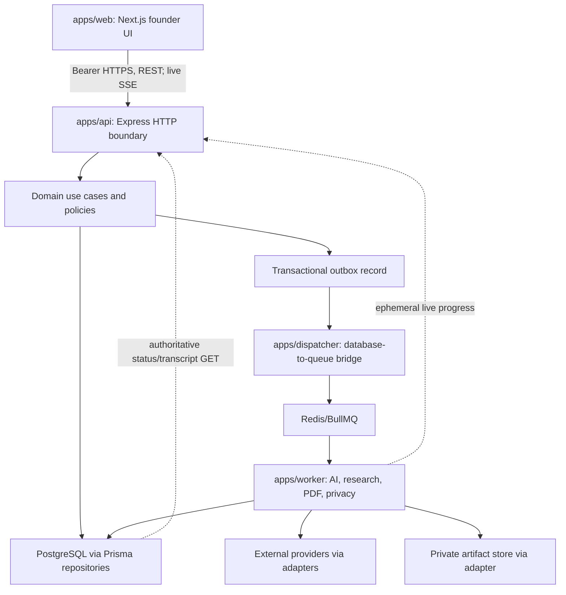
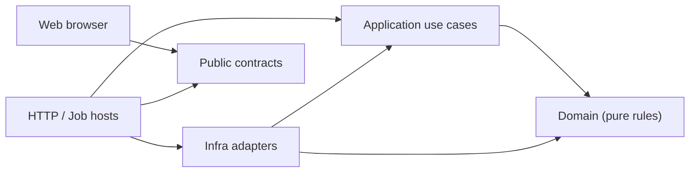

# Founder's Lens — LLD Phase 7A: Implementation Strategy & Repository Architecture

**Document ID:** FL-LLD-IMP-7A  
**Version:** 0.2 - formal documentation baseline
**Status:** Approved - Documentation Only; FL-P7-0.2-approved. M00 and all implementation remain unauthorized.
**Proposed location:** `Docs/lld/09-implementation-planning/implementation-strategy-repository-architecture.md` (Codex must confirm canonical directory convention)  
**Audience:** Founder, implementation lead, Codex, reviewers  
**Scope:** Build strategy, modular-monolith boundaries, proposed monorepo layout, dependency graph, design-to-code traceability, development workflow and readiness. No code, dependencies, configuration or cloud resources are created by this document.

> **Evidence boundary.** This draft is based on locally available earlier architecture drafts plus the owner's reports of approved `FL-P2D-1.0-approved`, `FL-P3-0.3-approved`, `FL-P4-0.5-approved`, `FL-P5-0.4-approved` and `FL-P6-0.3-approved`. The *latest canonical local Windows repository*, its updated OpenAPI/Prisma and exact approved manifests are not mounted here. Before adopting tasks or generating code, Codex must inspect and validate those exact active documents. This plan does not replace or amend them.

## 1. Executive implementation recommendation

**Build one TypeScript monorepo as a modular monolith** with independently running frontend, API, outbox dispatcher and background workers. Keep PostgreSQL authoritative, Redis/BullMQ for asynchronous coordination, and a private artifact storage adapter. Implement one thin end-to-end founder journey at a time, starting with infrastructure and identity foundations—not a large horizontal build of all database models or all screens.

**Optimize for:** security; correctness under retries/failures; small reviewable changes; local-first execution; zero unapproved paid-provider activity; reproducible development; interview-ready explanations and evidence.

**Do not:** choose a hosting provider now; add a microservice, BFF or unnecessary dependency; route founder browser calls directly to AI providers; move authorized business logic into React; treat generated Prisma migrations as executed; assert tests pass before running.

**Important distinction:** the *code monorepo* is one versioned repository; *runtime processes* still have separate start/stop/scaling lifecycles. “Monolith” describes ownership and deployment architecture, not a requirement to bundle every process into one server.

## 2. Fundamentals, in precise Q&A

| Question | Answer |
|---|---|
| What is a monorepo? | One repository holding related apps and reusable internal packages, versioned together. |
| What is a modular monolith? | One bounded backend application whose domains have explicit internal interfaces rather than independent network services. |
| What is a vertical slice? | A minimal complete founder use case across UI, API, persistence, authorization and tests. |
| What is an adapter? | Code that isolates an external service (Clerk, Redis, model provider, object storage) behind a testable interface. |
| What is a contract test? | A check that a consumer and producer agree on exact method, fields, headers, status and error shape. |
| What is a migration? | A reviewed, executed change to a database schema; a Prisma schema file alone is only a specification. |
| What is a quality gate? | Evidence that must pass before a change is accepted into the next stage. |
| What is a dependency boundary? | A rule preventing a module from importing lower-trust or unrelated implementation details. |

## 3. Approved architecture translated into code responsibilities



- **`apps/web`** owns routes, accessible views, composer, view state and client API adapter. It **does not** own authorization, durable approvals, model keys or final assistant state.
- **`apps/api`** owns request parsing, authentication, authorization, validation, conditional headers, use-case calls and response mapping. Accepted asynchronous operations commit durable state/outbox before returning their accepted response.
- **`apps/dispatcher`** is a logical independently running outbox relay. Its binary/process arrangement is a later implementation decision; even if its code is hosted beside the API/worker, its lifecycle and recovery need explicit ownership.
- **`apps/worker`** executes already-admitted tasks and rechecks ownership, lifecycle and fencing before expensive calls and final commits.
- **PostgreSQL** owns durable state and business invariants; **Redis** transports queue work, not permanent founder records.
- **Clerk, model/search vendors and private PDF storage** are outside trust boundaries, accessed only through authorized adapters.

**No separate BFF:** the approved browser-to-Express model uses session Bearer authentication, with SDK/token/CORS behavior to be verified during implementation. Never silently switch to a cookie BFF architecture.

## 4. Proposed monorepo layout (directory names are recommendations)

```text
founders-lens/
├── Docs/                         # Approved specifications and manifests (retain)
├── apps/
│   ├── web/                      # Next.js App Router frontend
│   │   └── src/
│   │       ├── app/              # Routes, layouts, error/loading boundaries
│   │       ├── features/         # Think, ideas, learning, memory, snapshots
│   │       ├── components/       # Accessible presentation primitives
│   │       └── lib/              # Session-bound client, recovery, scoped cache
│   ├── api/                      # Express HTTP host
│   │   └── src/
│   │       ├── http/             # Routes, middleware, validators, responders
│   │       ├── composition/      # Dependency wiring
│   │       └── main/             # Startup, health, shutdown
│   ├── worker/                   # Background job execution host
│   │   └── src/
│   │       ├── handlers/         # Generation, research, export, privacy
│   │       └── main/             # Queue lifecycle, shutdown
│   └── dispatcher/               # Transactional outbox delivery host
├── packages/
│   ├── contracts/                # Generated/validated PUBLIC API types only
│   ├── domain/                   # Pure domain rules, states and business types
│   ├── application/              # Backend use cases, ports and permissions
│   ├── persistence/              # Prisma repositories and DB transaction adapters
│   ├── integrations/             # Clerk, queue, model/search, storage adapters
│   ├── observability/            # Redacted structured telemetry helpers
│   ├── test-support/             # Synthetic fixtures and deterministic harnesses
│   └── config/                   # Environment schema; no secrets committed
├── tooling/                      # Shared scripts and verified tooling setup
└── ...                           # Workspace, lockfile, CI and compose added later
```

**Scope controls:** This tree is conceptual and **not** approval to create every package now. At first, create only the workspace and packages needed for the first slice; extract further packages when their boundaries are genuinely reused. Avoid “shared” folders that import backend implementation into browser bundles.

Potential simplification: `application`, `persistence`, and `integrations` may initially live under `apps/api/src/modules` or `packages/backend`, with strict import boundaries, until independent worker imports justify extraction. **The architecture requires boundaries, not a particular number of packages.**

### 4.1 Suggested backend domain modules

| Module | Owns | Must not own |
|---|---|---|
| Identity & lifecycle | Clerk subject mapping, account lifecycle, tombstone and deletion access gates | Trusting client-supplied user IDs |
| Ideas & conversations | Idea ownership, conversation settings, same-idea validation | Model execution |
| Messaging & generation | Submission ledger, generation state, response selection, streaming status | Permanent fragment replay |
| Memory | Proposals, approval, version/provenance, removal/context exclusion | Automatic AI approval |
| Research & evidence | Admission, quotas, evidence/provenance, references | Treating retrieved text as instructions |
| Assumptions, experiments & learning | Explicit founder actions, experiment v3 hypothesis, `LearningEvidence` | Inventing absent data |
| Snapshots & exports | Immutability, approved versions, PDF export jobs/grants | Modifying approved snapshots |
| Privacy recovery | Independent deletion-intent authority, suppression, purge/reconciliation | Reopening access without coverage proof |

P4-B01 legacy experiment create behavior (409 `EXPERIMENT_HYPOTHESIS_REQUIRED` for fresh unsupported creates), P4-B02 learning evidence marker and P5-AM01 independent suppression are approved documented contracts **as reported by the owner**; verify exact latest canonical DTOs and implementation invariants before coding.

## 5. Import boundaries and code ownership

A recommended one-way dependency direction:



**Hard boundaries:**

1. `domain` cannot import Next.js, Express, Prisma, Redis, Clerk, model SDKs, Node process environment or browser APIs.
2. `application` depends on domain types and abstract ports, not a concrete PostgreSQL or external provider API.
3. `persistence` depends on Prisma and approved schema; it does not expose Prisma models across public HTTP or to browser code.
4. `web` may import safe public DTO/types, UI packages and its client adapter; never backend repositories, server-only config or private integrations.
5. Providers are untrusted; model and retrieved web output cannot issue privileged commands without server authorization.
6. Module-to-module reads/writes go through use cases/owned interfaces, not direct arbitrary SQL across module boundaries.
7. Background handlers must be safe for redelivery (at least once): durable identity, de-duplication, leases/fences, context epochs, budget admission.
8. Any AI-generated output must pass the approved structured response validation and durable finalization policy.

**Contract rule:** Canonical OpenAPI is the source for wire formats; generate or validate client types from the checked-in version, never hand-invent fields. The approved public default and opt-in structured transcript remain separate.

## 6. Workspace and toolchain policy

- **Language:** TypeScript for web, API, worker and shared domain; use a single strict TS convention and explicit runtime validation at untrusted boundaries.
- **Workspace:** Recommend a lightweight workspace mechanism using a package-manager lockfile and workspace support; choose **one** package manager at implementation start after checking supported Next.js/Prisma/CI versions. Avoid choosing pnpm/npm/Bun by habit without verifying compatibility.
- **Build:** Apps independently build/start. Shared packages use explicit exports and browser/server entrypoint guards. Production artifacts should not contain plaintext secrets or test data.
- **Formatting/lint:** Consistent formatting, import boundary checking, strict typecheck, dependency audit and secret scanning as CI tasks; versions pinned only during scaffold.
- **Testing:** A small TS-compatible unit/integration runner plus real DB/Redis and browser E2E; select versions later from Phase 6 requirements and installed tooling.
- **Local infrastructure:** Containerized PostgreSQL/Redis and isolated private file adapter; API, web, worker and dispatcher may run locally as separate processes. No guarantee of free model/search provider usage.
- **Configuration:** Zod-validated settings; secrets stay out of Git, logs, traces, browser bundles and error pages.
- **Changes to approved schemas:** Proposed in change records; migrations are reviewed/generated/tested only in implementation under explicit authorization.

### 6.1 Environment separation

| Environment | Intended use | Controls |
|---|---|---|
| Local | Developer learning and feature implementation | Disposable synthetic data, fake model/search/Clerk adapters unless controlled real integration needed |
| Integration test | PostgreSQL/Redis and deterministic worker/job failures | Isolated databases, reset fixtures, no real paid calls |
| Provider sandbox | Explicit Clerk, storage, search/model compatibility checks | Quotas, approved credentials, privacy-safe synthetic fixtures |
| Public demo | Separate future decision | No production customer data; test auth, privacy, costs, backups and incident roles first |
| Production | Deferred deployment | Evidence-backed gates from Phase 5/6, not presumed free |

## 7. Proposed first-to-last implementation dependency plan

**This is the strategic order; Phase 7B will turn it into smaller, estimable and acceptance-linked vertical slices.**

| Order | Foundation or slice | Primary dependency and deliverable | Evidence required |
|---|---|---|---|
| 0 | Preflight & baseline audit | Verify approved manifests, exact OpenAPI/Prisma, worktree, scope, tool versions; confirm AI-D14 handling | Checked evidence ledger; no unsupported assumptions |
| 1 | Minimal workspace & local harness | Repeatable independent app boots; DB/Redis test infrastructure; fake provider adapters | Startup, health, graceful shutdown, CI smoke |
| 2 | Persistence and authorization foundation | Prisma/SQL mapped and migrated in isolated dev DB; Clerk adapter + owner/idea lifecycle gates | Real cross-account 401/404, DB constraint tests |
| 3 | Founder creates an idea and conversation | Existing approved routes and UI create/read | Authenticated browser E2E + negative owner tests |
| 4 | Durable message acceptance only | Idempotency ledger, `202`, outbox + status, no model yet | Lost response/duplicate/transaction crash tests |
| 5 | Worker and generation lifecycle | Dispatcher/BullMQ, six states, fencing/cancel/retry, fake deterministic model | Real Redis/DB race and crash tests |
| 6 | AI context and response pipeline | Approved-memory selection, context epoch, strategies, schema validation, SSE observation | Privacy/safety and non-replay tests; stub provider first |
| 7 | Memory, research and learning | Explicit approval, source/version, bounded research, evidence, experiments, `LearningEvidence` | Authorization, optimistic concurrency, round-trip and race tests |
| 8 | Approved snapshots and private PDF exports | New immutable draft/version, approval, export, expiring grants | Hash/version invariants and failure/expiry tests |
| 9 | Privacy deletion + restore proof | Independent suppression intent, reconcile, scoped purge; full fault testing **before public access** | P5-AM01 crash/rollback, restoration and access-gate proof |
| 10 | Operational hardening and release preparation | Full E2E, accessibility, load, AI eval, monitoring, cost and security gates | Evidence-based launch readiness decision |

**Security caveat:** Deletion/lifecycle access gates must exist from early persistence/identity work (step 2); step 9 represents **full restore/fault proof**, not a license to defer the basic deletion protection until the end. Similarly, cost default-deny and privacy-safe logging apply from the first worker call.

**Provider caveat:** Expensive real model/search requests are optional late integration tasks, never automatic acceptance criteria for local slice completion. Mock outputs are not evidence that real model behavior is sound.

### 7.1 Why this sequence?

Build the least expensive, highest-risk invariants before layering complexity. An AI conversation without idempotent durable acceptance creates double-charge and lost-work risk; a UI memory button without version checks violates founder approval; exporting an approved snapshot before immutability is enforced undermines the product record.

## 8. Codex execution contract — one bounded task per iteration

A coding task must explicitly declare:

1. **Authority:** exact approved document sections and manifest revision(s), with quoted operation IDs where relevant.
2. **Goal:** one observable behavior in one vertical slice.
3. **Allowed edits:** narrow files/modules; forbidden changes such as modifying historical approval manifests.
4. **Inputs & DTOs:** canonical routes/methods/status/headers, preconditions and authorized identities.
5. **Data effects:** transaction boundaries, idempotency, version checks, outbox events, deletion gates.
6. **Failure behavior:** 400/401/403/404/409/412/428, lost replies, races, retries and service shutdown where relevant.
7. **Tests:** unit + DB/Redis integration + E2E/negative cases matching the slice, with unique scenario IDs.
8. **Cost/privacy:** provider mock by default, zero unauthorized paid calls, redacted diagnostics, synthetic test data.
9. **Definition of done:** explicit runnable commands and outputs, docs/contract drift inspection, no unverified claims.
10. **Stop conditions:** unclear contract, incompatible migration, unsafe privacy path, missing account/provider support.

Suggested prompt pattern:

> Inspect the approved OpenAPI and design sections for [one behavior]. Implement only [small slice]. Do not invent APIs or schema fields. Write isolated tests for [specific success/failure/race]. Show file changes, commands/results, risk and remaining gates. Stop and ask for owner review if implementing the slice requires changing an approved contract.

### 8.1 Review and commit discipline

- Start by listing worktree modifications; never overwrite other user changes.
- One logical change per branch/commit candidate; CI must report actual execution outcome.
- Do not mix documentation-only approvals with application implementations.
- Keep migrations explicit and reversible/rehearsed when safe; never roll back data by blindly dropping tables.
- Build a traceability record from source requirement → API operation → code module → test evidence.
- Changes requiring product approval use a controlled amendment rather than “fixing” approved specs inside implementation.
- No auto-deploy, auto-spend or production credential use.

## 9. Quality gates and evidence ladder

| Gate | Minimum proof | Blocking examples |
|---|---|---|
| G0: Document alignment | Approved manifests/route/Prisma/version inspection | Stale schema, undocumented endpoint or false baseline hash |
| G1: Static | Typecheck, lint, schema validation, secret scan | Unvalidated public response or token leak |
| G2: Local unit | Deterministic domain rules and state-machine tests | Incorrect idempotency version semantics |
| G3: Persistence/integration | Actual PostgreSQL constraints, Express/Clerk sandbox where applicable, BullMQ/Redis | Duplicate paid job, foreign idea access, broken FK |
| G4: Founder journey | Real browser route/login/idea/chat/memory/PDF scenarios | UI shows streamed answer as durable before commit |
| G5: Adversarial resilience | Fault barriers, replay races, privacy restoration, token expiry | Deleted data reopened, unbounded spend or missing suppression proof |
| G6: Public release | Accessibility/AT, incident playbooks, measured AI evaluation, cost/backup and security | Any unresolved privacy/security/spending hard gate |

**No currently executed results are asserted.** Prior phase checks are *static documentation validation only*; passing them does not satisfy G1–G6.

### 9.1 Acceptance evidence vocabulary

- `NOT_RUN`: Specified but not executed.
- `PASS`: Executed with reproducible evidence for the claimed environment.
- `FAIL`: Executed and violated expectation.
- `BLOCKED`: Could not run because of missing prerequisite or safety/contract issue.
- `NOT_APPLICABLE`: Justified for this task/environment, not a shortcut to skip a required release gate.

Each entry must record test ID, environment, tool version, run command, observed result and evidence location. Do not label a unit mock as proof of provider behavior.

## 10. High-risk implementation design checkpoints

| Risk | Correct implementation boundary | Verification |
|---|---|---|
| Cross-account leaks | Authorize within every API/use case/worker, not only route UI | Two-principal negative tests, stale cache/BFCache |
| Duplicate AI calls | Durable ledger + idempotent dispatcher/worker + budget control | Lost `202`, replay, crash after provider invocation |
| Invalid AI context | Selected logical transcript + approved ACTIVE memory + epoch checks | Remove memory during generation, old history still historical |
| Untrusted research text | Data-only evidence with source attribution, no tool authority | Prompt-injection fixtures and malformed source |
| Conflicting approval | Correct `If-Match`/ETag and transaction check | Two-tab approval, stale 412, missing 428 |
| Experiment mapping | Versioned hypothesis separate from `plan.title`, legacy rejection | v3 roundtrip and 409 legacy create |
| Learning provenance | `LearningEvidence` same-idea join, capture marker semantics | Duplicate link and unknown-vs-empty roundtrip |
| Snapshot immutability | Approved snapshot content/hash unchanged; new POST creates draft version | Concurrent approval/export/edit races |
| Deletion resurrection | Independent durable suppression intent before commit; fail-closed restoration | P5-AM01 barriers including accepted-but-unmirrored |
| Private artifacts | Owner-scoped grants, expiry, no artifact bytes in general logs | Cross-owner download and stale grant |
| Provider spend | Deny-by-default paid access, admission ledger, bounded retries | Provider invoked zero times after denied budget |
| Observability privacy | Metadata only with operator-audited access | Log/trace scan against synthetic secrets/prompt payloads |

## 11. Decisions and deferrals

### Already fixed by approved design (do not reopen casually)

Next.js + TS; Express + TS; Clerk identity; PostgreSQL/Prisma; Redis/BullMQ/outbox; REST + bearer SSE; structured/legacy transcript compatibility; immutable approved snapshots; explicit memory approval; privacy lifecycle and P5-AM01 suppression; local-first and provider-neutral hosting; security/privacy/spending failures as hard gates.

### Pending implementation-specific choices

- Which package manager and supported version; workspace task runner if any; compatibility of selected Next.js/Prisma/Clerk SDK versions.
- Initial layout: individual internal packages versus strict modules under a backend package; allow progressive extraction.
- Local object storage adapter and any separate local service needed to emulate signed grants.
- Migration ordering, DB permissions and reconciliation for approved new tables/guards.
- Choice of minimal TypeScript test runner, browser E2E runner and accessibility matrix.
- Toolchain/container versions and CI runner configuration, subject to zero-card/no-spend limits.
- Specific AI provider, free/sandbox access if available, and exact budgets.
- Production monitoring provider, host and incident on-call role; no provider chosen.
- AI-D14 editorial HLD correction through a **separate** controlled amendment.

**No automatic lock-in:** These choices should be made with compatibility checks and owner review when they materially affect cost, security or the approved contract.

## 12. Phase 7A acceptance checklist (documentation design only)

- [ ] Every runtime process in the approved architecture has a named code owner and host.
- [ ] The proposed layout avoids browser imports of server-only modules.
- [ ] Each major domain maps to an approved feature/API family.
- [ ] Outbox and queue architecture do not equate Redis delivery with durable completion.
- [ ] Foundation steps include auth and scope gating before founder data.
- [ ] Paid provider calls are denied by default and isolated behind adapters.
- [ ] Schema/DTOs derive from the *current canonical repo*, not the old drafts.
- [ ] Phase 7B can split the proposed slices into short, testable increments.
- [ ] Phase 7C can issue Codex tasks without authorizing unrelated changes.
- [ ] No Phase 7 approval manifest or application code has been created.

## 13. Planned implementation-readiness verification scenarios

All statuses **NOT_RUN**. The test cases below are planning requirements and do not replace any approved Phase 6 scenario.

| ID | Planned check | Expected evidence |
|---|---|---|
| IMP7A-01 | Approved manifest/contract preflight | Current hash consistency and exact API/schema references |
| IMP7A-02 | Browser/server import isolation | Build rejects secret or Prisma import in browser |
| IMP7A-03 | API versus worker independent lifecycle | Separate health/shutdown and no jobs executed in HTTP handler |
| IMP7A-04 | HTTP acceptance/outbox atomicity | Lost response still yields one durable logical command |
| IMP7A-05 | Dispatcher duplicate delivery | Exactly one committed logical effect, at-least-once delivery tolerated |
| IMP7A-06 | Clerk identity and foreign idea | Authenticated request for another owner denied neutrally |
| IMP7A-07 | UI stream/disconnect/final GET | Fragment remains tentative; backend final is authoritative |
| IMP7A-08 | Memory proposal and `If-Match` | No stale or automated durable memory approval |
| IMP7A-09 | Experiment v3 and legacy create | Separate title/hypothesis, documented 409 |
| IMP7A-10 | LearningEvidence roundtrip | Same-idea links unique; unknown/empty capture distinguished |
| IMP7A-11 | Snapshot immutability | Approved hash unchanged after new version/export |
| IMP7A-12 | Independent suppression/restoration | Access stays blocked when completeness cannot be proven |
| IMP7A-13 | Paid model budget denied | Zero unapproved calls and no automatic expensive retry |
| IMP7A-14 | Log/metric privacy | Synthetic prompts/secrets absent from normal telemetry |
| IMP7A-15 | Browser/accessibility smoke | Auth, composer, keyboard/focus and small-screen flow verified |
| IMP7A-16 | No-op/deferred cloud configuration | Local setup requires no paid account or host commitment |

## 14. Handoff and required Codex repository reconciliation

Before approving Phase 7A or coding, Codex must:

1. Inspect the live local repo, exact Phase 2D–6 approved JSON manifests, current OpenAPI and route inventory, Prisma schema and SQL guards, current development state and Git status.
2. Identify any pre-existing application directories/lockfiles; **do not overwrite or duplicate** the current structure.
3. Map each architecture module and proposed file location to the exact approved contracts, recording discrepancies with source paths/sections.
4. Compare package manager/workspace layouts for compatibility and simplicity, without installing or scaffolding anything.
5. Verify that the new P4/P5 amendments are reflected in current active schemas, authorization and test plans.
6. Preserve existing `Docs` and approval manifests, plus AI-D14's tracked editorial exception.
7. State which layout/tooling choices can be safely made in Phase 7B/7C and which require owner approval.
8. Report **document alignment**, **implementation readiness**, and **runtime proof** as separate categories.

**Phase 7A disposition:** Initial plan ready for canonical repository reconciliation; NOT APPROVED. No executable implementation, dependency install, tests, migrations, deployment, paid provider work or Phase 7B work has occurred here.


## Current canonical reconciliation

Actual directory: Docs/lld/09-implementation-strategy/. Phase7D section14 owns current findings, task/API/SRS/evidence maps and readiness. Earlier source-unavailable/intake statements are historical. Candidate FL-P7-0.2-review - Not Approved. Original12 milestones,24 parent tasks,36 Phase7B evidence IDs and18 findings retained. M02 suppression-aware access is prerequisite to private features; M10 completes real deletion/restore proof. Child verification steps preserve parent IDs and require explicit future allowed-path authorization. All runtime/tests remain NOT_RUN. No M00,scaffold,dependency,migration,provider,deployment orimplementation authorized.


## Formal documentation approval - current status

FL-P7-0.2-approved - Approved, Documentation Only under IMP7D-A01. Evidence is the owner''s explicit Phase7 formal documentation sign-off instruction in this conversation, subject to successful static verification. No approval timestamp, signature or Git commit is inferred. Phase7D section15 and approved-revision-0.2.json govern current status. Earlier draft/pending/unapproved labels are preserved historical review stages, not current package status. Approval covers the plan only; all24 task cards and36 behavior scenarios remain unexecuted. M02 suppression-aware access remains prerequisite; M10 independent deletion/restore proof remains a release gate. Exact tools, future code allowlists, provider choices, runtime evidence and AI-D14 remain deferred as documented. No M00,coding,scaffolding,installation,migration,runtime tests,provider calls,spending,provisioning ordeployment authorized.
